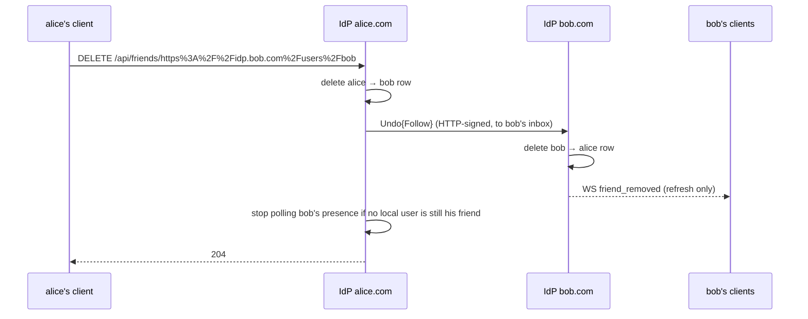
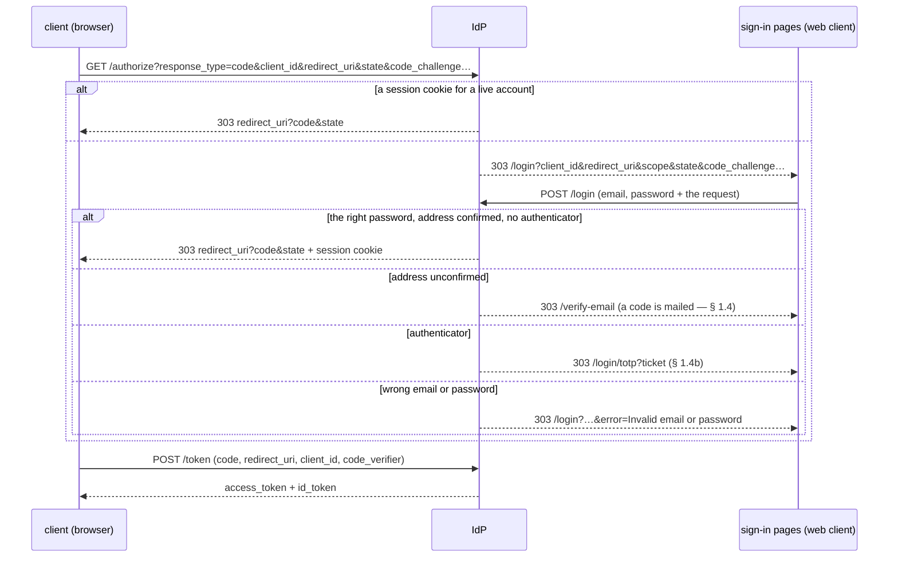
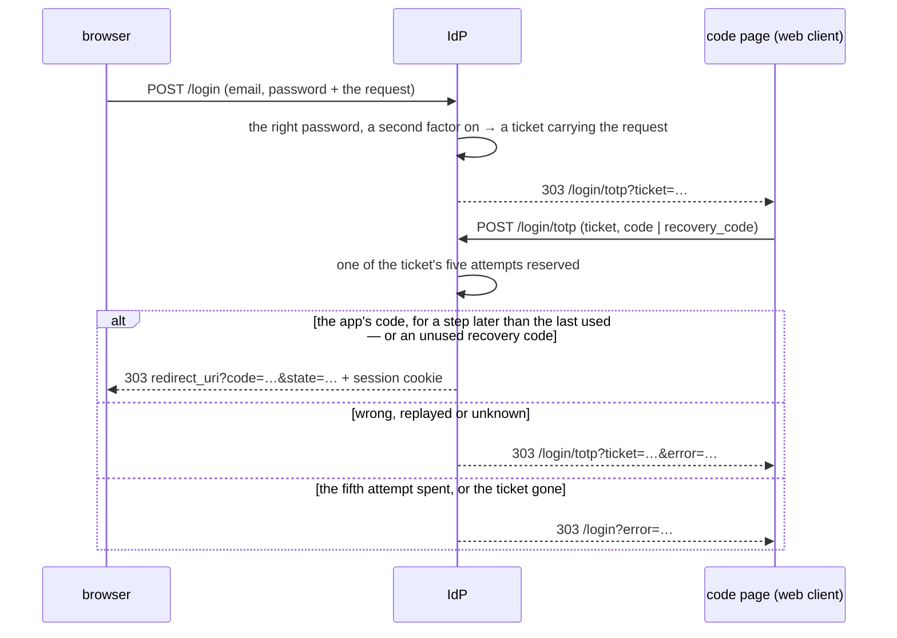
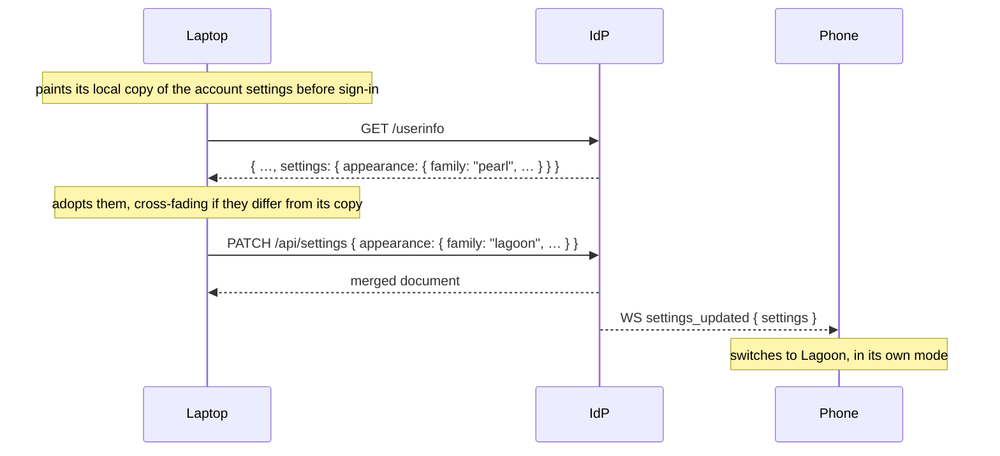
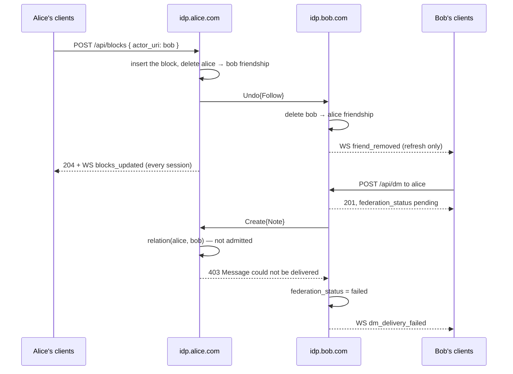
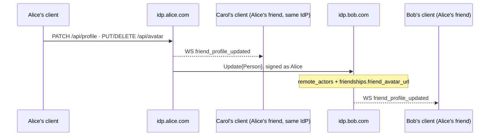

# Pina'i — Identity, Friends & Federation Backbone

In this architecture, users can be on **different IdPs** (e.g. Alice on `idp.alice.com`, Bob on `idp.bob.com`). Each IdP's PostgreSQL stores its own local users and a *remote actor* cache. So a friend's username can be either **local** or **remote**.

---

### Data model

```sql
-- Local users registered on this IdP instance
CREATE TABLE users (
  id            UUID PRIMARY KEY DEFAULT gen_random_uuid(),
    username      TEXT NOT NULL UNIQUE,       -- the handle: chosen name + "_" + 5 of a–z0–9,
                                            -- e.g. "alice_xk9mp"; used for federation:
                                            -- alice_xk9mp@idp.alice.com (§ 1.4)
  display_name  TEXT NOT NULL,              -- set to user input at creation, e.g. "alice"
                                            -- freeform, no uniqueness constraint, shown in UI
  avatar_url    TEXT,                       -- public RustFS URL with `?v=<unix_secs>` cache-bust
                                            -- (avatars bucket is public-read; see § Avatar storage)
  pronouns      TEXT,                       -- closed enum, see CHECK below
  bio           TEXT,                       -- ≤ 190 chars, freeform; enforced server-side
    email         TEXT NOT NULL UNIQUE,       -- used by OIDC; kept lowercase, and unique
                                            -- whatever its case (users_email_lower_key)
  password_hash TEXT NOT NULL,
  actor_uri     TEXT NOT NULL UNIQUE,       -- e.g. "https://idp.alice.com/users/alice"
  inbox_url     TEXT NOT NULL,              -- e.g. "https://idp.alice.com/users/alice/inbox"
  outbox_url    TEXT NOT NULL,              -- e.g. "https://idp.alice.com/users/alice/outbox"
  email_verified_at TIMESTAMPTZ,            -- NULL until the signup OTP is consumed;
                                            -- /login refuses to issue a session while NULL
  contact_policy TEXT NOT NULL DEFAULT 'friends_and_groups',
                                            -- who may message the account (§ 1.7):
                                            -- everyone | friends_and_groups | friends
  created_at    TIMESTAMPTZ NOT NULL DEFAULT now(),
  updated_at    TIMESTAMPTZ NOT NULL DEFAULT now(),

  CONSTRAINT users_pronouns_check
    CHECK (pronouns IS NULL OR pronouns IN ('he', 'she', 'non-binary'))
);

-- Signup confirmation OTPs (6-digit numeric, peppered HMAC-SHA256).
-- At most one *unconsumed* row per user at any moment; resend consumes the
-- previous row in the same transaction. The hourly sweep drops consumed/expired
-- rows older than 24 h.
CREATE TABLE email_verification_codes (
  id          UUID PRIMARY KEY DEFAULT gen_random_uuid(),
  user_id     UUID NOT NULL REFERENCES users(id) ON DELETE CASCADE,
  code_hash   BYTEA NOT NULL,            -- HMAC-SHA256(EMAIL_OTP_PEPPER, code)
  expires_at  TIMESTAMPTZ NOT NULL,      -- now() + 10 minutes
  consumed_at TIMESTAMPTZ,               -- set on successful verify OR resend invalidation
    attempts    INTEGER NOT NULL DEFAULT 0, -- max 5, counted under a row lock (resend required)
  created_at  TIMESTAMPTZ NOT NULL DEFAULT now()
);
CREATE INDEX idx_evc_user_unconsumed
    ON email_verification_codes(user_id)
 WHERE consumed_at IS NULL;

-- Cache of remote users fetched via ActivityPub / WebFinger from other IdP instances
CREATE TABLE remote_actors (
  id            UUID PRIMARY KEY DEFAULT gen_random_uuid(),
  actor_uri     TEXT NOT NULL UNIQUE,       -- e.g. "https://idp.bob.com/users/bob"
  inbox_url     TEXT,                       -- e.g. "https://idp.bob.com/users/bob/inbox"
                                            -- cached on first WebFinger resolution to avoid repeated lookups;
                                            -- NULL for an actor first seen through an inbound Follow,
                                            -- which is then reached at "{actor_uri}/inbox"
  instance      TEXT NOT NULL,              -- e.g. "idp.bob.com"
  display_name  TEXT,
  avatar_url    TEXT,
  fetched_at    TIMESTAMPTZ NOT NULL DEFAULT now(),  -- used for cache invalidation
  updated_at    TIMESTAMPTZ NOT NULL DEFAULT now()
);

-- Friends relationships — owner is always local (FK), friend can be local or remote (actor_uri)
CREATE TABLE friendships (
  id                UUID PRIMARY KEY DEFAULT gen_random_uuid(),
  owner_user_id     UUID NOT NULL REFERENCES users(id) ON DELETE CASCADE,  -- always local
  friend_actor_uri  TEXT NOT NULL,   -- e.g. "https://idp.bob.com/users/bob" (local or remote)
  friend_avatar_url TEXT,            -- a remote friend's avatar, as its last Update{Person} said
  status            TEXT NOT NULL DEFAULT 'pending' CHECK (status IN ('pending', 'accepted')),
  direction         TEXT NOT NULL CHECK (direction IN ('outgoing', 'incoming')),  -- who sent the request
  created_at        TIMESTAMPTZ NOT NULL DEFAULT now(),
  updated_at        TIMESTAMPTZ NOT NULL DEFAULT now(),

  UNIQUE (owner_user_id, friend_actor_uri)
);
```

> **Who sent the request**
>
> Each side of a friendship has its own row — both in this database for a local pair, one on each
> IdP for a cross-IdP pair — and `direction` says which side the owner is on: `outgoing` when the
> owner sent the request, `incoming` when they received it. Only the `incoming` side may answer
> it: `GET /api/friends/incoming` lists incoming pending rows only, `POST /api/friends/:id/accept`
> and `DELETE /api/friends/:id/reject` refuse any other row, and an inbound `Accept` or `Reject`
> only applies to an `outgoing` row. Without it a pending row reads the same to both parties, and
> the requester could accept their own request. A repeated request takes over both pending rows,
> so the latest request decides who answers.
>
> A request never reopens an accepted friendship. `POST /api/friends/request` to an existing
> friend is refused (`Already friends`), and recording a request leaves an accepted row untouched
> — otherwise a peer could quietly take a friendship back to `pending`. An inbound `Follow` for an
> accepted friendship means the peer missed the `Accept`: it is answered with the `Accept` again,
> naming the pair's DM, and nothing else changes. Ending a friendship goes through unfriend only.
>
> A request to someone who blocked the requester never reaches them, and the requester can't tell:
> their own side is recorded `pending`, as for any request still unanswered (§ 1.7).

> **Remote actor cache**
>
> `remote_actors` is written whenever an actor is resolved (WebFinger, on an outgoing request) or
> discovered (its first inbound `Follow`), with the inbox, name and avatar (`icon`) its actor
> document gives. A fetch that brings no inbox, name or avatar — an unreachable peer, a document
> without them — keeps the cached value rather than erasing it. Discovery accepts only a URI of the
> form `…/users/{handle}`; any other actor is refused with `400 Cannot parse remote actor URL`. A
> name or avatar outside the peer profile limits (§ 2) counts as none. The friendship keeps the
> avatar the actor was met with, on either side of the request, so a new friend is shown with it
> at once.
>
> The cache is never what tells a user whether someone exists, or what they are called: that would
> tell them who on this instance has met whom. Where a user names an arbitrary actor — a group's
> invitees — the actor is resolved anew on its own instance, cached or not
> (`identity-provider/specs/03-direct-messages.md § 10`).
>
> A resolution the actor's instance fails — it doesn't answer, or answers a WebFinger or actor
> document no instance would send — is `502 the account's instance did not answer`: for a friend
> request, a DM to an address not cached here, and a group invitee (with its `actor_uri`). An
> instance that answers it knows no such account is `404`.

> **What peers read of an account**
>
> `GET /.well-known/webfinger?resource=acct:{handle}@{domain}` points at the account's actor, for
> an account of this instance only (`404 User not found` for any other). `GET /users/{handle}` is
> its `Person` — display name (else the handle), inbox, `icon` when it has an avatar, and the
> instance key as `publicKey`; `GET /actor` is the instance's `Application` actor, whose key signs
> the inter-instance requests. The outbox and the `followers` / `following` collections are always
> empty: nothing is published, and whom an account is friends with is not for anyone to read.

> **Federated address format**
>
> The canonical address format used throughout the system is `username@domain` (e.g. `alice_xk9mp@idp.alice.com`), **without** a leading `@` — `/userinfo` answers it as `address`. Clients receive actor URIs (`https://idp.alice.com/users/alice_xk9mp`) in some events and normalise them to `username@domain` via `actorUriToAddress()` before using them as conversation keys.
>
> An actor URI is an `http(s)` URL with a host, no query and no fragment, of 2 KiB at most once
> normalised (`domain::identity::ActorUri`) — whether a peer or a user hands it over, anything else is
> refused.

> **`username` vs `display_name`**
>
> - `username` is the unique internal identifier used for federation and ActivityPub addressing. It is composed of the user-chosen name + `_` + a 5-character suffix of `a–z0–9` appended by the backend at account creation (e.g. `alice_xk9mp`; § 1.4). This guarantees uniqueness per instance with no coordination needed. It is never shown in the UI.
> - `display_name` is the only name shown client-side. It is automatically set by the backend at account creation to the user-chosen part, before the suffix (e.g. user types `alice` → `display_name = "alice"`). It has no uniqueness constraint and can be changed at any time, within the rules of § 1.5.
>
> Example flow at account creation:
> - User inputs: `alice`
> - Backend sets: `username = "alice_xk9mp"`, `display_name = "alice"`, `actor_uri = "https://idp.alice.com/users/alice_xk9mp"`

---

### Querying the friends list

Using `actor_uri` as the universal key, a JOIN across `users` and `remote_actors` gives the full friends list, whether local or federated:

```sql
SELECT
  u.username                                 AS username,      -- NULL for a remote friend
  COALESCE(u.display_name, ra.display_name)  AS display_name,
  CASE WHEN u.id IS NULL THEN f.friend_avatar_url
       ELSE u.avatar_url END                 AS avatar_url,
  f.friend_actor_uri,
  COALESCE(ra.instance, 'local')             AS instance
FROM friendships f
LEFT JOIN users u          ON f.friend_actor_uri = u.actor_uri
LEFT JOIN remote_actors ra ON f.friend_actor_uri = ra.actor_uri
WHERE f.owner_user_id = $1     -- pass the caller's local user id
  AND f.status = 'accepted';
```

A local friend is shown as its account is now — name and avatar from `users` — and a remote one
as it was met and as each `Update{Person}` since said (§ 2). The friendship's `friend_avatar_url` is that copy for a
remote friend; for a local one it is never read, so a cleared avatar stays cleared.

### Friendship-accept also creates the DM conversation

When a friendship transitions to `accepted` (via `POST /api/friends/:id/accept` for both same-IdP and cross-IdP recipients, or an inbound `Accept{Follow}` when a remote peer's IdP accepts a request our user sent), the accepter's IdP flips both local rows and creates the DM conversation in one transaction: a
request accepted twice at once is accepted once, and the loser is told `Not an incoming friend
request`. Same-IdP and cross-IdP requests share one model: both rows land in `pending` at request time, and the recipient must explicitly accept — there is no auto-accept path. The new id flows out two ways:

- **Locally**: the WS `friend_accepted` payload carries it on `FriendshipPayload.conversation_id` (`Option<Uuid>`, absent on `friend_request`/`friend_removed` — the conversation outlives an unfriend). Web clients invalidate the `dm-conversations` query on this event so `localDmConvos` populates with the new row immediately.
- **Cross-IdP**: the outbound AP `Accept{Follow}` activity carries it in a non-standard `conversationId` field on the activity body (a sibling of `id`/`type`/`actor`/`object`). The requester's IdP opens its DM under that id, so both sides persist the row under the same UUID — unless the pair already shares a DM there, which is kept. An advertised id that already names a group conversation is never reused: a separate DM is opened. A peer that omits the field gets a DM under a locally minted id; the two IdPs then disagree on it, which is a safe degradation.

The migration `20260512000001_backfill_friendship_conversations.sql` retroactively creates a DM for every accepted friendship that doesn't yet have one (deduplicated by ordering the actor pair lexicographically so the two friendship rows don't each get their own conversation).

### Declining a request and ending a friendship

Both are silent for the other person: neither raises a notification. A declined request
simply stops existing, and an ended friendship drops out of the friends list. Neither
touches the DM conversation — its row, members and history stay, and re-friending the
same person reuses it. Each removes both local rows in one transaction.

| Action | Endpoint | Caller's row | Other side, same IdP | Other side, remote IdP |
|---|---|---|---|---|
| Decline | `DELETE /api/friends/:id/reject` (pending `incoming` rows only) | Deleted | Requester's pending row deleted, no event | `Reject{Follow}` to the requester's inbox |
| Unfriend | `DELETE /api/friends/:actor_uri` (percent-encoded; 404 when no row) | Deleted | Friend's row deleted; `friend_removed` WS event | `Undo{Follow}` to the friend's inbox |

`DELETE /api/friends/:actor_uri` also withdraws a pending request the caller sent, through
the same paths. Blocking someone ends the friendship through these same paths too
(§ 1.7).

The `friend_removed` event carries the friend's own `friendship_id` and exists so their
clients refresh the friends and DM lists; clients do not surface it as a notification.



**Inbound `Accept` and `Reject`** act on exactly one row: the one owned by the inbox the
activity was delivered to, whose friend is the activity's `actor`, and only while it is a
`pending` `outgoing` request. The embedded Follow is not trusted to name the local user, so a
peer can neither answer anyone else's request nor accept a request it sent itself.

**Delivery** of every friendship activity — `Follow`, `Accept`, `Reject`, `Undo{Follow}` — is
best-effort: the local change is committed first, the activity is sent in the background, and
the request succeeds even if the peer is unreachable (a failure is logged). A peer that missed a
`Follow` never sees the request — the requester can send it again. One that missed an `Accept`
still has its request pending and answers with nothing until it redelivers the `Follow`, which is
answered with the `Accept` again. One that missed a `Reject` or `Undo{Follow}` keeps its row
until either side touches the relationship again — its user unfriending sends an `Undo{Follow}`
back, which is a no-op here.

**Redelivery** of any friendship activity is a no-op: an `Accept`, `Reject` or `Undo{Follow}`
with no matching row answers `202` and changes nothing, and a repeated `Follow` keeps the one
pending row.

**Remote presence polling** is registered per IdP, not per user. It is only released when
no local user still has the remote actor as an accepted friend.

---

## 1.3. Signing in — OpenID Connect

The IdP is the OpenID provider of its own accounts. There is one flow — the authorization code
flow with PKCE (`S256`) — for public clients, which hold no secret. The web client hosts the
sign-in pages (`/login`, `/verify-email`, `/login/totp`) at `FRONTEND_URL`; the IdP's form
endpoints answer by redirecting between them, and finally back to the client with a code.



### Clients

`oauth_clients` registers each client: its `client_id` and its `redirect_uris`. A redirect URI
must match a registered one **exactly**, case and path included (RFC 6749 § 3.1.2) — it is where
codes are sent. The web client is seeded by the first migration.

### `GET /authorize`

1. The client must be known and the `redirect_uri` registered for it. Either failure is
   answered by the IdP itself — `401 invalid_client` or `400 invalid_request` — since the
   redirect cannot be trusted.
2. Only then the flow: `response_type=code` and `code_challenge_method=S256`. A failure here goes
   back to the client, as RFC 6749 § 4.1.2.1 says: `redirect_uri?error=unsupported_response_type`
   (or `invalid_request`)`&error_description=…&state=…`.
3. A browser with a session cookie for an account that still exists is handed a code at once;
   any other goes to the login page, carrying the request.

### `POST /login`

The login form, posted by the browser with the request it carries.

- The request is checked again — a known client, a registered `redirect_uri` — or any page
  could have a code sent wherever it names. A failure is `401` / `400`, never a redirect.
- Password guesses are bounded per email address, in any case: 10, then one a minute. Past that,
  the form is sent back with `error=Too many attempts — try again in a minute`, whatever the
  password — known address or not, so the limit tells nothing of who has an account.
- An unknown email is checked against a decoy hash as costly as a real one, and answered like a
  wrong password: `error=Invalid email or password`. Neither the answer nor its timing tells
  whether the address has an account.
- The right password on an unconfirmed address mails a fresh code and goes to `/verify-email`
  (§ 1.4); on an account with an authenticator it opens a ticket and goes to `/login/totp`
  (§ 1.4b). Otherwise it issues a code and sets the session cookie.

A code is good for 10 minutes, once. It remembers the account, the client, the
`redirect_uri`, the scope, the challenge and the nonce; the `state` goes back with it and is not
kept.

### The session cookie

`idp_session` holds the account id, signed (HMAC-SHA256) with a key derived from
`SESSION_SECRET`: `HttpOnly`, `SameSite=Lax`, `Path=/`, 30 days, and `Secure` in production. It is
what lets `/authorize` skip the login page.

The secret makes two keys, each derived from all of it with HKDF-SHA256 under a label of its own:
the session cookie's (`pinai idp: session cookies`) and the attachment links'
(`pinai idp: attachment links`, `identity-provider/specs/03-direct-messages.md` § 9). No purpose
shares another's key, and a new secret signs everyone out.

### `POST /token`

`application/x-www-form-urlencoded`: `grant_type`, `code`, `redirect_uri`, `client_id`,
`code_verifier`.

1. `grant_type` must be `authorization_code`, the client known, the `redirect_uri` registered.
2. The code is **spent** as it is read — even if the rest of the exchange is refused, it is never
   tried twice.
3. The code must have been issued to this client for this `redirect_uri`, and the verifier must
   meet its challenge: `BASE64URL(SHA256(code_verifier)) = code_challenge`.
4. The account must still exist.

```json
{ "access_token": "…", "token_type": "Bearer", "expires_in": 3600, "id_token": "…" }
```

Every answer, success or refusal, carries `Cache-Control: no-store` and `Pragma: no-cache`
(RFC 6749 § 5.1).

| Refusal | Status | `error` |
|---|---|---|
| Another grant type | 400 | `unsupported_grant_type` |
| Unknown client | 401 | `invalid_client` |
| Unregistered or mismatched `redirect_uri`, unusable code (unknown, expired, spent, or its account gone), another client's code, a verifier that does not meet the challenge | 400 | `invalid_grant` |

### Tokens

Both are JWTs signed with the instance's Ed25519 key (`EdDSA`, the key the JWKS publishes):
`iss` the issuer, `sub` the account id, `aud` the `client_id`, `email`, `preferred_username` (the
handle), valid for one hour. The ID token adds the request's `nonce`. There is no refresh token:
a client signs in again, which a live session cookie makes silent.

A bearer token that is missing or unusable is answered `401 invalid_token`, with the challenge
RFC 6750 § 3 asks for: `WWW-Authenticate: Bearer` when none was sent, `Bearer
error="invalid_token"` when one was.

### `GET /logout`

Drops the session cookie and redirects to `post_logout_redirect_uri` — only when it is an
`http(s)` URL on the origin of a registered redirect URI, where a client lives. Anything else
goes to `/`: the endpoint is never an open redirect.

### Discovery

`GET /.well-known/openid-configuration` (OpenID Connect Discovery 1.0 § 4) names the endpoints,
`response_types_supported: ["code"]`, `grant_types_supported: ["authorization_code"]`,
`code_challenge_methods_supported: ["S256"]`, `id_token_signing_alg_values_supported: ["EdDSA"]`
and `token_endpoint_auth_methods_supported: ["none"]`. `GET /.well-known/jwks.json` serves the
public key.

### Scenarios

- **First visit.** The web client sends the browser to `/authorize`; without a session it lands
  on the login page, signs in, and comes back with a code the client exchanges at `/token`.
- **Coming back.** The session cookie is still there: `/authorize` answers with a code at once.
- **A page that forges the login form** with its own `redirect_uri` is refused with `400` — no
  code leaves.
- **Someone guessing passwords** for an address gets 10 tries, then one a minute; the answers
  and their timing are the same for an address with no account.
- **A code intercepted after its exchange** is useless: it was spent, and without the verifier it
  could not have been exchanged anyway.
- **Signing out** returns the browser to the client's origin; a link naming another site goes to
  `/` instead.

---

## 1.4. Sign-up email verification

Every new account must prove ownership of its email address before a session
cookie or access token is issued. Federation, friend graph, and DMs are all
inaccessible to an unverified user.

### Flow

```
┌──────────────┐  ① POST /register-and-login (form)
│  Web client  │ ────────────────────────────────────►  IdP creates user (email_verified_at = NULL),
│ (verify page)│                                        inserts email_verification_codes row,
│              │                                        SMTPs the 6-digit code to the address.
│              │  ② 302 → /verify-email?pending_user_id=…&pending_email=…&{oidc params}
│              │ ◄────────────────────────────────────
│              │  ③ POST /verify-email-and-login (form)
│              │ ────────────────────────────────────►  IdP verifies code, flips
│              │                                        email_verified_at, issues auth code,
│              │                                        sets session cookie, 302 → redirect_uri
│              │  ④ 302 → redirect_uri?code=…&state=…
│              │ ◄────────────────────────────────────
└──────────────┘
```

### Registration rules

- **The chosen name** follows the handle rules of `domain::identity`: 2–32 characters of `a–z`,
  `0–9`, `_` and `.`, no dot at either end or twice in a row. A name breaking them is refused
  with the rule — never silently changed, so what the user sees is what they typed. It becomes
  the display name as it is.
- **The handle** is the chosen name, `_`, and 5 characters drawn from `a–z0–9`
  (`alice_xk9mp`): it names the account in its actor URI and its address. A handle already
  taken — a one-in-60-million draw — is drawn again.
- **The address** is kept lowercase, and is one account's whatever its case: `Alice@Example.com`
  is taken once `alice@example.com` is. One `@` between two non-empty parts, no whitespace, at
  most 254 characters.
- **The password** is 8 bytes at least.
- Two registrations racing for one address or handle are settled by the database's unique
  indexes: the one that loses is told the address is registered, as if it had come second.

### Endpoints

| Endpoint | Body | Result |
|---|---|---|
| `POST /register` | JSON `{ username, email, password }` | `201` with the account (`id`, `username`, `display_name`, `address`, `email`, `email_verified: false`, `pending_user_id`) and a code mailed. `400` names the rule broken, or `Email already registered`. |
| `POST /register-and-login` | username, email, password + OIDC params | Creates the account unconfirmed, mails a code, redirects to `frontend_url/verify-email?pending_user_id=…&pending_email=…&{oidc params}`. **No session is issued.** A broken rule goes back to `/login?tab=register&…&error=…`; an unknown client or an unregistered `redirect_uri` is `401` / `400`. |
| `POST /verify-email-and-login` | `pending_user_id`, `pending_email`, `code` + OIDC params | The request is checked first (`401` / `400`, and `400` for a method other than `S256`); then the code: the right one confirms the address, issues an OIDC auth code and the session cookie, and redirects to `redirect_uri`. A wrong, malformed, expired or exhausted code goes back to `/verify-email` with `error=…`; an address confirmed already goes to `/login`. |
| `POST /verify-email/resend` | `pending_user_id` | A fresh code. `204` on success, `410` if already confirmed, `429` past the resend limit, `404` for an unknown account. |
| `POST /login` | email, password + OIDC params | The right password on an unconfirmed address mails a fresh code — within the same resend limit — and redirects to `/verify-email` instead of issuing a session (§ 1.3). |

### Code rules

- **Length.** 6 numeric digits, drawn from `OsRng` with rejection sampling so each digit is
  uniform `0..=9` (no modulo bias).
- **Lifetime.** 10 minutes.
- **Storage.** `code_hash = HMAC-SHA256(EMAIL_OTP_PEPPER, code)`. The pepper is a ≥ 32-byte hex
  env var; startup fails if unset or shorter. A leaked database without the pepper is not
  brute-forceable offline.
- **Resend limit.** At most 5 codes per account in any 10 minutes, whoever asks — the resend
  endpoint or a sign-in on the unconfirmed address. Each code is more mail to the address, and
  more guesses at it: past the limit nothing is sent, and the codes already mailed still work.
- **Attempts.** 5 per code, then a new one must be asked for. An attempt locks the code's row
  until it is counted, so guesses sent in parallel queue up and the cap holds for all of them.
- **Single use.** The right code is spent and the address confirmed in the same transaction.
- **Only the latest counts.** Issuing a code retires the account's earlier ones.

### Sweep

Every hour — and once at startup — the IdP deletes:
1. the codes and the login tickets (§ 1.4b) spent or expired, once a day old;
2. the accounts never confirmed, once a week old: an abandoned sign-up frees its address and
   handle.

### Scenarios

- **Signing up.** The web client's form posts to `/register-and-login`; the address gets a
  code; the verify page posts it back and the browser returns to the client signed in.
- **A code that never arrives.** The page asks `/verify-email/resend`; after five codes in ten
  minutes it answers `429`.
- **Someone guessing codes** gets five guesses per code, however many they send at once, and
  five codes per ten minutes.
- **Someone registering a victim's address.** The victim gets one mail per code, within the
  resend limit; the account, never confirmed, is deleted after a week.
- **`Alice@example.com` registering after `alice@example.com`** is told the address is
  registered.

### Dev SMTP

Mailpit ships in `docker/docker-compose.yml` (`MP_SMTP_AUTH_ACCEPT_ANY=true`, `MP_SMTP_AUTH_ALLOW_INSECURE=true`). Web UI on `MAILPIT_UI_PORT` (Alice 8027, Bob 8028) lets a developer click through to the rendered email and copy the code. Production points `SMTP_HOST`/`SMTP_PORT` at a real relay; set `SMTP_STARTTLS=true` for TLS-enabled relays. `POST /dev/send-test-email` (JSON `{ to, display_name? }`) is mounted only when `IDP_ENV=development` and mails a fixed `123456` code to check the SMTP path.

### `/userinfo`

Returns `email_verified: boolean` derived from `email_verified_at IS NOT NULL` so clients can show / hide flow-gates without an extra round trip.

---

## 1.4b. TOTP two-factor authentication

Per-login second factor backed by an authenticator app (RFC 6238, SHA-1, 6
digits, 30-second window). Recovery codes substitute when a user loses access
to their device.

### Data model additions

```sql
ALTER TABLE users
    ADD COLUMN totp_secret    BYTEA,
    ADD COLUMN totp_enabled   BOOLEAN NOT NULL DEFAULT FALSE,
    ADD COLUMN totp_last_step BIGINT;   -- the last 30 s step whose code was used

-- Mid-enrollment secret. Discarded once verify succeeds (copied to users.totp_secret).
CREATE TABLE pending_totp_enrollments (
    user_id    UUID PRIMARY KEY REFERENCES users(id) ON DELETE CASCADE,
    secret     BYTEA NOT NULL,
    created_at TIMESTAMPTZ NOT NULL DEFAULT now()
);

-- "You passed password, now show me the second factor" tickets.
CREATE TABLE pending_totp_logins (
    id                    UUID PRIMARY KEY DEFAULT gen_random_uuid(),
    user_id               UUID NOT NULL REFERENCES users(id) ON DELETE CASCADE,
    client_id             TEXT NOT NULL,
    redirect_uri          TEXT NOT NULL,
    scope                 TEXT NOT NULL,
    oauth_state           TEXT NOT NULL,
    code_challenge        TEXT NOT NULL,
    code_challenge_method TEXT NOT NULL,
    nonce                 TEXT,
    expires_at            TIMESTAMPTZ NOT NULL,   -- now() + 5 minutes
    consumed_at           TIMESTAMPTZ,
    attempts              INTEGER NOT NULL DEFAULT 0,
    created_at            TIMESTAMPTZ NOT NULL DEFAULT now()
);

-- 10 single-use codes per user. HMAC-SHA256(EMAIL_OTP_PEPPER, plaintext) — same
-- pepper as signup OTPs (one secret to manage).
CREATE TABLE recovery_codes (
    id          UUID PRIMARY KEY DEFAULT gen_random_uuid(),
    user_id     UUID NOT NULL REFERENCES users(id) ON DELETE CASCADE,
    code_hash   BYTEA NOT NULL,
    consumed_at TIMESTAMPTZ,
    created_at  TIMESTAMPTZ NOT NULL DEFAULT now()
);
```

### Login flow



- **A ticket** is opened by the password step (§ 1.3), carrying the request; opening one closes
  the account's earlier ones. It lasts 5 minutes.
- **Five attempts per ticket**, the right one included. Each attempt is reserved on the ticket
  before its code is checked, in one statement, so guesses sent in parallel cannot pass five.
  After the fifth the browser goes back to `/login` (`Too many attempts — sign in again`): the
  password step must be cleared again, not just the second factor. A form with neither a code
  nor a recovery code is not an attempt (`Enter a code or a recovery code`).
- **A code is good once** (RFC 6238 § 5.2). A code matches the app's for the current step or one
  either side; the account keeps the last step whose code it used, and a code is accepted only
  for a later step. A code seen once — by someone looking over a shoulder, or replayed from a
  captured request — is refused thereafter (`Incorrect code`). The same holds for the codes that
  disable the second factor or regenerate recovery codes.
- **A recovery code** is spent by its use; dashes, spaces and case do not matter.
- An expired, spent or unknown ticket goes back to `/login` (`Sign-in expired — try again`).

### Enrollment / disable / regenerate endpoints

| Endpoint | Auth | Body | Result |
|---|---|---|---|
| `POST /api/totp/enroll` | Bearer | — | Generates a fresh 20-byte secret, keeps it in `pending_totp_enrollments` (replacing an earlier one), returns `{ secret_base32, provisioning_url }`. The provisioning URL is the `otpauth://totp/...` string the client renders as a QR; its issuer names the instance, `Pina'i (DOMAIN)` — a port written after a space, as the format keeps `:` to split the label. `400` while the second factor is on. |
| `POST /api/totp/enroll/verify` | Bearer | `{ code }` | Checks the first authenticator code against the pending secret. On success, in one transaction: commits the secret, records the code's step, forgets the enrollment, and mints 10 recovery codes, returned in `{ recovery_codes: [...] }` — shown once and never re-served. The second factor is never on without recovery codes. `400 invalid_grant` for a wrong code. |
| `POST /api/totp/disable` | Bearer | `{ code }` | Requires a current, unused TOTP code (a passive session cannot disarm it). In one transaction: clears the secret and its last step, sets `totp_enabled = false`, deletes the recovery codes and any enrollment. `204`. |
| `POST /api/totp/recovery-codes/regenerate` | Bearer | `{ code }` | Requires a current, unused TOTP code. Replaces all of the account's recovery codes in one transaction and returns the fresh set. |

### Constants

- **TOTP digits / step / skew**: 6 / 30 s / ±1 step (allows ±30 s clock drift). Matches Google Authenticator / Authy / 1Password.
- **Secret length**: 20 bytes (RFC 4226).
- **Login ticket TTL**: 5 minutes; 5 attempts per ticket.
- **Recovery codes**: 10 per user, 10 chars from a Crockford-style alphabet (no `0`, `1`, `I`, `L`, `O`, `U`), formatted `XXXXX-XXXXX`. Normalization on input strips dashes + whitespace and uppercases — `abcde-12345` and `ABCDE12345` are equivalent.
- **Pepper**: recovery code hashes reuse `EMAIL_OTP_PEPPER` — one secret to manage.

### Scenarios

- **Turning it on.** Settings call `/api/totp/enroll`, show the QR, and send the app's first code
  to `/api/totp/enroll/verify`; the recovery codes appear once.
- **Signing in.** The password step lands on the code page; the app's code returns the browser to
  the client.
- **A lost phone.** A recovery code replaces the app's code, once each; new ones can be minted
  with the app, or the second factor turned off.
- **A shoulder-surfed code** is refused: it was used already.
- **Someone with the password guessing codes** gets five attempts per ticket, however many they
  send at once, then must clear the password step again.

### `/userinfo`

Returns `totp_enabled: boolean` so the web client knows whether to render the
"Enable 2FA" pane vs. the "Disable / Generate new recovery codes" pane.

### Sweep

The hourly sign-up sweep (§ 1.4) also deletes the login tickets spent or expired, once a day
old.

---

## 1.5. Profile editing API

An account edits its name, pronouns, bio and avatar through three Bearer-auth endpoints, and reads
them back on `/userinfo`:

| Endpoint | Body | Answer |
|---|---|---|
| `GET /userinfo` | — | The account: `sub`, `email`, `email_verified`, `totp_enabled`, `preferred_username` (the handle), `display_name`, `address` (`handle@domain`), `actor_uri`, `avatar_url`, `pronouns`, `bio`, its `settings` (§ 1.6), and `privacy` (§ 1.7). A token whose account is gone is `401 invalid_token` (`User not found`). |
| `PATCH /api/profile` | `{ display_name, pronouns?, bio? }` | The new `/userinfo` document. |
| `PUT /api/avatar` | the raw image, typed by its `Content-Type`: `image/jpeg`, `image/png`, `image/webp` or `image/gif` | `{ avatar_url }` |
| `DELETE /api/avatar` | — | `204` |

### Profile rules

The form sends every field on every save:

- `display_name` — required; trimmed, 1–50 characters.
- `pronouns` — `he`, `she` or `non-binary`; `null` or empty clears. The `users` table checks the
  set too.
- `bio` — at most 190 characters; empty clears.

A value outside them is `400 invalid_request`, described by the rule it breaks (`display_name
cannot be blank`, `pronouns must be one of: he, she, non-binary`, …). An avatar is 1 byte to 2 MiB
of one of the four types, else `400` (`Content-Type must be image/jpeg, image/png, image/webp, or
image/gif`, `Body cannot be empty`).

Only the display name and the avatar federate (§ 2); pronouns and bio stay on the home IdP.
Mastodon-style `summary` (bio) and `attachment[].PropertyValue` (pronouns) are the upgrade path.

### Avatar storage

The avatars bucket is **public-read** (`s3:GetObject` for `Principal: *`), unlike the attachments
bucket. The IdP keeps one object per account and type, `{user_id}.{ext}`, and stores its public
URL on `users.avatar_url`, versioned by the upload time:

```
{STORAGE_PUBLIC_URL}/avatars/{user_id}.{ext}?v={unix_secs}
```

The key is stable, so without `?v` a browser keeps the old bytes after a re-upload; the version
travels verbatim through `Update{Person}` to peers' `remote_actors.avatar_url` and
`friendships.friend_avatar_url`.

The account never points at a removed image. An upload is stored, then shown on
`users.avatar_url`, and only then are the account's images of the other types removed; a delete
clears `users.avatar_url` before removing the images. A failed upload or write leaves the avatar
the account had. An image a failed removal leaves behind is shown nowhere, and the next upload
removes it.

After each change the account's friends are told of it (§ 2).

---

## 1.6. User settings

A user's settings come in two scopes, and only one of them reaches the IdP:

| Scope | Examples | Kept |
|---|---|---|
| Account | palette, motif, notification mutes | `user_settings` on the home IdP; every device follows it |
| Device | light / dark / system | the device only (the client's local storage) — never sent |

The palette is an identity choice that should look the same everywhere; light or dark depends on the
screen and the time of day. A device paints the account's palette in its own mode.

### Data model

```sql
CREATE TABLE user_settings (
  user_id    UUID PRIMARY KEY REFERENCES users(id) ON DELETE CASCADE,
  settings   JSONB NOT NULL DEFAULT '{}'::jsonb
      CHECK (jsonb_typeof(settings) = 'object')
      CHECK (octet_length(settings::text) <= 16384),
  updated_at TIMESTAMPTZ NOT NULL DEFAULT now()
);
```

The document belongs to the client. Each top-level key is a **section** — `appearance` and
`notifications` today:

```json
{
  "appearance": { "family": "lagoon", "motif": "raranga" },
  "notifications": { "muteAll": false, "mutedConversations": ["<conversation id>"] }
}
```

The IdP checks the shape (an object of objects, within 16 KiB) and never interprets a section. A client
that doesn't know a section therefore never drops it, and a client validates whatever it reads back,
falling back to its defaults for a value it doesn't recognise.

Settings are not federated and not end-to-end encrypted: they live on the user's home IdP only and say
nothing about anyone else.

### Endpoints

| Endpoint | Behaviour |
|---|---|
| `GET /userinfo` | Carries the document as `settings` (`{}` if never saved), so a client has it from its first request without a fetch of its own. `PATCH /api/profile`, which answers with the same shape, carries it too. |
| `PATCH /api/settings` | Bearer-auth. Body: an object of sections. Each section named **replaces** the stored one whole; the others are kept — a single `settings \|\| $change` upsert. Answers with the merged document, and pushes it to every session of the user as a `settings_updated` WebSocket event. 400 on a body that isn't an object of objects, or that would take the document past the cap. |

There is no `GET /api/settings`: a client reads its settings on `/userinfo`, which it fetches on every
sign-in — including the silent one each page load goes through, since access tokens live in memory only
— and follows changes from its other sessions through `settings_updated`.

### Scenarios



- **Change on one device.** The client applies and caches the change at once, then sends it. The other
  sessions switch live on `settings_updated`; the originating session receives the same document back.
- **Change while the IdP is unreachable.** The client keeps its change marked unsynced and sends it
  again on its next sign-in, where it wins over the IdP's copy instead of being overwritten by it.
- **Several devices changing concurrently.** The last `PATCH` for a section wins; sections don't
  interfere with one another, because a client sends only the sections it changed — a whole document
  would put its stale copy of the others back.
- **Before sign-in, or before `/userinfo` answers.** The client paints its local copy of the account
  settings — those of the last account signed in on it — so pages never flash the default.

## 1.7. Who can reach a user

Two things decide who may message a user or add them to a group: their **contact setting** and
their **blocks**. Both go through one rule, and every refusal it causes is the same refusal. A refusal never tells its cause,
so the blocked person can't tell a block from a setting they may have fallen outside of — nor, on
another instance, from an instance that didn't answer.

The default setting is what makes this hold. Under it, someone who isn't a friend and shares no group
with the user can't message them. An unfriend therefore already stops the DMs, and a block, which
always ends the friendship, looks like an unfriend.

| | Effect of Alice blocking Bob |
|---|---|
| Friendship | Ended on both sides, exactly as an unfriend — or, for a request Bob sent, a decline |
| Friend requests | Bob's never reach Alice: his side stays `pending`, and she sees nothing. Alice's to Bob are refused until she unblocks him |
| DMs | Neither can send the other a new DM, or edit one in their 1:1. Bob's attempts end undelivered, as a stranger's do under the default setting |
| Their DM conversation | Kept, with its history — as after an unfriend |
| Groups they already share | Unchanged: both read and write as before. Bob's messages don't count as unread for Alice |
| New groups | Bob can't add Alice to one, nor she him. Others still can add both, if Alice admits them |
| Presence | As after an unfriend — hiding more would tell Bob he is blocked |

### The contact setting

"Who can message you or add you to a group", one value per account, `users.contact_policy`:

| Value | Who may message the account, or add it to a group |
|---|---|
| `everyone` | Anyone with its address, on any instance |
| `friends_and_groups` (default) | Its friends, and the people it shares a group with |
| `friends` | Its friends only |

It lives on `users`, not in `user_settings`: that document is the client's, and the IdP never
interprets it (§ 1.6). The IdP enforces this one.

| Endpoint | Behaviour |
|---|---|
| `PATCH /api/privacy` | Bearer-auth. Body `{ contact_policy }`. Answers `200 { contact_policy }`; 400 `contact_policy must be everyone, friends_and_groups or friends`. |
| `GET /userinfo` | Carries it as `privacy: { contact_policy }`, as does `PATCH /api/profile`, which answers the same shape. |

### Blocks

A user can block any actor, local or remote. A block is private to the blocker: it lives on their
home IdP only, and it is never federated. ActivityPub's `Block` activity is not delivered to its
object, as the specification advises, so the blocked person's IdP never learns of it.

#### Data model

```sql
-- Actors a local user has blocked, local or remote, by actor URI.
CREATE TABLE user_blocks (
  owner_user_id      UUID NOT NULL REFERENCES users(id) ON DELETE CASCADE,
  blocked_actor_uri  TEXT NOT NULL,
  created_at         TIMESTAMPTZ NOT NULL DEFAULT now(),
  PRIMARY KEY (owner_user_id, blocked_actor_uri)
);
```

"Alice blocked Bob" below means a row with Alice as owner and Bob's actor URI. A list holds at most
1000 actors (`domain::social::MAX_BLOCKS`), each an actor URI of 2 KiB at most, since the IdP stores
what the blocker writes.

#### Endpoints

| Endpoint | Behaviour |
|---|---|
| `GET /api/blocks` | Bearer-auth. The caller's blocked actors, newest first: `[{ actor_uri, display_name, avatar_url, blocked_at }]` (`blocked_at` RFC 3339), names from `users` or `remote_actors` (`null` for an actor never resolved). |
| `POST /api/blocks` | Bearer-auth. Body `{ actor_uri }`. Blocks the actor and ends the relationship (below). Idempotent — blocking again changes nothing, even with a full list. 204; 400 `Invalid actor URI`, `You can't block yourself`, or `You can't block more than 1000 people` — nothing ended then. |
| `DELETE /api/blocks/:actor_uri` | Bearer-auth; `actor_uri` percent-encoded. Removes the block and nothing else. 204; 404 `Not blocked` when the actor isn't blocked. |

Both writes push `blocks_updated` to every session of the caller, so their other devices refetch the
list. Like `friend_removed`, it is refresh-only:

```json
{ "type": "blocks_updated", "data": {} }
```

#### Ending the relationship

`POST /api/blocks` inserts the row and deletes the friendship's rows here in one transaction, then
tells the other side what the matching friendship action would (§ "Declining a request and ending a
friendship") — so Bob sees an unfriend or a decline, never a block:

| Caller's friendship row | Same as | Other side, same IdP | Other side, remote IdP |
|---|---|---|---|
| `accepted`, or `pending` `outgoing` | Unfriend | Bob's row deleted; `friend_removed` | `Undo{Follow}` |
| `pending` `incoming` | Decline | Bob's row deleted, no event | `Reject{Follow}` |
| none | — | nothing | nothing |

Remote presence polling is released as on unfriend. Unblocking restores nothing: the friendship stays
ended, and either side must send a new request.

### The rule

Whether an actor may reach a local account is decided on the account's own instance, from four facts
read together in one query (`domain::social::Relation`), so that every outcome costs the same:

| Fact | Holds when |
|---|---|
| `policy` | the account's contact setting |
| `blocked` | the account blocked the actor |
| `friends` | an `accepted` friendship — a pending request is not one |
| `share_a_group` | both are active members of a conversation of kind `group` |

A block refuses, whatever else holds. Otherwise `everyone` admits, `friends_and_groups` needs
`friends` or `share_a_group`, and `friends` needs `friends`. Their 1:1 DM, which an unfriend keeps,
is no tie: it would otherwise let an ex-friend write on, and only a block would stop him.

A user who blocked someone can't write to them, ask them to be friends, nor add them to a group:
those refusals, `You blocked this user` and `Unblock this user first`, are for the blocker only.

Friend requests are open to anyone the user didn't block: the contact setting doesn't cover them. A
block keeps a request out silently, so to the requester it is just a request nobody answered.

### Where the rule is enforced

| Path | Refused when | Refusal |
|---|---|---|
| `POST /api/dm`, WS `send_dm`, `PATCH /api/dm/:id/edit` — 1:1 conversations | The sender blocked the recipient | 403 `You blocked this user` |
| Same, local recipient | The recipient doesn't admit the sender | 403 `Message could not be delivered`; nothing stored, and no DM opened — checked before the conversation is |
| Inbound `Create{Note}` without `mlsGroup`, inbound `Update{Note}` in a 1:1 | The inbox owner doesn't admit the actor | 403 `Message could not be delivered`, nothing stored. The sender's IdP marks the message `failed` and pushes `dm_delivery_failed`, as for an unreachable instance (`identity-provider/specs/03-direct-messages.md § Delivery failure`) |
| `GET /api/dm` unread counts | — | Messages from actors the caller blocked don't count (`identity-provider/specs/03-direct-messages.md § 6`) |
| `POST /api/friends/request` | The caller blocked the target | 400 `Unblock this user first` |
| Same, local target | The target blocked the caller | None visible: the caller's `outgoing` side is recorded and answered as usual; the target's `incoming` side and its `friend_request` are not |
| Inbound `Follow` | The inbox owner blocked the actor | None visible: answered 202, nothing recorded. The requester's own IdP keeps its `pending` side |
| `POST /api/groups`, `POST /api/groups/:id/members` | The caller blocked an invitee, or a local invitee doesn't admit the caller | 403 `You blocked this user` or `Can't add this person`, with the invitee's `actor_uri`; nothing written. A remote invitee is refused by its own IdP, below |
| `POST /api/keys/packages/claim`, local target | The target doesn't admit the claimer — the Bearer user, or the account a peer's request is signed as. Not checked for one's own packages | 403 `Can't add this person`, before a package is taken. Proxied for a remote target, the same 403 comes back |
| `POST /api/mls/welcomes`, local recipient, 1:1 | The recipient doesn't admit the sender — but for one's own new device | 403 `Can't add this person`, nothing written. A group's Welcome needs no check: joining went through the group routes |
| Inbound Welcome | A 1:1's, or a group's to someone not yet an active member: the recipient doesn't admit the sender, who is the one adding them | 403 `Can't add this person`, nothing mirrored or written |
| Inbound group `Create{Note}` with `mlsGroup`, recipient not yet an active member | The recipient doesn't admit the sender, or the roster holds someone they blocked | None visible: answered 202, and neither the group nor a DM is created |

WS `send_dm` has no error channel, so a refused `send_dm` is dropped; clients send through
`POST /api/dm`. Messages and edits in a group are never checked, nor are MLS commits: the group's
MLS state stays in step, so once a block is lifted new messages decrypt again without re-keying.

**Why new groups are checked twice.** Adding someone to an MLS group takes one of their
KeyPackages, so the claim is where Bob's attempt from another instance stops. A group he created
still lists Alice on his IdP, though, and every member's messages fan out to her with the roster.
Her IdP would mirror the group from the first one (`identity-provider/specs/03-direct-messages.md
§ 10`), and she would see a group she can never decrypt — named as Bob likes. The roster doesn't
say who added whom, so the inbound check falls back to its sender and its members. The cost: a
group whose Welcome to Alice is lost is mirrored from its messages only when their sender may reach
her and nobody she blocked is in it; the Welcome, from whoever added her, still gets her in.

### What clients do

The IdP enforces the rule. A client keeps quiet what still reaches the user from someone they
blocked, and words every refusal so that it gives no more away than the IdP does.

- **The list.** `GET /api/blocks`, fetched again on `blocks_updated`. A person is blocked from
  their row in the friends list, the conversation list (1:1s) or a group's members. They are
  unblocked from the last two, from the 1:1 itself, from the friends list's Blocked tab, or from
  Settings → Privacy, which also holds the contact setting.
- **What still arrives.** A shared group's messages from someone blocked are shown, but play no
  sound, don't count as unread while the client is open, and their typing isn't shown — the IdP
  already leaves them out of `unread_count`. A group member the user blocked carries a badge.
- **The 1:1 with someone blocked.** Its history stays; in place of the composer, "You blocked
  *name*" and an Unblock button.
- **Sending.** Every DM goes through `POST /api/dm`, so a refusal comes back as an answer. An own
  message that ends `failed` or undelivered in a 1:1 says only that the recipient may accept
  messages from friends only, or that their server may be unreachable — the same words whichever it
  was.
- **Adding to a group.** The client keys each invitee after the group route accepts them. When a
  remote invitee's IdP refuses the KeyPackage claim (`Can't add this person`) or has none to give,
  the client removes them from the group again, so its roster stops naming someone who can never
  read it, and says they couldn't be added. Only `You blocked this user` names its cause.

### Scenarios



- **Alice blocks a friend.** The friendship ends as an unfriend would; their DM stays listed with its
  history on both sides. Bob's next message there ends undelivered, and so does every retry.
- **Carol, a stranger elsewhere, writes to Alice under the default setting.** Her message ends
  undelivered exactly as Bob's does. Once Alice chooses `everyone`, Carol's messages arrive; Bob's
  still don't.
- **Bob is on Alice's own instance.** His `POST /api/dm` is refused at once with the same 403 a
  stranger gets; no conversation is opened for either of them.
- **Alice writes to Bob after blocking him.** Refused with `You blocked this user`, until she
  unblocks him; asking him to be friends, with `Unblock this user first`.
- **Bob asks Alice to be friends.** His request is recorded on his side, `pending`, and never
  answered: Alice's IdP drops his `Follow`, or, on her own instance, records nothing for her. Once
  she unblocks him, a new request from him reaches her as any other.
- **Bob tries to add Alice to a group.** On her instance, the creation is refused outright with
  `Can't add this person`. From another instance, his claim for her KeyPackage gets that same
  answer, and his group's messages never make it appear for her.
- **Carol, Alice's friend, creates a group with Alice and Bob.** It works: others may add both.
  Bob's messages there reach Alice as before, without counting as unread.
- **Alice blocks someone whose request is pending.** The request is declined, silently, as
  `DELETE /api/friends/:id/reject` would.
- **Alice blocks someone she never met.** Only the row is written; nobody is told anything.
- **Alice unblocks Bob.** The row goes; they are strangers, and either may send a new request.

## 2. Real-time profile propagation

An account's display name and avatar are shown by its friends' clients, here and on other
instances; a change reaches them at once.



### Outbound

After a change the IdP pushes `friend_profile_updated` to the live sessions of each local account
that counts the actor among its accepted friends, and posts an `Update{Person}`, signed as the
account, to the inbox of each accepted friend on another instance — one first seen through its
`Follow` is reached at `{actor_uri}/inbox`. Delivery is best-effort (§ Federation delivery
semantics): the change is saved whatever becomes of it.

```json
{
  "@context": "https://www.w3.org/ns/activitystreams",
  "type": "Update",
  "actor": "https://idp.bob.com/users/bob_k2m9x",
  "object": {
    "type": "Person",
    "id": "https://idp.bob.com/users/bob_k2m9x",
    "preferredUsername": "bob_k2m9x",
    "name": "New Bob",
    "icon": { "type": "Image", "url": "https://s3.bob.com/avatars/<id>.webp?v=1790762965" }
  }
}
```

The `Person` carries the whole shown profile — no `name` without a display name, no `icon`
without an avatar — so each `Update` replaces what the peer knew.

### Inbound

An `Update{Person}` at `POST /users/:username/inbox`, past the three inbound checks
(`specs/06-federation-authentication.md`):

- **Only the account itself.** The `Person`'s `id` must be the activity's actor, which the
  signature binds; one naming any other account, or an account of this instance, is
  `403 access_denied` (`an actor may only update its own profile`). The signature proves who sent
  the activity, not whose profile it names.
- **Within this instance's limits.** The name is taken as a local display name is (trimmed,
  1–50 characters), the avatar only at an `http(s)` URL of at most 2048 bytes, since every
  friend's client loads it. Anything else is taken as not given. The name an actor document gives
  when the actor is discovered or resolved (§ Remote actor cache) goes through the same rule.
- The name and avatar replace those in `remote_actors`, the avatar that of every friendship
  naming the actor, and `friend_profile_updated` goes to the local accounts that count it among
  their accepted friends. A `Person` whose `id` is no actor URI is ignored.

### The event

```json
{
  "type": "friend_profile_updated",
  "data": {
    "actorUri": "https://idp.bob.com/users/bob_k2m9x",
    "displayName": "New Bob",
    "avatarUrl": "https://s3.bob.com/avatars/<id>.webp?v=1790762965"
  }
}
```

`displayName` and `avatarUrl` are `null` once cleared. The client updates the friend at once.

### Summary

| Trigger | Transport | What is written |
|---|---|---|
| Local profile update | WebSocket push | `users` |
| Remote profile update | `Update{Person}` → WebSocket push | `remote_actors` + `friendships.friend_avatar_url` |

---

## 3. Message broker strategy

Naively pushing events directly over WebSockets creates several problems:

- Events are lost if the client is temporarily disconnected.
- No catch-up mechanism on reconnect.
- No fan-out to multiple devices (web + desktop).

The solution is a **message broker** as the backbone for durable client-event
delivery. Given Redis is already in the stack for presence/pub-sub,
**Redis Streams** is the pragmatic choice to avoid adding a new infrastructure
dependency.

### Redis transport split

| Channel | Type | Use case |
|---|---|---|
| Presence (online/offline/typing) | Redis pub-sub | Ephemeral — losing an event is acceptable |
| DMs, profile updates, friend requests | Redis Streams | Durable client-side — survives a recipient's disconnect |

Redis pub-sub remains appropriate for presence events since they are high-frequency and inherently transient. Redis Streams handles everything that must survive a recipient disconnect.

> The streams carry **client-facing events** so a reconnecting tab can catch
> up. They are **not** the inter-IdP outbox — outbound ActivityPub delivery
> is covered separately below.

### Federation delivery semantics

> Delivery covered here is the outbound half. Every activity leaves signed, and every
> activity arriving at `POST /users/:username/inbox` is authenticated before any state is
> touched — see `specs/06-federation-authentication.md` for the signing scheme, the three inbound
> checks, and the peer request policy.

Outbound ActivityPub activities are delivered **inline** via `tokio::spawn`
per remote inbox — there is no persistent outbox queue. Every activity we
emit is either time-sensitive (durable retry actively makes it worse) or
idempotent and naturally self-healing through another mechanism:

| Activity | Property | Recovery on delivery failure |
|---|---|---|
| `Create{Note}` (1:1 DM) | Time-sensitive | Outcome recorded in `direct_messages.federation_status`; a failure is pushed to the sender (`dm_delivery_failed`), whose client sends the message again as a new one — see `identity-provider/specs/03-direct-messages.md § Delivery failure` |
| `Update{Note}` (edit) | Time-sensitive | Same — recipients see the original until they can refetch |
| `Like` / `Undo{Like}` (reaction) | Idempotent | Reconciles on next conversation fetch |
| `Follow` / `Accept` | Idempotent, low-frequency | The requester can send the request again; a `Follow` for a friendship already accepted here is answered with the `Accept` again |
| `Reject` / `Undo{Follow}` | Idempotent, low-frequency | The peer keeps its row until either side touches the relationship again — see § Declining a request and ending a friendship |
| `Update{Person}` (profile) | Idempotent, carries the whole shown profile | The next change sends it whole again; until then the peer shows the name and avatar it had |

Each activity type owns its own reconciliation story (the next change,
next user interaction, sender-driven resend), so a missed delivery never produces a
permanently inconsistent state. This avoids the failure modes a generic
queue introduces (silent worker death, queue growth, attempt-counter
overflow, mis-tuned backoff). If a future activity does require durable
retry, that activity earns its own scoped queue at that point — rather
than a one-size-fits-all outbox up front.

### Client reconnect & catch-up

The WebSocket layer becomes a thin delivery mechanism that reads from Redis Streams rather than being the source of truth. On reconnect, the client sends its last received event ID, and the server replays any undelivered stream entries:

```
Client reconnects ──▶ sends last_event_id ──▶ server replays missed entries from Redis Stream
```

This naturally handles multi-device scenarios too: each device maintains its own consumer position in the stream.

### Scaling consideration

Redis Streams is the right starting point. If federation traffic grows significantly, **NATS JetStream** is a better long-term fit — it is designed for exactly this kind of federated, multi-instance messaging topology. Migrating later is straightforward since the broker is behind an abstraction layer in the Msg Backbone.

---
