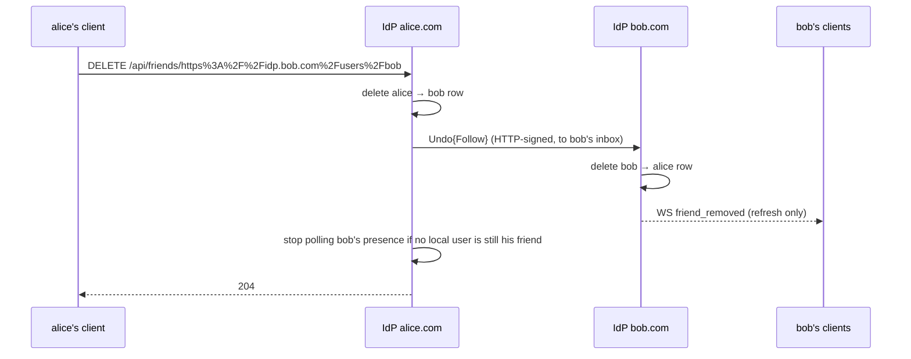

# Pina'i — Identity, Friends & Federation Backbone

In this architecture, users can be on **different IdPs** (e.g. Alice on `idp.alice.com`, Bob on `idp.bob.com`). Each IdP's PostgreSQL stores its own local users and a *remote actor* cache. So a friend's username can be either **local** or **remote**.

---

### Data model

```sql
-- Local users registered on this IdP instance
CREATE TABLE users (
  id            UUID PRIMARY KEY DEFAULT gen_random_uuid(),
  username      TEXT NOT NULL UNIQUE,       -- user input + NanoID suffix, e.g. "alice_xK9mP"
                                            -- used for federation: @alice_xK9mP@idp.alice.com
  display_name  TEXT NOT NULL,              -- set to user input at creation, e.g. "alice"
                                            -- freeform, no uniqueness constraint, shown in UI
  avatar_url    TEXT,                       -- public RustFS URL with `?v=<unix_secs>` cache-bust
                                            -- (avatars bucket is public-read; see § Avatar storage)
  pronouns      TEXT,                       -- closed enum, see CHECK below
  bio           TEXT,                       -- ≤ 190 chars, freeform; enforced server-side
  email         TEXT NOT NULL UNIQUE,       -- used by OIDC
  password_hash TEXT NOT NULL,
  actor_uri     TEXT NOT NULL UNIQUE,       -- e.g. "https://idp.alice.com/users/alice"
  inbox_url     TEXT NOT NULL,              -- e.g. "https://idp.alice.com/users/alice/inbox"
  outbox_url    TEXT NOT NULL,              -- e.g. "https://idp.alice.com/users/alice/outbox"
  email_verified_at TIMESTAMPTZ,            -- NULL until the signup OTP is consumed;
                                            -- /login refuses to issue a session while NULL
  created_at    TIMESTAMPTZ NOT NULL DEFAULT now(),
  updated_at    TIMESTAMPTZ NOT NULL DEFAULT now(),

  CONSTRAINT users_pronouns_check
    CHECK (pronouns IS NULL OR pronouns IN ('he', 'she', 'non-binary'))
);

-- Signup confirmation OTPs (6-digit numeric, peppered HMAC-SHA256).
-- At most one *unconsumed* row per user at any moment; resend consumes the
-- previous row in the same transaction. Reaper drops consumed/expired rows
-- older than 24 h.
CREATE TABLE email_verification_codes (
  id          UUID PRIMARY KEY DEFAULT gen_random_uuid(),
  user_id     UUID NOT NULL REFERENCES users(id) ON DELETE CASCADE,
  code_hash   BYTEA NOT NULL,            -- HMAC-SHA256(EMAIL_OTP_PEPPER, code)
  expires_at  TIMESTAMPTZ NOT NULL,      -- now() + 10 minutes
  consumed_at TIMESTAMPTZ,               -- set on successful verify OR resend invalidation
  attempts    INTEGER NOT NULL DEFAULT 0, -- max 5 before lockout (resend required)
  created_at  TIMESTAMPTZ NOT NULL DEFAULT now()
);
CREATE INDEX idx_evc_user_unconsumed
    ON email_verification_codes(user_id)
 WHERE consumed_at IS NULL;

-- Cache of remote users fetched via ActivityPub / WebFinger from other IdP instances
CREATE TABLE remote_actors (
  id            UUID PRIMARY KEY DEFAULT gen_random_uuid(),
  actor_uri     TEXT NOT NULL UNIQUE,       -- e.g. "https://idp.bob.com/users/bob"
  inbox_url     TEXT,                       -- e.g. "https://idp.bob.com/users/bob/inbox"
                                            -- cached on first WebFinger resolution to avoid repeated lookups
  instance      TEXT NOT NULL,              -- e.g. "idp.bob.com"
  display_name  TEXT,
  avatar_url    TEXT,
  fetched_at    TIMESTAMPTZ NOT NULL DEFAULT now(),  -- used for cache invalidation
  updated_at    TIMESTAMPTZ NOT NULL DEFAULT now()
);

-- Friends relationships — owner is always local (FK), friend can be local or remote (actor_uri)
CREATE TABLE friendships (
  id                UUID PRIMARY KEY DEFAULT gen_random_uuid(),
  owner_user_id     UUID NOT NULL REFERENCES users(id) ON DELETE CASCADE,  -- always local
  friend_actor_uri  TEXT NOT NULL,   -- e.g. "https://idp.bob.com/users/bob" (local or remote)
  friend_avatar_url TEXT,            -- cached to avoid extra S3/RustFS lookup at render time
  status            TEXT NOT NULL DEFAULT 'pending' CHECK (status IN ('pending', 'accepted')),
  direction         TEXT NOT NULL CHECK (direction IN ('outgoing', 'incoming')),  -- who sent the request
  created_at        TIMESTAMPTZ NOT NULL DEFAULT now(),
  updated_at        TIMESTAMPTZ NOT NULL DEFAULT now(),

  UNIQUE (owner_user_id, friend_actor_uri)
);
```

> **Who sent the request**
>
> Each side of a friendship has its own row — both in this database for a local pair, one on each
> IdP for a cross-IdP pair — and `direction` says which side the owner is on: `outgoing` when the
> owner sent the request, `incoming` when they received it. Only the `incoming` side may answer
> it: `GET /api/friends/incoming` lists incoming pending rows only, `POST /api/friends/:id/accept`
> and `DELETE /api/friends/:id/reject` refuse any other row, and an inbound `Accept` or `Reject`
> only applies to an `outgoing` row. Without it a pending row reads the same to both parties, and
> the requester could accept their own request. A repeated request takes over both pending rows,
> so the latest request decides who answers.
>
> A request never reopens an accepted friendship. `POST /api/friends/request` to an existing
> friend is refused (`Already friends`), an inbound `Follow` for one is ignored, and
> `friendships::create_friendship` returns an accepted row untouched — otherwise a peer could
> quietly take a friendship back to `pending`. Ending a friendship goes through unfriend only.

> **Federated address format**
>
> The canonical address format used throughout the system is `username@domain` (e.g. `alice_xK9mP@idp.alice.com`), **without** a leading `@`. This is produced by `User::federated_address(&self, domain: &str)` on the server side. Clients receive actor URIs (`https://idp.alice.com/users/alice_xK9mP`) in some events and normalise them to `username@domain` via `actorUriToAddress()` before using them as conversation keys.

> **`username` vs `display_name`**
>
> - `username` is the unique internal identifier used for federation and ActivityPub addressing. It is composed of the user-chosen name + a NanoID 5-character suffix appended by the backend at account creation (e.g. `alice_xK9mP`). This guarantees uniqueness per instance with no coordination needed. It is never shown in the UI.
> - `display_name` is the only name shown client-side. It is automatically set by the backend at account creation to the user-chosen part, before the NanoID suffix (e.g. user types `alice` → `display_name = "alice"`). It is freeform, has no uniqueness constraint, and can be changed freely at any time.
>
> Example flow at account creation:
> - User inputs: `alice`
> - Backend sets: `username = "alice_xK9mP"`, `display_name = "alice"`, `actor_uri = "https://idp.alice.com/users/alice_xK9mP"`

---

### Querying the friends list

Using `actor_uri` as the universal key, a JOIN across `users` and `remote_actors` gives the full friends list, whether local or federated:

```sql
SELECT
  COALESCE(u.username,
    split_part(f.friend_actor_uri, '/', -1)) AS username,  -- derived from actor_uri for remote
  COALESCE(u.display_name, ra.display_name)  AS display_name,
  f.friend_avatar_url                        AS avatar_url,
  f.friend_actor_uri,
  COALESCE(ra.instance, 'local')             AS instance
FROM friendships f
LEFT JOIN users u          ON f.friend_actor_uri = u.actor_uri
LEFT JOIN remote_actors ra ON f.friend_actor_uri = ra.actor_uri
WHERE f.owner_user_id = $1     -- pass the caller's local user id
  AND f.status = 'accepted';
```

### Friendship-accept also creates the DM conversation

When a friendship transitions to `accepted` (via `POST /api/friends/:id/accept` for both same-IdP and cross-IdP recipients, or `handle_accept` when a remote peer's IdP accepts a request our user sent), the accepter's IdP creates the DM conversation in the same logical transaction. Same-IdP and cross-IdP requests share one model: both rows land in `pending` at request time, and the recipient must explicitly accept — there is no auto-accept path. The new id flows out two ways:

- **Locally**: the WS `friend_accepted` payload carries it on `FriendshipPayload.conversation_id` (`Option<Uuid>`, absent on `friend_request`/`friend_removed` — the conversation outlives an unfriend). Web clients invalidate the `dm-conversations` query on this event so `localDmConvos` populates with the new row immediately.
- **Cross-IdP**: the outbound AP `Accept{Follow}` activity carries it in a non-standard `conversationId` field on the activity body (a sibling of `id`/`type`/`actor`/`object`). The peer IdP's `handle_accept` reads it and calls `conversations::get_or_create_dm_with_id` so both sides persist the row under the same UUID. A pre-refactor peer omits the field; the receiver falls back to `get_or_create_dm`, ending up with a divergent id — exactly matching the pre-refactor state. This is a safe degradation.

The migration `20260512000001_backfill_friendship_conversations.sql` retroactively creates a DM for every accepted friendship that doesn't yet have one (deduplicated by ordering the actor pair lexicographically so the two friendship rows don't each get their own conversation).

### Declining a request and ending a friendship

Both are silent for the other person: neither raises a notification. A declined request
simply stops existing, and an ended friendship drops out of the friends list. Neither
touches the DM conversation — its row, members and history stay, and re-friending the
same person reuses it (`get_or_create_dm` finds the pair's existing row).

| Action | Endpoint | Caller's row | Other side, same IdP | Other side, remote IdP |
|---|---|---|---|---|
| Decline | `DELETE /api/friends/:id/reject` (pending `incoming` rows only) | Deleted | Requester's pending row deleted, no event | `Reject{Follow}` to the requester's inbox |
| Unfriend | `DELETE /api/friends/:actor_uri` (percent-encoded; 404 when no row) | Deleted | Friend's row deleted; `friend_removed` WS event | `Undo{Follow}` to the friend's inbox |

`DELETE /api/friends/:actor_uri` also withdraws a pending request the caller sent, through
the same paths.

The `friend_removed` event carries the friend's own `friendship_id` and exists so their
clients refresh the friends and DM lists; clients do not surface it as a notification.



**Inbound `Accept` and `Reject`** act on exactly one row: the one owned by the inbox the
activity was delivered to, whose friend is the activity's `actor`, and only while it is a
`pending` `outgoing` request. The embedded Follow is not trusted to name the local user, so a
peer can neither answer anyone else's request nor accept a request it sent itself.

**Delivery** of `Reject` and `Undo{Follow}` is best-effort: the local change is committed
first and the request succeeds even if the peer is unreachable. A peer that missed the
activity keeps its row until either side touches the relationship again — its user
unfriending sends an `Undo{Follow}` back, which is a no-op here.

**Remote presence polling** is registered per IdP, not per user. It is only released when
no local user still has the remote actor as an accepted friend.

---

## 1.4. Sign-up email verification

Every new account must prove ownership of its email address before a session
cookie or access token is issued. Federation, friend graph, and DMs are all
inaccessible to an unverified user.

### Flow

```
┌──────────────┐  ① POST /register-and-login (form)
│  Web client  │ ────────────────────────────────────►  IdP creates user (email_verified_at = NULL),
│ (verify page)│                                        inserts email_verification_codes row,
│              │                                        SMTPs the 6-digit code to the address.
│              │  ② 302 → /verify-email?pending_user_id=…&pending_email=…&{oidc params}
│              │ ◄────────────────────────────────────
│              │  ③ POST /verify-email-and-login (form)
│              │ ────────────────────────────────────►  IdP verifies code, flips
│              │                                        email_verified_at, issues auth code,
│              │                                        sets session cookie, 302 → redirect_uri
│              │  ④ 302 → redirect_uri?code=…&state=…
│              │ ◄────────────────────────────────────
└──────────────┘
```

### Endpoints

| Endpoint | Body | Result |
|---|---|---|
| `POST /register-and-login` | username, email, password + OIDC params | Creates the user with `email_verified_at = NULL`, dispatches OTP, redirects to `frontend_url/verify-email`. **No session is issued.** |
| `POST /verify-email-and-login` | `pending_user_id`, `pending_email`, `code` + OIDC params | Consumes the code, sets `email_verified_at = now()`, issues an OIDC auth code + session cookie, redirects to `redirect_uri`. Recoverable failures (wrong code, expired) redirect back to `/verify-email` with `error=…`. |
| `POST /verify-email/resend` | `pending_user_id` | Issues a fresh OTP; rate-limited to 5 codes per user per 10-min window. `204` on success, `410` if already verified, `429` if rate-limited. |
| `POST /login` (existing) | email, password + OIDC params | If credentials are valid but `email_verified_at IS NULL`, dispatches a fresh OTP and redirects to `/verify-email` instead of issuing a session. |

### OTP rules

- **Length.** 6 numeric digits. Drawn from `OsRng` with rejection sampling so each digit is uniform `0..=9` (no modulo bias).
- **Lifetime.** 10 minutes (`SIGNUP_OTP_TTL_SECS = 600`).
- **Storage.** `code_hash = HMAC-SHA256(EMAIL_OTP_PEPPER, code)`. The pepper is a ≥ 32-byte hex env var; startup fails if unset or shorter. A leaked DB without the pepper is not brute-forceable offline.
- **Attempts.** 5 per code row before lockout — the user must resend.
- **Single-use.** `consume_and_verify_user` atomically marks the row `consumed_at = now()` *and* sets `email_verified_at` in one transaction. A race losing thread sees `flipped = false` and is told the code was already used.
- **Resend invalidation.** Inserting a new code consumes the previous unconsumed row in the same transaction, so only the latest code can succeed.

### Reaper

`run_signup_reaper` (spawned from `server::main`) wakes every hour and:
1. Deletes `email_verification_codes` rows that are consumed-or-expired *and* older than 24 hours.
2. Deletes `users` rows where `email_verified_at IS NULL` *and* `created_at` is older than 7 days. Abandoned signups free the email + username so they can be re-registered.

### Dev SMTP

Mailpit ships in `docker/docker-compose.yml` (`MP_SMTP_AUTH_ACCEPT_ANY=true`, `MP_SMTP_AUTH_ALLOW_INSECURE=true`). Web UI on `MAILPIT_UI_PORT` (Alice 8027, Bob 8028) lets a developer click through to the rendered email and copy the code. Production points `SMTP_HOST`/`SMTP_PORT` at a real relay; set `SMTP_STARTTLS=true` for TLS-enabled relays. `POST /dev/send-test-email` is mounted only when `IDP_ENV=development` and fires a hard-coded `123456` code to verify the SMTP path.

### `/userinfo`

Returns `email_verified: boolean` derived from `email_verified_at IS NOT NULL` so clients can show / hide flow-gates without an extra round trip.

---

## 1.4b. TOTP two-factor authentication

Per-login second factor backed by an authenticator app (RFC 6238, SHA-1, 6
digits, 30-second window). Recovery codes substitute when a user loses access
to their device.

### Data model additions

```sql
ALTER TABLE users
    ADD COLUMN totp_secret  BYTEA,
    ADD COLUMN totp_enabled BOOLEAN NOT NULL DEFAULT FALSE;

-- Mid-enrollment secret. Discarded once verify succeeds (copied to users.totp_secret).
CREATE TABLE pending_totp_enrollments (
    user_id    UUID PRIMARY KEY REFERENCES users(id) ON DELETE CASCADE,
    secret     BYTEA NOT NULL,
    created_at TIMESTAMPTZ NOT NULL DEFAULT now()
);

-- "You passed password, now show me the second factor" tickets.
CREATE TABLE pending_totp_logins (
    id                    UUID PRIMARY KEY DEFAULT gen_random_uuid(),
    user_id               UUID NOT NULL REFERENCES users(id) ON DELETE CASCADE,
    client_id             TEXT NOT NULL,
    redirect_uri          TEXT NOT NULL,
    scope                 TEXT NOT NULL,
    oauth_state           TEXT NOT NULL,
    code_challenge        TEXT NOT NULL,
    code_challenge_method TEXT NOT NULL,
    nonce                 TEXT,
    expires_at            TIMESTAMPTZ NOT NULL,   -- now() + 5 minutes
    consumed_at           TIMESTAMPTZ,
    attempts              INTEGER NOT NULL DEFAULT 0,
    created_at            TIMESTAMPTZ NOT NULL DEFAULT now()
);

-- 10 single-use codes per user. HMAC-SHA256(EMAIL_OTP_PEPPER, plaintext) — same
-- pepper as signup OTPs (one secret to manage).
CREATE TABLE recovery_codes (
    id          UUID PRIMARY KEY DEFAULT gen_random_uuid(),
    user_id     UUID NOT NULL REFERENCES users(id) ON DELETE CASCADE,
    code_hash   BYTEA NOT NULL,
    consumed_at TIMESTAMPTZ,
    created_at  TIMESTAMPTZ NOT NULL DEFAULT now()
);
```

### Login flow

```
POST /login (email + password) ──► verify creds + email_verified_at
                                  │
                                  ├─ user.totp_enabled = false
                                  │     → issue auth code + session cookie + 302 redirect_uri  (existing flow)
                                  │
                                  └─ user.totp_enabled = true
                                        → create pending_totp_logins row carrying OIDC params
                                        → 302 to frontend_url/login/totp?ticket=<uuid>
                                                                  │
                                                                  ▼
                              POST /login/totp (ticket + code | recovery_code)
                                        → verify code via idp_totp::verify_code(secret, code)  -or-
                                          ct-compare recovery_code against unconsumed rows + consume
                                        → consume ticket + issue auth code + session cookie
                                        → 302 redirect_uri?code=…&state=…
```

Failures (wrong code, ticket expired, ticket already consumed) all redirect
back to `/login/totp?ticket=…&error=…` so the form re-renders inline. After 5
failed attempts the user is bounced to `/login` with a "sign in again" notice
— the password step must be re-cleared, not just the second factor.

### Enrollment / disable / regenerate endpoints

| Endpoint | Auth | Body | Result |
|---|---|---|---|
| `POST /api/totp/enroll` | Bearer | — | Generates a fresh 20-byte secret, stores it in `pending_totp_enrollments`, returns `{ secret_base32, provisioning_url }`. The provisioning URL is the `otpauth://totp/...` string the client renders as a QR. |
| `POST /api/totp/enroll/verify` | Bearer | `{ code }` | Verifies the first authenticator code against the pending secret. On success: commits the secret to `users.totp_secret`, deletes the pending row, generates 10 recovery codes, returns them in `{ recovery_codes: [...] }` — shown once and never re-served. |
| `POST /api/totp/disable` | Bearer | `{ code }` | Requires a current TOTP code (passive sessions can't disarm). Clears `totp_secret`, sets `totp_enabled = false`, deletes all recovery codes. |
| `POST /api/totp/recovery-codes/regenerate` | Bearer | `{ code }` | Requires a current TOTP code. Atomically replaces all of the user's recovery codes and returns the fresh set. |

### Constants

- **TOTP digits / step / skew**: 6 / 30 s / ±1 step (allows ±30 s clock drift). Matches Google Authenticator / Authy / 1Password.
- **Secret length**: 20 bytes (RFC 4226).
- **Login ticket TTL**: 5 minutes; max 5 attempts per ticket.
- **Recovery codes**: 10 per user, 10 chars from a Crockford-style alphabet (no `0`, `1`, `I`, `L`, `O`, `U`), formatted `XXXXX-XXXXX`. Normalization on input strips dashes + whitespace and uppercases — `abcde-12345` and `ABCDE12345` are equivalent.
- **Pepper**: recovery code hashes reuse `EMAIL_OTP_PEPPER` — one secret to manage.

### `/userinfo`

Returns `totp_enabled: boolean` so the web client knows whether to render the
"Enable 2FA" pane vs. the "Disable / Generate new recovery codes" pane.

### Reaper

`run_signup_reaper` (already running) now also drops consumed/expired
`pending_totp_logins` rows older than 24 h via the same hourly cadence.

---

## 1.5. Profile editing API

The user's editable profile fields (`display_name`, `pronouns`, `bio`) and their
avatar are exposed through two endpoints:

| Endpoint | Body | Notes |
|---|---|---|
| `PATCH /api/profile` | `{ display_name, pronouns?, bio? }` | All three fields sent on every save. `display_name` required & ≤50 chars. `pronouns` ∈ {`he`,`she`,`non-binary`} or `null`. `bio` ≤190 chars; empty clears. Returns the updated `UserinfoResponse`. |
| `PUT /api/avatar` | raw image bytes (`image/jpeg|png|webp|gif`, ≤2 MiB) | Replaces any prior avatar. Stored URL ends in `?v=<unix_secs>` to bypass browser cache on re-upload. |
| `DELETE /api/avatar` | — | Clears the user's avatar. |

After any successful change, `propagate_profile_update(user_id)` is invoked
(see § 2). Pronouns and bio are **local-only today**; only `display_name` and
`avatar_url` federate. Mastodon-style federation of `summary` (bio) and
`attachment[].PropertyValue` (pronouns) is the planned upgrade path.

### Avatar storage

The avatars bucket is **public-read** (`s3:GetObject` for `Principal: *`),
unlike the attachments bucket. The IdP stores the public URL directly on
`users.avatar_url`:

```
{STORAGE_PUBLIC_URL}/avatars/{user_id}.{ext}?v={unix_secs}
```

The query param is appended at upload time. Storage keys are stable per user,
so without `?v` the browser keeps the old bytes after a re-upload — the
version param forces a fresh fetch and propagates verbatim through the AP
`Update{Person}` activity to peer `remote_actors.avatar_url` and
`friendships.friend_avatar_url`.

---

## 2. Real-time profile propagation when a friend updates their profile

Regardless of whether the friend is local or remote, the downstream propagation is always the same. The only difference is *how the update is triggered*.

1. A profile update occurs:
   - **Local friend**: the Msg Backbone updates the `users` table directly and publishes an event to the message broker.
   - **Remote friend**: Bob's IdP sends an ActivityPub `Update` activity to Alice's IdP, which updates `remote_actors` and publishes an event to the broker.

```json
{
  "@context": "https://www.w3.org/ns/activitystreams",
  "type": "Update",
  "actor": "https://idp.bob.com/users/bob",
  "object": {
    "type": "Person",
    "id": "https://idp.bob.com/users/bob",
    "preferredUsername": "new_bob",
    "name": "New Bob Display Name",
    "icon": { "type": "Image", "url": "https://idp.bob.com/avatars/bob.webp" }
  }
}
```

2. The IdP updates `friend_avatar_url` on all matching `friendships` rows.
3. The broker fans out a `friend_profile_updated` event to all users who have that actor as a friend.
4. The WebSocket layer consumes the event from the broker and pushes it to all connected clients:

```json
{
  "event": "friend_profile_updated",
  "actorUri": "https://idp.bob.com/users/bob",
  "displayName": "New Bob",
  "avatarUrl": "https://idp.bob.com/avatars/bob.webp"
}
```

5. Alice's client receives it and updates its local state immediately.

```
Profile update ──▶ IdP (DB + friendships cache) ──▶ Broker ──▶ WebSocket layer ──▶ Alice's client
```

---

### Summary

| Trigger | Transport | Who updates the cache? |
|---|---|---|
| Local profile update | Broker → WebSocket | `users` table + `friendships.friend_avatar_url` |
| Remote profile update | ActivityPub `Update` → Broker → WebSocket | `remote_actors` table + `friendships.friend_avatar_url` |

---

## 3. Message broker strategy

Naively pushing events directly over WebSockets creates several problems:

- Events are lost if the client is temporarily disconnected.
- No catch-up mechanism on reconnect.
- No fan-out to multiple devices (web + desktop).

The solution is a **message broker** as the backbone for durable client-event
delivery. Given Redis is already in the stack for presence/pub-sub,
**Redis Streams** is the pragmatic choice to avoid adding a new infrastructure
dependency.

### Redis transport split

| Channel | Type | Use case |
|---|---|---|
| Presence (online/offline/typing) | Redis pub-sub | Ephemeral — losing an event is acceptable |
| DMs, profile updates, friend requests | Redis Streams | Durable client-side — survives a recipient's disconnect |

Redis pub-sub remains appropriate for presence events since they are high-frequency and inherently transient. Redis Streams handles everything that must survive a recipient disconnect.

> The streams carry **client-facing events** so a reconnecting tab can catch
> up. They are **not** the inter-IdP outbox — outbound ActivityPub delivery
> is covered separately below.

### Federation delivery semantics

> Delivery covered here is the outbound half. Every activity leaves signed, and every
> activity arriving at `POST /users/:username/inbox` is authenticated before any state is
> touched — see `specs/06-federation-authentication.md` for the signing scheme, the three inbound
> checks, and the peer request policy.

Outbound ActivityPub activities are delivered **inline** via `tokio::spawn`
per remote inbox — there is no persistent outbox queue. Every activity we
emit is either time-sensitive (durable retry actively makes it worse) or
idempotent and naturally self-healing through another mechanism:

| Activity | Property | Recovery on delivery failure |
|---|---|---|
| `Create{Note}` (1:1 DM) | Time-sensitive | Outcome recorded in `direct_messages.federation_status`; a failure is pushed to the sender (`dm_delivery_failed`), whose client sends the message again as a new one — see `identity-provider/specs/03-direct-messages.md § Delivery failure` |
| `Update{Note}` (edit) | Time-sensitive | Same — recipients see the original until they can refetch |
| `Like` / `Undo{Like}` (reaction) | Idempotent | Reconciles on next conversation fetch |
| `Follow` / `Accept` | Idempotent, low-frequency | User can re-trigger; relationships are bidirectional |
| `Reject` / `Undo{Follow}` | Idempotent, low-frequency | The peer keeps its row until either side touches the relationship again — see § Declining a request and ending a friendship |
| `Update{Person}` (profile) | Idempotent | Self-heals via `remote_actors.fetched_at` TTL re-fetch |

Each activity type owns its own reconciliation story (TTL re-fetch, next
user interaction, sender-driven resend), so a missed delivery never produces a
permanently inconsistent state. This avoids the failure modes a generic
queue introduces (silent worker death, queue growth, attempt-counter
overflow, mis-tuned backoff). If a future activity does require durable
retry, that activity earns its own scoped queue at that point — rather
than a one-size-fits-all outbox up front.

### Client reconnect & catch-up

The WebSocket layer becomes a thin delivery mechanism that reads from Redis Streams rather than being the source of truth. On reconnect, the client sends its last received event ID, and the server replays any undelivered stream entries:

```
Client reconnects ──▶ sends last_event_id ──▶ server replays missed entries from Redis Stream
```

This naturally handles multi-device scenarios too: each device maintains its own consumer position in the stream.

### Scaling consideration

Redis Streams is the right starting point. If federation traffic grows significantly, **NATS JetStream** is a better long-term fit — it is designed for exactly this kind of federated, multi-instance messaging topology. Migrating later is straightforward since the broker is behind an abstraction layer in the Msg Backbone.

---
