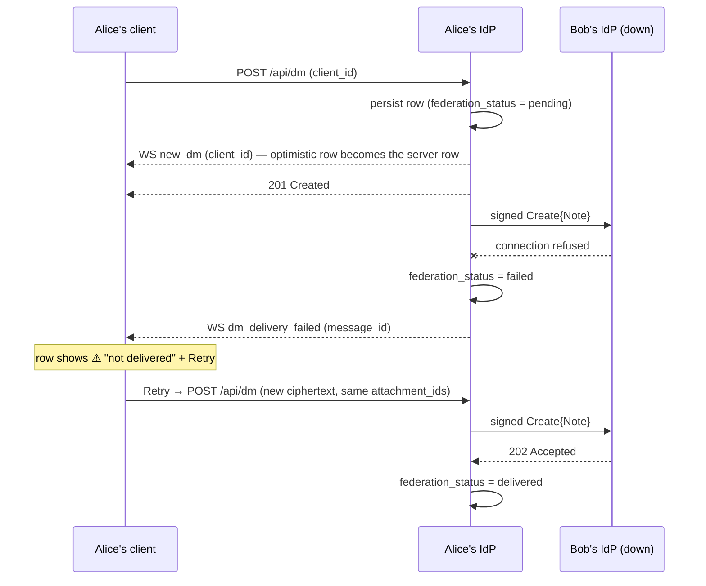
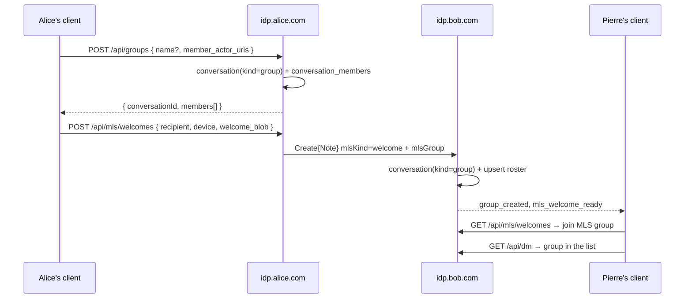
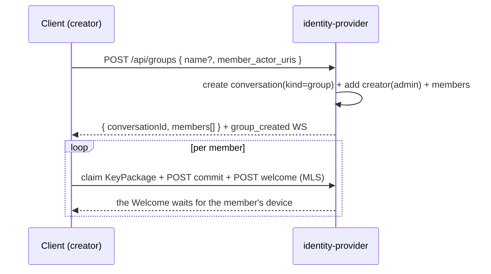

# Pina'i — Direct Messages

DMs live on the Msg Backbone (IdP layer). Since Alice and Bob can be on different instances, each IdP stores its own full copy of the conversation (Option 1 — mirrored). Each message is delivered via ActivityPub (`Create` activity wrapping a `Note` object) and persisted on both ends. `activity_uri` is the canonical ActivityPub object ID used to correlate federated copies across instances for edits and deletes.

> **End-to-end encryption (Phase 3 onward).** Every message body is an
> opaque MLS ciphertext on the wire and at rest — `direct_messages.content`
> was dropped, and `mls_ciphertext BYTEA NOT NULL` took its place. Reactions
> are no longer a server-side table; they're MLS application messages of
> `kind = "reaction"` inside the encrypted body. Reply previews
> (`reply_to_content`, `reply_to_sender`) likewise moved into the
> encrypted body — `reply_to_id` stays plaintext for thread routing.
> See [`05-e2ee.md`](./05-e2ee.md) for the protocol-level design.

### Schema

Conversations are anchored by a stable UUID that never changes regardless of participant count. This is the single key used for message storage, typing channels, unread tracking, and federation.

```sql
-- Conversation anchor — one row per conversation, DM or group
CREATE TABLE conversations (
  id           UUID PRIMARY KEY DEFAULT gen_random_uuid(),
  kind         TEXT NOT NULL DEFAULT 'dm'
                 CHECK (kind IN ('dm', 'group')),
  name         TEXT,                          -- NULL for DMs (title derived client-side from
                                              -- the other member's display_name)
                                              -- Required for groups; defaults at creation to
                                              -- the joined display_names of all initial members
                                              -- e.g. "Alice, Bob, Harry" — editable afterwards
  created_at   TIMESTAMPTZ NOT NULL DEFAULT now(),
  dm_low       TEXT,                          -- a DM's pair of actor URIs, the smaller first;
  dm_high      TEXT,                          -- NULL for groups
  CHECK ((dm_low IS NULL AND dm_high IS NULL) OR (kind = 'dm' AND dm_low < dm_high))
);

-- One DM per pair: concurrent first messages or accepts share it
CREATE UNIQUE INDEX conversations_dm_pair ON conversations (dm_low, dm_high)
  WHERE dm_low IS NOT NULL;

-- Members of a conversation — local or remote actors
-- left_at IS NULL means the member is still active
CREATE TABLE conversation_members (
  conversation_id  UUID NOT NULL REFERENCES conversations(id) ON DELETE CASCADE,
  actor_uri        TEXT NOT NULL,             -- local or remote
  joined_at        TIMESTAMPTZ NOT NULL DEFAULT now(),
  left_at          TIMESTAMPTZ,               -- NULL = still a member
  role             TEXT NOT NULL DEFAULT 'member'
                     CHECK (role IN ('member', 'admin')),  -- group management gate; ignored for DMs
  PRIMARY KEY (conversation_id, actor_uri)
);

CREATE INDEX idx_conv_members_actor
  ON conversation_members (actor_uri) WHERE left_at IS NULL;

-- Messages — keyed by conversation_id instead of sender/recipient pair.
-- Body is opaque MLS ciphertext; the server never decrypts.
--
-- `id` is derived from the trailing UUID of `activity_uri`
-- (`<issuer>/users/<username>/activities/<uuid>`), NOT freshly
-- generated. This bridges row ids across IdPs in cross-server DMs:
-- both the sender's IdP and the recipient's IdP see the same
-- activity_uri, so both compute the same row id. Without this,
-- payloads that reference a message by its server-side id (reactions'
-- `target_message_id` inside the encrypted MLS body, edits' PATCH
-- url, replies' `reply_to_id` as observed by the client) silently
-- fail on the receiver because each IdP would have picked its own
-- random UUID. `DEFAULT gen_random_uuid()` stays as a fallback for
-- legacy / malformed URIs that fail the extraction.
CREATE TABLE direct_messages (
  id                UUID PRIMARY KEY DEFAULT gen_random_uuid(),
  conversation_id   UUID NOT NULL REFERENCES conversations(id) ON DELETE CASCADE,
  sender_actor_uri  TEXT NOT NULL,
  mls_ciphertext    BYTEA NOT NULL,           -- TLS-encoded MLSMessage
  activity_uri      TEXT NOT NULL UNIQUE,     -- e.g. "https://idp.alice.com/users/alice/activities/uuid"
                                              -- used to correlate federated copies for edits/deletes
                                              -- AND as the source for `id` (see above)
  federation_status TEXT NOT NULL DEFAULT 'pending'
    CHECK (federation_status IN ('pending', 'delivered', 'failed')),
  reply_to_id       UUID REFERENCES direct_messages(id) ON DELETE SET NULL,
  created_at        TIMESTAMPTZ NOT NULL DEFAULT now(),
  edited_at         TIMESTAMPTZ,
  deleted_at        TIMESTAMPTZ               -- soft delete, NULL = not deleted
);

-- Keyset pagination index
CREATE INDEX idx_dm_conversation_cursor
  ON direct_messages (conversation_id, created_at DESC, id DESC);
```

> **Conversation ID ownership**: DM `conversation_id` is decided at **friendship-accept time** by the accepter's IdP, not by the first-message sender, and both IdPs of a cross-IdP pair file the DM under the same id — see `identity-provider/specs/01-identity-federation.md § Friendship-accept also creates the DM conversation`. Clients always read `dmData.id` from `localDmConvos` and pin it on `POST /api/dm`; the WS `dm-conversations` query is invalidated on `friend_accepted` so the new row appears immediately.

> **One DM per pair, and whose id**: a pair of actors has exactly one DM — its pair is a unique key, so two concurrent first messages or accepts open the same one. An id a client pins (`POST /api/dm`'s `conversation_id`, the MLS group it already bootstrapped) or a peer advertises (a Note's `context`, an Accept's `conversationId`) is used only when the pair has no DM yet, and only if it names no conversation, or a DM none but the pair ever belonged to. Any other id — a group's, another pair's DM — is ignored and the DM opens under a fresh one: honouring it would add the pair to someone else's conversation.

> **Group name**: optional at creation. When the client sends a blank/absent name the server stores `NULL`, and clients derive the title from the member `display_name` values (e.g. `"Bob, Harry"`) — the list is shown from the local user's perspective, so their own name is omitted. A stored name can be changed via `PATCH /api/groups/:conversation_id` (admin only). See **§9 Group conversation management**.

### Delivery flow

Whether the sender may reach the recipient is decided first, before any conversation is opened or
message stored: a sender who blocked the recipient is refused with 403 `You blocked this user`, and
a local recipient who doesn't admit the sender — a block, or their contact setting — with 403
`Message could not be delivered`. A remote recipient's own IdP decides on its side, with the same
refusal (`identity-provider/specs/01-identity-federation.md § 1.7`).

**Local DM** (sender and recipient on the same IdP):

```
Alice types → WS handler persists message
            → publishes JSON event to Redis Streams (broker) for both users
            → pushes `new_dm` to both Alice's and Bob's live connections
```

**Remote DM** (sender and recipient on different IdPs):

```
Alice types → WS handler resolves Bob's inbox_url
                ├─ cache hit:  read from remote_actors.inbox_url (no WebFinger needed)
                └─ cache miss: resolve via WebFinger → upsert into remote_actors (async)
            → persists message (federation_status = 'pending')
            → echoes `new_dm` to Alice only (Bob is remote)
            → builds ActivityPub Create{Note} activity
            → delivers to Bob's inbox_url via HTTP Signatures (background task)
            → records the outcome: federation_status = 'delivered' | 'failed'
            → on failure, pushes `dm_delivery_failed` to Alice

Bob's IdP ← receives HTTP POST to /users/bob/inbox
          → verifies HTTP Signature
          → persists its own copy of the message (a redelivered activity — same
            activity URI — is answered 202 without a second copy or event)
          → pushes `new_dm` to Bob's live connections
          → writes the event to Bob's Redis stream, for his catch-up
```

> **Note on `sender_address`**: the `DmPayload.sender_address` field sent over WebSocket is the
> sender's `username@domain`, for local and delivered messages alike — the actor URI only when
> the sender's URI is not of the `…/users/{username}` form. `kind` is the conversation's (`dm` or
> `group`), delivered messages included. The `conversation_id` UUID is the stable key used for
> all conversation routing — the client never derives a conversation key from actor URIs.

> **Note on outbound delivery**: ActivityPub delivery for DMs (and every
> other activity type) runs in a background `tokio::spawn`, best-effort.
> No persistent outbox queue — see `identity-provider/specs/01-identity-federation.md § Federation delivery semantics`
> for the rationale and the per-activity recovery story. A 1:1 DM's story
> is below.

### Delivery failure

The sender's IdP answers `POST /api/dm` (or processes `send_dm`) as soon as the
message is stored, before it contacts the recipient's IdP. Delivery happens
afterwards, once, and is never retried by the IdP. So a delivery failure cannot
be an error on the send. Instead the IdP records it and tells the sender, and
the sender decides whether to send the message again.

- **Outcome on the row.** The delivery task (`application::messaging::DeliverDirectMessage`,
  shared by both send paths) sets `direct_messages.federation_status` to
  `'delivered'` or `'failed'`. A peer that is unreachable, times out, or answers
  non-2xx counts as `'failed'`. Local DMs and group messages keep `'pending'`:
  a local DM is never delivered over federation, and a group message goes to
  several inboxes, which one status cannot describe.
- **`dm_delivery_failed`.** On failure the IdP pushes this event to the
  sender's live connections:

  ```json
  { "type": "dm_delivery_failed",
    "data": { "message_id": "uuid", "conversation_id": "uuid" } }
  ```

- **Ordering.** The sender's `new_dm` echo is sent *before* delivery starts,
  and both travel through the same per-connection channel. So the echo, which
  carries the sender's `client_id` and turns the optimistic row into the
  server row, always arrives first, and `dm_delivery_failed` always finds the
  row it names.
- **Retry is a new message.** The failed row stays in the sender's history as
  the record of the attempt. Sending it again re-encrypts the plaintext at the
  current MLS ratchet position and posts it as a new message, so the retry is
  always decryptable for the recipient. The original row is never re-delivered.
- **Attachments move.** An attachment linked to one of the sender's own
  `'failed'` messages may be named again in `attachment_ids`. The new message
  takes the rows over, in the transaction that stores it, with the same
  ids, so the `AttachmentBlobKey.id`s in the new encrypted body stay valid and
  nothing is uploaded again. The recipient's IdP has never seen those ids,
  because the failed activity never reached it.



Scenarios:

| Scenario | What the sender sees |
|---|---|
| Recipient's IdP is down while the sender is online | The message turns undelivered within the delivery timeout; Retry sends it as a new message at the bottom of the conversation, and the original keeps its warning without a Retry button |
| The sender's tab closed before the failure landed | Next time the conversation loads, history carries `federation_status: "failed"` and the client applies it over its cached row |
| The failed message had attachments | Retry reuses the same attachment ids; the server moves them to the new message |
| The failure reaches another of the sender's devices, which never held the plaintext | The row turns undelivered there too, but its Retry is disabled — only a device holding the plaintext can re-encrypt it |
| The sender's IdP stopped before the delivery ended (a crash, a restart) | The row would stay `pending` for good: a sweep, every minute, marks `failed` each DM to another IdP still `pending` five minutes after it was stored — well past the delivery timeout — and pushes `dm_delivery_failed` to its sender |
| The recipient doesn't admit the sender — a block, or their contact setting (`identity-provider/specs/01-identity-federation.md § 1.7`) | Their IdP refuses the message with 403, so it turns undelivered exactly as for an unreachable IdP, and so does every retry |
| The recipient's IdP persisted the message but answered non-2xx (or too late) | The row is marked failed although the recipient has it; a retry then gives the recipient a duplicate, whose attachment rows stay with the first copy (same ids, so the recipient's inbox skips them). The sender's IdP cannot tell this apart from a lost delivery |

### Pagination — infinite scroll upward

Keyset pagination on `(created_at, id)` is used instead of `LIMIT/OFFSET` to avoid drift when new messages arrive during scrolling.

```sql
-- Initial load (most recent messages)
-- $1 = conversation_id UUID
SELECT * FROM direct_messages
WHERE conversation_id = $1
  AND deleted_at IS NULL
ORDER BY created_at DESC, id DESC
LIMIT 50;

-- Subsequent pages (scroll up: fetch older messages)
-- $2 = oldest created_at from previous page, $3 = oldest id from previous page
SELECT * FROM direct_messages
WHERE conversation_id = $1
  AND deleted_at IS NULL
  AND (created_at, id) < ($2, $3)
ORDER BY created_at DESC, id DESC
LIMIT 50;
```

The client keeps track of the oldest `(created_at, id)` it has received and passes it as the cursor for the next page request: `GET /api/dm/:conversation_id?cursor_created_at=<RFC 3339>&cursor_id=<uuid>&limit=<≤ 100>`, `cursor_created_at` exactly as the message's `created_at` was returned. Both halves are needed — either alone reads the first page, which also marks the conversation read.

---

## 6. DM unread notification tracking

When a user is offline or viewing a different conversation, incoming DMs must not be silently lost — they need to surface as unread counts when the user returns.

### Schema

```sql
-- Tracks the last time a user opened each conversation.
-- Used to compute per-conversation unread counts on login / reconnect.
CREATE TABLE conversation_reads (
  user_id          UUID        NOT NULL REFERENCES users(id) ON DELETE CASCADE,
  conversation_id  UUID        NOT NULL REFERENCES conversations(id) ON DELETE CASCADE,
  last_read_at     TIMESTAMPTZ NOT NULL DEFAULT NOW(),
  PRIMARY KEY (user_id, conversation_id)
);
```

### Unread count query

Computed inline in the `GET /api/dm` (list conversations) response via a SQL CTE + LEFT JOIN:

```sql
-- $1 = caller actor_uri, $2 = caller user_id (local UUID)
-- After Phase 3 there's no plaintext preview — message bodies are opaque
-- ciphertext. The client maintains its own preview cache by replaying its
-- decrypted MLS stream. We still expose `last_message_sender` (the
-- sender_actor_uri of the most recent message) since that's plaintext.
WITH ranked_messages AS (
    SELECT
        dm.conversation_id,
        dm.sender_actor_uri,
        dm.created_at,
        ROW_NUMBER() OVER (
            PARTITION BY dm.conversation_id
            ORDER BY dm.created_at DESC, dm.id DESC
        ) AS rn
    FROM direct_messages dm
    WHERE dm.deleted_at IS NULL
)
SELECT
    c.id                                        AS conversation_id,
    c.kind,
    c.name,
    cm_self.conversation_id                     AS _check,
    MAX(rm.created_at)                          AS last_message_at,
    (SELECT rm2.sender_actor_uri
     FROM ranked_messages rm2
     WHERE rm2.conversation_id = c.id AND rm2.rn = 1)
                                                AS last_message_sender,
    COUNT(CASE
        WHEN rm.sender_actor_uri != $1
             AND (r.last_read_at IS NULL OR rm.created_at > r.last_read_at)
             AND NOT EXISTS (SELECT 1 FROM user_blocks b
                             WHERE b.owner_user_id = $2
                               AND b.blocked_actor_uri = rm.sender_actor_uri)
        THEN 1 ELSE NULL
    END)                                        AS unread_count,
    -- all active members except the caller, as a JSON array
    COALESCE(
        JSON_AGG(
            JSON_BUILD_OBJECT(
                'actorUri',    cm_other.actor_uri,
                'displayName', COALESCE(u.display_name, ra.display_name),
                'avatarUrl',   COALESCE(u.avatar_url, ra.avatar_url)
            )
        ) FILTER (WHERE cm_other.actor_uri != $1),
        '[]'
    )                                           AS members
FROM conversation_members cm_self
JOIN conversations c
    ON c.id = cm_self.conversation_id
JOIN conversation_members cm_other
    ON cm_other.conversation_id = c.id
   AND cm_other.left_at IS NULL
LEFT JOIN users u
    ON u.actor_uri = cm_other.actor_uri
LEFT JOIN remote_actors ra
    ON ra.actor_uri = cm_other.actor_uri
LEFT JOIN ranked_messages rm
    ON rm.conversation_id = c.id
LEFT JOIN conversation_reads r
    ON r.user_id = $2 AND r.conversation_id = c.id
WHERE cm_self.actor_uri = $1
  AND cm_self.left_at IS NULL
GROUP BY c.id, c.kind, c.name, cm_self.conversation_id
ORDER BY last_message_at DESC NULLS LAST;
```

Only messages **not sent by the caller** count as unread — this works correctly for both DMs and group conversations. Messages from actors the caller blocked don't count either, so a group shared with someone blocked doesn't light up for their messages (`identity-provider/specs/01-identity-federation.md § 1.7`). A `NULL` `last_read_at` means the user has never opened that conversation.

The `members` array contains all active participants **except the caller**. The client uses this to:
- **DM** (`kind = 'dm'`): use `members[0].displayName` as the conversation title.
- **Group** (`kind = 'group'`): use `conversations.name` as the title; display `members` list as the subtitle.

### Mark-as-read

`GET /api/dm/:conversation_id` (conversation history, initial page only — no cursor) fires a background upsert:

```sql
INSERT INTO conversation_reads (user_id, conversation_id, last_read_at)
VALUES ($user_id, $conversation_id, NOW())
ON CONFLICT (user_id, conversation_id) DO UPDATE SET last_read_at = NOW();
```

This runs in a `tokio::spawn` so it never blocks the response.

### End-to-end flow

```
Bob logs in
  → GET /api/dm returns conversations with unread_count per conversation
  → client seeds its in-memory unread store from the response
  → sidebar shows badges immediately

Alice sends a DM while Bob is connected but on a different page
  → Bob's WS receives new_dm event
  → client checks active conversation: not this one → increments unread counter + plays sound
  → badge appears on Alice's conversation in Bob's sidebar

Bob clicks Alice's conversation
  → GET /api/dm/:conversation_id called (initial page, no cursor)
  → server upserts last_read_at = NOW() in background
  → client clears the in-memory unread counter for that conversation
  → badge disappears
```

### DM API response — display names

All DM API responses include resolved display names to avoid requiring clients to do additional lookups:

| Endpoint | Fields returned | Notes |
|---|---|---|
| `GET /api/dm` | `conversation_id`, `kind`, `name`, `members[]` (`actorUri` + `displayName` + `avatarUrl`, excluding caller), `last_message_sender`, `last_message_at`, `unread_count` | Single query — see above. Client derives DM title from `members[0].displayName`, avatar from `members[0].avatarUrl`. Plaintext preview is gone with E2EE — client computes one from the decrypted MLS stream |
| `GET /api/dm/:conversation_id` | messages with `sender_display_name`, `mls_ciphertext` (base64), `attachments[]` per row | Display name resolved from `users` or `remote_actors`; ciphertext is opaque; attachments resolved from `message_attachments` |
| `POST /api/dm` | Bearer; body `{ recipient_address, mls_ciphertext: <base64>, reply_to_id?, attachment_ids[], conversation_id?, client_id? }` | `mls_ciphertext` is mandatory, non-empty and at most 64 KiB decoded — on every path: REST, WebSocket `send_dm`, group sends, edits, and what the inbox receives. `client_id` is echoed on the sender's own `new_dm` (see below) |
| WS `new_dm` event | `conversation_id`, `kind`, `sender_actor_uri`, `sender_display_name`, `mls_ciphertext` (base64), `attachments[]` | Client uses `conversation_id` to route, then decrypts `mls_ciphertext` to recover the application message. WS `send_dm` shortcut path doesn't carry `attachment_ids` — anything with attachments must use REST `POST /api/dm` |

### Optimistic-send reconciliation (`client_id`)

When the client sends a DM — over WebSocket (`send_dm`) or REST (`POST /api/dm`) — it MAY include an opaque `client_id` correlation token. The server echoes that token back **only on the sender's own `new_dm`** event (never on the recipient's), so the client can swap its optimistic placeholder for the persisted message rather than appending a duplicate. Recipients never see another user's `client_id`.

On the REST path the echo and the HTTP response race; whichever lands first reconciles the row and the other is a no-op. Reconciling from the echo is what lets a `dm_delivery_failed` find the row (see **Delivery failure**), so the echo carries everything the optimistic row held, attachment keys included.

Own echoes without a `client_id` — group sends (`POST /api/groups/:id/messages` doesn't take one) and broker replays — are a no-op, except that they heal a `"sending"` or `"failed"` row forward to `"sent"` via `message_id`: the "REST succeeded but the response was lost" edge.

### Send status indicator (client-side)

Clients render a small status icon next to each own-message timestamp, driven by an optional `status` field on the rendered `Message` model:

| `status` | When | Render |
|---|---|---|
| `"sending"` | Optimistic push, network in flight | Clock icon |
| `"sent"` | Server returned 201 / WS echo with matching `client_id` arrived | Check icon, auto-hides ~3 s after the transition |
| `"failed"` | Caught error in encrypt / `POST /api/dm` / WS-send — the IdP never accepted the message | Warning icon + retry icon-button |
| `"undelivered"` | `dm_delivery_failed`, or history reporting `federation_status: "failed"` — the IdP stored the message but couldn't reach the recipient's IdP | Warning icon + retry icon-button, hidden once the message was sent again |

The status lives on the client's persisted `Message`; the server's side of it is `federation_status`, which only ever moves a row to `"undelivered"` (`applyFederationStatus` in `@pinai/domain/models/dm`). The two failure states retry differently:

- **`"failed"`** retries in place: the same optimistic row is sent again.
- **`"undelivered"`** retries as a new message, pushed at the bottom of the conversation; the original stays with its warning and is marked `resent`, which hides its retry button so the content can't be sent twice by accident.

Both rebuild the send from the cached message when the in-memory send intent is gone (after a reload, or once the IdP accepted the message): plaintext, reply target, and attachment keys, whose ids are the attachment ids. The retry button is disabled only on a device that never held the plaintext — one that learned of the message from another device's echo.

---

## 7. Replies & reactions

### Reactions

Reactions are **MLS application messages** of `kind = "reaction"` inside the encrypted body — there is no server-side reaction state. Each client maintains its own reaction bar for a conversation by replaying its decrypted MLS stream and folding `{ target_message_id, emoji, op: "add"|"remove" }` operations.

The `message_reactions` table was dropped in Phase 3. The `Like` / `Undo{Like}` AP handlers were removed from the inbox; peer IdPs that try to send a `Like` for an MLS-era message see it silently dropped with a warning.

### Replies

Replies still reference the parent via the server-visible `reply_to_id` self-FK on `direct_messages`. The server uses it for thread routing and the soft-delete cascade rule (`ON DELETE SET NULL` — Discord-style "Original message was deleted").

The **preview** (parent body excerpt + sender display name) is no longer fetched server-side — it would leak plaintext from the parent's encrypted body. Instead, the sender includes a `kind = "reply_meta"` application message piggy-backed on the reply itself: `{ target_message_id, preview_text, preview_sender }`. Recipients render the preview from the decrypted body.

```sql
-- The conversation history query no longer joins `parent.content` /
-- `parent.sender_actor_uri`. `reply_to_id` flows through plaintext.
SELECT * FROM direct_messages
WHERE conversation_id = $1
  AND deleted_at IS NULL
  AND (created_at, id) < ($2, $3)
ORDER BY created_at DESC, id DESC
LIMIT 50;
```

A reply names a message of **its own conversation**. `POST /api/dm` and `POST /api/groups/:id/messages` answer 404 `Parent message not found` for a parent that is unknown or belongs to another conversation; an inbound `inReplyTo` naming one is dropped, and the message is stored unthreaded.

The conversation remains a **flat list** — no recursive thread fetching. Threads (a sub-conversation branching off a message) would require a separate `thread_id` column + table, deferred until needed.

#### Federation

A reply is federated as a `Create{Note}` with the same MLS envelope as a regular DM, plus an `inReplyTo` field pointing to the parent's `activity_uri`:

```json
{
  "@context": "https://www.w3.org/ns/activitystreams",
  "type": "Create",
  "actor": "https://idp.alice.com/users/alice_xK9mP",
  "object": {
    "type": "Note",
    "id": "https://idp.alice.com/users/alice_xK9mP/activities/<uuid>",
    "mediaType": "application/mls",
    "mlsKind": "application",
    "context": "<conversation_id>",
    "inReplyTo": "https://idp.bob.com/users/bob_aB3cD/activities/parent-uuid",
    "content": "<base64(MLSMessage carrying the reply text + reply_meta)>"
  }
}
```

### Real-time delivery

```json
// new_dm — every DM, reply, reaction, edit goes through this same shape
{
  "event": "new_dm",
  "messageId": "uuid",
  "conversationId": "uuid",
  "senderActorUri": "https://idp.alice.com/users/alice_xK9mP",
  "senderDisplayName": "alice",
  "mlsCiphertext": "<base64(MLSMessage)>",
  "replyToId": "parent-uuid",
  "createdAt": "2026-03-20T12:00:00Z"
}
```

Reactions are *invisible* on the wire — they look exactly like text DMs. The client decrypts and inspects the application-message `kind` to route the body into its reaction bar instead of its message list.

---

## 8. Message editing

### REST endpoint

```
PATCH /api/dm/:message_id/edit
Authorization: Bearer <access_token>
Content-Type: application/json

{ "mls_ciphertext": "<base64(new MLSMessage)>" }
```

**Authorization**: only the original sender can edit, and in a 1:1 only while they may still write to the other member — an edit is a message there, refused as a new one would be: 403 `You blocked this user`, or 403 `Message could not be delivered` (`identity-provider/specs/01-identity-federation.md § 1.7`). Edits in a group are never checked. The `WHERE` clause enforces ownership atomically at the DB level:

```sql
UPDATE direct_messages
SET mls_ciphertext = $3, edited_at = now()
WHERE id         = $1
  AND sender_actor_uri = $2
  AND deleted_at IS NULL
RETURNING *;
```

Returns `404` if the message does not exist, is already deleted, or belongs to a different sender. The new content lives entirely inside the new `mls_ciphertext` blob; the server stamps `edited_at` for ordering but stays opaque to what changed.

### Real-time delivery

After a successful update the server pushes a `message_edited` WS event to both parties:

```json
{
  "event": "message_edited",
  "messageId": "uuid",
  "newMlsCiphertext": "<base64(new MLSMessage)>",
  "editedAt": "2026-03-20T12:05:00Z"
}
```

- **Local recipient**: pushed via `hub.send_to_user()` + published to Redis Streams for catch-up.
- **Sender (multi-device)**: echoed via `hub.send_to_user()`.
- **Remote recipient**: an `Update{Note}` ActivityPub activity carrying the new ciphertext is delivered to the recipient's IdP inbox in a background `tokio::spawn`. The remote IdP applies the edit via `edit_message_by_activity_uri` (matches by `activity_uri` instead of `id`) and then pushes `message_edited` to the remote recipient over their local WS. In a 1:1, a recipient who doesn't admit the sender refuses it with 403, and nothing changes there.

### Federation — `Update{Note}` (MLS)

```json
{
  "@context": "https://www.w3.org/ns/activitystreams",
  "type": "Update",
  "id": "https://idp.alice.com/users/alice_xK9mP/activities/<uuid>",
  "actor": "https://idp.alice.com/users/alice_xK9mP",
  "object": {
    "type": "Note",
    "id": "https://idp.alice.com/users/alice_xK9mP/activities/original-uuid",
    "mediaType": "application/mls",
    "mlsKind": "edit",
    "context": "<conversation_id>",
    "content": "<base64(new MLSMessage)>"
  }
}
```

The `object.id` is the original `activity_uri` stored in `direct_messages.activity_uri`, which is the stable cross-instance identifier used to correlate the two mirrored copies of the message. The receiving inbox rejects any `Update{Note}` without `mediaType: application/mls` — peers must run an MLS-capable build.

---

## 9. Attachments

DMs may carry up to 5 file attachments per message (50 MiB each by default).
Bytes live in a private `attachments` RustFS bucket that **never faces the
public network** — every byte the browser or a peer IdP sees is proxied
through this IdP. Authorization is the IdP's HMAC token (browser) or HTTP
Signatures (peer). Local and federated paths use the same client-facing API;
federation is server-mediated (option B from
`docs/plans/2026-05-05-message-attachments-design.md`).

### Schema

```sql
CREATE TABLE message_attachments (
    id                    UUID PRIMARY KEY DEFAULT gen_random_uuid(),
    message_id            UUID REFERENCES direct_messages(id),
    uploaded_by_actor_uri TEXT NOT NULL,
    storage_key           TEXT NOT NULL UNIQUE,
    mime_type             TEXT NOT NULL,
    byte_size             BIGINT NOT NULL CHECK (byte_size > 0),
    original_filename     TEXT NOT NULL,
    -- Set for remote attachments — points at origin IdP's
    -- /api/attachments/{id}/content endpoint.
    remote_origin_url     TEXT,
    created_at            TIMESTAMPTZ NOT NULL DEFAULT now()
);
```

> **Cross-IdP id bridging**: `id` is shared across IdPs the same way
> `direct_messages.id` is. On a **local** upload the client supplies the
> UUID up front via the `attachment_id` multipart form field (it's also
> the AAD bound to the AES-GCM ciphertext, so it has to exist before
> the encrypt). On a **remote** ingress the receiver extracts the same UUID from the activity's `attachment.url`
> field of shape `<issuer>/api/attachments/<uuid>/content` and uses it
> as the local row id. An id is recorded once: a local upload naming an id
> that already exists is refused with `409`, never written over the existing
> row. Both IdPs therefore agree on `message_attachments.id`,
> which is what `AttachmentBlobKey.id` (carried in the encrypted MLS
> body) references — without this bridging the receiver's
> `attachmentKeys[a.id]` lookup misses and images render as a "FILE"
> tile because the decrypted MIME never reaches the renderer.

Lifecycle:
- `message_id IS NULL` ⇒ orphan (uploaded but not yet attached); reaped by
  background sweep after `attachment_orphan_ttl` (default 30 min).
- `message_id IS NOT NULL` ⇒ linked; lifetime tied to its message. When the
  message is hard-deleted (or future soft-deleted), the storage object is
  deleted and the row removed.
- Linked to one of the uploader's messages whose `federation_status` is
  `'failed'` ⇒ still claimable by that uploader: a `POST /api/dm` naming it
  moves it to the new message (see **Delivery failure**). The uploader keeps
  access to it from the failed row, since `GET /api/attachments/{id}` always
  admits the uploader.

### API

| Endpoint | Auth | Purpose |
|---|---|---|
| `POST /api/attachments` | Bearer | Upload up to 5 multipart files; returns orphan IDs. An `attachment_id` already taken answers `409 conflict`. |
| `POST /api/dm` | Bearer | New `attachment_ids: [Uuid]` field — each an orphan, or linked to one of the caller's `'failed'` messages. Empty `content` is allowed iff `attachment_ids` is non-empty. |
| `GET /api/dm/{conv_id}` | Bearer | Each message gains `attachments: [{ id, mime_type, byte_size, original_filename }]`. |
| `GET /api/attachments/{id}` | Bearer | Returns `{ url, expires_at, mime_type, byte_size, original_filename }`. The `url` is a token-protected blob URL on this IdP. |
| `GET /api/attachments/{id}/blob?token=...` | HMAC token, under the attachment-link key (`identity-provider/specs/01-identity-federation.md` § The session cookie) | The actual fetch. Streams bytes through the IdP — local from the private object store, remote via a signed download from the origin (`specs/06-federation-authentication.md` § Peer request policy), cut off past the `byte_size` the origin announced. |
| `GET /api/attachments/{id}/content` | HTTP Signature (see `specs/06-federation-authentication.md`) | Peer-IdP-facing source of truth. Streams bytes through the IdP after a membership check (peer must have an actor in the conversation). |

Blob URL TTL: `attachment_url_ttl` (default 1 hour). Browser caches the bytes
once loaded; the URL only needs to live until first fetch. `` /
`<a onError>` should re-call `GET /api/attachments/{id}` to refresh on
expiry.

Headers on the blob response:
- `X-Content-Type-Options: nosniff`
- `Content-Disposition: attachment; filename="…"`
- `Content-Type: <verified MIME>`
- `Content-Length: <byte_size>` (when the object store reports a non-negative length)

> **No presigned URLs cross the public network.** An earlier design used
> `302` redirects to a presigned RustFS URL but that exposed the object
> store to the browser, leaked URLs via browser history/network logs, and
> bypassed the IdP's HMAC token as the actual authorization layer. The
> store now stays on the private network in every path.

### Federation wire format

`Note.attachment` is a standard ActivityPub array of `Document` objects:

```json
"attachment": [
  {
    "type": "Document",
    "mediaType": "application/pdf",
    "url": "https://idp.alice.com/api/attachments/<uuid>/content",
    "name": "report.pdf",
    "size": 482012
  }
]
```

`url` points at the origin IdP's HTTP-Signature-protected `/content` endpoint.
The recipient IdP persists a `message_attachments` row with `remote_origin_url`
set to that URL — bytes are not fetched at inbox time, only on first read.

The recipient later fetches that URL as itself, so it only accepts the
sender's own content endpoint: the same scheme and host as the sender's actor,
and the path `/api/attachments/<uuid>/content`. Any other `url` is dropped and
the message is recorded without that attachment — otherwise a peer could point
the recipient at any address, private ones included. `size` becomes the row's
`byte_size`, and a read stops once that many bytes have arrived.

### Validation

- File count: ≤ `attachment_max_files_per_message` (default 5).
- File size: ≤ `attachment_max_byte_size` (default 50 MiB).
- Extension blocklist (extends built-in list of common executables).
- MIME blocklist (extends built-in list).
- Built-in lists cannot be removed via env — only extended (defense in depth).

### Configuration

```env
ATTACHMENT_MAX_FILES_PER_MESSAGE=5
ATTACHMENT_MAX_BYTE_SIZE=52428800
ATTACHMENT_URL_TTL_SECS=3600
ATTACHMENT_ORPHAN_TTL_SECS=1800
ATTACHMENT_BLOCKED_EXTENSIONS=    # comma-separated, additive
ATTACHMENT_BLOCKED_MIMES=          # comma-separated, additive
```

### Out of scope (deferred)

- Caching of remote bytes (Bob's IdP re-fetches each time; ADR follow-up).
- Edit/replace of attachments after delivery — attachments are immutable
  post-`Create`.
- Image thumbnails / preview generation.
- Magic-byte file-type sniffing as a second validation layer.

See `docs/plans/2026-05-05-message-attachments-design.md` for the full design.

---

## 10. Group conversation management

Group conversations are `conversations` rows with `kind = 'group'`. Their
membership and roles live in `conversation_members`; the REST API below owns
**membership, roles, the authorization gates, and the membership WS events**.
MLS key material (commits/welcomes) flows separately through the Delivery
Service (`identity-provider/specs/05-e2ee.md`) — after creating or adding a member here, the
client bootstraps/extends the MLS group so keys reach the new members.

### Roles

`conversation_members.role` is `'admin'` or `'member'` (default `'member'`;
ignored for DMs). The **creator** of a group becomes its first `admin`. Only
admins may add/remove members, rename the group, or change roles. Any member
may leave (self-removal). Removal and leaving are soft — `left_at` is set, never
a hard delete, so earlier messages stay attached to the conversation.

- **A group always keeps an admin.** Its last admin can neither leave nor be demoted while
  other members remain — `409 conflict`; they promote someone first. The last member of all
  may leave.
- **Groups only.** Every route below answers `404 Conversation not found` for a DM, exactly as
  for someone outside the group: a DM has no admin, no name and no leaving.
- **Outsiders see nothing.** A non-member is told the group does not exist (404); a member who
  is not an admin is refused management (`403 Only group admins can do this`).
- **Names** are trimmed and 1–100 characters (400 otherwise). A blank name at creation leaves
  the group unnamed, and clients title it by its members.
- **Actor URIs** in a request are validated (400 for one that is not an actor URI); a group is
  created with its whole roster in one step, never half.

### Endpoints (Bearer-auth)

| Endpoint | Gate | Behaviour |
|---|---|---|
| `POST /api/groups` | member | Body `{ name?, member_actor_uris[] }` — at least one URI (400 otherwise). Creates a `kind='group'` row with the caller as `admin` and each other URI once as `member`, in one transaction. Returns the group view (`conversationId`, `kind`, `name`, `members[]` with roles, `createdAt`). Emits `group_created`. |
| `GET /api/groups/:id/members` | member | Members with `role`, `displayName`, `avatarUrl`. |
| `POST /api/groups/:id/members` | **admin** | Body `{ actor_uri }`. Adds the member as `member`; a member who left rejoins. Someone already in the group: `409 Already a member`, their role untouched. Emits `member_added`. |
| `DELETE /api/groups/:id/members/:actor_uri` | **admin** or self | Sets `left_at`. `actor_uri` is percent-encoded; 404 `Member not found` when not a member. Emits `member_removed` to everyone who was a member, the removed one included (`removed_by_actor_uri` is `null` on self-leave). |
| `PATCH /api/groups/:id` | **admin** | Body `{ name }` (1–100 characters). Renames the group and returns its view. Emits `group_renamed`. |
| `POST /api/groups/:id/members/:actor_uri/role` | **admin** | Body `{ role: "admin" \| "member" }`. Promote/demote — never the last admin. Emits `member_role_changed`. |
| `POST /api/groups/:id/messages` | member | Body `{ mls_ciphertext, reply_to_id?, attachment_ids? }`. Attachments follow the DM rules — as many as a DM may carry, each the sender's own upload, unlinked or linked to one of its `'failed'` messages — or the message is refused (400) and nothing is stored. See **Message fan-out** below. |

Both `POST /api/groups` and `POST /api/groups/:id/members` check every invitee before writing
anything. An invitee must name an account: a local one, or one its own IdP answers for over
WebFinger, under that very actor URI — asked every time, whether this IdP has the actor cached or
not, so neither the answer nor the names in the group view tell who here has met whom
(`identity-provider/specs/01-identity-federation.md § Remote actor cache`). Anything else is 404
`User not found` with the invitee's `actor_uri`. Then one the caller blocked, or a local one who doesn't admit the caller — a block or their
contact setting — refuses the whole request with 403 and the invitee's `actor_uri`
(`identity-provider/specs/01-identity-federation.md § 1.7`). A remote invitee is refused by its
own IdP, at the KeyPackage claim and on the Welcome.

### Message fan-out

A group message is **one** `direct_messages` row carrying a single MLS
ciphertext — MLS encrypts for the whole group, so every member decrypts the
same blob. `POST /api/groups/:id/messages` persists the row, then fans the
ciphertext out: local members receive a `new_dm` WS event (and broker publish);
remote members receive a signed AP `Create{Note}` (`mlsKind: application`) at
their inbox, exactly like a 1:1 — only enumerated over `conversation_members`
instead of a single recipient. Delivery is best-effort and self-heals via the
recipient's catch-up pull. The sender encrypts once with the group's existing
MLS state (no per-message bootstrap), so there is no `ensureGroupExists` step.

### WS events

`group_created`, `member_added`, `member_removed`, `member_role_changed`, and
`group_renamed` are pushed to every **local** member of the conversation (same
local-fanout pattern as `mls_commit`). A remote member receives `group_created`
from their own IdP instead, the moment it materialises the group from an
inbound snapshot — see **Federated groups** below.

### Federated groups

`POST /api/groups` writes `conversations` + `conversation_members` on the
creator's IdP only, and a Welcome carries nothing but key material. Since
`GET /api/dm` is driven entirely off `conversation_members`, a remote member
whose IdP holds no row would never see the group — no reload, and no number of
inbound messages, would surface it.

Every MLS Note bound for a remote member therefore carries an `mlsGroup`
snapshot of the sender's roster beside the payload:

```json
{
  "mlsKind": "welcome",
  "context": "9f1c…",
  "content": "<base64 MLS Welcome>",
  "mlsRecipientDeviceId": "3b7e…",
  "mlsGroup": {
    "name": "Weekend trip",
    "members": [
      { "actorUri": "https://idp.alice.com/users/alice_xK9mP", "role": "admin" },
      { "actorUri": "https://idp.bob.com/users/pierre_q4Rt",   "role": "member" }
    ]
  }
}
```

The receiving IdP creates the conversation under the advertised `context` UUID
with `kind = 'group'`, upserts every member, and pushes `group_created` to the
recipient — once per recipient, gated on their own membership row being new,
so the second welcome into an already-materialised group still notifies its
target. Both Welcomes and group `Create{Note}`s carry the snapshot, so a group
whose Welcome never landed still materialises on the first message to arrive.
1:1 DMs never carry one: their row is minted on both IdPs at friendship-accept.

Because the snapshot is a point-in-time copy, an inbound Note is also what
converges membership: the next Note a member receives upserts any roster entry
their IdP is missing, so an add or a role change propagates without a dedicated
activity. Convergence is **additive only** — a local member absent from the
snapshot is left in place, because the snapshot reflects whatever the *sending*
member's IdP mirrors and may itself be stale; honouring its absences would let
one peer undo a removal another has already applied. A removal therefore
converges on the hosting IdP alone. That costs nothing in confidentiality: the
roster only routes ciphertext, and the MLS Remove commit has already cut the
member off cryptographically.

Only a **member asserts a roster**. A group Note or Welcome is accepted from an actor this IdP
holds as an active member of the group, or — for a group new here — one the snapshot itself
lists; anything else is refused (400) and nothing is mirrored or stored. A snapshot is never
applied to a DM. Without this, any federated peer could add itself — or anyone — to a group
by sending a Note that lists it.

A recipient who isn't an active member yet is mirrored into a group only by someone they admit
(`identity-provider/specs/01-identity-federation.md § 1.7`): a Welcome from someone else is refused
(403), and a group Note is dropped (202) when its sender isn't admitted or its roster holds someone
the recipient blocked — the Note is then neither mirrored nor filed as a 1:1.

An inbound group `Create{Note}` is filed under its `context` UUID directly.
Opening a DM is reserved for `kind = 'dm'`:
it matches on the two actors before the id, so routing a group through it
would file the group's ciphertext into the sender's existing 1:1 with the
recipient.



### Create flow (client → server)



### Forking a 1:1

A 1:1 DM is private to exactly two people and is never mutated in place.
"Adding people" to a 1:1 is a **client-side** action that opens the group
composer pre-seeded with the DM peer and calls `POST /api/groups` — a brand-new
group is created and the original two-person conversation is left untouched.

---

