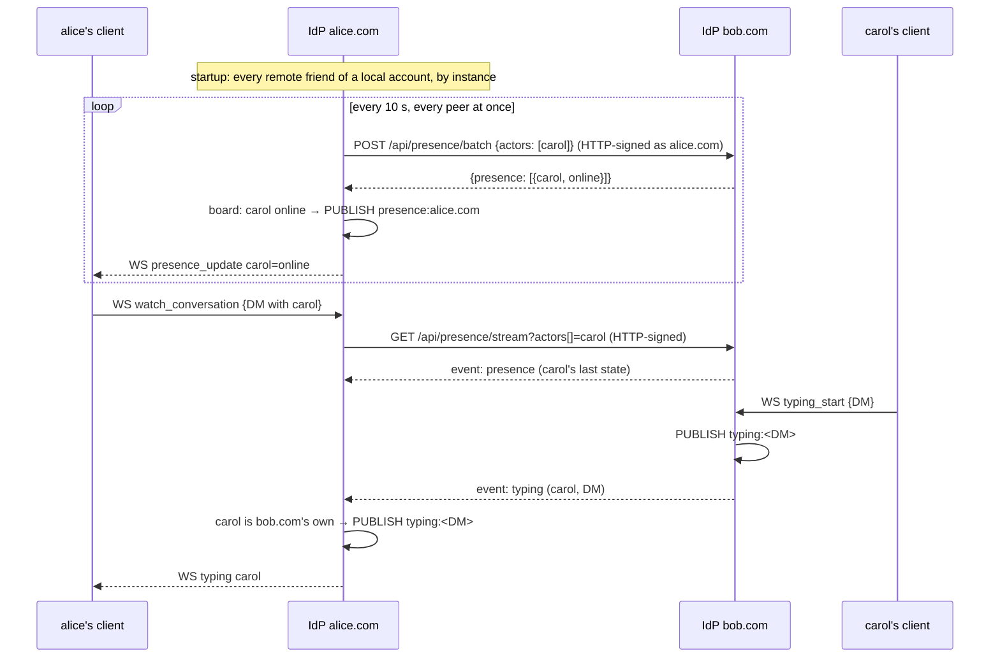

# Pina'i — Presence System

### Overview

The presence system is split into two fully independent subsystems with separate Redis channels, separate fan-out logic, and separate SSE event types:

| Subsystem | Redis channel | Fan-out target | Replay on reconnect |
|---|---|---|---|
| **Presence** | `presence:<domain>` | All friends of the actor | Yes — last known state |
| **Typing** | `typing:<convId>` | The conversation's other local members | Never |

Both are **ephemeral** — never persisted to PostgreSQL. Redis pub-sub is the local transport. Losing any event is always acceptable.

Each instance speaks for its own accounts only. Other instances learn about them by polling and streaming from it (§ Cross-instance presence), and republish what they learn on their own bus.

---

### Part A — Presence states

#### States

| State | Meaning | Origin |
|---|---|---|
| `online` | User has at least one active WebSocket connection | Auto (connect, heartbeat from `away`) |
| `away` | User is connected but idle | Auto (10 min no heartbeat) **or** user-chosen ("Idle") |
| `offline` | User has no active WebSocket connections — or has manually picked "Invisible" | Auto (last connection closed) **or** user-chosen ("Invisible") |
| `dnd` | "Do not disturb": peers see a red indicator; the user's own clients suppress local sound notifications | User-chosen only |

#### Redis channel

One global channel per IdP instance:

```
presence:<domain>
```

Example: `presence:idp.alice.com`

Every WebSocket worker on the instance subscribes to this channel on startup. Fan-out to individual connected clients is done in the application-level hub (`HashMap<UserId, Vec<WsSender>>`).

#### Payload envelope

```json
{
  "type": "presence",
  "event": "online" | "away" | "offline" | "dnd",
  "actorUri": "https://idp.alice.com/users/alice_xK9mP",
  "timestamp": "2026-03-24T12:00:00Z"
}
```

#### Publishing rules

| Trigger | Event published |
|---|---|
| WebSocket connection established | `online` |
| Last WebSocket connection closed | `offline` |
| No `heartbeat` received for 10 minutes | `away` |
| `away` user sends any message or heartbeat | `online` |
| Client sent `set_presence` (see below) | the chosen state |

#### User-chosen state — `set_presence`

The popover status switcher emits a client → server WS message:

```json
{ "type": "set_presence", "data": { "state": "online" | "away" | "offline" | "dnd" } }
```

The server validates the state and republishes via the same `presence:<domain>`
channel as auto-determined transitions, so fan-out is identical.

UI ↔ wire mapping (the client-side palette is broader than the wire enum):

| Popover label | Wire state | Notes |
|---|---|---|
| Online | `online` | — |
| Idle | `away` | Same wire state as the auto-idle transition |
| Do not disturb | `dnd` | Friends see the red indicator; client locally mutes sound notifications |
| Invisible | `offline` | Connection stays alive (DMs still arrive); peers see "offline" |

> **Heartbeat × manual override.** The auto-sweep only flips `online → away`,
> and the heartbeat handler only flips `away → online`. So `dnd` and
> `offline` (Invisible) survive both sweeps until the user picks something
> else. The exception is `away` set manually — a subsequent heartbeat will
> bump it back to `online`. Tracking a sticky manual override per user
> server-side is a known follow-up.

#### Heartbeat

The client sends a heartbeat every **30 seconds** over the existing WebSocket connection:

```json
{ "type": "heartbeat" }
```

The server responds immediately:

```json
{ "type": "heartbeat_ack" }
```

The server keeps a `last_heartbeat` per connection. A background task runs every 60 seconds and marks an account `away` — by publishing an `away` event to Redis — once **every one** of its connections has been silent for 10 minutes: a tab or a device left idle does not make an account in use elsewhere idle. Only `online` turns `away`; a state picked by hand stays. The connections are **not closed** — the user is still connected, just idle.

#### Fan-out logic

When the WebSocket worker receives a presence event from Redis:

1. Records the state on the presence board (§ Presence board).
2. Looks up the local accounts that count the actor among their accepted friends (in the database, on every event).
3. For each one with an active **local** connection, calls `hub.send_to_user()`.
4. Remote friends hear of it from their own instance, which polls or streams it from this one (§ Cross-instance presence) — the local worker does not handle them.

#### WebSocket event pushed to clients

```json
{
  "type": "presence_update",
  "data": {
    "actorUri": "https://idp.alice.com/users/alice_xK9mP",
    "state": "online" | "away" | "offline" | "dnd",
    "timestamp": "2026-03-24T12:00:00Z"
  }
}
```

---

### Part B — Typing indicators

Typing is an independent subsystem. It shares no Redis channel, no payload envelope, and no fan-out path with presence states.

#### Redis channel

One channel per conversation, derived directly from the conversation UUID:

```
typing:<conversation_id>
```

Example: `typing:018e1b2c-3d4f-7a8b-9c0d-1e2f3a4b5c6d`

The `conversation_id` is the UUID assigned at conversation creation (see §5). It is stable for the lifetime of the conversation regardless of participant count — adding a member does not change it. No hashing needed since UUIDs are already compact and safe as Redis channel names.

#### Payload envelope

```json
{
  "type": "typing",
  "actorUri": "https://idp.alice.com/users/alice_xK9mP",
  "conversationId": "<conversation_id>",
  "timestamp": "2026-03-24T12:00:05Z"
}
```

`conversationId` is the conversation's UUID. Recipients use it to match the typing event to the correct conversation in their local state.

#### Client → server message

The client sends over WebSocket when the user starts typing:

```json
{ "type": "typing_start", "data": { "conversationId": "<conversation_id>" } }
```

There is no `typing_stop` — the recipient clears the indicator after a **3-second timeout** with no new `typing` event for that conversation.

Only an **active member** of the conversation types in it: anyone else's `typing_start` is ignored, and a typing event heard on the bus from an actor who is not a member here — a peer's stream republishes what it receives — reaches nobody. Otherwise anyone could show as typing in any conversation whose id they know.

#### Publishing rules

| Trigger | Action |
|---|---|
| An active member sends `typing_start` | Publish to `typing:<conversation_id>` |
| No further `typing_start` from client | Channel goes silent; recipients time out after 3s |

Rate-limit: the server ignores `typing_start` messages sent more than once per second per user, to avoid flooding Redis.

#### Fan-out logic

When the WebSocket worker receives a typing event from Redis:

1. Looks up the conversation's active members (in the database).
2. Drops the event if its actor is not one of them.
3. For each member **except the sender** who has an active local connection, calls `hub.send_to_user()`.
4. The sender is **never** echoed the typing event back.

For DMs the member list always has exactly one entry, making this identical in cost to the previous single-recipient lookup. For future group conversations the same logic fans out to all local members without any structural change.

#### WebSocket event pushed to client

```json
{
  "type": "typing",
  "data": {
    "actorUri": "https://idp.alice.com/users/alice_xK9mP",
    "conversationId": "<conversation_id>",
    "timestamp": "2026-03-24T12:00:05Z"
  }
}
```

---

### Cross-instance presence

#### Principle

An instance tells other instances about **its own accounts only**, and believes a peer only
about **the peer's own accounts**. What it learns from a peer goes onto its local bus like a local
event, so the WebSocket fan-out never tells local and remote apart.

A peer learns about this instance's accounts through two transports, chosen by what its users
are looking at:

| Context | Transport | What it carries | Latency |
|---|---|---|---|
| Friends list | Batch poll, every 10 s per peer instance | The presence of every remote friend of a local account | ≤ 10 s |
| Open conversation | One SSE stream per peer instance, while a local account has a conversation with its members open | Presence **and typing** of those members | Real-time |
| Neither | Nothing | — | — |

With no cross-instance conversation open, an instance holds no stream at all; the polls run on
their own.



#### What a peer is told

A peer is the instance whose key signed its request: the actor its `keyId` names, reduced to
its domain. It is told about an account of this instance only when **one of the peer's accounts
knows it**:

- the account counts one of the peer's accounts among its accepted friends, or
- the account shares an active conversation with one of the peer's accounts, both still in it.

| Asked about | Batch poll answers | Stream carries |
|---|---|---|
| A local account a peer's account knows | Its state | Its presence, and its typing in the conversations it shares with the peer's accounts |
| A local account none of the peer's accounts knows | `offline` | Nothing |
| Another instance's actor | `offline` | Nothing — that instance speaks for it |
| A string that is not an actor URI | `offline` | Nothing |

Typing in a conversation with no member on the peer's instance is never streamed to it, even
from an account it follows: the peer has no one to show it to, and would learn the conversation
exists.

#### What is taken from a peer

- A presence state or a typing indicator from a peer's stream is kept only for an actor **on
  that peer's domain**; anything else is dropped. Otherwise a peer could put any account online
  here, or show it typing in any conversation.
- A poll answer counts only for the actors it was asked about — the peer's own remote friends.
- A typing indicator from an actor who is not an active member of the conversation here reaches
  nobody (Part B).

#### Batch poll — `POST /api/presence/batch`

```
POST /api/presence/batch
Signature: (HTTP Signature — see below)
Content-Type: application/json

{ "actors": ["https://idp.alice.com/users/alice_xK9mP", "https://idp.alice.com/users/bob_aB3cD"] }
```

```json
{
  "presence": [
    { "actorUri": "https://idp.alice.com/users/alice_xK9mP", "state": "online" },
    { "actorUri": "https://idp.alice.com/users/bob_aB3cD",   "state": "offline" }
  ]
}
```

Every actor asked about is answered, in the order asked, from the presence board — no
persistence. An actor never heard of reads `offline`, like one the peer may not see.

The polling side keeps the **poll targets**: the remote friends of its local accounts, by
instance. They are loaded from the accepted friendships at startup and kept by the social
context after — an accepted friendship adds the friend, and the friend is released once no
local account still counts them among its friends
(`identity-provider/specs/01-identity-federation.md` § 1.3). Local friends are never polled.

Every 10 seconds, **every instance is polled at once**, so a slow peer delays only its own
friends' states. A state that differs from the board's is recorded and published on the local
`presence:<domain>` channel, from where it reaches the local friends. A peer that fails to
answer is logged and asked again at the next round.

#### Stream — `GET /api/presence/stream`

```
GET /api/presence/stream?actors[]=<actor URI>&actors[]=...
Signature: (HTTP Signature over the path and query — see below)
Accept: text/event-stream
```

- `actors[]` is required: a request naming no actor URI is `400`.
- The response is a persistent SSE stream. A comment (`: keep-alive`) is sent every 15 seconds.
- On **every connect**, the stream first replays the last known state of each followed actor
  heard of since the instance started; typing is **never** replayed — a stale "is typing" would
  be worse than none. There is no `Last-Event-ID`: a reconnecting peer starts over and gets the
  replay again.
- It then carries every presence change of the followed actors, and their typing in the
  conversations they share with the peer's accounts, as they are published on the local bus.

What the stream follows is settled **when it opens**: each stream listens to the whole local
bus through its own subscription and filters it with the actors and conversations computed at
connect. The requesting side opens a new stream whenever it starts watching a conversation, so
a conversation created after a stream opened is followed from its first watch.

SSE event format — the `event:` field names the subsystem, and `data:` carries the same JSON
as the local bus:

```
id: <uuid>
event: presence
data: {"type":"presence","event":"online","actorUri":"https://idp.alice.com/users/alice_xK9mP","timestamp":"2026-03-24T12:00:00Z"}

id: <uuid>
event: typing
data: {"type":"typing","actorUri":"https://idp.alice.com/users/alice_xK9mP","conversationId":"018e1b2c-3d4f-7a8b-9c0d-1e2f3a4b5c6d","timestamp":"2026-03-24T12:00:05Z"}
```

#### Following on the requesting side

A client sends, over its WebSocket:

```json
{ "type": "watch_conversation",   "data": { "conversationId": "<conversation_id>" } }
{ "type": "unwatch_conversation", "data": { "conversationId": "<conversation_id>" } }
```

Watching a conversation groups its remote members by instance; each instance gets **one**
stream asking for the union of the remote members of every conversation watched there. The
stream is opened again when a conversation is added or the union changes, and closed once no
watched conversation has a member there. A dropped stream is opened again after 2 s, backing
off to 30 s.

What arrives is checked (§ What is taken from a peer), then published on the local bus: a
presence state on `presence:<domain>`, a typing indicator on `typing:<convId>`.

#### Authentication — HTTP Signatures

Both inter-IdP presence endpoints authenticate the calling instance with an HTTP Signature,
signed as the instance (`{issuer}/actor#main-key`), the same scheme and the same code path as
every other server-to-server endpoint. The signing and verification rules, the verifying-key
cache and the peer URL policy are defined once in `specs/06-federation-authentication.md`;
nothing here is specific to presence. A request without a signature is `400`, one whose
signature does not verify `403`.

No new key material — the key pair that signs JWTs signs these requests too.

#### Bounds on the requesting side

Both requests go through the shared federation transport, so the peer's URL is screened
before it is fetched (`specs/06-federation-authentication.md` § Peer request policy):

| | Batch poll | Stream |
|---|---|---|
| Client | the shared peer client | the download client |
| Connect timeout | 3 s | 3 s |
| Total timeout | 5 s | none — a stream stays open |
| Read timeout | — | 30 s: two missed keep-alives end the stream, which is then opened again |
| Redirects | ≤ 2 | none |
| Body cap | 256 KiB | frames are read one at a time |

#### Scenarios

- **Carol, on bob.com, comes online; alice on alice.com is her friend.** Within 10 s alice.com's
  poll reads `online`, records it and publishes it; alice's clients get `presence_update`.
- **Alice opens her DM with carol.** alice.com opens a stream from bob.com for carol and gets
  carol's last state at once. Carol typing in the DM reaches alice in real time; carol typing in
  a group with only bob.com members does not leave bob.com.
- **A peer asks about someone none of its accounts knows.** The poll reads `offline`, and the
  stream carries nothing for them.
- **A peer claims another instance's account is offline.** alice.com drops it: only that
  instance speaks for its accounts.
- **A peer stops answering.** Its poll fails after 5 s, the other peers' answers are applied
  without waiting, and it is asked again 10 s later. A stream that goes silent ends after 30 s
  and is opened again.

---

### Presence board

Each IdP keeps the last state heard for every actor, local or remote, in memory:

```rust
struct PresenceBoard {
    states: Mutex<HashMap<ActorUri, PresenceState>>,
}
```

It is updated from the local bus — local transitions and what peer streams republish — and by
the polls, and read by `GET /api/presence`, the batch poll and the stream replay. No
persistence: after a restart every actor reads `offline` until it is heard of again.

---

### Initial presence state on connect

When a user opens the friends list or a DM conversation, their IdP serves current presence states immediately from the in-memory store:

```
GET /api/presence?actors[]=https://idp.alice.com/users/alice_xK9mP&actors[]=...
Authorization: Bearer <access_token>
```

Response:

```json
{
  "presence": [
    { "actorUri": "https://idp.alice.com/users/alice_xK9mP", "state": "online"  },
    { "actorUri": "https://idp.bob.com/users/carol_zZ1wX",   "state": "away"    },
    { "actorUri": "https://idp.bob.com/users/dave_mN4pQ",    "state": "offline" }
  ]
}
```

`actors[]` are actor URIs, percent-encoded. For remote actors, the state reflects the last event received through a peer's stream or the batch poll. An actor never heard of reads `offline`.

The answer is real only for the caller itself, its accepted friends, and the active members of its active conversations; **anyone else reads `offline`**, so presence never tells a stranger who is around. A value that is not an actor URI reads `offline` too.

Typing state is **not** included in this endpoint — it is too ephemeral to be meaningful as a snapshot.

---

### Summary — data flow

```
── Local presence ──────────────────────────────────────────────────
Client connect / disconnect / heartbeat timeout / set_presence
  → PUBLISH presence:<domain>
  → WS worker: board + hub.send_to_user() → all local friends

── Local typing ────────────────────────────────────────────────────
Client typing_start (active members only, rate-limited: 1/s)
  → PUBLISH typing:<convId>
  → WS worker: hub.send_to_user() → the other local members (never the sender)
  → recipients clear the indicator after 3s silence

── Cross-instance presence (friends list / batch poll) ────────────
idp.bob.com → POST idp.alice.com/api/presence/batch (every 10 s, every peer at once)
  ← { presence: [ { actorUri, state }, ... ] }   (offline for whoever bob.com's users don't know)
  → a changed state: board + PUBLISH presence:idp.bob.com
  → WS worker → Alice's friends on Bob's instance

── Cross-instance presence and typing (open conversation) ─────────
Bob's client watch_conversation
  → idp.bob.com → GET idp.alice.com/api/presence/stream?actors[]=...
  ← replay of the last states, then presence and typing as published on idp.alice.com
  → only idp.alice.com's own actors kept → PUBLISH on idp.bob.com's bus
  → WS worker → Bob's clients

── Initial state on page load ──────────────────────────────────────
Client → GET /api/presence?actors[]=...
       ← board snapshot (typing excluded; offline for strangers)
```
