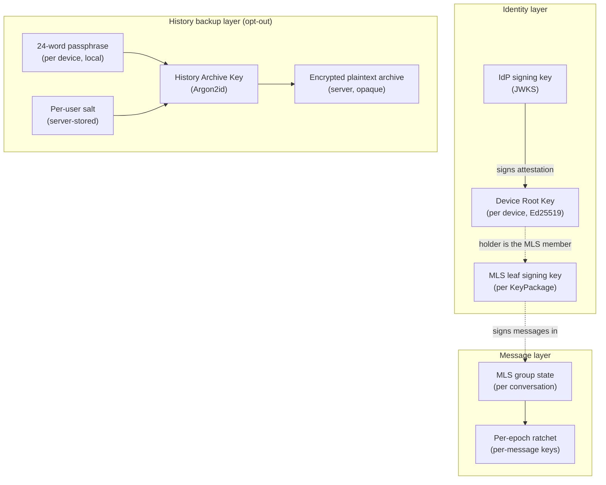
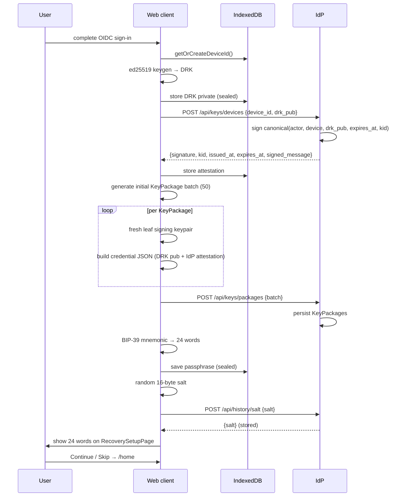
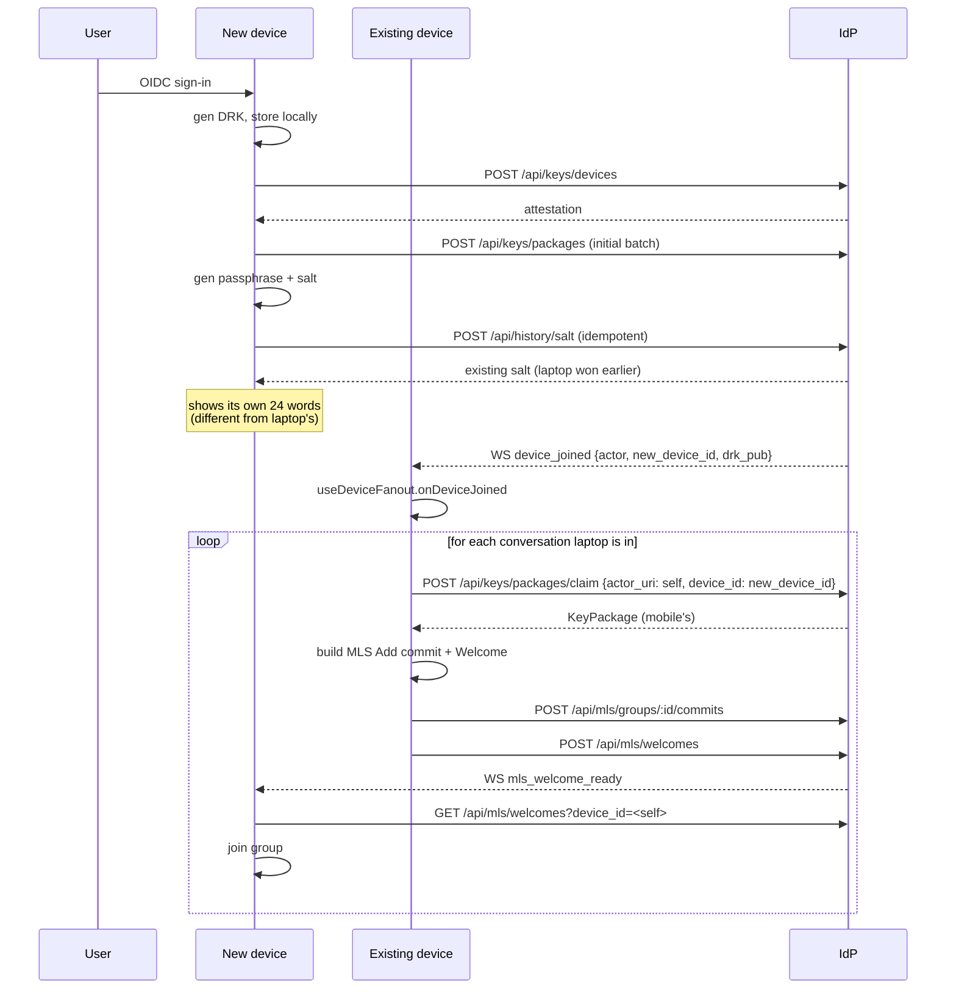
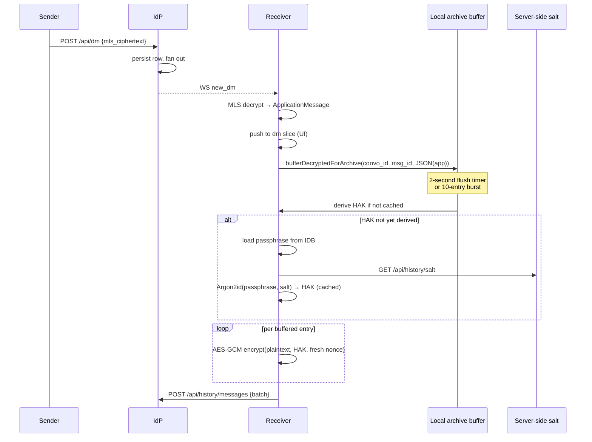
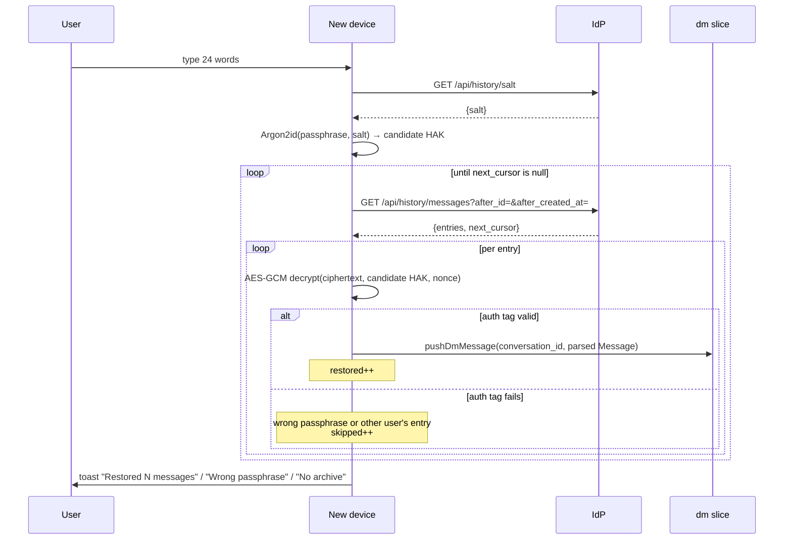
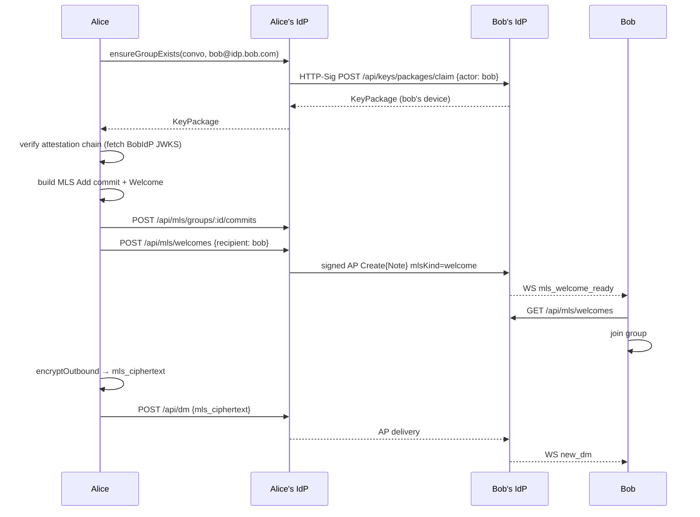
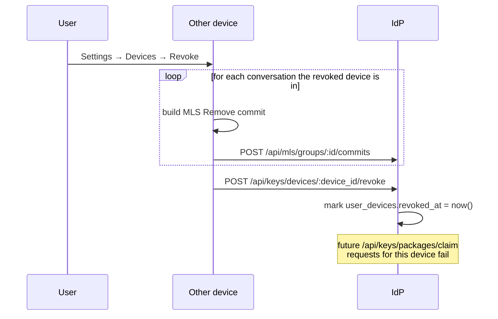
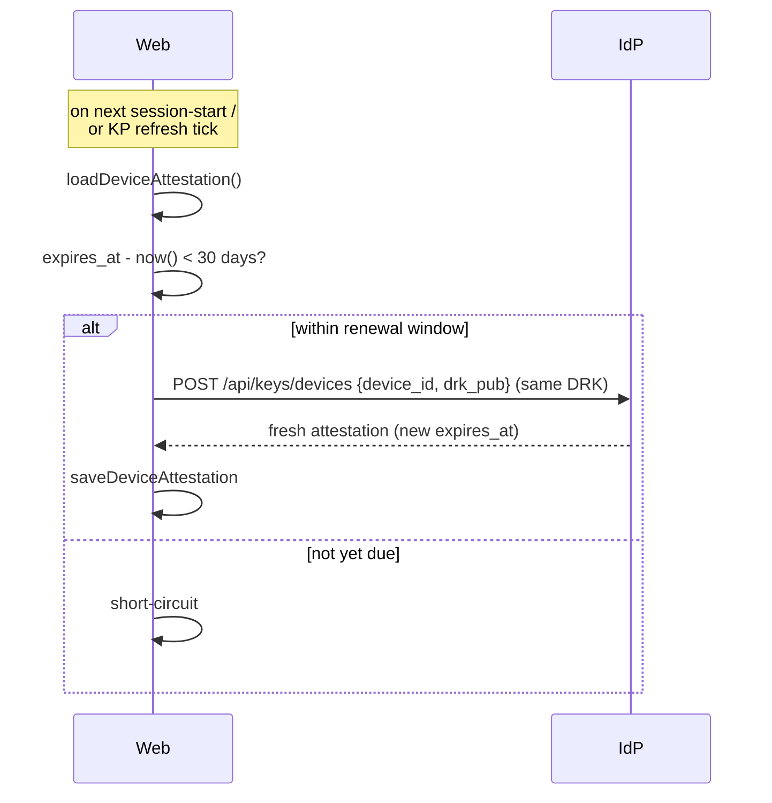
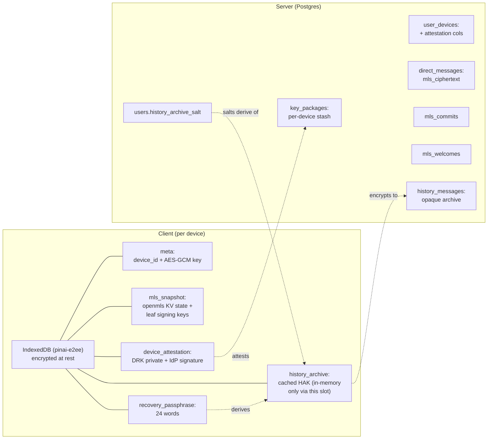

# Pīna'i — End-to-End Encryption (MLS)

All direct messages and group conversations are end-to-end encrypted using
**MLS (RFC 9420)**. The identity-provider serves three roles: an OIDC
authentication endpoint, a key directory, and an MLS Delivery Service. It
never sees plaintext message content.

For the protocol-level explainer of MLS itself (TreeKEM, KeyPackages,
commits, epochs), see [`/e2ee-protocols-overview.md`](./e2ee-protocols-overview.md).
This document is the integration spec.

---

## 1. Principles

Three properties define the system:

1. **The IdP is the trust root, never the eavesdropper.** Each user picks an
   identity-provider (`alice@idp.alice.com`). That IdP signs every device's
   long-lived cryptographic identity. The IdP never holds the user's
   message-decryption keys.
2. **Per-device, not per-user, identity.** Every device generates its own
   Ed25519 Device Root Key (DRK) and gets a fresh attestation from the IdP.
   A user is the set of their attested devices. New devices join existing
   conversations through standard MLS Add commits; no master-secret has to
   be smuggled around.
3. **History is opt-out, not opt-in.** When a user is created, the system
   mints a 24-word recovery passphrase on-device and uses it to derive a
   History Archive Key. Every decrypted plaintext gets re-encrypted under
   that key and uploaded to an opaque server-side archive. A user with the
   passphrase on a fresh device can restore their past messages; a user
   who lost the passphrase cannot — that's the explicit security/usability
   trade-off this system accepts.



---

## 2. Threat model

### What we protect against

| Threat | Mitigation |
|---|---|
| IdP operator reads message content (legal order, insider, breach) | Server only sees MLS ciphertext; per-message keys are derived inside MLS, never transmitted |
| IdP operator silently MITMs a new conversation | Adding a peer requires consuming one of *their* KeyPackages — the server can't forge MLS leaf credentials signed by Device Root Keys it doesn't control |
| Peer IdP serves a forged KeyPackage for one of its users | Each leaf credential carries an attestation signed by the peer's IdP; verifying it pulls that IdP's JWKS. If the peer's IdP is compromised the attack succeeds — that's the explicit trust ceiling for federation |
| Compromised device | Per-device leaves: revoke the leaf via MLS Remove commits. Post-compromise security recovers within one commit cycle. The directory-level revocation flag stops the server from handing out fresh KeyPackages for the dead device |
| Replay / reorder / forging by transport | MLS application-message authentication + epoch ordering — handled inside the protocol |
| Lost passphrase + lost all devices | Conversations are unrecoverable. Intentional and documented |

### Trust ceiling

The system trusts the user's IdP. The IdP can mint a fresh device
attestation for an attacker who controls its signing key — that attacker
can then join the user's MLS groups going forward. This is acceptable
because it's the same ceiling OIDC already imposes: a compromised IdP
can issue access tokens for the user too, so trusting the IdP for
device attestation doesn't lower the ceiling, only makes it explicit.

What this trust does **not** grant:
- Reading historical messages — MLS forward secrecy means past
  per-message keys are deleted after use, and the IdP doesn't see the
  history archive's HAK
- Impersonating the user to peer IdPs in a way they can detect on
  rotation — peer IdPs cache the user's JWKS and notice key changes
- Reading the user's local cached passphrase or attestation — the
  IDB at-rest encryption key is non-extractable

### Out of scope (non-goals)

- **Metadata.** The IdP knows: who's in each conversation, when commits
  happen, message ordering, sender device per message. We don't
  implement sealed sender or anonymous credentials.
- **Traffic analysis.** No padded delivery, no cover traffic, no mixnets.
- **Endpoint compromise.** Full device compromise breaks all bets, as
  with every E2EE system.
- **Cross-IdP plaintext fallback.** Conversations with a peer who can't
  speak the federated MLS handshake gracefully fail.

---

## 3. Elements

### 3.1 Device Root Key (DRK)

An Ed25519 keypair generated once on first sign-in to a device. The
private half lives in IndexedDB, encrypted at rest under a non-
extractable AES-256-GCM device key. The public half is sent to the IdP
exactly once — the IdP signs an attestation binding it to the user.

The DRK is *long-lived* by default (1-year attestation, silent renewal
when within 30 days of expiry). It's not used to sign MLS application
messages directly; that's the per-KeyPackage leaf signing key. The DRK
binds the device's IdP-attested identity to whatever leaf signing keys
that device produces.

### 3.2 IdP attestation

A signature by the IdP's existing JWKS key (the same one that signs
OIDC tokens and HTTP Signatures) over the canonical bytes:

```
IDP-ATTEST-v1\n
<actor_uri>\n
<device_id>\n
<base64(drk_pub)>\n
<iso8601(expires_at)>\n
<kid>
```

The domain-separation tag `IDP-ATTEST-v1` prevents an attestation
signature from ever validating as some other Ed25519 use of the same
key. The leading newline-separated fields are stable across versions;
new fields would require bumping the tag.

The signature lives inside every MLS leaf credential the device
produces. Peers verify by fetching the issuer's JWKS, looking up the
key by `kid`, and validating the signature.

### 3.3 MLS leaf credential

Every MLS leaf carries a `BasicCredential` whose identity bytes are
this JSON:

```json
{
  "v": 1,
  "actor_uri": "https://idp.alice.com/users/alice_xK9mP",
  "device_id": "550e8400-e29b-41d4-a716-446655440000",
  "drk_pub": "<base64>",
  "idp_att": {
    "issuer": "https://idp.alice.com",
    "kid": "key-2026-01",
    "expires_at": "2027-05-14T12:00:00Z",
    "signature": "<base64>"
  }
}
```

Receivers verify in this order:

1. Parse JSON; reject if `v !== 1`.
2. `idp_att.issuer` origin must match the origin of `actor_uri` — an
   attacker-controlled IdP must not be able to attest someone else's
   actor.
3. `expires_at` must be in the future (5-minute clock-skew slack).
4. Look up the issuer's JWKS by `kid` (1-hour client-side cache,
   refresh-on-verify-failure for rotation safety) and verify the
   signature over the canonical bytes.

After verification, the leaf is trusted as "actor X's device Y." MLS's
own LeafNode self-signature handles per-message integrity.

### 3.4 KeyPackage

A single-use bundle the device publishes ahead of time so peers can
add it to groups without a round-trip. Each KeyPackage contains a
fresh leaf-signing keypair + the device's full credential (Section 3.3)
+ MLS protocol fields (HPKE init key, capabilities, lifetime). The
server stores them in an inventory keyed by `(user_id, device_id)`;
peers claim one atomically when adding the user to a conversation.

The device replenishes its KeyPackage stash as the server reports
`needs_refill = true`. The stash cap is 100 per device by default;
refill threshold 30.

### 3.5 24-word recovery passphrase

A BIP-39 mnemonic generated client-side on first sign-in. Its only job
is to derive the History Archive Key — losing it means losing past
messages on a fresh device, not losing your account.

Each device of the same user generates its own passphrase. Users
typically write one down; the others can sit unsaved. The passphrase
is stored locally encrypted under the device's AES-GCM key for
revealability in Settings → Devices.

### 3.6 History Archive Key (HAK)

Derived from a passphrase and a per-user salt via Argon2id
(`t=3, m=64 MiB, p=4, dkLen=32`). Salt is 16 bytes random, generated
by the first device and stored server-side (`POST /api/history/salt`
is idempotent set-once via `COALESCE`, so multi-device races converge
on the first device's salt).

Each device of a user derives the same HAK as long as they share the
passphrase. Different passphrases = different HAKs = different
encrypted archives.

### 3.7 Encrypted plaintext archive

Every decrypted MLS application message gets re-encrypted under HAK
with AES-256-GCM (fresh 12-byte nonce per entry) and batch-uploaded
to the server. The server only sees opaque ciphertext + nonces. A
device with the right passphrase + salt can paginate the archive and
decrypt every entry; a device without the passphrase sees only bytes.

---

## 4. Schema

```
users                    — local accounts (actor_uri, inbox_url, display_name,
                            username + NanoID suffix, avatar_url, pronouns, bio,
                            history_archive_salt BYTEA NULL)
remote_actors            — cache of federated users (inbox_url, avatar_url, TTL)
conversations            — kind: dm | group, name
conversation_members     — actor_uri, joined_at, left_at
direct_messages          — sender_actor_uri, mls_ciphertext, activity_uri,
                            reply_to_id, federation_status (server stores
                            ciphertext, never sees plaintext)

user_devices             — per-device row, one per (user_id, device_id):
                            display_name, kind (laptop | phone | tablet | unknown),
                            paired_at, last_seen_at, revoked_at,
                            drk_public_key BYTEA, attestation_signature BYTEA,
                            attestation_kid TEXT, attestation_issued_at,
                            attestation_expires_at
key_packages             — single-use stash (per-device, expires_at, consumed_at)
history_messages         — PRIMARY KEY (user_id, id);
                            conversation_id, ciphertext BYTEA, nonce BYTEA,
                            client_message_id, created_at.
                            Server-opaque; idempotent upserts via
                            ON CONFLICT DO NOTHING.

mls_commits              — per-conversation commit log
                            UNIQUE (conversation_id, epoch)
mls_welcomes             — outbound queue for offline device adds
                            (recipient_user_id, recipient_device_id)
```

---

## 5. Endpoints

All Bearer-auth except where noted. Cross-IdP paths use HTTP Signatures.

### Key directory

| Endpoint | Description |
|---|---|
| `POST /api/keys/devices` | Register/renew/rotate the caller's DRK attestation. Idempotent on `(device_id, drk_public_key)`. First-time mint emits a `DeviceJoined` WS event to the user's other live sessions. Returns the signature, kid, issued_at, expires_at, and the canonical bytes the IdP signed so the client can re-verify locally |
| `GET /api/keys/devices` | List the caller's devices with their attestation expiry (the client uses this to schedule silent renewals) |
| `POST /api/keys/devices/:device_id/revoke` | Directory-level revocation flag; complements MLS Remove commits |
| `POST /api/keys/packages` | Upload a batch of KeyPackages for one of the caller's devices |
| `POST /api/keys/packages/claim` | Atomically reserve one KeyPackage for `actor_uri`. Bearer or HTTP-Sig (peer IdPs); for remote `actor_uri` the local IdP proxies to the target IdP via HTTP-Sig |
| `GET /api/keys/packages/status` | Per-device available counts + `needs_refill` flag |

### MLS Delivery Service

| Endpoint | Description |
|---|---|
| `POST /api/mls/groups/:conversation_id/commits` | Append an MLS Commit at the next epoch. `409` on epoch race carries the winning commit. First-message bootstrap: if `epoch <= 1` and no `conversation_members` rows exist, lazy-creates a DM with the proposer as sole initial member |
| `GET /api/mls/groups/:conversation_id/commits?since=<epoch>` | Catch-up; paginated |
| `GET /api/mls/welcomes?device_id=<uuid>` | Atomically claim every pending Welcome targeted at the calling device |
| `POST /api/mls/welcomes` | Hand a Welcome bundle to the sender's IdP. The IdP routes off `recipient_actor_uri`: local → row + WS push, remote → signed AP `Create{Note}` with `mlsKind: welcome` |

### History backup

| Endpoint | Description |
|---|---|
| `POST /api/history/salt` | Idempotent set-once via `COALESCE`. Multi-device race-safe — the loser receives the winner's salt |
| `GET /api/history/salt` | Returns `{salt_base64}` or 404 when unset |
| `POST /api/history/messages` | Batch upload, cap 50. Server validates membership in each `conversation_id` against `conversation_members`. Idempotent upsert on `(user_id, id)` — first decryptor of a message wins; subsequent uploads from the user's other devices no-op |
| `GET /api/history/messages?after_id=&after_created_at=&limit=` | Keyset pagination over `(created_at DESC, id DESC)`, limit clamped 1..=500, default 100 |
| `DELETE /api/history/messages` | Wipe the user's archive. Settings → Devices → Clear |

### WebSocket events (server → client)

| Event | When |
|---|---|
| `new_dm` | A peer sent a message in a conversation the recipient is in |
| `message_edited` | Sender replaced the ciphertext for one of their existing messages |
| `mls_welcome_ready` | A Welcome bundle was just deposited for one of the recipient's devices |
| `device_joined` | A new device of *this user* completed first-time DRK registration. Other live sessions of the same user run the multi-device fanout |
| `friend_request`, `friend_accepted`, `friend_removed`, `presence_update`, `typing`, `heartbeat_ack` | (Out of scope for this spec — see other specs) |

---

## 6. Scenarios

### 6.1 First-ever sign-in (brand-new user, brand-new device)



The user is now able to send and receive E2EE messages. The salt + a
locally-stored passphrase mean every future decrypted message will be
archived to `/api/history/messages` under HAK.

### 6.2 Same user signs in on a second device



The mobile can now decrypt *future* messages in every conversation. Past
messages remain inaccessible unless the user runs the history restore
flow (Section 6.4).

**Offline case** — if every other device of the user is offline at the
moment of registration, the WS push lands nowhere. The reconcile-on-WS-
connect path inside `useDeviceFanout` handles this: every time any
device of the user comes online, it pulls `/api/keys/devices` and runs
the same fanout for any device it doesn't yet have an MLS leaf for in
every conversation.

### 6.3 Receiving a message



The server only sees the MLS ciphertext (per-message) and later the
HAK-encrypted plaintext copy in the archive. Neither lets it read the
message content without breaking the underlying cryptography.

### 6.4 Restoring history on a new device

The user reaches `/onboarding/recovery-restore` either by direct URL or
via Settings → Devices → "Restore history."



A wrong passphrase manifests as every entry failing the AES-GCM auth-tag
check — the result is `{restored: 0, skipped: N>0}`, which the UI
distinguishes from `{restored: 0, skipped: 0}` (no archive on the server)
and reports as "wrong passphrase."

### 6.5 Sending a message to a new contact



The verification step on Alice's side — "fetch BobIdP JWKS" — is the
moment Alice's client decides whether to trust this leaf as belonging
to Bob. JWKS is cached for an hour; rotation safety comes from
`invalidate(issuer)` and retry on verify-failure.

### 6.6 Revoking a compromised device



MLS Remove commits provide post-compromise security: future epochs use
a key schedule the revoked leaf was never part of. The directory-level
flag stops the server from handing out fresh KeyPackages from the dead
device.

### 6.7 Silent attestation renewal



Renewal reuses the existing DRK — only the attestation's `expires_at`
moves forward. KeyPackages already in the server's stash stay valid.
New KeyPackages built after renewal carry the fresh attestation.

---

## 7. Wire formats

### 7.1 MLS leaf credential

Inside every leaf's `BasicCredential` (Section 3.3 JSON).

### 7.2 Canonical attestation bytes

What the IdP signs in `POST /api/keys/devices`:

```
IDP-ATTEST-v1\n
<actor_uri>\n
<device_id>\n
<base64-std(drk_pub)>\n
<iso8601(expires_at)>\n
<kid>
```

UTF-8 bytes. `\n` is a literal newline (0x0A). The domain-separation
tag binds the signature to this purpose.

### 7.3 History archive entry (POST `/api/history/messages`)

```json
{
  "entries": [
    {
      "id": "<uuid; matches direct_messages.id>",
      "conversation_id": "<uuid>",
      "ciphertext": "<base64-std>",
      "nonce": "<base64-std, 12 bytes>",
      "client_message_id": "<optional>"
    }
  ]
}
```

`ciphertext` is the AES-256-GCM encryption of the JSON-serialised
`ApplicationMessage` under HAK with `nonce`. The JSON includes a
domain-specific replacer for `Uint8Array` fields (attachment AES keys
+ nonces) so they round-trip through serialization.

### 7.4 JWKS rotation handling

The IdP's JWKS at `/.well-known/jwks.json` publishes one or more
EdDSA keys. Each leaf credential's `idp_att.kid` names which key
signed it. When a peer fails to verify a signature:

1. The peer invalidates the cached JWKS for that issuer.
2. The peer refetches and retries the verification once.
3. Permanent failure rejects the leaf.

When the IdP rotates its signing key, the **old key remains in JWKS
for at least the longest active-attestation lifetime** (1 year by
default — same as `attestation_expires_at`). This is the same rule
the IdP follows for JWT-signing-key rotation, just with a longer
horizon. Existing attestations remain verifiable through their
natural expiry; clients renew through the normal 30-day window;
new attestations use the new key.

---

## 8. Storage architecture summary



Two persistence boundaries:

- **Client IndexedDB** holds everything the device needs to decrypt
  messages and prove its identity to peers. Every blob is encrypted
  under a per-device non-extractable AES-256-GCM `CryptoKey` so that
  full IDB extraction by an attacker without script execution in the
  user's origin yields nothing useful.
- **Server Postgres** holds opaque material only — MLS ciphertexts,
  base64'd KeyPackages, encrypted history archive entries, salts (not
  secret), public attestation columns. Read access to the database
  yields no plaintext message content.

The same per-device AES-GCM key encrypts the Zustand `persist`
middleware's message-plaintext cache — that way the cache (used for
"don't blank conversation history on page reload") shares the same
threat model as the rest of the IDB content.

---

## 9. Open questions and known limitations

- **Server-side KeyPackage signature validation.** The server doesn't
  currently re-verify that an uploaded KeyPackage's embedded leaf
  credential signature chains back to a registered DRK. Peer clients
  do this verification when a foreign leaf surfaces in their MLS
  state, so the security-critical path is covered; server-side
  validation is defense-in-depth and requires pulling `openmls` into
  the server crate.
- **Reactions and edits in restored history.** The MVP restore path
  handles `kind: "text"` application messages. Reactions (which apply
  as deltas to an existing message) and edits (which replace the
  ciphertext of an existing message) are skipped — they'd need
  ordering guarantees against the restored target message that the
  current implementation doesn't provide.
- **Background streaming of large archives.** The restore page pulls
  pages serially. For users with very large histories this is
  noticeable; a progressive streaming UI is a future enhancement.
- **Out-of-band fingerprint verification.** No user-facing UI for
  comparing device attestations out of band. Trust on first use plus
  IdP-attestation is the baseline; an opt-in verification surface
  would be additive.
