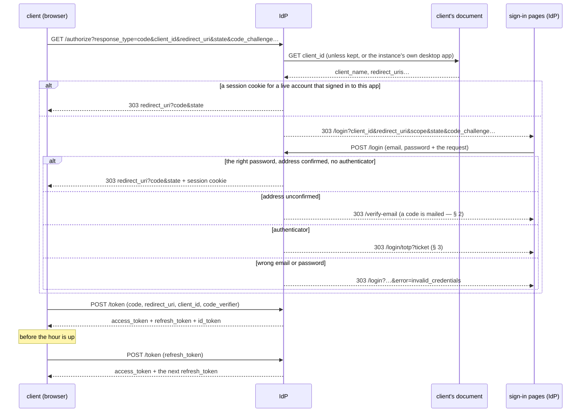
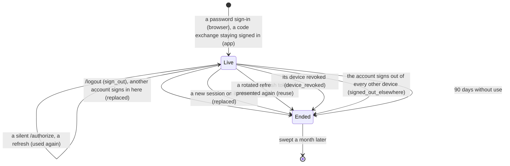
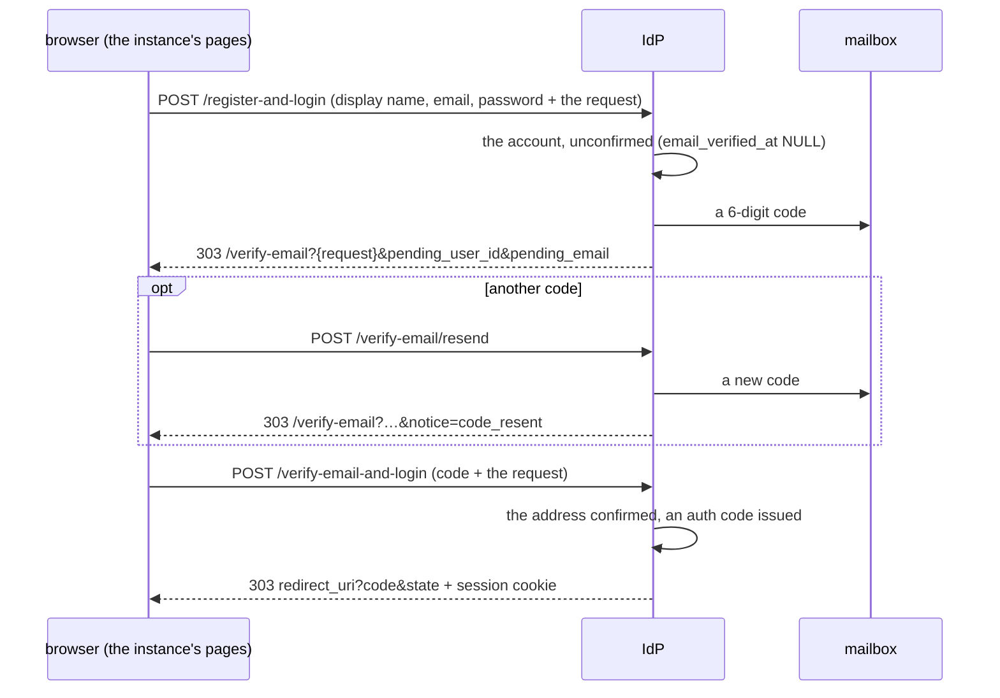
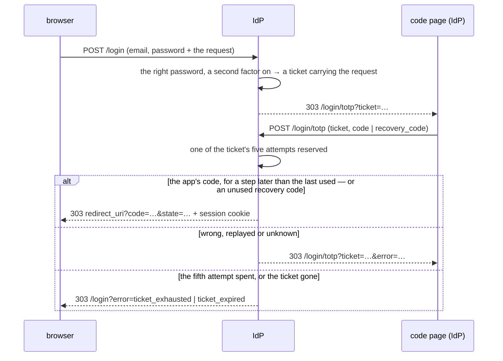

# Pina'i — Signing in, sign-up and the second factor

## 1. Signing in — OpenID Connect

The IdP is the OpenID provider of its own accounts. There is one flow — the authorization code
flow with PKCE (`S256`) — for public clients, which hold no secret. Any client may sign its users
in here: it is known by the document it publishes (§ "Clients"). The IdP serves the sign-in pages
itself (§ "The sign-in pages"), so a password is only ever typed on the server that checks it,
and no client — a web client elsewhere, the desktop app's system browser — ever sees it.



### Clients

A client is the URL of a JSON document it publishes about itself (the OAuth Client ID Metadata
Document draft). So an instance signs in clients it has never heard of, and one web client signs
its users in to any instance. Nothing is registered here.

The `client_id` is that URL: `http(s)`, with a path, in normalised form (no `.` or `..` segment,
no default port, a lower-case host), at most 2 KiB.

The IdP reads the document when a client sends a browser to `/authorize`, and again at `/token`.
It trusts nothing the document doesn't list:

| Field | Rule |
|---|---|
| `client_id` | The URL the document was fetched from, exactly |
| `client_name` | Shown to the user; 80 characters at most. Absent or blank, the client is named by its host |
| `application_type` | `web` (the default) or `native` |
| `redirect_uris` | 1 to 10, matched **exactly**, case and path included (RFC 6749 § 3.1.2): they are where codes are sent. A web client's are `https` URLs on the `client_id`'s own origin. A native client's are on the loopback interface (`http://127.0.0.1:<port>/…` or `http://[::1]:<port>/…`, RFC 8252 § 7.3), or under a scheme named after its own domain, reversed: `https://example.org/…` may use `org.example:/…` (RFC 8252 § 7.1). So no document can claim another app's scheme |
| `post_logout_redirect_uris` | 10 at most, under the same rules |
| `scope` | `offline_access` here asks to stay signed in on the device, with a session of its own (§ "Sessions"); only a native client may |
| `token_endpoint_auth_method` | `none`, or absent: confidential clients aren't supported |

Other fields are ignored. A document that breaks a rule leaves its client unknown.

**Fetching:**
- screened like every peer URL: never a private address on an `https` instance;
- no redirect followed;
- 5 s, and 5 KiB at most.

**Keeping:**
- for the document's `max-age`, within 5 minutes and 24 hours;
- a document that couldn't be had is asked again after 1 minute;
- 1,024 documents at most, the soonest to expire dropped first.

A development instance, whose issuer is plain `http`, also takes `http` clients, and lets a native
client use any scheme but a reserved one (`http`, `https`, `javascript`, `data`, `file`, `blob`…).

**The official desktop app** is described by every instance itself. `GET /clients/desktop.json`
serves its document:
- `client_name` "Pīna'i desktop";
- native;
- `io.github.pina-i:/callback`;
- `offline_access`.

A request naming it is answered without a fetch. So a desktop sign-in depends on nothing but the
user's own instance, and a new desktop redirect URI or scope ships with the instances.

### `GET /authorize`

1. The client must be known and the `redirect_uri` registered for it. Either failure is
   answered by the IdP itself, on its page "This app couldn't be verified" — `401` for the
   client, `400` for the `redirect_uri` — since the redirect cannot be trusted.
2. Only then the flow: `response_type=code` and `code_challenge_method=S256`. A failure here goes
   back to the client, as RFC 6749 § 4.1.2.1 says: `redirect_uri?error=unsupported_response_type`
   (or `invalid_request`)`&error_description=…&state=…`.
3. A browser with a session cookie, for an account that still exists and that signed in to this
   app with its password (§ "The session cookie"), is handed a code at once; any other goes to
   the login page, carrying the request and the client's theme (§ "The sign-in pages").
4. `prompt=login` (OpenID Connect Core § 3.1.2.1) always goes to the login page, whatever session
   the browser holds. The desktop app sends it at each sign-in: it signs in through the system
   browser, which may hold another account's session, and the user can pick another account
   there.

### The sign-in pages

Rendered by the IdP from templates (askama: compiled, every value HTML-escaped), with **no inline
script** and no inline style, which allows a strict CSP. The one script is the instance's own
file, `/assets/sign-in.js`: a form on its way turns its submit button into a spinner and disables
it, so it can't be sent twice (Enter or a click alike), and a page brought back from the
back-forward cache is ready again. Everything else works without it.

| Route | Page |
|---|---|
| `GET /login` | Sign in, or Register with `?tab=register` — two links, not script tabs |
| `GET /verify-email` | The code mailed at sign-up (§ 2), with a form to send another |
| `GET /login/totp` | The second factor (§ 3); `?mode=recovery` asks a recovery code instead |
| `GET /signed-out` | Where `/logout` lands when it may not go back to the client |
| `GET /assets/{path}` | The stylesheet, the script, the fonts (DM Sans, Instrument Serif, Azeret Mono — latin and latin-ext, OFL), the motifs and the grain, built into the binary; `Cache-Control: public, max-age=86400`. The stylesheet and the script are linked with `?v=<a hash of their content>`, so a release that changes one is fetched anew |

**What a page shows.** On one side the instance: its name, its description, how many people it
holds and that registration is open (`identity-provider/specs/identity.md § 6`), and "Runs the
Pīna'i identity provider v<version>". On the other "Sign in to <name>" under "— <domain>" and
"← Another home"; on the login page, the app asking — "to continue to *Pīna'i* app.example", its
`client_name` and where its document lives, left out for the instance's own desktop app — then
the form, ending with "Your password goes to <domain>, never to Pīna'i". A password typed there
signs in to that app (§ "The session cookie"), so that line is all the consent there is. Below
1024 px the two sides stack, the instance first.

**The request each page carries.** Every page, link and form carries the sign-in request it was
opened for — the `/authorize` parameters — and the POST it ends in checks it again. A `/login`
or `/verify-email` link with no request left, or a broken one, shows "This sign-in link has
expired"; one naming a client that can't be verified shows that page. The second-factor page
carries its ticket instead (§ 3), which holds the request.

**Cancel.** "← Another home" sends the browser back to the client with nothing signed in:
`redirect_uri?error=access_denied&state=…` (RFC 6749 § 4.1.2.1), to a `redirect_uri` checked
before the page was shown.

**The theme.** `/authorize` takes two parameters of its own, which the pages carry on:
`theme=<family>-<mode>` (`pearl`, `lagoon`, `jungle`, `sand` × `dark`, `light`) and
`motif=<key>` (`kowhaiwhai`, `raranga`, `puhoro`, `tapa1`–`tapa4`). A client sends what it is
painted in, so the pages match it; the web client does once someone has signed in on the device.
A value the IdP doesn't know is dropped; without them, a page is Black Pearl dark with Tapa 1.

**Errors are codes.** A page is sent `error=<code>` (or `notice=<code>`) and shows the fixed
sentence it maps to; any other value shows nothing. So no link can make the instance's own page
print words of its choosing.

| Page | Code | Shown |
|---|---|---|
| `/login` | `invalid_credentials` | Invalid email or password |
| | `rate_limited` | Too many attempts — try again in a minute |
| | `missing_field` | Fill in every field |
| | `invalid_display_name` | Display name: 1–50 characters |
| | `invalid_email` | Enter a valid email address |
| | `weak_password` | Password must be at least 8 characters |
| | `email_taken` | Email already registered |
| | `signup_expired` | This sign-up has expired — register again |
| | `notice=already_verified` | This address is confirmed already — sign in to continue |
| `/login`, no request | `ticket_expired` | This sign-in has expired |
| | `ticket_exhausted` | Too many attempts |
| `/verify-email` | `code_format` | Enter the 6-digit code |
| | `code_expired` | Code expired — request a new one |
| | `code_exhausted` | Too many attempts — request a new code |
| | `code_incorrect` + `left` | Incorrect code — *n* attempts left |
| | `code_used` | Code already used — try signing in |
| | `too_many_codes` | Too many codes sent — wait a few minutes |
| | `notice=code_resent` | New code sent. The previous one no longer works. |
| | `notice=confirm_email` | Confirm your email to finish signing in. |
| `/login/totp` | `totp_incorrect` | Incorrect code |
| | `recovery_unknown` | Recovery code not recognised |
| | `totp_missing` | Enter a code or a recovery code |

The address on the code page is shown only if it is one (`Email`).

**Safety.**
- **Same-origin forms.** Every form POST (`/login`, `/register-and-login`,
  `/verify-email-and-login`, `/verify-email/resend`, `/login/totp`) is refused `403` when the
  browser says it was sent from elsewhere: an `Origin` other than the instance's, or else a
  `Sec-Fetch-Site` other than `same-origin`. `Origin: null` alone is refused. A request saying
  neither — a script, a test — is let through: a browser always says. This stops login CSRF.
- **Headers on every page:**
  - `Content-Security-Policy: default-src 'none'; script-src 'self'; style-src 'self';
    font-src 'self'; img-src 'self' data:; form-action 'self' <the client's origin, or its scheme>;
    frame-ancestors 'none'; base-uri 'none'`. Chrome holds the redirect that follows a POST to
    `form-action`, hence the client's origin (`io.github.pina-i:` for the desktop app);
    `data:` is the grain shown under reduced motion.
  - `X-Frame-Options: DENY`, `X-Content-Type-Options: nosniff`, `Cache-Control: no-store`.
  - `Referrer-Policy: same-origin`: nothing reaches the client, and the page's own forms keep
    their `Origin` — under `no-referrer`, a browser posts them as `Origin: null`.

### `POST /login`

The login form, posted by the browser with the request it carries.

- The request is checked again — a known client, a registered `redirect_uri` — or any page
  could have a code sent wherever it names. A failure is the "This app couldn't be verified"
  page, `401` / `400`, never a redirect.
- Password guesses are bounded per email address, in any case: 10, then one a minute. Past that,
  the form is sent back with `error=rate_limited`, whatever the password — known address or not,
  so the limit tells nothing of who has an account.
- An unknown email is checked against a decoy hash as costly as a real one, and answered like a
  wrong password: `error=invalid_credentials`. Neither the answer nor its timing tells whether
  the address has an account.
- The right password on an unconfirmed address mails a fresh code and goes to `/verify-email`
  (§ 2); on an account with an authenticator it opens a ticket and goes to `/login/totp`
  (§ 3). Otherwise it issues a code and sets the session cookie.

A code is good for 10 minutes, once. It remembers the account, the client, the
`redirect_uri`, the scope, the challenge and the nonce; the `state` goes back with it and is not
kept.

### Sessions

A session is a row, so each one can end on its own, and every code, access token and refresh token
it leads to belongs to it. There are two kinds:

- A **browser session** is what a password sign-in opens — the login form, the code mailed at
  sign-up, the second factor — and what the `idp_session` cookie names. The web client's tokens
  belong to it.
- An **app session** is opened by a native client's code exchange when it stays signed in on its
  device: its document allows `offline_access`, its request asked for it, and the password sign-in
  agreed (`Grant::opens_app_session`). The desktop app's tokens belong to it, not to the system
  browser it signed in through, so signing out of that browser leaves the app signed in.

```sql
CREATE TABLE sessions (
    id             UUID PRIMARY KEY,
    user_id        UUID NOT NULL REFERENCES users(id) ON DELETE CASCADE,
    kind           TEXT NOT NULL,           -- browser | app
    client_id      TEXT,                    -- an app session's client, and only theirs
    device_id      UUID REFERENCES user_devices(device_id) ON DELETE SET NULL,
                                            -- the E2EE device it signed in (§ "Sessions and devices")
    created_at     TIMESTAMPTZ NOT NULL,
    last_used_at   TIMESTAMPTZ NOT NULL,    -- the last sign-in or refresh that used it
    revoked_at     TIMESTAMPTZ,
    revoked_reason TEXT                     -- sign_out | replaced | reuse | device_revoked
                                            --   | signed_out_elsewhere
);
-- and authorization_codes.session_id: the browser session a code was issued under
```



- **Live** while it isn't revoked and was used in the last 90 days (`Session::is_live`). A password
  sign-in, a silent `/authorize` and a refresh count as use. There is no absolute limit: an active
  user never signs in again.
- **The cookie** holds the browser session's id, signed (HMAC-SHA256) with a key derived from
  `SESSION_SECRET`: `HttpOnly`, `SameSite=Lax`, `Path=/`, `Secure` in production. It lasts as long as
  the session may, 90 days, and is **set again at every use**, so it slides with it. A cookie naming
  a session that isn't live is no cookie: the login page shows.
- **One account per browser.** A password sign-in keeps the browser's live session when it is the
  same account's, stamping it; another account's is ended (`replaced`) and a new one opened.
- **Codes and tokens belong to it.** A code is issued under the browser session and refused at
  `/token` once that session has ended. The access token names its session (`sid`), and every
  authenticated request and the `/ws` upgrade check that it still lives — one read by primary key
  — so an ended session's tokens stop at once, not an hour later: `401 invalid_token`, "The
  session has ended". A refresh token works while its session lives (§ "Tokens").
- **Ending one** (`/logout`, a replacement, a reuse, a revoked device, a sign-out elsewhere) also closes the account's WebSockets opened
  under it, with `1008` ("the session has ended"); a reconnect with its token is refused `401`.
- **Swept** by the hourly sign-up sweep (§ 2) a month after it ended: revoked then, or idle past its
  90 days. Its refresh tokens go with it.

The cookie is what lets `/authorize` skip the login page — **for the apps the account signed in to
with its password only**.

Any site can be a client, and any site can send a browser to `/authorize`. If a session alone
answered with a code, a page you merely visited could take one for your account, and the tokens
with it. So every sign-in the password goes through — the login form, the code mailed at
sign-up, the second factor — remembers its app for the account:

```sql
CREATE TABLE client_sign_ins (
    user_id        UUID NOT NULL REFERENCES users(id) ON DELETE CASCADE,
    client_id      TEXT NOT NULL,
    offline_access BOOLEAN NOT NULL DEFAULT FALSE, -- it asked to stay signed in; once given, kept
    signed_in_at   TIMESTAMPTZ NOT NULL,           -- the last sign-in with the password
    PRIMARY KEY (user_id, client_id)
);
```

A session answers `/authorize` at once only when its account has a row for the request's app
(`ClientSignIn::covers`), and, for a request asking to stay signed in on the device
(`offline_access`), one that asked it too. Anything else is the login page, naming the app: the
first sign-in to an app always takes the password, and signing in there as another account
replaces the session.

The secret makes two keys, each derived from all of it with HKDF-SHA256 under a label of its own:
the session cookie's (`pinai idp: session cookies`) and the attachment links'
(`pinai idp: attachment links`, `identity-provider/specs/attachments.md`). No purpose
shares another's key, and a new secret signs everyone out.

### Sessions and devices

A session is tied to the E2EE device it signed in (`identity-provider/specs/e2ee.md § 3.1`), so
revoking a device signs it out, and the Devices screen tells which devices are signed in.

```mermaid
sequenceDiagram
    participant D as client (a device)
    participant I as IdP
    participant O as client (another device)
    D->>I: PUT /api/sessions/current/device { device_id }
    I->>I: the session names the device; the device's earlier session ends (replaced)
    O->>I: GET /api/keys/devices
    I-->>O: … signed_in, last_active_at
    O->>I: POST /api/keys/devices/:id/revoke
    I->>I: the device's sessions end (device_revoked), then its directory flag
    I-->>D: its sockets close (1008); its tokens and refresh tokens refused
```

- **`PUT /api/sessions/current/device`** `{ device_id }`: the bearer's session names its device.
  The client sends it once the account's device storage is open and the device exists — on a
  first sign-in, after the onboarding that creates it. `204`; `403 access_denied` "Not one of
  your devices, or revoked" for a device that isn't the account's, is revoked, or is unknown.
- **A device is signed in once at a time.** Linking a session ends the device's other live
  sessions (`replaced`): signing in again on a device — after the browser lost its cookie, or a
  desktop app its refresh token — leaves no session behind.
- **`GET /api/keys/devices`** answers each device's `signed_in` (a live session of it) and
  `last_active_at` (that session's last use: a sign-in, a silent `/authorize` or a refresh), null
  when signed out (`last_active`).
- **Revoking a device** (`POST /api/keys/devices/:device_id/revoke`) ends its sessions
  (`device_revoked`) — their tokens, refresh tokens and sockets — then sets the directory flag.
  The sessions go first: if the flag fails, the device is out all the same, and revoking again
  finishes. A revoked device can't link a new session.
- **`DELETE /api/sessions?keep=current`** ends every session of the account but the caller's
  (`signed_out_elsewhere`): other browsers, other apps, linked to a device or not. The devices
  stay, and each may sign in again as the same device. `204`; `400` without `keep=current`.

### `POST /token`

`application/x-www-form-urlencoded`, with `grant_type` and `client_id`; each grant takes its own
fields, and one left out is refused as unusable.

**`authorization_code`**: `code`, `redirect_uri`, `code_verifier`.

1. The client known, the `redirect_uri` registered.
2. The code is **spent** as it is read — even if the rest of the exchange is refused, it is never
   tried twice.
3. The code must have been issued to this client for this `redirect_uri`, and the verifier must
   meet its challenge: `BASE64URL(SHA256(code_verifier)) = code_challenge`.
4. The account must still exist, and the browser session the code was issued under still live.
5. A client staying signed in gets an app session of its own (§ "Sessions"); any other's tokens
   belong to the browser session.

```json
{ "access_token": "…", "token_type": "Bearer", "expires_in": 3600, "refresh_token": "…", "id_token": "…" }
```

**`refresh_token`** (RFC 6749 § 6): `refresh_token`.

The token is rotated (§ "Tokens"), its session must live and its account exist, and the session is
used once more. The answer has no ID token — nobody signed in:

```json
{ "access_token": "…", "token_type": "Bearer", "expires_in": 3600, "refresh_token": "…" }
```

Every answer, success or refusal, carries `Cache-Control: no-store` and `Pragma: no-cache`
(RFC 6749 § 5.1).

| Refusal | Status | `error` |
|---|---|---|
| Another grant type | 400 | `unsupported_grant_type` |
| Unknown client (a `client_id` that isn't a client URL, for a refresh) | 401 | `invalid_client` |
| Unregistered or mismatched `redirect_uri`, unusable code (unknown, expired, spent, its account gone, or its session ended), another client's code, a verifier that does not meet the challenge | 400 | `invalid_grant` |
| An unusable refresh token: unknown, another client's, rotated (ending its session past the grace), its session ended or idle, its account gone | 400 | `invalid_grant` |

### Tokens

The access and ID tokens are JWTs signed with the instance's Ed25519 key (`EdDSA`, the key the
JWKS publishes): `iss` the issuer, `sub` the account id, `email`, `preferred_username` (the handle),
valid for one hour.

- **The access token** is addressed to this instance's API (RFC 9068): `aud` is the issuer, and
  `client_id` names the client it was issued to, so the API takes it from any client. `sid` names
  the session it belongs to (§ "Sessions"): it works while that session lives.
- **The ID token** is addressed to the client: `aud` is the `client_id`. It adds the request's
  `nonce`. Only a code exchange issues one.
- **The refresh token** is 256 random bits (base64url, 43 characters). Only its SHA-256 is kept.

```sql
CREATE TABLE refresh_tokens (
    token_hash     BYTEA PRIMARY KEY,       -- SHA-256 of the token
    session_id     UUID NOT NULL REFERENCES sessions(id) ON DELETE CASCADE,
    client_id      TEXT NOT NULL,
    created_at     TIMESTAMPTZ NOT NULL,
    rotated_at     TIMESTAMPTZ,             -- used; NULL for the head of its chain
    successor_hash BYTEA                    -- what it was rotated to
);
```

Each code exchange starts a **chain** under its session: one per tab of the web client, one per
desktop sign-in. Every use **rotates** the token — it is answered with its successor, and stops
working itself. What a presentation comes to is `RefreshLink::presented`:

| The token presented | Answer |
|---|---|
| The head of its chain | Its successor, the new head |
| Rotated within the last **60 s**, its successor never used | A new successor, replacing that one: the answer was lost on its way back |
| Rotated, past the 60 s or after its successor was used — or a successor so replaced | `invalid_grant`, and its **session ends** (`reuse`): two copies exist, and the server can't tell the owner's from the thief's |
| Unknown, or another client's | `invalid_grant`; nothing changes |

So a stolen refresh token works until the owner's next refresh, or the thief's: whichever comes
second signs both out. The rotated tokens are kept while their session lives, so a copy presented
late is still caught. A presentation locks its token's row, then its successor's: two presentations
of one token are judged one after the other, and leave one head. A client refreshes one at a time —
of two answers to two concurrent refreshes, only the later works.

A bearer token that is missing or unusable is answered `401 invalid_token`, with the challenge
RFC 6750 § 3 asks for: `WWW-Authenticate: Bearer` when none was sent, `Bearer
error="invalid_token"` when one was.

### `POST /revoke`

RFC 7009, how an app holding its own session signs out — the desktop: `client_id`, `token` (its
refresh token), `token_type_hint` (not read: refresh tokens are the only kind revoked here). The
token's session ends (`sign_out`) — every token of it, and its WebSockets — whether the token is
the head of its chain or a rotated one. The browser the app signed in through keeps its own
session.

`200` with no body for a token unknown here, or another client's, as for a revoked one: the
endpoint tells nothing of tokens. `400 invalid_request` without a token; `401 invalid_client` for
a `client_id` that isn't a client URL. `Cache-Control: no-store`.

### Calls from a browser

Every route answers CORS for any origin (`Access-Control-Allow-Origin: *`), because pages served
elsewhere call this instance: another instance's web client fetching its JWKS to verify a member's
device, and the desktop app.

Nothing is given away by it. The API is authorised by the bearer token alone, which a page holds
only once signed in. The session cookie serves only the sign-in flow the browser itself navigates
through: `/authorize`, the login, sign-up and code forms, and `/logout`. Under `*` a browser never
exposes the answer to a credentialed request.

The allowed request headers are listed, `Authorization` among them, rather than `*`, which Firefox
reads as not covering `Authorization`.

### `GET /logout`

Ends the browser's session (`sign_out`) — every token it led to stops working at once, and its
WebSockets close — drops the cookie, and redirects to `post_logout_redirect_uri`, but only when the
request names its client (`client_id`) and that client's document lists the URI exactly. Anything
else goes to the instance's own `/signed-out` page: the endpoint is never an open redirect.

### Discovery

`GET /.well-known/openid-configuration` (OpenID Connect Discovery 1.0 § 4) names the endpoints —
`revocation_endpoint` with `revocation_endpoint_auth_methods_supported: ["none"]` among them —
`scopes_supported: ["openid", "profile", "email", "offline_access"]`,
`response_types_supported: ["code"]`, `grant_types_supported: ["authorization_code", "refresh_token"]`,
`code_challenge_methods_supported: ["S256"]`, `id_token_signing_alg_values_supported: ["EdDSA"]`,
`token_endpoint_auth_methods_supported: ["none"]` and
`client_id_metadata_document_supported: true`. It names no `registration_endpoint`: clients aren't
registered, and the JSON `POST /register` creates accounts, not clients.
`GET /.well-known/jwks.json` serves the public key.

### Scenarios

- **First visit.** The web client sends the browser to `/authorize`; without a session it lands
  on the login page, signs in, and comes back with a code the client exchanges at `/token`.
- **Coming back.** The session cookie is still there, and this account signed in to this app:
  `/authorize` answers with a code at once, and the session's 90 days start over.
- **Back after four months.** The session went 90 days unused: it is over, and the password is
  asked again. Used every week, it never ends.
- **Signing out** in one tab ends the session for every tab of that browser: their tokens are
  refused at their next request, and their WebSockets close with `1008` at once.
- **A second app.** Signed in through the web client, the user opens the desktop app: the login
  page asks the password once, naming "Pīna'i desktop"; from then on both sign in silently.
- **A site that only sends the browser to `/authorize`** — its own document, its own callback —
  gets the login page, never a code: the account never signed in to it.
- **A page that forges the login form** with its own `redirect_uri` is refused with `400` — no
  code leaves. Posted from another site, it is refused `403` before anything is checked.
- **Changing your mind.** "← Another home" takes the browser back to the client with
  `error=access_denied`; the web client shows its landing again.
- **A phishing link** to the login page with `error=Your account is locked, call …` shows no
  error at all: only known codes have words.
- **Someone guessing passwords** for an address gets 10 tries, then one a minute; the answers
  and their timing are the same for an address with no account.
- **A code intercepted after its exchange** is useless: it was spent, and without the verifier it
  could not have been exchanged anyway.
- **A new web client**, deployed anywhere, publishes its document. Users sign in to any instance
  through it at once.
- **A document that lies**, listing another site's callback or another app's scheme, leaves its
  client unknown: `/authorize` answers `401` with "This app couldn't be verified", and no browser
  is sent anywhere.
- **Signing out** returns the browser where its client listed. A link naming another site, or no
  client, goes to `/signed-out` instead.
- **A copy of a cookie or a token** stops working when its session ends: signing out ends it on the
  server, not only in the browser that signed out.
- **An hour in.** The client trades its refresh token for a new access token and the next refresh
  token; the session's 90 days start over.
- **A refresh answer lost** on a flaky network: the client sends the same token again within the
  minute and gets a new successor. The one that never arrived stops working.
- **A stolen refresh token.** The thief refreshes with it; at the owner's next refresh the token
  comes back already rotated, and the session ends for both — every token, every socket. The owner
  signs in again; the thief can't.
- **The desktop app staying signed in.** Its sign-in goes through the system browser
  (`offline_access`, `prompt=login`) and comes back through `io.github.pina-i:/callback`; the
  exchange opens an app session that refreshes on its own. Signing out of that browser leaves the
  app signed in; three months without opening the app sign it out. Signing out of the app revokes
  its refresh token (`/revoke`) and leaves the browser signed in; its next sign-in asks the
  password, so another account can be picked.
- **A lost phone.** From the laptop, Settings → Devices shows the phone "Active 2 hours ago";
  revoking it signs it out at once — its socket closes, its next request and renewal are refused —
  and takes it out of every group.
- **"Sign out other devices".** Every other browser and app signs in again with the password;
  this one stays. The devices aren't revoked: each comes back as itself.

## 2. Sign-up email verification

Every new account must prove ownership of its email address before a session
cookie or access token is issued. Federation, friend graph, and DMs are all
inaccessible to an unverified user.

### Data model

```sql
-- Signup confirmation OTPs (6-digit numeric, peppered HMAC-SHA256).
-- At most one *unconsumed* row per user at any moment; resend consumes the
-- previous row in the same transaction. The hourly sweep drops consumed/expired
-- rows older than 24 h.
CREATE TABLE email_verification_codes (
  id          UUID PRIMARY KEY DEFAULT gen_random_uuid(),
  user_id     UUID NOT NULL REFERENCES users(id) ON DELETE CASCADE,
  code_hash   BYTEA NOT NULL,            -- HMAC-SHA256(EMAIL_OTP_PEPPER, code)
  expires_at  TIMESTAMPTZ NOT NULL,      -- now() + 10 minutes
  consumed_at TIMESTAMPTZ,               -- set on successful verify OR resend invalidation
    attempts    INTEGER NOT NULL DEFAULT 0, -- max 5, counted under a row lock (resend required)
  created_at  TIMESTAMPTZ NOT NULL DEFAULT now()
);
CREATE INDEX idx_evc_user_unconsumed
    ON email_verification_codes(user_id)
 WHERE consumed_at IS NULL;
```

### Flow



### Registration rules

- **The display name** is what the user types: trimmed, 1–50 characters (`DisplayName`).
- **The handle** is made from it: the display name in ASCII, lowercase, every run of other
  characters one `_` (`identity-provider/specs/identity.md § 5`), then `_` and 5 characters
  drawn from `a–z0–9`: "Hōkū" is `hoku_xk9mp`. It names the account in its actor URI and its
  address. A handle already taken — a one-in-60-million draw — is drawn again.
- **The address** is kept lowercase, and is one account's whatever its case: `Alice@Example.com`
  is taken once `alice@example.com` is. One `@` between two non-empty parts, no whitespace, at
  most 254 characters.
- **The password** is 8 bytes at least.
- Two registrations racing for one address or handle are settled by the database's unique
  indexes: the one that loses is told the address is registered, as if it had come second.

### Endpoints

| Endpoint | Body | Result |
|---|---|---|
| `POST /register` | JSON `{ display_name, email, password }` | `201` with the account (`id`, `username`, `display_name`, `address`, `email`, `email_verified: false`, `pending_user_id`) and a code mailed. `400` names the rule broken, or `Email already registered`. |
| `POST /register-and-login` | `display_name`, `email`, `password` + the request | Creates the account unconfirmed, mails a code, and goes to `/verify-email?{request}&pending_user_id=…&pending_email=…`. **No session is issued.** A broken rule goes back to `/login?{request}&tab=register&error=<code>`; an unknown client or an unregistered `redirect_uri` is "This app couldn't be verified" (`401` / `400`). |
| `GET /verify-email` | `pending_user_id`, `pending_email` + the request | The code page (§ 1 "The sign-in pages"). |
| `POST /verify-email-and-login` | `pending_user_id`, `pending_email`, `code` + the request | The request is checked first; then the code: the right one confirms the address, issues an OIDC auth code and the session cookie, and redirects to `redirect_uri`. A wrong, malformed, expired or exhausted code goes back to `/verify-email` with its `error`; an address confirmed already goes to `/login` with `notice=already_verified`, an account gone to `/login?tab=register&error=signup_expired`. |
| `POST /verify-email/resend` | `pending_user_id`, `pending_email` + the request | A fresh code, then the code page again with `notice=code_resent`, or `error=too_many_codes` past the resend limit. An address confirmed already goes to `/login` (`notice=already_verified`), an account gone to the register tab (`signup_expired`). |
| `POST /login` | email, password + the request | The right password on an unconfirmed address mails a fresh code — within the same resend limit — and goes to `/verify-email` with `notice=confirm_email` instead of issuing a session (§ 1). |

### Code rules

- **Length.** 6 numeric digits, drawn from `OsRng` with rejection sampling so each digit is
  uniform `0..=9` (no modulo bias).
- **Lifetime.** 10 minutes.
- **Storage.** `code_hash = HMAC-SHA256(EMAIL_OTP_PEPPER, code)`. The pepper is a ≥ 32-byte hex
  env var; startup fails if unset or shorter. A leaked database without the pepper is not
  brute-forceable offline.
- **Resend limit.** At most 5 codes per account in any 10 minutes, whoever asks — the resend
  endpoint or a sign-in on the unconfirmed address. Each code is more mail to the address, and
  more guesses at it: past the limit nothing is sent, and the codes already mailed still work.
- **Attempts.** 5 per code, then a new one must be asked for. An attempt locks the code's row
  until it is counted, so guesses sent in parallel queue up and the cap holds for all of them.
- **Single use.** The right code is spent and the address confirmed in the same transaction.
- **Only the latest counts.** Issuing a code retires the account's earlier ones.

### Sweep

Every hour — and once at startup — the IdP deletes:
1. the codes and the login tickets (§ 3) spent or expired, once a day old;
2. the accounts never confirmed, once a week old: an abandoned sign-up frees its address and
   handle;
3. the sessions (§ 1) ended a month ago: revoked then, or idle past their 90 days, and their
   refresh tokens with them;
4. the refresh tokens (§ 1) unused for 90 days — a head since its creation, a rotated one since its
   rotation — so the chains of a session in use, a tab per reload, don't pile up.

### Scenarios

- **Signing up.** The instance's register tab posts to `/register-and-login`; the address gets
  a code; the code page posts it back and the browser returns to the client signed in.
- **A code that never arrives.** "Send a new code" posts `/verify-email/resend`; after five codes
  in ten minutes the page says to wait.
- **Someone guessing codes** gets five guesses per code, however many they send at once, and
  five codes per ten minutes.
- **Someone registering a victim's address.** The victim gets one mail per code, within the
  resend limit; the account, never confirmed, is deleted after a week.
- **`Alice@example.com` registering after `alice@example.com`** is told the address is
  registered.

### Dev SMTP

Mailpit ships in `docker/docker-compose.yml` (`MP_SMTP_AUTH_ACCEPT_ANY=true`, `MP_SMTP_AUTH_ALLOW_INSECURE=true`). Web UI on `MAILPIT_UI_PORT` (Alice 8027, Bob 8028) lets a developer click through to the rendered email and copy the code. Production points `SMTP_HOST`/`SMTP_PORT` at a real relay; set `SMTP_STARTTLS=true` for TLS-enabled relays. `POST /dev/send-test-email` (JSON `{ to, display_name? }`) is mounted only when `IDP_ENV=development` and mails a fixed `123456` code to check the SMTP path.

### `/userinfo`

Returns `email_verified: boolean` derived from `email_verified_at IS NOT NULL` so clients can show / hide flow-gates without an extra round trip.

## 3. TOTP two-factor authentication

Per-login second factor backed by an authenticator app (RFC 6238, SHA-1, 6
digits, 30-second window). Recovery codes substitute when a user loses access
to their device.

### Data model additions

```sql
ALTER TABLE users
    ADD COLUMN totp_secret    BYTEA,
    ADD COLUMN totp_enabled   BOOLEAN NOT NULL DEFAULT FALSE,
    ADD COLUMN totp_last_step BIGINT;   -- the last 30 s step whose code was used

-- Mid-enrollment secret. Discarded once verify succeeds (copied to users.totp_secret).
CREATE TABLE pending_totp_enrollments (
    user_id    UUID PRIMARY KEY REFERENCES users(id) ON DELETE CASCADE,
    secret     BYTEA NOT NULL,
    created_at TIMESTAMPTZ NOT NULL DEFAULT now()
);

-- "You passed password, now show me the second factor" tickets.
CREATE TABLE pending_totp_logins (
    id                    UUID PRIMARY KEY DEFAULT gen_random_uuid(),
    user_id               UUID NOT NULL REFERENCES users(id) ON DELETE CASCADE,
    client_id             TEXT NOT NULL,
    redirect_uri          TEXT NOT NULL,
    scope                 TEXT NOT NULL,
    oauth_state           TEXT NOT NULL,
    code_challenge        TEXT NOT NULL,
    code_challenge_method TEXT NOT NULL,
    nonce                 TEXT,
    expires_at            TIMESTAMPTZ NOT NULL,   -- now() + 5 minutes
    consumed_at           TIMESTAMPTZ,
    attempts              INTEGER NOT NULL DEFAULT 0,
    created_at            TIMESTAMPTZ NOT NULL DEFAULT now()
);

-- 10 single-use codes per user. HMAC-SHA256(EMAIL_OTP_PEPPER, plaintext) — same
-- pepper as signup OTPs (one secret to manage).
CREATE TABLE recovery_codes (
    id          UUID PRIMARY KEY DEFAULT gen_random_uuid(),
    user_id     UUID NOT NULL REFERENCES users(id) ON DELETE CASCADE,
    code_hash   BYTEA NOT NULL,
    consumed_at TIMESTAMPTZ,
    created_at  TIMESTAMPTZ NOT NULL DEFAULT now()
);
```

### Login flow



- **A ticket** is opened by the password step (§ 1), carrying the request; opening one closes
  the account's earlier ones. It lasts 5 minutes. `GET /login/totp?ticket=…` shows its code page
  while it is open, and "This sign-in has expired" once it is not.
- **Five attempts per ticket**, the right one included. Each attempt is reserved on the ticket
  before its code is checked, in one statement, so guesses sent in parallel cannot pass five.
  After the fifth the browser goes to `/login?error=ticket_exhausted` ("Too many attempts"): the
  password step must be cleared again, not just the second factor. A form with neither a code
  nor a recovery code is not an attempt (`totp_missing`).
- **A code is good once** (RFC 6238 § 5.2). A code matches the app's for the current step or one
  either side; the account keeps the last step whose code it used, and a code is accepted only
  for a later step. A code seen once — by someone looking over a shoulder, or replayed from a
  captured request — is refused thereafter (`totp_incorrect`). The same holds for the codes that
  disable the second factor or regenerate recovery codes.
- **A recovery code** is spent by its use; dashes, spaces and case do not matter.
- An expired, spent or unknown ticket goes to `/login?error=ticket_expired` ("This sign-in has
  expired").

### Enrollment / disable / regenerate endpoints

| Endpoint | Auth | Body | Result |
|---|---|---|---|
| `POST /api/totp/enroll` | Bearer | — | Generates a fresh 20-byte secret, keeps it in `pending_totp_enrollments` (replacing an earlier one), returns `{ secret_base32, provisioning_url }`. The provisioning URL is the `otpauth://totp/...` string the client renders as a QR; its issuer names the instance, `Pina'i (DOMAIN)` — a port written after a space, as the format keeps `:` to split the label. `400` while the second factor is on. |
| `POST /api/totp/enroll/verify` | Bearer | `{ code }` | Checks the first authenticator code against the pending secret. On success, in one transaction: commits the secret, records the code's step, forgets the enrollment, and mints 10 recovery codes, returned in `{ recovery_codes: [...] }` — shown once and never re-served. The second factor is never on without recovery codes. `400 invalid_grant` for a wrong code. |
| `POST /api/totp/disable` | Bearer | `{ code }` | Requires a current, unused TOTP code (a passive session cannot disarm it). In one transaction: clears the secret and its last step, sets `totp_enabled = false`, deletes the recovery codes and any enrollment. `204`. |
| `POST /api/totp/recovery-codes/regenerate` | Bearer | `{ code }` | Requires a current, unused TOTP code. Replaces all of the account's recovery codes in one transaction and returns the fresh set. |

### Constants

- **TOTP digits / step / skew**: 6 / 30 s / ±1 step (allows ±30 s clock drift). Matches Google Authenticator / Authy / 1Password.
- **Secret length**: 20 bytes (RFC 4226).
- **Login ticket TTL**: 5 minutes; 5 attempts per ticket.
- **Recovery codes**: 10 per user, 10 chars from a Crockford-style alphabet (no `0`, `1`, `I`, `L`, `O`, `U`), formatted `XXXXX-XXXXX`. Normalization on input strips dashes + whitespace and uppercases — `abcde-12345` and `ABCDE12345` are equivalent.
- **Pepper**: recovery code hashes reuse `EMAIL_OTP_PEPPER` — one secret to manage.

### Scenarios

- **Turning it on.** Settings call `/api/totp/enroll`, show the QR, and send the app's first code
  to `/api/totp/enroll/verify`; the recovery codes appear once.
- **Signing in.** The password step lands on the code page; the app's code returns the browser to
  the client.
- **A lost phone.** A recovery code replaces the app's code, once each; new ones can be minted
  with the app, or the second factor turned off.
- **A shoulder-surfed code** is refused: it was used already.
- **Someone with the password guessing codes** gets five attempts per ticket, however many they
  send at once, then must clear the password step again.

### `/userinfo`

Returns `totp_enabled: boolean` so the web client knows whether to render the
"Enable 2FA" pane vs. the "Disable / Generate new recovery codes" pane.

### Sweep

The hourly sign-up sweep (§ 2) also deletes the login tickets spent or expired, once a day
old.
