# Pina'i — Signing in, sign-up, the second factor, admins, invitations, who can join and password resets

## 1. Signing in — OpenID Connect

The IdP is the OpenID provider of its own accounts. There is one flow — the authorization code
flow with PKCE (`S256`) — for public clients, which hold no secret. Any client may sign its users
in here: it is known by the document it publishes (§ "Clients"). The IdP serves the sign-in pages
itself (§ "The sign-in pages"), so a password is only ever typed on the server that checks it —
in the browser for a web client, in its own window for the desktop app — and goes nowhere else.

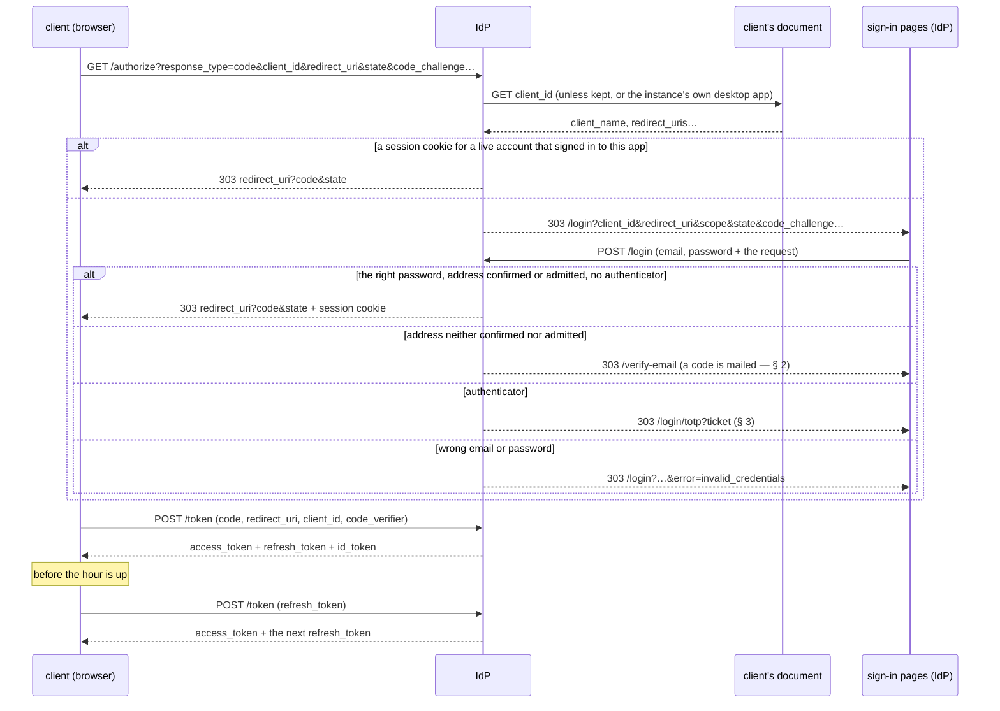

### Clients

A client is the URL of a JSON document it publishes about itself (the OAuth Client ID Metadata
Document draft). So an instance signs in clients it has never heard of, and one web client signs
its users in to any instance. Nothing is registered here.

The `client_id` is that URL: `http(s)`, with a path, in normalised form (no `.` or `..` segment,
no default port, a lower-case host), at most 2 KiB.

The IdP reads the document when a client sends a browser to `/authorize`, and again at `/token`.
It trusts nothing the document doesn't list:

| Field | Rule |
|---|---|
| `client_id` | The URL the document was fetched from, exactly |
| `client_name` | Shown to the user; 80 characters at most. Absent or blank, the client is named by its host |
| `application_type` | `web` (the default) or `native` |
| `redirect_uris` | 1 to 10, matched **exactly**, case and path included (RFC 6749 § 3.1.2): they are where codes are sent. A web client's are `https` URLs on the `client_id`'s own origin. A native client's are on the loopback interface (`http://127.0.0.1:<port>/…` or `http://[::1]:<port>/…`, RFC 8252 § 7.3), or under a scheme named after its own domain, reversed: `https://example.org/…` may use `org.example:/…` (RFC 8252 § 7.1). So no document can claim another app's scheme |
| `post_logout_redirect_uris` | 10 at most, under the same rules |
| `scope` | `offline_access` here asks to stay signed in on the device, with a session of its own (§ "Sessions"); only a native client may |
| `token_endpoint_auth_method` | `none`, or absent: confidential clients aren't supported |

Other fields are ignored. A document that breaks a rule leaves its client unknown.

**Fetching:**
- screened like every peer URL: never a private address on an `https` instance;
- no redirect followed;
- 5 s, and 5 KiB at most.

**Keeping:**
- for the document's `max-age`, within 5 minutes and 24 hours;
- a document that couldn't be had is asked again after 1 minute;
- 1,024 documents at most, the soonest to expire dropped first.

A development instance, whose issuer is plain `http`, also takes `http` clients, and lets a native
client use any scheme but a reserved one (`http`, `https`, `javascript`, `data`, `file`, `blob`…).

**The official desktop app** is described by every instance itself. `GET /clients/desktop.json`
serves its document:
- `client_name` "Pīna'i desktop";
- native;
- `io.github.pina-i:/callback`;
- `offline_access`.

A request naming it is answered without a fetch. So a desktop sign-in depends on nothing but the
user's own instance, and a new desktop redirect URI or scope ships with the instances.

### `GET /authorize`

1. The client must be known and the `redirect_uri` registered for it. Either failure is
   answered by the IdP itself, on its page "This app couldn't be verified" — `401` for the
   client, `400` for the `redirect_uri` — since the redirect cannot be trusted.
2. Only then the flow: `response_type=code` and `code_challenge_method=S256`. A failure here goes
   back to the client, as RFC 6749 § 4.1.2.1 says: `redirect_uri?error=unsupported_response_type`
   (or `invalid_request`)`&error_description=…&state=…`.
3. A browser with a session cookie, for an account that still exists and that signed in to this
   app with its password (§ "The session cookie"), is handed a code at once; any other goes to
   the login page, carrying the request and the client's theme (§ "The sign-in pages").
4. `prompt=login` (OpenID Connect Core § 3.1.2.1) always goes to the login page, whatever session
   the browser holds. The desktop app sends it at each sign-in: its window keeps the IdP's
   cookie like a browser, and the user can pick another account there. Any client sends it to
   have the password typed again before a sensitive action (§ "Sensitive actions").

### The sign-in pages

Rendered by the IdP from templates (askama: compiled, every value HTML-escaped), with **no inline
script** and no inline style, which allows a strict CSP. The one script is the instance's own
file, `/assets/sign-in.js`: a form on its way turns its submit button into a spinner and disables
it, so it can't be sent twice (Enter or a click alike), and a page brought back from the
back-forward cache is ready again. It also folds the login page's Sign in tab into the reset
request and back, the address typed kept and the tab's title following (§ 7 "Forgot your
password?"), and grades a new password as it is typed. Everything works without it.

| Route | Page |
|---|---|
| `GET /login` | Sign in, or Register with `?tab=register` — two links, not script tabs. On an invite-only instance (§ 6) there are no tabs: the page is the sign-in form, and `?tab=register` shows it too. On an open one, the Sign in tab has "Forgot password?" beside the Password label (§ 7) |
| `GET /forgot-password` | The login page opened on the reset request, as "Forgot password?" folds it (§ 7 "Forgot your password?"); on an invite-only instance, the page "No password reset by mail here", `404` |
| `GET /verify-email` | The code mailed at sign-up (§ 2), with a form to send another |
| `GET /login/totp` | The second factor (§ 3); `?mode=recovery` asks a recovery code instead |
| `GET /signed-out` | Where `/logout` lands when it may not go back to the client |
| `GET /i/{token}` · `GET /i/{token}/sign-up` | An invitation's doorway and its sign-up form (§ 5) |
| `GET /r/{token}` | A reset link's form, setting the account's new password — an admin's link, or one asked for by mail (§ 7) |
| `GET /assets/{path}` | The stylesheet, the script, the fonts (DM Sans, Instrument Serif, Azeret Mono — latin and latin-ext, OFL), the motifs and the grain, built into the binary; `Cache-Control: public, max-age=86400`. The stylesheet and the script are linked with `?v=<a hash of their content>`, so a release that changes one is fetched anew |

**What a page shows.** On one side the instance: its name, its description, how many people it
holds and who may join — "open registration", or "invite only" (§ 6;
`identity-provider/specs/identity.md § 6`) —, and "Runs the Pīna'i identity provider
v<version>". On the other "Sign in to <name>" under "— <domain>" and
"← Another home"; on the login page, the app asking — "to continue to *Pīna'i* app.example", its
`client_name` and where its document lives, left out for the instance's own desktop app — then
the form, ending with "Your password goes to <domain>, never to Pīna'i". A password typed there
signs in to that app (§ "The session cookie"), so that line is all the consent there is. Below
1024 px the two sides stack, the instance first.

**The source.** At the foot of every page — under the form, or beside "Only the admins of <domain>
make invitations" on an invitation's doorway — "↳ Source" links the code the instance runs,
`SOURCE_URL` (`identity-provider/specs/identity.md § 6`). A plain link, nothing the CSP has to
allow; it opens a new window, since the desktop app's sign-in window goes nowhere but the app and
the instance, and hands a new window to the system browser.

**The request each page carries.** Every page, link and form carries the sign-in request it was
opened for — the `/authorize` parameters — and the POST it ends in checks it again. A `/login`
or `/verify-email` link with no request left, or a broken one, shows "This sign-in link has
expired"; one naming a client that can't be verified shows that page. The second-factor page
carries its ticket instead (§ 3), which holds the request; an invitation's pages and a reset link's
carry their token in their path, and no request: no app asked for them (§ 5, § 7).

**Cancel.** "← Another home" sends the browser back to the client with nothing signed in:
`redirect_uri?error=access_denied&state=…` (RFC 6749 § 4.1.2.1), to a `redirect_uri` checked
before the page was shown.

**The theme.** `/authorize` takes two parameters of its own, which the pages carry on:
`theme=<family>-<mode>` (`pearl`, `lagoon`, `jungle`, `sand` × `dark`, `light`) and
`motif=<key>` (`kowhaiwhai`, `raranga`, `puhoro`, `tapa1`–`tapa4`). A client sends what it is
painted in, so the pages match it; the web client does once someone has signed in on the device.
A value the IdP doesn't know is dropped; without them, a page is Black Pearl dark with Tapa 1 —
an invitation's pages (§ 5), which no client opens, with Tapa 2.

**Errors are codes.** A page is sent `error=<code>` (or `notice=<code>`) and shows the fixed
sentence it maps to; any other value shows nothing. So no link can make the instance's own page
print words of its choosing.

| Page | Code | Shown |
|---|---|---|
| `/login` | `invalid_credentials` | Invalid email or password |
| | `rate_limited` | Too many attempts — try again in a minute |
| | `missing_field` | Fill in every field |
| | `invalid_display_name` | Display name: 1–50 characters |
| | `invalid_email` | Enter a valid email address |
| | `weak_password` | Password must be at least 8 characters |
| | `email_taken` | Email already registered |
| | `signup_expired` | This sign-up has expired — register again |
| | `invitation_required` | Accounts on <domain> are by invitation only |
| | `notice=already_verified` | This address is confirmed already — sign in to continue |
| | `notice=no_code_needed` | This account signs in with its password — sign in to continue |
| `POST /forgot-password`'s answer | `invalid_email` | Enter a valid email address |
| `/login`, no request | `ticket_expired` | This sign-in has expired |
| | `ticket_exhausted` | Too many attempts |
| `/verify-email` | `code_format` | Enter the 6-digit code |
| | `code_expired` | Code expired — request a new one |
| | `code_exhausted` | Too many attempts — request a new code |
| | `code_incorrect` + `left` | Incorrect code — *n* attempts left |
| | `code_used` | Code already used — try signing in |
| | `too_many_codes` | Too many codes sent — wait a few minutes |
| | `notice=code_resent` | New code sent. The previous one no longer works. |
| | `notice=confirm_email` | Confirm your email to finish signing in. |
| `/login/totp` | `totp_incorrect` | Incorrect code |
| | `recovery_unknown` | Recovery code not recognised |
| | `totp_missing` | Enter a code or a recovery code |

The address on the code page is shown only if it is one (`Email`).

**Safety.**
- **Same-origin forms.** Every form POST (`/login`, `/register-and-login`,
  `/verify-email-and-login`, `/verify-email/resend`, `/login/totp`, `/forgot-password`,
  `/i/{token}/sign-up`, `/r/{token}`) is refused `403` when the
  browser says it was sent from elsewhere: an `Origin` other than the instance's, or else a
  `Sec-Fetch-Site` other than `same-origin`. `Origin: null` alone is refused. A request saying
  neither — a script, a test — is let through: a browser always says. This stops login CSRF.
- **Headers on every page:**
  - `Content-Security-Policy: default-src 'none'; script-src 'self'; style-src 'self';
    font-src 'self'; img-src 'self' data:; form-action 'self' <the client's origin, or its scheme>;
    frame-ancestors 'none'; base-uri 'none'`. Chrome holds the redirect that follows a POST to
    `form-action`, hence the client's origin (`io.github.pina-i:` for the desktop app);
    `data:` is the grain shown under reduced motion.
  - `X-Frame-Options: DENY`, `X-Content-Type-Options: nosniff`, `Cache-Control: no-store`.
  - `Referrer-Policy: same-origin`: nothing reaches the client, and the page's own forms keep
    their `Origin` — under `no-referrer`, a browser posts them as `Origin: null`. An invitation's
    or a reset link's pages without a form, whose URL holds its token, are `no-referrer` (§ 5,
    § 7).

### `POST /login`

The login form, posted by the browser with the request it carries.

- The request is checked again — a known client, a registered `redirect_uri` — or any page
  could have a code sent wherever it names. A failure is the "This app couldn't be verified"
  page, `401` / `400`, never a redirect.
- Password guesses are bounded per email address, in any case: 10, then one a minute. Past that,
  the form is sent back with `error=rate_limited`, whatever the password — known address or not,
  so the limit tells nothing of who has an account.
- An unknown email is checked against a decoy hash as costly as a real one, and answered like a
  wrong password: `error=invalid_credentials`. Neither the answer nor its timing tells whether
  the address has an account.
- The right password on an address neither confirmed nor admitted (§ 4) mails a fresh code and
  goes to `/verify-email` (§ 2); on an account with an authenticator it opens a ticket and goes
  to `/login/totp` (§ 3). Otherwise it issues a code and sets the session cookie.

A code is good for 10 minutes, once. It remembers the account, the client, the
`redirect_uri`, the scope, the challenge and the nonce; the `state` goes back with it and is not
kept.

### Sessions

A session is a row, so each one can end on its own, and every code, access token and refresh token
it leads to belongs to it. There are two kinds:

- A **browser session** is what a password sign-in opens — the login form, the code mailed at
  sign-up, the second factor, an invitation's sign-up form (§ 5) — and what the `idp_session`
  cookie names. The web client's tokens belong to it.
- An **app session** is opened by a native client's code exchange when it stays signed in on its
  device: its document allows `offline_access`, its request asked for it, and the password sign-in
  agreed (`Grant::opens_app_session`). The desktop app's tokens belong to it, not to the system
  browser it signed in through, so signing out of that browser leaves the app signed in. Its
  password is the browser session's: it was typed there.

```sql
CREATE TABLE sessions (
    id             UUID PRIMARY KEY,
    user_id        UUID NOT NULL REFERENCES users(id) ON DELETE CASCADE,
    kind           TEXT NOT NULL,           -- browser | app
    client_id      TEXT,                    -- an app session's client, and only theirs
    device_id      UUID REFERENCES user_devices(device_id) ON DELETE SET NULL,
                                            -- the E2EE device it signed in (§ "Sessions and devices")
    created_at     TIMESTAMPTZ NOT NULL,
    last_used_at   TIMESTAMPTZ NOT NULL,    -- the last sign-in or refresh that used it
    authenticated_at TIMESTAMPTZ NOT NULL,  -- the account's password last typed on it
                                            --   (§ "Sensitive actions")
    revoked_at     TIMESTAMPTZ,
    revoked_reason TEXT                     -- sign_out | replaced | reuse | device_revoked
                                            --   | signed_out_elsewhere | password_reset
);
-- and authorization_codes.session_id: the browser session a code was issued under
```

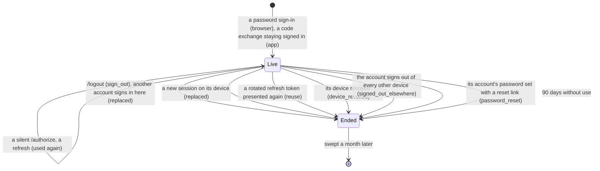

- **Live** while it isn't revoked and was used in the last 90 days (`Session::is_live`). A password
  sign-in, a silent `/authorize` and a refresh count as use. There is no absolute limit: an active
  user never signs in again.
- **The cookie** holds the browser session's id, signed (HMAC-SHA256) with a key derived from
  `SESSION_SECRET`: `HttpOnly`, `SameSite=Lax`, `Path=/`, `Secure` in production. It lasts as long as
  the session may, 90 days, and is **set again at every use**, so it slides with it. A cookie naming
  a session that isn't live is no cookie: the login page shows.
- **One account per browser.** A password sign-in keeps the browser's live session when it is the
  same account's, stamping its use and its password (`authenticated_at`); another account's is
  ended (`replaced`) and a new one opened.
- **Codes and tokens belong to it.** A code is issued under the browser session and refused at
  `/token` once that session has ended. The access token names its session (`sid`), and every
  authenticated request and the `/ws` upgrade check that it still lives — one read by primary key
  — so an ended session's tokens stop at once, not an hour later: `401 invalid_token`, "The
  session has ended". A refresh token works while its session lives (§ "Tokens").
- **Ending one** (`/logout`, a replacement, a reuse, a revoked device, a sign-out elsewhere, a
  password reset — § 7) also closes the account's WebSockets opened under it, with `1008` ("the
  session has ended"); a reconnect with its token is refused `401`.
- **Swept** by the hourly sign-up sweep (§ 2) a month after it ended: revoked then, or idle past its
  90 days. Its refresh tokens go with it.

The cookie is what lets `/authorize` skip the login page — **for the apps the account signed in to
with its password only**.

Any site can be a client, and any site can send a browser to `/authorize`. If a session alone
answered with a code, a page you merely visited could take one for your account, and the tokens
with it. So every sign-in the password goes through — the login form, the code mailed at
sign-up, the second factor — remembers its app for the account, and joining by invitation, where
the password is typed for an account to open in the official web app, remembers that app (§ 5):

```sql
CREATE TABLE client_sign_ins (
    user_id        UUID NOT NULL REFERENCES users(id) ON DELETE CASCADE,
    client_id      TEXT NOT NULL,
    offline_access BOOLEAN NOT NULL DEFAULT FALSE, -- it asked to stay signed in; once given, kept
    signed_in_at   TIMESTAMPTZ NOT NULL,           -- the last sign-in with the password
    PRIMARY KEY (user_id, client_id)
);
```

A session answers `/authorize` at once only when its account has a row for the request's app
(`ClientSignIn::covers`), and, for a request asking to stay signed in on the device
(`offline_access`), one that asked it too. Anything else is the login page, naming the app: the
first sign-in to an app always takes the password, and signing in there as another account
replaces the session.

The secret makes two keys, each derived from all of it with HKDF-SHA256 under a label of its own:
the session cookie's (`pinai idp: session cookies`) and the attachment links'
(`pinai idp: attachment links`, `identity-provider/specs/attachments.md`). No purpose
shares another's key, and a new secret signs everyone out.

### Sessions and devices

A session is tied to the E2EE device it signed in (`identity-provider/specs/e2ee.md § 3.1`), so
revoking a device signs it out, and the Devices screen tells which devices are signed in.

```mermaid
sequenceDiagram
    participant D as client (a device)
    participant I as IdP
    participant O as client (another device)
    D->>I: PUT /api/sessions/current/device { device_id }
    I->>I: the session names the device; the device's earlier session ends (replaced)
    O->>I: GET /api/keys/devices
    I-->>O: … signed_in, last_active_at
    O->>I: POST /api/keys/devices/:id/revoke
    I->>I: the device's sessions end (device_revoked), then its directory flag
    I-->>D: its sockets close (1008); its tokens and refresh tokens refused
```

- **`PUT /api/sessions/current/device`** `{ device_id }`: the bearer's session names its device.
  The client sends it once the account's device storage is open and the device exists — on a
  first sign-in, after the onboarding that creates it. `204`; `403 access_denied` "Not one of
  your devices, or revoked" for a device that isn't the account's, is revoked, or is unknown.
- **A device is signed in once at a time.** Linking a session ends the device's other live
  sessions (`replaced`): signing in again on a device — after the browser lost its cookie, or a
  desktop app its refresh token — leaves no session behind.
- **`GET /api/keys/devices`** answers each device's `signed_in` (a live session of it) and
  `last_active_at` (that session's last use: a sign-in, a silent `/authorize` or a refresh), null
  when signed out (`last_active`).
- **Revoking a device** (`POST /api/keys/devices/:device_id/revoke`) ends its sessions
  (`device_revoked`) — their tokens, refresh tokens and sockets — then sets the directory flag.
  The sessions go first: if the flag fails, the device is out all the same, and revoking again
  finishes. A revoked device can't link a new session.
- **`DELETE /api/sessions?keep=current`** ends every session of the account but the caller's
  (`signed_out_elsewhere`): other browsers, other apps, linked to a device or not. The devices
  stay, and each may sign in again as the same device. `204`; `400` without `keep=current`.

Both take a recent password (§ "Sensitive actions").

### Sensitive actions

A few actions take the account's password typed on this session in the last **10 minutes**
(`RECENT_SIGN_IN`), not only a live session: a token left on a device someone else picks up, or
taken from it, must not be enough to lock the owner out or erase their history.

| Action | Route |
|---|---|
| Revoke a device | `POST /api/keys/devices/:device_id/revoke` |
| Sign out every other device | `DELETE /api/sessions?keep=current` |
| Turn the second factor on | `POST /api/totp/enroll` |
| Clear the history backup | `DELETE /api/history/messages` |
| Give a member a password reset link (§ 7) | `POST /api/admin/members/{id}/password-reset` |

Turning the second factor off and replacing the recovery codes take a current authenticator code
instead (§ 3). Nothing else asks: the profile, the settings, blocking, signing oneself out.

- **What counts** is the password: a sign-in on the login form, the code mailed at sign-up, the
  second factor. Each dates its session's `authenticated_at`; an app session opened by the code
  exchange takes its browser session's. A silent `/authorize` and a refresh change nothing.
- **The access token** carries it as `auth_time` (OpenID Connect Core § 2), so the check reads
  no table: `Bearer::signed_in_recently`. The token keeps it through its renewals.
- **A refusal** is `401` with `error: "insufficient_user_authentication"` and the challenge of
  RFC 9470 § 3, `WWW-Authenticate: Bearer error="insufficient_user_authentication",
  max_age="600"`. Nothing was done. The session lives on: the client doesn't renew its token for
  it — a renewal brings no newer password.
- **The client** tells the user why, sends them to `/authorize` with `prompt=login`, and comes
  back to the screen they were on, signed in anew on the same session (a new app session on the
  desktop, replacing the one it held). The user then does it again: nothing is replayed.
  "← Another home" brings them back there too, still signed in.

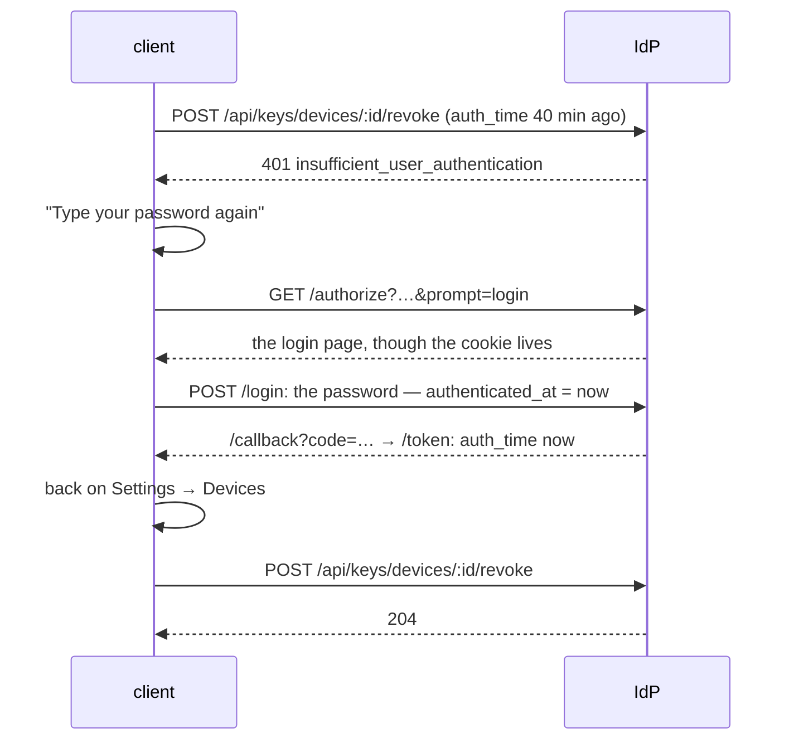

### `POST /token`

`application/x-www-form-urlencoded`, with `grant_type` and `client_id`; each grant takes its own
fields, and one left out is refused as unusable.

**`authorization_code`**: `code`, `redirect_uri`, `code_verifier`.

1. The client known, the `redirect_uri` registered.
2. The code is **spent** as it is read — even if the rest of the exchange is refused, it is never
   tried twice.
3. The code must have been issued to this client for this `redirect_uri`, and the verifier must
   meet its challenge: `BASE64URL(SHA256(code_verifier)) = code_challenge`.
4. The account must still exist, and the browser session the code was issued under still live.
5. A client staying signed in gets an app session of its own (§ "Sessions"); any other's tokens
   belong to the browser session.

```json
{ "access_token": "…", "token_type": "Bearer", "expires_in": 3600, "refresh_token": "…", "id_token": "…" }
```

**`refresh_token`** (RFC 6749 § 6): `refresh_token`.

The token is rotated (§ "Tokens"), its session must live and its account exist, and the session is
used once more. The answer has no ID token — nobody signed in:

```json
{ "access_token": "…", "token_type": "Bearer", "expires_in": 3600, "refresh_token": "…" }
```

Every answer, success or refusal, carries `Cache-Control: no-store` and `Pragma: no-cache`
(RFC 6749 § 5.1).

| Refusal | Status | `error` |
|---|---|---|
| Another grant type | 400 | `unsupported_grant_type` |
| Unknown client (a `client_id` that isn't a client URL, for a refresh) | 401 | `invalid_client` |
| Unregistered or mismatched `redirect_uri`, unusable code (unknown, expired, spent, its account gone, or its session ended), another client's code, a verifier that does not meet the challenge | 400 | `invalid_grant` |
| An unusable refresh token: unknown, another client's, rotated (ending its session past the grace), its session ended or idle, its account gone | 400 | `invalid_grant` |

### Tokens

The access and ID tokens are JWTs signed with the instance's Ed25519 key (`EdDSA`, the key the
JWKS publishes): `iss` the issuer, `sub` the account id, `email`, `preferred_username` (the handle),
valid for one hour.

- **The access token** is addressed to this instance's API (RFC 9068): `aud` is the issuer, and
  `client_id` names the client it was issued to, so the API takes it from any client. `sid` names
  the session it belongs to (§ "Sessions"): it works while that session lives. `auth_time` is
  when the password was last typed on that session (§ "Sensitive actions").
- **The ID token** is addressed to the client: `aud` is the `client_id`. It adds the request's
  `nonce`. Only a code exchange issues one.
- **The refresh token** is 256 random bits (base64url, 43 characters). Only its SHA-256 is kept.

```sql
CREATE TABLE refresh_tokens (
    token_hash     BYTEA PRIMARY KEY,       -- SHA-256 of the token
    session_id     UUID NOT NULL REFERENCES sessions(id) ON DELETE CASCADE,
    client_id      TEXT NOT NULL,
    created_at     TIMESTAMPTZ NOT NULL,
    rotated_at     TIMESTAMPTZ,             -- used; NULL for the head of its chain
    successor_hash BYTEA                    -- what it was rotated to
);
```

Each code exchange starts a **chain** under its session: one per tab of the web client, one per
desktop sign-in. Every use **rotates** the token — it is answered with its successor, and stops
working itself. What a presentation comes to is `RefreshLink::presented`:

| The token presented | Answer |
|---|---|
| The head of its chain | Its successor, the new head |
| Rotated within the last **60 s**, its successor never used | A new successor, replacing that one: the answer was lost on its way back |
| Rotated, past the 60 s or after its successor was used — or a successor so replaced | `invalid_grant`, and its **session ends** (`reuse`): two copies exist, and the server can't tell the owner's from the thief's |
| Unknown, or another client's | `invalid_grant`; nothing changes |

So a stolen refresh token works until the owner's next refresh, or the thief's: whichever comes
second signs both out. The rotated tokens are kept while their session lives, so a copy presented
late is still caught. A presentation locks its token's row, then its successor's: two presentations
of one token are judged one after the other, and leave one head. A client refreshes one at a time —
of two answers to two concurrent refreshes, only the later works.

A bearer token that is missing or unusable is answered `401 invalid_token`, with the challenge
RFC 6750 § 3 asks for: `WWW-Authenticate: Bearer` when none was sent, `Bearer
error="invalid_token"` when one was. One whose password is too old for the action is answered
`401 insufficient_user_authentication` (§ "Sensitive actions").

### `POST /revoke`

RFC 7009, how an app holding its own session signs out — the desktop: `client_id`, `token` (its
refresh token), `token_type_hint` (not read: refresh tokens are the only kind revoked here). The
token's session ends (`sign_out`) — every token of it, and its WebSockets — whether the token is
the head of its chain or a rotated one. The browser session its window signed in through is
left alone.

`200` with no body for a token unknown here, or another client's, as for a revoked one: the
endpoint tells nothing of tokens. `400 invalid_request` without a token; `401 invalid_client` for
a `client_id` that isn't a client URL. `Cache-Control: no-store`.

### Calls from a browser

Every route answers CORS for any origin (`Access-Control-Allow-Origin: *`), because pages served
elsewhere call this instance: another instance's web client fetching its JWKS to verify a member's
device, and the desktop app.

Nothing is given away by it. The API is authorised by the bearer token alone, which a page holds
only once signed in. The session cookie serves only the sign-in flow the browser itself navigates
through: `/authorize`, the login, sign-up and code forms, and `/logout`. Under `*` a browser never
exposes the answer to a credentialed request.

The allowed request headers are listed, `Authorization` among them, rather than `*`, which Firefox
reads as not covering `Authorization`. `WWW-Authenticate` is exposed to the page
(`Access-Control-Expose-Headers`): its challenge tells a token to renew from a password to type
again.

### `GET /logout`

Ends the browser's session (`sign_out`) — every token it led to stops working at once, and its
WebSockets close — drops the cookie, and redirects to `post_logout_redirect_uri`, but only when the
request names its client (`client_id`) and that client's document lists the URI exactly. Anything
else goes to the instance's own `/signed-out` page: the endpoint is never an open redirect.

### Discovery

`GET /.well-known/openid-configuration` (OpenID Connect Discovery 1.0 § 4) names the endpoints —
`revocation_endpoint` with `revocation_endpoint_auth_methods_supported: ["none"]` among them —
`scopes_supported: ["openid", "profile", "email", "offline_access"]`,
`response_types_supported: ["code"]`, `grant_types_supported: ["authorization_code", "refresh_token"]`,
`code_challenge_methods_supported: ["S256"]`, `id_token_signing_alg_values_supported: ["EdDSA"]`,
`token_endpoint_auth_methods_supported: ["none"]` and
`client_id_metadata_document_supported: true`. It names no `registration_endpoint`: clients aren't
registered, and the JSON `POST /register` creates accounts, not clients.
`GET /.well-known/jwks.json` serves the public key. Its `kid` is `JWT_KEY_ID`, or, unset, the key's
RFC 7638 thumbprint (SHA-256 over `{"crv":"Ed25519","kty":"OKP","x":"…"}`, base64url): the
same at every start for as long as the key lives, and another one for another key.

### Scenarios

- **First visit.** The web client sends the browser to `/authorize`; without a session it lands
  on the login page, signs in, and comes back with a code the client exchanges at `/token`.
- **Coming back.** The session cookie is still there, and this account signed in to this app:
  `/authorize` answers with a code at once, and the session's 90 days start over.
- **Back after four months.** The session went 90 days unused: it is over, and the password is
  asked again. Used every week, it never ends.
- **Signing out** in one tab ends the session for every tab of that browser: their tokens are
  refused at their next request, and their WebSockets close with `1008` at once.
- **A second app.** Signed in through the web client, the user opens the desktop app: the login
  page asks the password once, naming "Pīna'i desktop"; from then on both sign in silently.
- **A site that only sends the browser to `/authorize`** — its own document, its own callback —
  gets the login page, never a code: the account never signed in to it.
- **A page that forges the login form** with its own `redirect_uri` is refused with `400` — no
  code leaves. Posted from another site, it is refused `403` before anything is checked.
- **Changing your mind.** "← Another home" takes the browser back to the client with
  `error=access_denied`; the web client shows its landing again.
- **A phishing link** to the login page with `error=Your account is locked, call …` shows no
  error at all: only known codes have words.
- **Someone guessing passwords** for an address gets 10 tries, then one a minute; the answers
  and their timing are the same for an address with no account.
- **A code intercepted after its exchange** is useless: it was spent, and without the verifier it
  could not have been exchanged anyway.
- **A new web client**, deployed anywhere, publishes its document. Users sign in to any instance
  through it at once.
- **A document that lies**, listing another site's callback or another app's scheme, leaves its
  client unknown: `/authorize` answers `401` with "This app couldn't be verified", and no browser
  is sent anywhere.
- **Signing out** returns the browser where its client listed. A link naming another site, or no
  client, goes to `/signed-out` instead.
- **A copy of a cookie or a token** stops working when its session ends: signing out ends it on the
  server, not only in the browser that signed out.
- **An hour in.** The client trades its refresh token for a new access token and the next refresh
  token; the session's 90 days start over.
- **A refresh answer lost** on a flaky network: the client sends the same token again within the
  minute and gets a new successor. The one that never arrived stops working.
- **A stolen refresh token.** The thief refreshes with it; at the owner's next refresh the token
  comes back already rotated, and the session ends for both — every token, every socket. The owner
  signs in again; the thief can't.
- **The desktop app staying signed in.** It shows these pages in its own window
  (`offline_access`, `prompt=login`), and catches the answer to `io.github.pina-i:/callback`
  there; the exchange opens an app session that refreshes on its own, apart from the browser
  session the window signed in through. Three months without opening the app sign it out.
  Signing out of the app revokes its refresh token (`/revoke`); its next sign-in asks the
  password, so another account can be picked.
- **A lost phone.** From the laptop, Settings → Devices shows the phone "Active 2 hours ago";
  revoking it signs it out at once — its socket closes, its next request and renewal are refused —
  and takes it out of every group.
- **"Sign out other devices".** Every other browser and app signs in again with the password;
  this one stays. The devices aren't revoked: each comes back as itself.
- **Revoking the phone a day after signing in.** The laptop's password is a day old: "Type your
  password again", the login page, and back on Settings → Devices, where revoking it now goes
  through. Within the next 10 minutes, nothing more is asked.
- **A laptop left open.** Whoever sits at it can read and write as its owner, but can't revoke
  the owner's other devices, sign them out, turn the second factor on or clear the history
  backup without the password — nor, on an admin's, make a member's reset link, which hands that
  account over.

## 2. Sign-up email verification

Every new account must prove ownership of its email address before a session
cookie or access token is issued, unless it was admitted (§ 4). Federation, friend graph, and DMs
are all inaccessible to an unverified user.

### Data model

```sql
-- Signup confirmation OTPs (6-digit numeric, peppered HMAC-SHA256).
-- At most one *unconsumed* row per user at any moment; resend consumes the
-- previous row in the same transaction. The hourly sweep drops consumed/expired
-- rows older than 24 h.
CREATE TABLE email_verification_codes (
  id          UUID PRIMARY KEY DEFAULT gen_random_uuid(),
  user_id     UUID NOT NULL REFERENCES users(id) ON DELETE CASCADE,
  code_hash   BYTEA NOT NULL,            -- HMAC-SHA256(EMAIL_OTP_PEPPER, code)
  expires_at  TIMESTAMPTZ NOT NULL,      -- now() + 10 minutes
  consumed_at TIMESTAMPTZ,               -- set on successful verify OR resend invalidation
    attempts    INTEGER NOT NULL DEFAULT 0, -- max 5, counted under a row lock (resend required)
  created_at  TIMESTAMPTZ NOT NULL DEFAULT now()
);
CREATE INDEX idx_evc_user_unconsumed
    ON email_verification_codes(user_id)
 WHERE consumed_at IS NULL;
```

### Flow

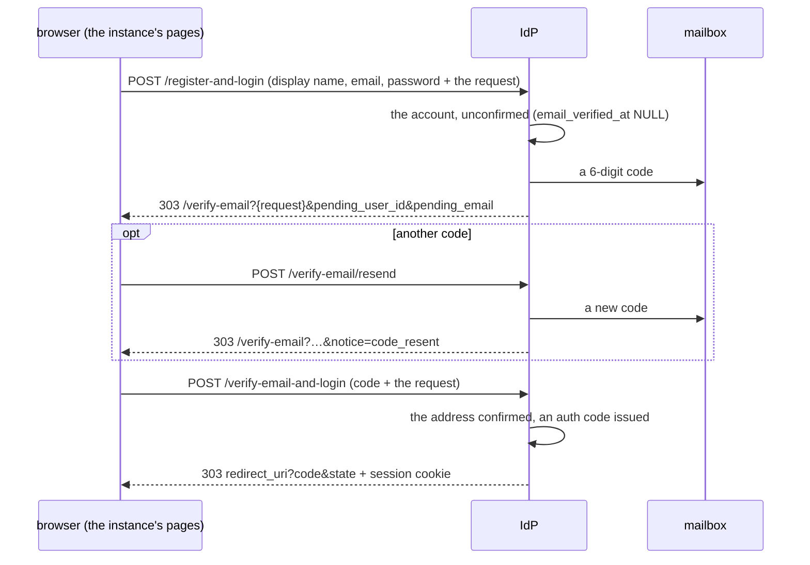

### Registration rules

- **The display name** is what the user types: trimmed, 1–50 characters (`DisplayName`).
- **The handle** is made from it: the display name in ASCII, lowercase, every run of other
  characters one `_` (`identity-provider/specs/identity.md § 5`), then `_` and 5 characters
  drawn from `a–z0–9`: "Hōkū" is `hoku_xk9mp`. It names the account in its actor URI and its
  address. A handle already taken — a one-in-60-million draw — is drawn again.
- **The address** is kept lowercase, and is one account's whatever its case: `Alice@Example.com`
  is taken once `alice@example.com` is. One `@` between two non-empty parts, no whitespace, at
  most 254 characters.
- **The password** is 8 bytes at least.
- Two registrations racing for one address or handle are settled by the database's unique
  indexes: the one that loses is told the address is registered, as if it had come second.

### Endpoints

| Endpoint | Body | Result |
|---|---|---|
| `POST /register` | JSON `{ display_name, email, password }` | `201` with the account (`id`, `username`, `display_name`, `address`, `email`, `email_verified: false`, `pending_user_id`) and a code mailed. `400` names the rule broken, or `Email already registered`. On an invite-only instance (§ 6), `403 invitation_required` before anything else is looked at. |
| `POST /register-and-login` | `display_name`, `email`, `password` + the request | Creates the account unconfirmed, mails a code, and goes to `/verify-email?{request}&pending_user_id=…&pending_email=…`. **No session is issued.** A broken rule goes back to `/login?{request}&tab=register&error=<code>`; an unknown client or an unregistered `redirect_uri` is "This app couldn't be verified" (`401` / `400`). On an invite-only instance (§ 6), back to `/login?{request}&error=invitation_required`, nothing created. |
| `GET /verify-email` | `pending_user_id`, `pending_email` + the request | The code page (§ 1 "The sign-in pages"). |
| `POST /verify-email-and-login` | `pending_user_id`, `pending_email`, `code` + the request | The request is checked first; then the code: the right one confirms the address, issues an OIDC auth code and the session cookie, and redirects to `redirect_uri`. A wrong, malformed, expired or exhausted code goes back to `/verify-email` with its `error`; an address confirmed already goes to `/login` with `notice=already_verified`, an admitted account (§ 4) to `/login` with `notice=no_code_needed` — no code is tried, no session issued —, an account gone to `/login?tab=register&error=signup_expired`. |
| `POST /verify-email/resend` | `pending_user_id`, `pending_email` + the request | A fresh code, then the code page again with `notice=code_resent`, or `error=too_many_codes` past the resend limit. An address confirmed already goes to `/login` (`notice=already_verified`), an admitted account to `/login` (`notice=no_code_needed`) with nothing mailed, an account gone to the register tab (`signup_expired`). |
| `POST /login` | email, password + the request | The right password on an unconfirmed address, never admitted (§ 4), mails a fresh code — within the same resend limit — and goes to `/verify-email` with `notice=confirm_email` instead of issuing a session (§ 1). |

### Code rules

- **Length.** 6 numeric digits, drawn from `OsRng` with rejection sampling so each digit is
  uniform `0..=9` (no modulo bias).
- **Lifetime.** 10 minutes.
- **Storage.** `code_hash = HMAC-SHA256(EMAIL_OTP_PEPPER, code)`. The pepper is a ≥ 32-byte hex
  env var; startup fails if unset or shorter. A leaked database without the pepper is not
  brute-forceable offline.
- **Resend limit.** At most 5 codes per account in any 10 minutes, whoever asks — the resend
  endpoint or a sign-in on the unconfirmed address. Each code is more mail to the address, and
  more guesses at it: past the limit nothing is sent, and the codes already mailed still work.
- **Attempts.** 5 per code, then a new one must be asked for. An attempt locks the code's row
  until it is counted, so guesses sent in parallel queue up and the cap holds for all of them.
- **Single use.** The right code is spent and the address confirmed in the same transaction.
- **Only the latest counts.** Issuing a code retires the account's earlier ones.

### Sweep

Every hour — and once at startup — the IdP deletes:
1. the codes and the login tickets (§ 3) spent or expired, once a day old;
2. the accounts never confirmed, once a week old: an abandoned sign-up frees its address and
   handle. An admitted account (§ 4) is never deleted so;
3. the sessions (§ 1) ended a month ago: revoked then, or idle past their 90 days, and their
   refresh tokens with them;
4. the refresh tokens (§ 1) unused for 90 days — a head since its creation, a rotated one since its
   rotation — so the chains of a session in use, a tab per reload, don't pile up;
5. the invitations (§ 5) a month after they ended: used, revoked or expired, whichever came first;
6. the password reset links (§ 7) a month after they ended: used, replaced or expired, whichever
   came first.

### Scenarios

- **Signing up.** The instance's register tab posts to `/register-and-login`; the address gets
  a code; the code page posts it back and the browser returns to the client signed in.
- **A code that never arrives.** "Send a new code" posts `/verify-email/resend`; after five codes
  in ten minutes the page says to wait.
- **Someone guessing codes** gets five guesses per code, however many they send at once, and
  five codes per ten minutes.
- **Someone registering a victim's address.** The victim gets one mail per code, within the
  resend limit; the account, never confirmed, is deleted after a week.
- **`Alice@example.com` registering after `alice@example.com`** is told the address is
  registered.

### SMTP

Codes, and the reset links asked for (§ 7), go out through a relay, `SMTP_HOST`/`SMTP_PORT`, over `SMTP_TLS`: `none` (plain), `starttls` (port 587) or `tls` (port 465). Unset or empty, `SMTP_PORT` is 587 in production and 1025, Mailpit's, in development, and `SMTP_TLS` is `none` in development and, in production, `tls` on port 465 and `starttls` on any other. `SMTP_FROM`, unset or empty, is `Pīna'i <no-reply@{host}>`, the host being `DOMAIN` without its port. The connection is opened on the first send, so the instance starts whether or not the relay is up; an unset or empty `SMTP_HOST` means no relay — never a host the instance wasn't given —, and every code then fails to send — only an invite-only instance starts without one (§ 6). In the background of every start, the IdP connects, signs in and quits, logging `SMTP relay reachable` or `SMTP relay unusable` with the reason, so a wrong relay shows before anyone signs up; an invite-only instance with no relay logs `no SMTP relay: mail is off` instead.

Mailpit ships in the root `compose.yaml` (`MP_SMTP_AUTH_ACCEPT_ANY=true`, `MP_SMTP_AUTH_ALLOW_INSECURE=true`). Web UI on `MAILPIT_UI_PORT` (Alice 8025, Bob 8026) lets a developer click through to the rendered email and copy the code. `POST /dev/send-test-email` (JSON `{ to, display_name? }`) is mounted only when `IDP_ENV=development` and mails a fixed `123456` code to check the SMTP path.

### `/userinfo`

Returns `email_verified: boolean` derived from `email_verified_at IS NOT NULL` so clients can show / hide flow-gates without an extra round trip. An admitted account's (§ 4) is `false`: no code ever confirmed its address.

## 3. TOTP two-factor authentication

Per-login second factor backed by an authenticator app (RFC 6238, SHA-1, 6
digits, 30-second window). Recovery codes substitute when a user loses access
to their device.

### Data model additions

```sql
ALTER TABLE users
    ADD COLUMN totp_secret    BYTEA,
    ADD COLUMN totp_enabled   BOOLEAN NOT NULL DEFAULT FALSE,
    ADD COLUMN totp_last_step BIGINT;   -- the last 30 s step whose code was used

-- Mid-enrollment secret. Discarded once verify succeeds (copied to users.totp_secret).
CREATE TABLE pending_totp_enrollments (
    user_id    UUID PRIMARY KEY REFERENCES users(id) ON DELETE CASCADE,
    secret     BYTEA NOT NULL,
    created_at TIMESTAMPTZ NOT NULL DEFAULT now()
);

-- "You passed password, now show me the second factor" tickets.
CREATE TABLE pending_totp_logins (
    id                    UUID PRIMARY KEY DEFAULT gen_random_uuid(),
    user_id               UUID NOT NULL REFERENCES users(id) ON DELETE CASCADE,
    client_id             TEXT NOT NULL,
    redirect_uri          TEXT NOT NULL,
    scope                 TEXT NOT NULL,
    oauth_state           TEXT NOT NULL,
    code_challenge        TEXT NOT NULL,
    code_challenge_method TEXT NOT NULL,
    nonce                 TEXT,
    expires_at            TIMESTAMPTZ NOT NULL,   -- now() + 5 minutes
    consumed_at           TIMESTAMPTZ,
    attempts              INTEGER NOT NULL DEFAULT 0,
    created_at            TIMESTAMPTZ NOT NULL DEFAULT now()
);

-- 10 single-use codes per user. HMAC-SHA256(EMAIL_OTP_PEPPER, plaintext) — same
-- pepper as signup OTPs (one secret to manage).
CREATE TABLE recovery_codes (
    id          UUID PRIMARY KEY DEFAULT gen_random_uuid(),
    user_id     UUID NOT NULL REFERENCES users(id) ON DELETE CASCADE,
    code_hash   BYTEA NOT NULL,
    consumed_at TIMESTAMPTZ,
    created_at  TIMESTAMPTZ NOT NULL DEFAULT now()
);
```

### Login flow

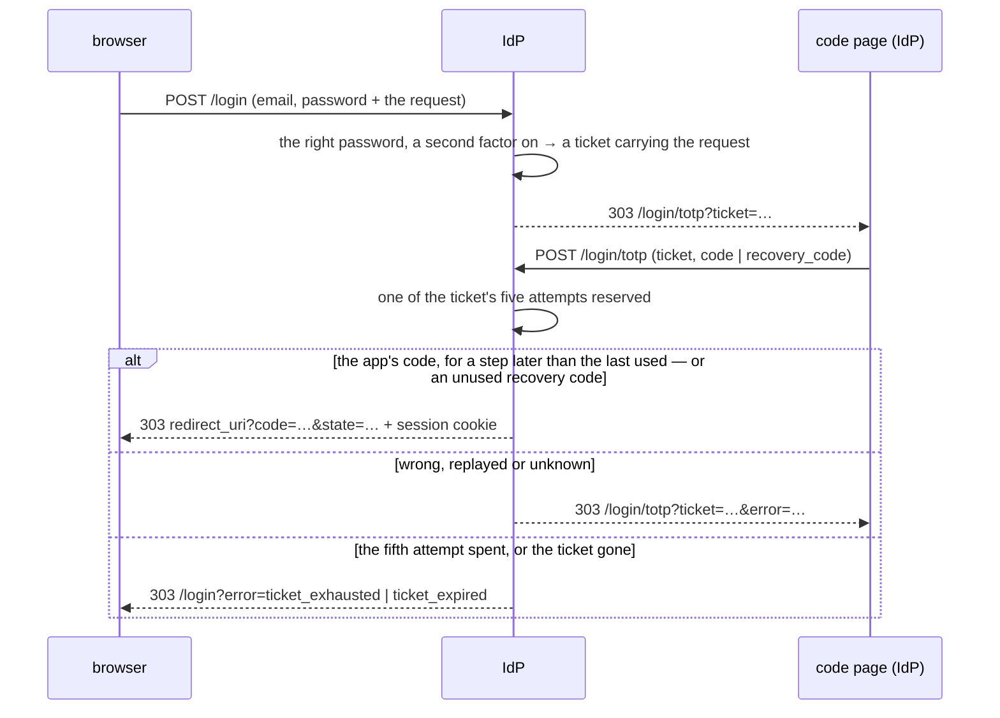

- **A ticket** is opened by the password step (§ 1), carrying the request; opening one closes
  the account's earlier ones, and so does a password reset (§ 7). It lasts 5 minutes. `GET /login/totp?ticket=…` shows its code page
  while it is open, and "This sign-in has expired" once it is not.
- **Five attempts per ticket**, the right one included. Each attempt is reserved on the ticket
  before its code is checked, in one statement, so guesses sent in parallel cannot pass five.
  After the fifth the browser goes to `/login?error=ticket_exhausted` ("Too many attempts"): the
  password step must be cleared again, not just the second factor. A form with neither a code
  nor a recovery code is not an attempt (`totp_missing`).
- **A code is good once** (RFC 6238 § 5.2). A code matches the app's for the current step or one
  either side; the account keeps the last step whose code it used, and a code is accepted only
  for a later step. A code seen once — by someone looking over a shoulder, or replayed from a
  captured request — is refused thereafter (`totp_incorrect`). The same holds for the codes that
  disable the second factor or regenerate recovery codes.
- **A recovery code** is spent by its use; dashes, spaces and case do not matter.
- An expired, spent or unknown ticket goes to `/login?error=ticket_expired` ("This sign-in has
  expired").

### Enrollment / disable / regenerate endpoints

| Endpoint | Auth | Body | Result |
|---|---|---|---|
| `POST /api/totp/enroll` | Bearer, a recent password (§ 1 "Sensitive actions") | — | Generates a fresh 20-byte secret, keeps it in `pending_totp_enrollments` (replacing an earlier one), returns `{ secret_base32, provisioning_url }`. The provisioning URL is the `otpauth://totp/...` string the client renders as a QR; its issuer names the instance, `Pina'i (DOMAIN)` — a port written after a space, as the format keeps `:` to split the label. `400` while the second factor is on. |
| `POST /api/totp/enroll/verify` | Bearer | `{ code }` | Checks the first authenticator code against the pending secret. On success, in one transaction: commits the secret, records the code's step, forgets the enrollment, and mints 10 recovery codes, returned in `{ recovery_codes: [...] }` — shown once and never re-served. The second factor is never on without recovery codes. `400 invalid_grant` for a wrong code. |
| `POST /api/totp/disable` | Bearer | `{ code }` | Requires a current, unused TOTP code (a passive session cannot disarm it). In one transaction: clears the secret and its last step, sets `totp_enabled = false`, deletes the recovery codes and any enrollment. `204`. |
| `POST /api/totp/recovery-codes/regenerate` | Bearer | `{ code }` | Requires a current, unused TOTP code. Replaces all of the account's recovery codes in one transaction and returns the fresh set. |

### Constants

- **TOTP digits / step / skew**: 6 / 30 s / ±1 step (allows ±30 s clock drift). Matches Google Authenticator / Authy / 1Password.
- **Secret length**: 20 bytes (RFC 4226).
- **Login ticket TTL**: 5 minutes; 5 attempts per ticket.
- **Recovery codes**: 10 per user, 10 chars from a Crockford-style alphabet (no `0`, `1`, `I`, `L`, `O`, `U`), formatted `XXXXX-XXXXX`. Normalization on input strips dashes + whitespace and uppercases — `abcde-12345` and `ABCDE12345` are equivalent.
- **Pepper**: recovery code hashes reuse `EMAIL_OTP_PEPPER` — one secret to manage.

### Scenarios

- **Turning it on.** Settings call `/api/totp/enroll`, show the QR, and send the app's first code
  to `/api/totp/enroll/verify`; the recovery codes appear once.
- **Signing in.** The password step lands on the code page; the app's code returns the browser to
  the client.
- **A lost phone.** A recovery code replaces the app's code, once each; new ones can be minted
  with the app, or the second factor turned off.
- **A shoulder-surfed code** is refused: it was used already.
- **Someone with the password guessing codes** gets five attempts per ticket, however many they
  send at once, then must clear the password step again.

### `/userinfo`

Returns `totp_enabled: boolean` so the web client knows whether to render the
"Enable 2FA" pane vs. the "Disable / Generate new recovery codes" pane.

### Sweep

The hourly sign-up sweep (§ 2) also deletes the login tickets spent or expired, once a day
old.

## 4. Admins and admitted accounts

An instance's **admins** are the accounts with `users.is_admin`. `/userinfo` tells an account
whether it is one (`admin`), so a client can show an admin the way to what only admins do.

### Admitted accounts

An account is **admitted** when it was let in without confirming its email address, because
something else vouched for it: the instance's first admin is (§ "The first admin"), and so is an
account an invitation let in, vouched for by the admin who made the invitation (§ 5).
`users.admitted_at` says when.

- **It signs in with its password alone.** Whether a sign-in asks for a mailed code is one rule,
  `SignInAccount::needs_code`: the address is neither confirmed nor admitted. `POST /login` (§ 1)
  sends an admitted account neither a code nor to `/verify-email`, so it signs in on an instance
  whose mail relay isn't set up yet.
- **It never gets a code.** Its address was never proven, and the code page signs in whoever
  types the right code: a code mailed to it would stand in for its password. So a code is mailed
  only to an account that `needs_code` — `POST /verify-email/resend` sends an admitted one to
  `/login` with `notice=no_code_needed` and mails nothing — and `POST /verify-email-and-login`
  tries no code for it, issues no session, and sends it to sign in the same way.
- **The sign-up sweep (§ 2) never deletes it**, however long its address stays unconfirmed.
- **Its address stays unconfirmed**: no code reached it, and `/userinfo` says so truthfully,
  `email_verified: false`.

### The first admin

`ADMIN_EMAIL` and `ADMIN_PASSWORD` name the first admin. An empty value counts as unset. They are
read once, as the instance starts: `Application::build` runs `application::auth::EnsureAdmin`
after the migrations and before anything is served, so nobody can register that address first.
The decision is a domain rule, `admin_bootstrap`, over who may join (§ 6), the address paired
with who has it (found as signing in finds it, whatever its case) and whether any admin exists,
both read in one query (`SignUps::admin_facts`). A decision to create carries the address and
the password, so none is taken without them; the use case carries it out and reports what it did
without the password, and the start logs that, or stops on a refusal — a bad address and a bad
password alike.

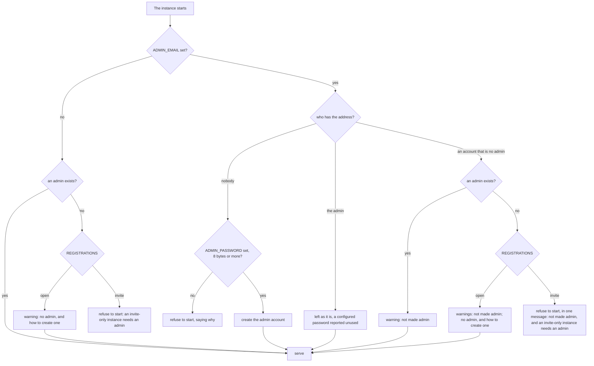

- **Nobody has the address**: the admin account is created, in one insert through the sign-up
  store, which settles a race for the address or the handle as for a registration (§ 2): display
  name `Admin` (the admin edits it like any name), a handle drawn from it as a registration draws
  one (`admin_xk9mp`), the password hashed as a registration's, `is_admin`, admitted, its address
  unconfirmed. No code is mailed. Without `ADMIN_PASSWORD`, or with one shorter than the
  instance's 8 bytes, the instance refuses to start ("ADMIN_PASSWORD is needed to create the admin
  account ADMIN_EMAIL names", "ADMIN_PASSWORD: at least 8 bytes"); an `ADMIN_EMAIL` that is not an
  address stops it too ("ADMIN_EMAIL: an address like name@example.com").
- **The admin has the address**: the account is left as it is. `ADMIN_PASSWORD` never writes over
  its password, so a password the admin chose is never reverted by a restart. While
  `ADMIN_PASSWORD` is set, each start warns that it is unused once the account exists and can be
  removed from `.env`.
- **An account that is not an admin has the address**: it is not made one, so a typo can't make a
  stranger admin. A warning says so, then the start goes on as without `ADMIN_EMAIL` — on an
  open instance, or on an invite-only one that has an admin already. An invite-only instance with
  no admin stops instead, with a single refusal that says both — the account is never promoted,
  and the instance needs an admin — and no warning before it.
- **No admin at all**: an open instance warns, at each start, that it has no admin, and that
  setting `ADMIN_EMAIL` and `ADMIN_PASSWORD`, then restarting, creates one. An invite-only
  instance refuses to start, saying the same and that `REGISTRATIONS=open` with a relay is the
  other way out (§ 6): nobody could ever get in.
- **`ADMIN_EMAIL` unset and an admin exists**: nothing.

An open instance that sets neither variable only warns, at each start, that it has no admin. An
invite-only one — `REGISTRATIONS` unset is invite-only — doesn't start until it has one.

### The members list

`GET /api/admin/members` lists the instance's members to its admins, on open and invite-only
instances alike. It takes an admin's bearer token — `401` without one, `403 access_denied` "Only
an admin may do this" for a member — and no recent password: it changes nothing.

A **member** is an account admitted or with its address confirmed (`SignInAccount::needs_code`
false): an account still to confirm its address is a sign-up under way, and is not listed. Each
member is answered as `{ id, display_name, admin, last_active_at, online }`:

| Field | |
|---|---|
| `id` | the account, as a reset link names it (§ 7) |
| `display_name` | its display name, `null` for an account without one — never its handle or its address |
| `admin` | an admin of the instance |
| `last_active_at` | the latest use of a live session of it (RFC 3339) — a sign-in, a silent `/authorize`, a refresh —, `null` when it is signed out everywhere |
| `online` | `true` when the instance's presence board reads it `online`, `away` or `dnd` — idle and busy count as online (`PresenceState::is_around`) —, `false` when it reads `offline`: an account that picked Invisible is offline to its admins as to everyone (`identity-provider/specs/presence.md`) |

The most recently active come first, then those signed out everywhere, by id. One query reads the
accounts with their sessions (`InstanceMembers`); the presence board, in memory, says who is
online (`ListMembers`).

### The instance's name and description

Admins change how the instance introduces itself — its name and its description, on its pages and
in its NodeInfo — from Settings → Instance, on open and invite-only instances alike. What they save
takes over from `INSTANCE_NAME` and `INSTANCE_DESCRIPTION`; the rule, what is in force and where a
change shows are `identity-provider/specs/identity.md § 6`.

| Route | |
|---|---|
| `GET /api/admin/intro` | An admin's bearer — `401` without one, `403 access_denied` "Only an admin may do this" for a member. `200 { name, description }`: the text in force as written, each `null` for the default (the domain, no description), so the form shows the domain as a placeholder rather than a value |
| `PUT /api/admin/intro` | An admin's bearer, no recent password: the text gives nobody an account. `403` for a member whatever the body. Body `{ name, description }`, both keys required, each a string or `null`, saved together. `200` with the text saved, as the `GET` answers it — trimmed, a blank field `null`. `400 invalid_request`, nothing saved, names the rule broken (`instance name: 40 characters at most`), or, for a body that is no such object — not JSON, without its `Content-Type`, a key missing —, what it must be (`instance intro: a name and a description, each a string or null`). Each save is logged, `changed the instance's intro`, with the admin's id |

A member is refused whatever the body: the admin check comes before the draft is judged. A key is
never left out to mean the default, so a body missing one resets nothing.

### Scenarios

- **Setting up an instance.** The operator sets `ADMIN_EMAIL` and `ADMIN_PASSWORD` in `.env`
  and starts it. The admin account exists before the first request, and signs in at once with
  that password, no code asked — mail may not be set up yet. `/userinfo` answers `admin: true`.
- **The restarts after.** The admin account is left as it is; a warning asks to remove
  `ADMIN_PASSWORD` from `.env`.
- **A password that breaks the rule** (`ADMIN_PASSWORD=admin`): the instance doesn't start, and
  says why. Nothing is created until a valid one is set.
- **A typo** in `ADMIN_EMAIL` that happens to be a member's address: the member stays a member,
  and the log warns.
- **An admin's password forgotten, on an open instance**: "Forgot password?" on the login page, as
  for anyone (§ 7).
- **Admin access lost** — the password forgotten, the mailbox gone: the operator sets
  `ADMIN_EMAIL` to an address no account has, and `ADMIN_PASSWORD`, then restarts. Another admin
  account is created beside the first.

### `/userinfo`

Returns `admin: boolean`: `true` for an admin of this instance, `false` for anyone else.

## 5. Invitations

An admin lets someone in with an **invitation**: a link to this instance's own pages, good for one
account, where the person creates theirs. Nobody types a code: the admin who made the link vouches
for the account, which is admitted (§ 4) and remembers who invited it (`users.invited_by`). Only
admins make invitations, and only on an invite-only instance (§ 6); any admin may revoke an open
one.

### Data model

```sql
CREATE TABLE invitations (
    id         UUID PRIMARY KEY,
    token_hash BYTEA NOT NULL UNIQUE,     -- SHA-256 of the link's token, never the token
    created_by UUID NOT NULL REFERENCES users(id) ON DELETE CASCADE,
    created_at TIMESTAMPTZ NOT NULL,
    expires_at TIMESTAMPTZ NOT NULL,      -- created_at + 7 days
    used_at    TIMESTAMPTZ,               -- set with used_by, by the account it let in
    used_by    UUID REFERENCES users(id) ON DELETE SET NULL,
    revoked_at TIMESTAMPTZ
);

ALTER TABLE users ADD COLUMN invited_by UUID REFERENCES users(id) ON DELETE SET NULL;
```

### The token

256 bits from the system's random source, written in URL-safe base64 without padding: 43
characters (`InvitationToken`). Only its SHA-256 is kept, as a refresh token's is, so the table
alone lets nobody in. The token is in one answer only — the admin's `POST`, as the link
`{issuer}/i/{token}` — and in no log: a request's path is logged as `/i/…`, and the token's
`Debug` prints `InvitationToken(..)`. Anything else in the token's place names no invitation.

### Open, used, revoked, expired

An invitation is **open** while it is unused, unrevoked and unexpired (`Invitation::is_open`): it
expires the second its 7 days (`INVITATION_TTL`) are up. Only an open one lets anyone in, and
only an open one can be revoked.

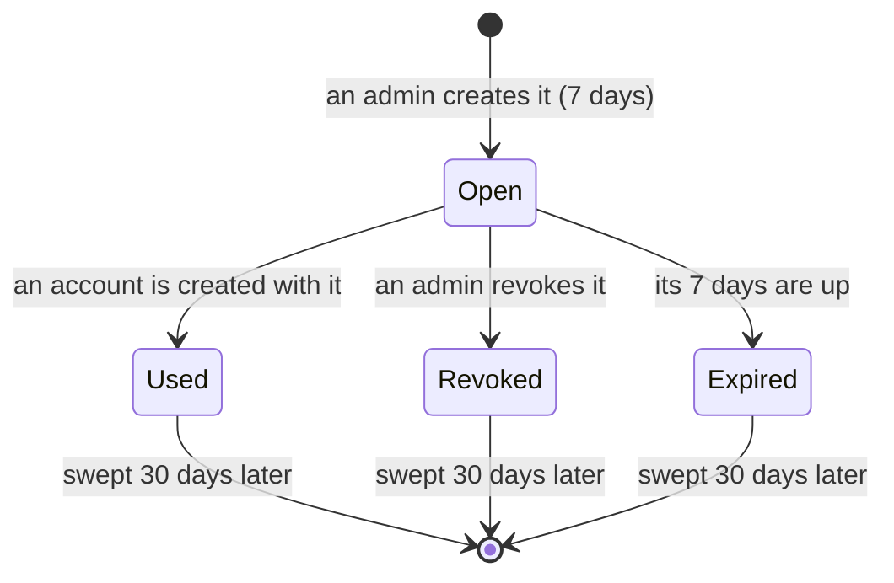

### The admin API

Every route takes the bearer token of an admin of this instance: without one, `401`; a member's
is `403 access_denied` "Only an admin may do this" (`AuthError::NotAdmin`, decided by the use
cases from `SignInAccount::admin`).

| Route | Answer |
|---|---|
| `POST /api/admin/invitations` | No body. `201 { id, link, expires_at }`: `link` is `{issuer}/i/{token}`, the only answer the token is ever in. On an open instance (§ 6), `409 registrations_open` "This instance is open: people sign up themselves" — to an admin; a member is `403` first |
| `GET /api/admin/invitations` | The open invitations, newest first: `[{ id, created_at, expires_at, created_by: { display_name } }]`. Used, expired and revoked invitations are not listed |
| `DELETE /api/admin/invitations/{id}` | Revokes an open one: `204`. Anything else — used, revoked, expired, unknown, not an id — is `404` "Invitation not found" |

### Joining by invitation

```mermaid
sequenceDiagram
    participant A as admin (Pīna'i)
    participant P as the person's browser
    participant I as IdP
    participant W as official web app

    A->>I: POST /api/admin/invitations
    I-->>A: 201 { link: {issuer}/i/{token} }
    A-->>P: the link, by any means
    P->>I: GET /i/{token}
    I-->>P: the doorway: who invites, to which instance, until when
    P->>I: GET /i/{token}/sign-up (Continue)
    I-->>P: the instance's sign-up form
    P->>I: POST /i/{token}/sign-up (display name, email, password)
    I->>I: one transaction: the invitation spent, the account admitted, invited_by its admin
    alt the official web app is known
        I->>I: a browser session, its password typed now; the web app remembered (client_sign_ins)
        I-->>P: 303 {web app}/?instance={domain} + session cookie
        P->>W: the web app opens on the instance
        W->>I: GET /authorize (its usual sign-in)
        I-->>W: 303 redirect_uri?code&state — a live session, for an app it signed in to
        W->>I: POST /token
        I-->>W: access_token + refresh_token + id_token
    else no web app known
        I-->>P: "Your account on {instance} is ready" — sign in from the app
    end
```

**The doorway**, `GET /i/{token}`, takes the whole page: Tapa 2 as a field and the instance's
initial set large behind; a top bar with the Pīna'i mark and "Self-hosted · Federated ·
Open-source"; "— {domain}"; "You've been invited by *{inviter}* to join *{instance name}*." — the
inviter by their display name only, never a handle or an address, and left out when they have
none —; the instance's description, when the instance has one, then "This link lets one
person create an account and expires in {N days, or hours under a day}."; **Continue**; and at
the foot "Only the admins of {domain} make invitations".

**The form**, `GET /i/{token}/sign-up`, is laid out as the sign-in pages are. Beside it, the
instance: its initial in a square and its name, its domain, its description as the headline,
"Invited by {inviter}" with their initial, the motif band. In the column: "— {domain}", "← Back to
the invitation", "Create your account", the display name, the address and the password, **Create
account**, "Your password goes to {domain}, never to Pīna'i", and, when the web app is known,
"Already have an account on {domain}? Sign in instead", a link to the web app on this instance.
There are no Sign in / Register tabs: the link decided.

**Posting it** (`RegisterInvited`) checks the invitation is open, then the registration rules of
§ 2 — the same words as the register tab's —, and creates the account through
`SignUps::create_invited`, sharing the handle draw of every account created
(`create_account`):

1. the invitation is spent by a guarded `UPDATE … WHERE used_at IS NULL AND revoked_at IS NULL
   AND expires_at > now RETURNING created_by`;
2. the account is inserted admitted (`admitted_at` now), `invited_by` the invitation's creator;
3. the invitation records it (`used_by`);

in one transaction. An address or a handle already taken rolls it all back, so the invitation
stays open. No code is mailed, ever (§ 4).

**Then, with the official web app known**, the browser is signed in as a password sign-in signs
it in (`CompleteSignIn`, without its code): a browser session whose password was typed now — one
another account held on this browser ends, `replaced` — and the web app remembered in
`client_sign_ins`, which is the app's consent (§ 1 "The session cookie"). The answer is `303` to
`{web app}/?instance={DOMAIN}`, with the session cookie, and no authorization code: no request
is in flight. The web app then starts its own sign-in, and `/authorize`, finding a live session
of an account that signed in to it, answers with a code at once. With no web app known, the
answer is the page "Your account on {instance name} is ready. Open the Pīna'i app and sign in
with {email}." — no session: the app asks for the password at its first sign-in, which is its
consent.

**What goes wrong:**
- Signing the browser in fails after the account was created: the account stands and the
  invitation is spent, so the answer is the "ready" page, and the failure is logged once.
- A broken rule or an address taken shows the form again, `400`, with its sentence and what was
  typed, the password aside.
- An invitation used, revoked or expired, or no invitation at all — on either page, or spent by
  someone else while the form was filled in — is the one page "This invitation can no longer be
  used. Ask the person who sent it for a new one.", `404`, the same whatever happened.

**Headers.** The pages are the sign-in pages' (§ 1: the strict CSP, `no-store`, the instance's
own script only). Their URL holds the token, so none sends it off the instance: the doorway, the
"can no longer be used" page, the redirect to the web app and the "ready" page are
`Referrer-Policy: no-referrer`; the form's page keeps the sign-in pages' `same-origin`, under which
the form posts its `Origin` — a browser without `Sec-Fetch-Site` can join too. The form's
`form-action` also names the web app's origin, where its answer redirects. The form is refused
`403` from another site.

### The official web app

The official web app is built into the IdP like the desktop app's document: its origin is
`OFFICIAL_WEB_APP_ORIGIN` (`domain::auth`; none until it is published), its client ID
`{origin}/oauth-client.json`, the document it serves (`WebApp`). `WEB_APP_ORIGIN`, an `http(s)`
origin, overrides that address in any environment. Unset, a development instance uses the web
client of a checkout, `http://localhost:5173`, and a production one the official web app, if any.
The redirect after joining goes to that origin only, never to anything a request names. An origin
that is not one — or whose document's URL is no client ID — stops the instance from starting.

### Racing for one link

Two sign-ups posted at once with one link create one account. The guarded `UPDATE` locks the
invitation's row: the second waits for the first's transaction, then finds the invitation used
and creates nothing — its sender gets the "can no longer be used" page. Had the first been rolled
back (its address taken), the second goes through.

### Sweep

The hourly sign-up sweep (§ 2) deletes an invitation 30 days after it ended — used, revoked or
expired, whichever came first (`INVITATION_RETENTION`). An open one is never swept.

### Scenarios

- **Inviting someone.** An admin creates an invitation in Pīna'i and sends the link. The person
  opens it, continues, fills in the form and lands in the web app signed in; no mail is sent. The
  invitation, used, is not in the admin's list of open ones.
- **A link used, revoked or expired** shows "This invitation can no longer be used. Ask the person
  who sent it for a new one." — which of the three, it never says.
- **Two people racing on one link**: one account is created; the other is told the link can no
  longer be used.
- **An address already registered**: the form says so; the link stays open, for another address
  or for signing in instead.
- **A browser signed in as someone else**: joining signs it in as the new account, ending the
  other's session there.
- **No web app known** (a production instance before the official web app exists): the person is
  told their account is ready, and signs in from the app with their password, no code asked.
- **A link sent to the wrong person**: an admin revokes it and creates another.

## 6. Who can join

An instance is **open** or **invite-only**, as `REGISTRATIONS` says: `open` or `invite`, in any
case. Unset or empty, it is `invite`: an instance lets in only the people its admins invite,
unless told otherwise. Any other value stops the start ("Invalid REGISTRATIONS: 'closed' (expected
open or invite)"). The setting is `domain::auth::Registrations`, read once as the instance starts
(`app::configuration`), and given to the use cases that depend on it.

| | Open — `REGISTRATIONS=open` | Invite-only — `REGISTRATIONS=invite`, the default |
|---|---|---|
| Who creates an account | Anyone: the register tab or `POST /register` (§ 2) | Only someone invited (§ 5) |
| A new account's address | Confirmed by a mailed code (§ 2) | Never confirmed by a code: the invitation admits it (§ 4) |
| Invitations | None made (`409`); those left from before still work, are listed and revoked | Made by admins |
| Mail relay (`SMTP_HOST`) | Required: no start without one | Optional |
| An admin | Optional: each start without one warns | Required: no start without one |
| NodeInfo `openRegistrations` | `true` | `false` |
| Password reset links (§ 7) | Made by admins, or asked for by mail: "Forgot password?" on the login page | Made by admins only: no "Forgot password?", `/forgot-password` is `404` |
| The sign-in pages | "open registration"; the Sign in and Register tabs | "invite only"; no tabs |

### The sign-up rule

An uninvited sign-up is allowed only on an open instance; a sign-up through an invitation is
allowed in both modes (`Registrations::admit`, with `Joining::Uninvited` or `Joining::Invited`).
So a link made while the instance was invite-only lets its person in until it ends — used, revoked
or expired — whatever the instance has become since.

`Register`, behind `POST /register` and `POST /register-and-login`, asks the rule before anything
else, and so does `RegisterInvited`, behind `POST /i/{token}/sign-up`. On an invite-only instance
every uninvited sign-up gets the same refusal,
`AuthError::InvitationRequired`, whatever was typed — an address already registered included —,
so it tells nothing of who has an account; nothing is created and nothing is mailed:

- `POST /register` answers `403 {"error": "invitation_required", "error_description": "Accounts on
  {domain} are by invitation only"}`;
- the register form goes back to `/login?{request}&error=invitation_required`, where the page says
  "Accounts on {domain} are by invitation only".

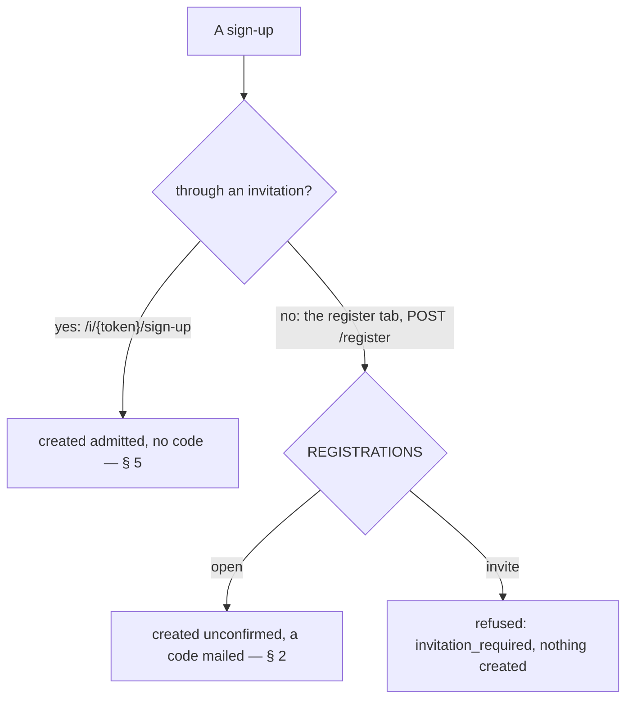

### Invitations only on invite-only instances

An open instance has no need to invite: its people sign up themselves. `CreateInvitation` refuses
there (`Registrations::allow_invitations`), once the caller is known to be an admin — a member is
`403` first, as on any instance: `POST /api/admin/invitations` answers `409 {"error":
"registrations_open", "error_description": "This instance is open: people sign up themselves"}`.
Listing and revoking work in both modes, so the links left over after a switch to open can be
seen and revoked; until then each still lets its person in.

### Starting

Two rules keep an instance from starting, each saying how to set it right:

- **An open instance needs a mail relay**: it mails every sign-up a code, and an unset or empty
  `SMTP_HOST` means no relay (§ 2 "SMTP"). Reading the configuration refuses it:
  "REGISTRATIONS=open needs an SMTP relay: set SMTP_HOST, or REGISTRATIONS=invite".
- **An invite-only instance needs an admin**: nobody else makes the invitations that let anyone
  in. The rule of § 4, `admin_bootstrap`, takes the setting: where an open instance only warns
  that it has no admin — `ADMIN_EMAIL` unset, or naming an account that is not an admin — an
  invite-only one is refused (`AdminRefusal::NoAdminToInvite`), and `report_admin` stops the
  start: "REGISTRATIONS=invite (the default) needs an admin: set ADMIN_EMAIL and ADMIN_PASSWORD,
  or REGISTRATIONS=open with an SMTP relay"; when `ADMIN_EMAIL` names an account that is not an
  admin, the one refusal also says it is never promoted. So an instance that sets neither
  `REGISTRATIONS` nor the admin's variables, and has no admin yet, doesn't start.

An invite-only instance without a relay starts: it logs `no SMTP relay: mail is off`, and checks
no relay. A relay that is set but can't be used is warned about in both modes (`SMTP relay
unusable`).

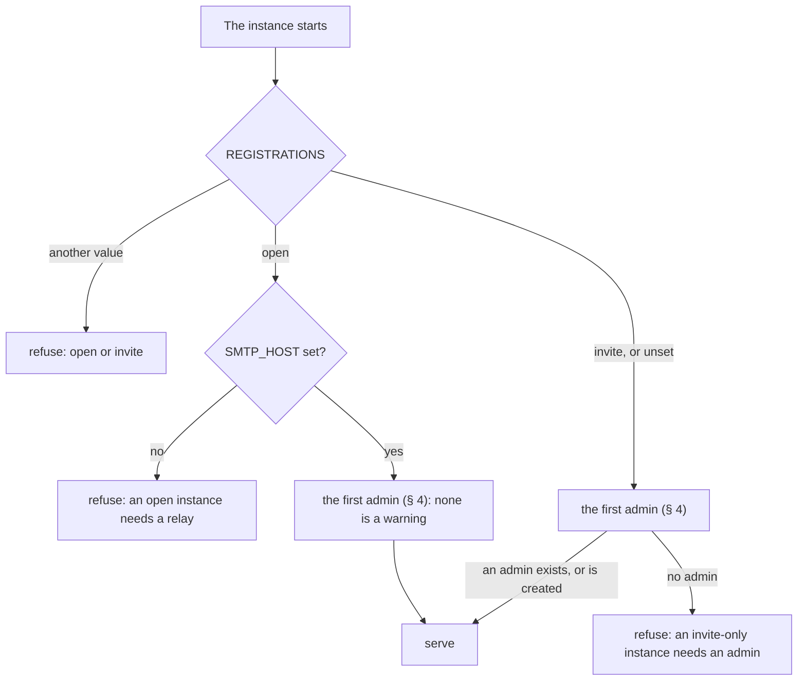

### What the instance tells

- **NodeInfo**: `openRegistrations` is `true` on an open instance, `false` on an invite-only one
  (`identity-provider/specs/identity.md § 6`).
- **The sign-in pages** (§ 1): beside the form, "open registration" in the colour of something
  on, or "invite only" in the idle one. On the login page, an open instance has its Sign in and
  Register tabs and "Forgot password?" (§ 7); an invite-only one has no tabs — its login page is
  the sign-in form, `/login?tab=register` included — and no "Forgot password?": whoever forgot
  theirs asks an admin.
- **The invitation pages** (`/i/{token}` and its form, § 5) are the same in both modes. The
  "ready" page that can end joining carries the instance's facts like every sign-in page, so it
  shows "open registration" or "invite only".

### Switching modes

`REGISTRATIONS` is read as the instance starts: change it, then restart.

- **Invite-only to open** needs a relay first: an open instance doesn't start without one. The
  accounts that joined by invitation, and the first admin, keep signing in with their password
  alone: admitted (§ 4), they are never asked to confirm their address. Invitations still open
  keep letting their person in until they end; no new one is made.
- **Open to invite-only** closes sign-up. The instance needs an admin, as every invite-only one
  does. Existing accounts keep signing in, except one that never confirmed its address: it still
  needs its code — which, without a relay, can't be mailed — and the sign-up sweep (§ 2) deletes
  it a week after it was created.

### Scenarios

- **A circle of friends.** The operator sets `ADMIN_EMAIL` and `ADMIN_PASSWORD`, leaves
  `REGISTRATIONS` unset, and sets up no relay. The instance starts invite-only and logs that mail
  is off; the admin signs in without a code and invites each friend.
- **A public instance.** `REGISTRATIONS=open` and a relay: anyone signs up on the register tab and
  confirms with the mailed code. NodeInfo says `openRegistrations: true`.
- **Someone at an invite-only instance's register tab** — an old link with `?tab=register` — sees
  the sign-in form, no tabs, and "invite only" beside it. The form posted anyway, or `POST /register`,
  is refused "Accounts on {domain} are by invitation only", and no account is created.
- **An admin of an open instance asking for an invitation** is answered `409`: people sign up
  themselves there.
- **A forgotten password**: on an open instance, "Forgot password?" mails a link; on an
  invite-only one, an admin makes it (§ 7).
- **Forgetting the admin.** An instance started with neither `REGISTRATIONS` nor `ADMIN_EMAIL`
  stops at once, saying to set the admin's address and password, or to open sign-up with a relay.
- **`REGISTRATIONS=open` without `SMTP_HOST`** stops at once, saying to set the relay or to go
  invite-only.

## 7. Password reset links

Someone who forgot their password gets back in through a **reset link**: a single-use link with
which whoever opens it sets a new password for the account, on this instance's own page. A link
comes one of two ways:

- **An admin makes it** for a member and sends it however they like (§ "The admin API"), on open
  and invite-only instances alike: for a member only — an account admitted or with its address
  confirmed (§ 4 "The members list") — and never for an admin, who recovers through `ADMIN_EMAIL`
  and `ADMIN_PASSWORD` (§ 4 "The first admin") or, on an open instance, as anyone does by mail.
  Nothing is mailed. Open 24 hours.
- **The account asks for it by mail**, "Forgot password?" on the login page of an open instance
  (§ "Forgot your password?"): any account with the address, confirmed or admitted, admins
  included. Open 30 minutes.

Either way, setting the password ends every session of the account and signs nobody in: a link
forwarded by its owner must not sign anyone into the owner's account. Which way it came
(`ResetBy`) only changes what its page says.

### Data model

```sql
CREATE TABLE password_resets (
    id          UUID PRIMARY KEY DEFAULT gen_random_uuid(),
    token_hash  BYTEA NOT NULL UNIQUE,     -- SHA-256 of the link's token, never the token
    user_id     UUID NOT NULL REFERENCES users(id) ON DELETE CASCADE,  -- the member
    created_by  UUID REFERENCES users(id) ON DELETE CASCADE,  -- the admin: a link answers for
                                           --   them, as an invitation does; NULL for a link the
                                           --   account asked for by mail
    created_at  TIMESTAMPTZ NOT NULL,
    expires_at  TIMESTAMPTZ NOT NULL,      -- created_at + 24 hours (an admin's), + 30 minutes
                                           --   (asked for)
    used_at     TIMESTAMPTZ,
    replaced_at TIMESTAMPTZ,               -- a newer link for the same member took its place
    replaced_by UUID                       -- that link: withdrawn because its mail failed, it
                                           --   gives this one back. No foreign key: it is
                                           --   deleted first
);
-- At most one link per member neither used nor replaced.
CREATE UNIQUE INDEX password_resets_one_open ON password_resets (user_id)
    WHERE used_at IS NULL AND replaced_at IS NULL;
-- The links an account asked for in the last hour, counted at each request.
CREATE INDEX password_resets_by_account ON password_resets (user_id, created_at);
-- and sessions.revoked_reason: password_reset (§ 1 "Sessions")
```

### The token

As an invitation's (§ 5): 256 bits from the system's random source, written in URL-safe base64
without padding, 43 characters (`ResetToken`). Only its SHA-256 is kept, so the table alone sets no
password. The token is in one answer only — the admin's `POST`, as the link `{issuer}/r/{token}` —
or in the one mail that carries that link, and in no log: a request's path is logged as `/r/…`
(`RESET_PATH_PREFIX`, the prefix the router and the link use too), and the token's `Debug` prints
`ResetToken(..)`. Anything else in the token's place names no link.

### Open, used, replaced, expired

A link is **open** while it is unused, not replaced and unexpired (`PasswordReset::is_open`): it
expires the second its time is up — 24 hours for an admin's (`RESET_TTL`), 30 minutes for one asked
for by mail (`REQUESTED_RESET_TTL`), which only has to cross a mailbox. A new link for an account
**replaces** the one it had open, in the transaction that makes it — an admin's replacing one asked
for, and a request replacing an admin's: only the newest works. The store holds at most one link per
account that is neither used nor replaced — a partial unique index, not a convention — and making
one locks the account's row first, so two made at once leave one open.

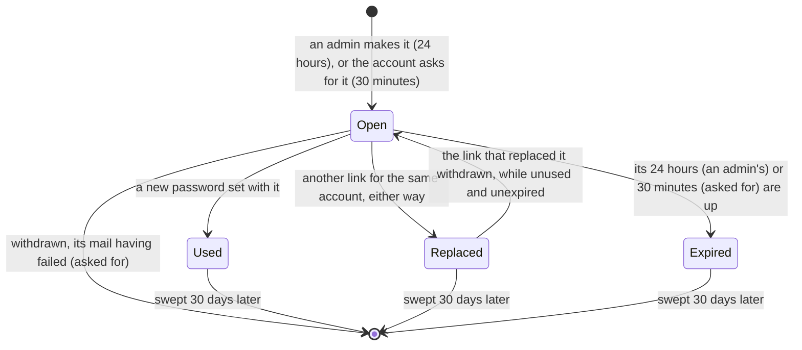

### The admin API

| Route | Answer |
|---|---|
| `POST /api/admin/members/{id}/password-reset` | No body. `201 { link, expires_at }`: `link` is `{issuer}/r/{token}`, the only answer the token is ever in. The member's open link, if any, stops working. An unknown account, one still to confirm its address, or an id that is none, `404` "Member not found"; an admin `409 admin_account` "An admin recovers their access through ADMIN_EMAIL and ADMIN_PASSWORD, not a reset link" |

It takes an admin's bearer token with a recent password (§ 1 "Sensitive actions"): a link hands the
member's account to whoever holds it. Without a token, `401`; a password typed more than 10 minutes
ago on the admin's session, `401 insufficient_user_authentication`, checked with the token, before
anything else; then a member's token is `403 access_denied` "Only an admin may do this", whatever
the id (`IssuePasswordReset`, `AuthError::NotAdmin`). Who may get a link is a domain rule,
`reset_target`: a member who is no admin. An account still to confirm its address is a sign-up
under way, not a member: it is answered as an unknown one, `404`. The refusal of an admin is `409`,
not `403`: on this API `403` says the caller is no admin, while here an admin asks and the account
refuses — as `409 registrations_open` does for an invitation on an open instance (§ 6).

### Forgot your password?

On an **open** instance, which always has a mail relay (§ 6), the login page offers a way back that
needs nobody: `Registrations::allow_reset_by_mail`. An invite-only instance shows no such link,
and answers `/forgot-password` with the page "No password reset by mail here. Ask an admin of
{domain} for a reset link.", `404`: its admins make the links.

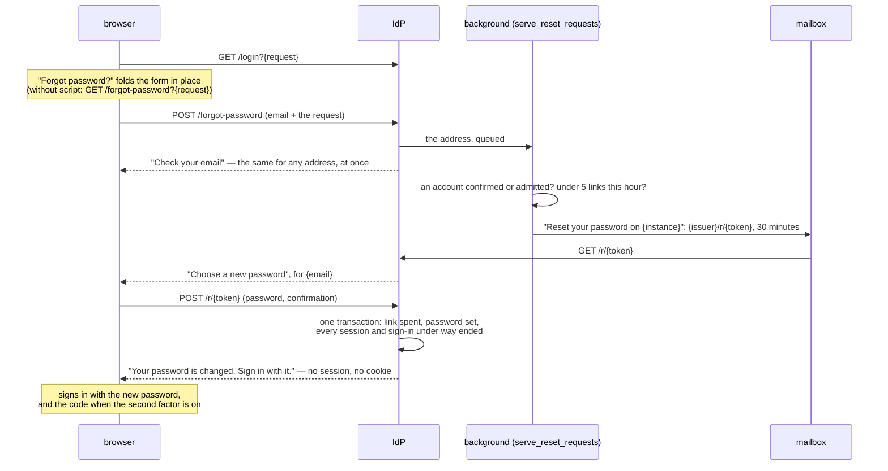

**The login page.** On the Sign in tab, **Forgot password?** sits at the right of the Password
label. It opens "Reset your password": the app's line, the tabs and the password fold away, the
address typed stays, the button says **Send reset link →**, "{instance} will email a link to choose
a new password. It works once, for 30 minutes." appears below the form, "← Sign in" stands in for
"← Another home", and the line at the foot says "{domain} sends the link. Pīna'i never sees your
email." The link is `/forgot-password?{the request}`: without script it opens that page, the login
page in that state, carrying the request, the theme and the motif; with it, `/assets/sign-in.js`
folds the form in place and back, its `action` turning from `/login` to `/forgot-password`, the
password disabled so it is neither required nor sent, the URL and the tab's title following. The
Register tab has no such link.

**The request**, `POST /forgot-password`, a same-origin form (§ 1 "Safety") carrying the request:

- on an invite-only instance, the "No password reset by mail here" page, `404`, before anything
  else;
- with no request left, back to `/login`, which says the sign-in expired; for a client that can't
  be verified, that page (§ 1) — the request is checked as the login form's is;
- what is no address: the request again, `400`, "Enter a valid email address", the typed text in
  its field;
- otherwise "Check your email": "If {email} has an account on {domain}, a reset link is on its
  way. It works once and expires in 30 minutes.", "Nothing yet? Check spam, or *send it again*.",
  and "← Back to sign in". *Send it again* posts the address back with `again=1`, which only opens
  the reset request once more, the address in its field: nothing is sent until it is asked for
  again. The address is in these pages only, answers to a `POST`: never in a URL.

**The same answer, whatever the address.** No account, an account still to confirm its address, an
account past the limit, a mail that fails: the words are the same, and so is the timing — the
handler parses the address, puts it on a queue and answers, before anything is looked up. A
background task beside the sweeps (`api::background::serve_reset_requests`) takes the requests one
at a time and runs `RequestPasswordReset` on each — a panic in one leaves it taking the next:

1. the account with the address, whatever its case;
2. `reset_requester`: confirmed or admitted, admins included — the account and the address are
   theirs, and an operator's way back stays `ADMIN_EMAIL`. Not an account still to confirm its
   address: it finishes signing up (§ 2);
3. `PasswordResets::request`, in one transaction under the account's row lock: the links the
   account asked for in the last hour are counted from the rows — an admin's don't count — and
   past 5 (`RESET_REQUEST_LIMIT`, `RESET_REQUEST_WINDOW`, `may_request_reset`) nothing is made, the
   open link left as it is; otherwise its open link, an admin's included, is replaced by a new one,
   `created_by` NULL. Requests at once queue on the lock, so none passes the limit;
4. the mail. Should it fail, the new link is withdrawn (`PasswordResets::withdraw`, which never
   takes back an admin's link or one used): it neither counts towards the 5 nor works, and the
   link it replaced — a mailed one or an admin's — works again, if it is still unused and
   unexpired and the withdrawn one was still the newest. All in one transaction under the
   account's lock, the withdrawn row deleted first so the account never holds two open links; the
   link given back is the one whose `replaced_by` names the withdrawn link — never found by a
   timestamp, which several replacements can share. So a request that can't be mailed — the budget
   spent, the relay down — never takes away a link someone already holds. A mail whose outcome is
   unclear — the relay took it, then the connection timed out — withdraws a link that may yet
   arrive: opened, it shows the "can no longer be used" page, which points to "Forgot
   password?".

**What gets through.** The mails, not the requests, are budgeted: 60 reset mails, then one every
6 seconds, for the whole instance (`infrastructure::email::ResetMailBudget`, around the relay).
Past the budget the send fails (`AuthError::MailBudgetSpent`), and the link is withdrawn as for any
failed mail; these refusals are warned about by count, at most once a minute. A made-up address
never mails, so a flood of them spends none of it and never stops a real address's link; a real
address mails 5 an hour at most. The requests themselves are bound by their queue only: 256 wait at
most, drained at the database's pace for an address with no account; past that, one is dropped,
and the drops are warned about at most once a minute, by count — a count left over is written out
by the task's minute tick, so a burst's last one is told too. The IdP can't tell clients apart
behind its proxy, so limiting each client is the proxy's job. When the instance stops, the task
keeps taking requests until the HTTP server has answered its last one, then handles those still
waiting until the instance's ten seconds to stop are up — the same ten seconds the HTTP server's
drain has, counted from the stop —, and logs how many were left unsent — waiting, or under way
when the time ran out —, if any. A request dropped or
failed mails nothing — the person asks again —, and no log line holds the address: a relay's
refusal is logged by its SMTP code and whether it is lasting, never by its reply, which often
repeats the recipient; each step with the relay times out after 15 seconds.

**The mail**, plain text and HTML like the sign-up code's (§ 2 "SMTP"): "Reset your password on
{instance}", the link `{issuer}/r/{token}`, "It works once, for 30 minutes.", and "If you didn't
ask for it, ignore this email: your password stays as it is."

### Setting the new password

```mermaid
sequenceDiagram
    participant A as admin (Pīna'i)
    participant P as the member's browser
    participant I as IdP
    participant D as the member's devices
    A->>I: POST /api/admin/members/{id}/password-reset (a recent password)
    I-->>A: 201 { link: {issuer}/r/{token}, expires_at }
    A-->>P: the link, by any means
    P->>I: GET /r/{token}
    I-->>P: "Set a new password" for {name}
    P->>I: POST /r/{token} (password, confirmation)
    I->>I: one transaction: the link spent, the password set, the sessions and sign-ins under way ended
    I-->>D: their sockets close (1008); their tokens and refresh tokens refused
    I-->>P: "Your password is changed. Sign in with it."
```

**The page**, `GET /r/{token}`, is laid out as the sign-in pages are, the instance beside the form.
For an admin's link, in the column: "— {domain}", "Set a new password", "for {member's display
name}" — never a handle or an address, and left out when they have none —, the new password and
its confirmation, each with the register form's `autocomplete="new-password"` and `minlength="8"`,
**Set the password**, and "Your password goes to {domain}, never to Pīna'i". For a link asked for
by mail: "Choose a new password", "For {email}. This link works once." — the address the link was
mailed to —, **New password** with a strength meter under it (four bars the script fills as it is
typed: a hint, one bar under 8 characters since the instance refuses those), **Repeat it**, marked
once it matches, **Set new password**, and "Every device signed in to {domain} is signed out, and
signs in again with it." Either form posts to this instance only (`form-action 'self'`).

**Posting it** (`ResetPassword`) first checks the link is open — a made-up link costs no password
hash —, then the new password: 8 bytes at least, typed the same twice (`NewPassword`). A broken
rule or two different passwords show the form again, `400`, with its sentence ("Password must be at
least 8 characters", "The two passwords differ") and nothing that was typed. Then
`PasswordResets::reset`, in one transaction:

1. the link's member is looked up by the token's hash, without a lock — no link, and nothing
   happens —, then the member's account row is locked, as making a link locks it, so the two
   queue up instead of deadlocking;
2. the link is spent by a guarded `UPDATE … WHERE used_at IS NULL AND replaced_at IS NULL AND
   expires_at > now RETURNING user_id` — the member whose password is set —, and nothing more
   happens when it returns none;
3. the member's password hash is replaced;
4. every session of theirs not revoked yet ends — those idle past their 90 days included —,
   `revoked_reason = 'password_reset'`, and is returned;
5. their open second-factor tickets (§ 3) are closed: a sign-in half done with the old password,
   waiting for the authenticator's code, can't finish.

After the commit the use case closes the sockets of each session ended, as signing out of the
other devices does (`SessionNotifier`): they close with `1008`, and the sessions' tokens and
refresh tokens are refused at once (§ 1 "Sessions"). The answer is the page "Your password is
changed. Sign in with it.", with — when the official web app is known (§ 5 "The official web
app") — a **Sign in** link to `{web app}/?instance={domain}`. Whichever the link, no session is
opened, no cookie set and no app consented to: a link its owner forwards must not sign anyone into
the owner's account. The account signs in with the new password as anyone does, and with its code
when the second factor is on.

**Left as it was**: the second factor — an account with an authenticator still types its code after
the new password (§ 3) —, the apps the account signed in to (`client_sign_ins`), and the devices,
each of which signs in again as itself.

**What goes wrong**: a link unknown, used, replaced or expired — on the page, or spent by another
submission while the form was filled in — is the one page "This link can no longer be used.",
`404`, the same whatever happened and whatever the token. What it says next depends on the instance
only: on an open one, "Ask for a new one with "Forgot password?" on the sign-in page.", with a
**Sign in** link to the web app when it is known; on an invite-only one, "Ask an admin of {domain}
for a new one."

**Headers.** The pages are the sign-in pages' (§ 1: the strict CSP, `no-store`, the instance's own
script only). The form's page keeps the sign-in pages' `Referrer-Policy: same-origin`, under which
the form posts its `Origin`; the "can no longer be used" page and the "changed" page are
`no-referrer`. The form is refused `403` from another site.

### Racing for one link

Two submissions at once with one link change the password once. Both lock the member's account row:
the second waits for the first's transaction, then finds the link used and changes nothing — its
sender gets the "can no longer be used" page, and the password is the first's.

### Sweep

The hourly sign-up sweep (§ 2) deletes a link 30 days after it ended — used, replaced or expired,
whichever came first (`RESET_RETENTION`). An open one is never swept.

### Scenarios

- **Forgot your password, on an open instance.** "Forgot password?" on the login page, the
  address, **Send reset link**. The mail arrives; its link opens "Choose a new password"; once it
  is set, every device of the account is signed out, and the page says to sign in with it — from
  the web app's **Sign in**, or any app.
- **A link forwarded by its owner** — asked for, then sent to someone else: whoever sets a
  password with it changes the owner's password, and is signed in nowhere.
- **An address with no account** — or an account still signing up, or one that asked five times
  this hour — gets the same "Check your email", as fast; no mail goes out.
- **A mailbox flooded by someone else's requests** gets 5 links an hour at most, each replacing the
  one before; ignoring them changes nothing.
- **An account with an authenticator** sets its password with the mailed link, and is told to sign
  in with it: the sign-in asks the password, then the code.
- **The relay refuses the address**: nothing arrives, the link is withdrawn, and the log says the
  relay refused a reset link — its code —, never to whom.
- **A request while the mail budget is spent**: no mail, and the link the account already held —
  mailed earlier, or an admin's — keeps working.
- **A link expired on an open instance**: "This link can no longer be used. Ask for a new one with
  "Forgot password?" on the sign-in page."
- **An admin of an open instance** who forgot their password asks for a link like anyone.
- **A forgotten password on an invite-only instance.** The member asks an admin. The admin finds
  them in the members list, asks for a reset link — typing their own password again when it is
  older than 10 minutes — and sends it. The member sets a new password on the instance's page;
  every device of theirs is signed out at once, and each signs in again with the new password.
- **A link used, or past its 24 hours — 30 minutes for one asked for**: "This link can no longer
  be used." — which of the two, it never says.
- **A link replaced**: the admin made another, the first having gone to the wrong place; the first
  shows the same "can no longer be used" page, the newest works.
- **Two submissions racing** — a double click, two tabs —: the password changes once; the second
  gets the "can no longer be used" page.
- **A member with an authenticator**, after an admin's link, signs in with the new password, then
  the authenticator's code, as before. An authenticator lost too is a recovery code's business (§ 3), not a link's.
- **A sign-in half done with the old password** — the password typed, the authenticator's code not
  yet — doesn't finish once the password is reset: its ticket closes with the sessions.
- **An account still signing up**, its address never confirmed, gets no link: `404`, as an unknown
  one. It isn't in the members list either.
- **An admin asking a link for an admin** — another, or themselves — is refused `409`: an admin
  recovers through `ADMIN_EMAIL` and `ADMIN_PASSWORD` (§ 4 "Admin access lost").
- **A member's token copied, or a device of theirs lost**: the reset signs it out with every other
  session of theirs, not only the browser's.
- **An admin's laptop left open.** Whoever sits at it can't make a member's reset link without the
  admin's password.
