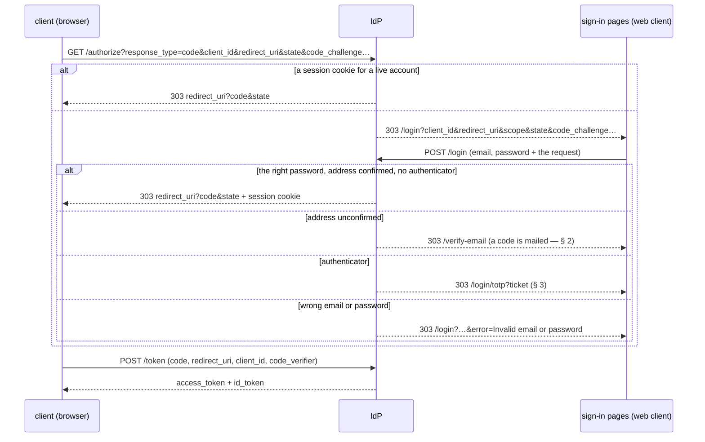
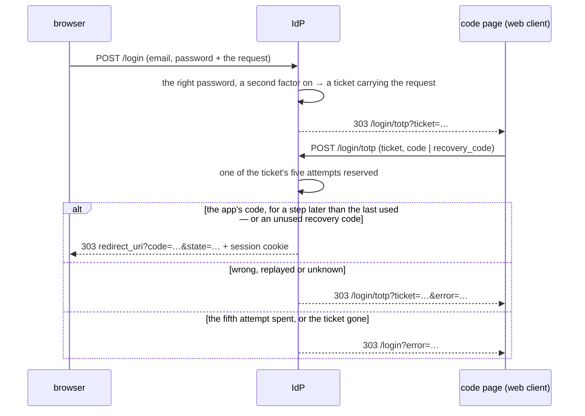

# Pina'i — Signing in, sign-up and the second factor

## 1. Signing in — OpenID Connect

The IdP is the OpenID provider of its own accounts. There is one flow — the authorization code
flow with PKCE (`S256`) — for public clients, which hold no secret. The web client hosts the
sign-in pages (`/login`, `/verify-email`, `/login/totp`) at `FRONTEND_URL`; the IdP's form
endpoints answer by redirecting between them, and finally back to the client with a code.



### Clients

`oauth_clients` registers each client: its `client_id` and its `redirect_uris`. A redirect URI
must match a registered one **exactly**, case and path included (RFC 6749 § 3.1.2) — it is where
codes are sent. The web client is seeded by the first migration.

### `GET /authorize`

1. The client must be known and the `redirect_uri` registered for it. Either failure is
   answered by the IdP itself — `401 invalid_client` or `400 invalid_request` — since the
   redirect cannot be trusted.
2. Only then the flow: `response_type=code` and `code_challenge_method=S256`. A failure here goes
   back to the client, as RFC 6749 § 4.1.2.1 says: `redirect_uri?error=unsupported_response_type`
   (or `invalid_request`)`&error_description=…&state=…`.
3. A browser with a session cookie for an account that still exists is handed a code at once;
   any other goes to the login page, carrying the request.

### `POST /login`

The login form, posted by the browser with the request it carries.

- The request is checked again — a known client, a registered `redirect_uri` — or any page
  could have a code sent wherever it names. A failure is `401` / `400`, never a redirect.
- Password guesses are bounded per email address, in any case: 10, then one a minute. Past that,
  the form is sent back with `error=Too many attempts — try again in a minute`, whatever the
  password — known address or not, so the limit tells nothing of who has an account.
- An unknown email is checked against a decoy hash as costly as a real one, and answered like a
  wrong password: `error=Invalid email or password`. Neither the answer nor its timing tells
  whether the address has an account.
- The right password on an unconfirmed address mails a fresh code and goes to `/verify-email`
  (§ 2); on an account with an authenticator it opens a ticket and goes to `/login/totp`
  (§ 3). Otherwise it issues a code and sets the session cookie.

A code is good for 10 minutes, once. It remembers the account, the client, the
`redirect_uri`, the scope, the challenge and the nonce; the `state` goes back with it and is not
kept.

### The session cookie

`idp_session` holds the account id, signed (HMAC-SHA256) with a key derived from
`SESSION_SECRET`: `HttpOnly`, `SameSite=Lax`, `Path=/`, 30 days, and `Secure` in production. It is
what lets `/authorize` skip the login page.

The secret makes two keys, each derived from all of it with HKDF-SHA256 under a label of its own:
the session cookie's (`pinai idp: session cookies`) and the attachment links'
(`pinai idp: attachment links`, `identity-provider/specs/attachments.md`). No purpose
shares another's key, and a new secret signs everyone out.

### `POST /token`

`application/x-www-form-urlencoded`: `grant_type`, `code`, `redirect_uri`, `client_id`,
`code_verifier`.

1. `grant_type` must be `authorization_code`, the client known, the `redirect_uri` registered.
2. The code is **spent** as it is read — even if the rest of the exchange is refused, it is never
   tried twice.
3. The code must have been issued to this client for this `redirect_uri`, and the verifier must
   meet its challenge: `BASE64URL(SHA256(code_verifier)) = code_challenge`.
4. The account must still exist.

```json
{ "access_token": "…", "token_type": "Bearer", "expires_in": 3600, "id_token": "…" }
```

Every answer, success or refusal, carries `Cache-Control: no-store` and `Pragma: no-cache`
(RFC 6749 § 5.1).

| Refusal | Status | `error` |
|---|---|---|
| Another grant type | 400 | `unsupported_grant_type` |
| Unknown client | 401 | `invalid_client` |
| Unregistered or mismatched `redirect_uri`, unusable code (unknown, expired, spent, or its account gone), another client's code, a verifier that does not meet the challenge | 400 | `invalid_grant` |

### Tokens

Both are JWTs signed with the instance's Ed25519 key (`EdDSA`, the key the JWKS publishes):
`iss` the issuer, `sub` the account id, `aud` the `client_id`, `email`, `preferred_username` (the
handle), valid for one hour. The ID token adds the request's `nonce`. There is no refresh token:
a client signs in again, which a live session cookie makes silent.

A bearer token that is missing or unusable is answered `401 invalid_token`, with the challenge
RFC 6750 § 3 asks for: `WWW-Authenticate: Bearer` when none was sent, `Bearer
error="invalid_token"` when one was.

### Calls from a browser

Every route answers CORS for any origin (`Access-Control-Allow-Origin: *`), because pages served
elsewhere call this instance: another instance's web client fetching its JWKS to verify a member's
device, and the desktop app.

Nothing is given away by it. The API is authorised by the bearer token alone, which a page holds
only once signed in. The session cookie serves only the sign-in flow the browser itself navigates
through: `/authorize`, the login, sign-up and code forms, and `/logout`. Under `*` a browser never
exposes the answer to a credentialed request.

The allowed request headers are listed, `Authorization` among them, rather than `*`, which Firefox
reads as not covering `Authorization`.

### `GET /logout`

Drops the session cookie and redirects to `post_logout_redirect_uri` — only when it is an
`http(s)` URL on the origin of a registered redirect URI, where a client lives. Anything else
goes to `/`: the endpoint is never an open redirect.

### Discovery

`GET /.well-known/openid-configuration` (OpenID Connect Discovery 1.0 § 4) names the endpoints,
`response_types_supported: ["code"]`, `grant_types_supported: ["authorization_code"]`,
`code_challenge_methods_supported: ["S256"]`, `id_token_signing_alg_values_supported: ["EdDSA"]`
and `token_endpoint_auth_methods_supported: ["none"]`. `GET /.well-known/jwks.json` serves the
public key.

### Scenarios

- **First visit.** The web client sends the browser to `/authorize`; without a session it lands
  on the login page, signs in, and comes back with a code the client exchanges at `/token`.
- **Coming back.** The session cookie is still there: `/authorize` answers with a code at once.
- **A page that forges the login form** with its own `redirect_uri` is refused with `400` — no
  code leaves.
- **Someone guessing passwords** for an address gets 10 tries, then one a minute; the answers
  and their timing are the same for an address with no account.
- **A code intercepted after its exchange** is useless: it was spent, and without the verifier it
  could not have been exchanged anyway.
- **Signing out** returns the browser to the client's origin; a link naming another site goes to
  `/` instead.

## 2. Sign-up email verification

Every new account must prove ownership of its email address before a session
cookie or access token is issued. Federation, friend graph, and DMs are all
inaccessible to an unverified user.

### Data model

```sql
-- Signup confirmation OTPs (6-digit numeric, peppered HMAC-SHA256).
-- At most one *unconsumed* row per user at any moment; resend consumes the
-- previous row in the same transaction. The hourly sweep drops consumed/expired
-- rows older than 24 h.
CREATE TABLE email_verification_codes (
  id          UUID PRIMARY KEY DEFAULT gen_random_uuid(),
  user_id     UUID NOT NULL REFERENCES users(id) ON DELETE CASCADE,
  code_hash   BYTEA NOT NULL,            -- HMAC-SHA256(EMAIL_OTP_PEPPER, code)
  expires_at  TIMESTAMPTZ NOT NULL,      -- now() + 10 minutes
  consumed_at TIMESTAMPTZ,               -- set on successful verify OR resend invalidation
    attempts    INTEGER NOT NULL DEFAULT 0, -- max 5, counted under a row lock (resend required)
  created_at  TIMESTAMPTZ NOT NULL DEFAULT now()
);
CREATE INDEX idx_evc_user_unconsumed
    ON email_verification_codes(user_id)
 WHERE consumed_at IS NULL;
```

### Flow

```
┌──────────────┐  ① POST /register-and-login (form)
│  Web client  │ ────────────────────────────────────►  IdP creates user (email_verified_at = NULL),
│ (verify page)│                                        inserts email_verification_codes row,
│              │                                        SMTPs the 6-digit code to the address.
│              │  ② 302 → /verify-email?pending_user_id=…&pending_email=…&{oidc params}
│              │ ◄────────────────────────────────────
│              │  ③ POST /verify-email-and-login (form)
│              │ ────────────────────────────────────►  IdP verifies code, flips
│              │                                        email_verified_at, issues auth code,
│              │                                        sets session cookie, 302 → redirect_uri
│              │  ④ 302 → redirect_uri?code=…&state=…
│              │ ◄────────────────────────────────────
└──────────────┘
```

### Registration rules

- **The chosen name** follows the handle rules of `domain::identity`: 2–32 characters of `a–z`,
  `0–9`, `_` and `.`, no dot at either end or twice in a row. A name breaking them is refused
  with the rule — never silently changed, so what the user sees is what they typed. It becomes
  the display name as it is.
- **The handle** is the chosen name, `_`, and 5 characters drawn from `a–z0–9`
  (`alice_xk9mp`): it names the account in its actor URI and its address. A handle already
  taken — a one-in-60-million draw — is drawn again.
- **The address** is kept lowercase, and is one account's whatever its case: `Alice@Example.com`
  is taken once `alice@example.com` is. One `@` between two non-empty parts, no whitespace, at
  most 254 characters.
- **The password** is 8 bytes at least.
- Two registrations racing for one address or handle are settled by the database's unique
  indexes: the one that loses is told the address is registered, as if it had come second.

### Endpoints

| Endpoint | Body | Result |
|---|---|---|
| `POST /register` | JSON `{ username, email, password }` | `201` with the account (`id`, `username`, `display_name`, `address`, `email`, `email_verified: false`, `pending_user_id`) and a code mailed. `400` names the rule broken, or `Email already registered`. |
| `POST /register-and-login` | username, email, password + OIDC params | Creates the account unconfirmed, mails a code, redirects to `frontend_url/verify-email?pending_user_id=…&pending_email=…&{oidc params}`. **No session is issued.** A broken rule goes back to `/login?tab=register&…&error=…`; an unknown client or an unregistered `redirect_uri` is `401` / `400`. |
| `POST /verify-email-and-login` | `pending_user_id`, `pending_email`, `code` + OIDC params | The request is checked first (`401` / `400`, and `400` for a method other than `S256`); then the code: the right one confirms the address, issues an OIDC auth code and the session cookie, and redirects to `redirect_uri`. A wrong, malformed, expired or exhausted code goes back to `/verify-email` with `error=…`; an address confirmed already goes to `/login`. |
| `POST /verify-email/resend` | `pending_user_id` | A fresh code. `204` on success, `410` if already confirmed, `429` past the resend limit, `404` for an unknown account. |
| `POST /login` | email, password + OIDC params | The right password on an unconfirmed address mails a fresh code — within the same resend limit — and redirects to `/verify-email` instead of issuing a session (§ 1). |

### Code rules

- **Length.** 6 numeric digits, drawn from `OsRng` with rejection sampling so each digit is
  uniform `0..=9` (no modulo bias).
- **Lifetime.** 10 minutes.
- **Storage.** `code_hash = HMAC-SHA256(EMAIL_OTP_PEPPER, code)`. The pepper is a ≥ 32-byte hex
  env var; startup fails if unset or shorter. A leaked database without the pepper is not
  brute-forceable offline.
- **Resend limit.** At most 5 codes per account in any 10 minutes, whoever asks — the resend
  endpoint or a sign-in on the unconfirmed address. Each code is more mail to the address, and
  more guesses at it: past the limit nothing is sent, and the codes already mailed still work.
- **Attempts.** 5 per code, then a new one must be asked for. An attempt locks the code's row
  until it is counted, so guesses sent in parallel queue up and the cap holds for all of them.
- **Single use.** The right code is spent and the address confirmed in the same transaction.
- **Only the latest counts.** Issuing a code retires the account's earlier ones.

### Sweep

Every hour — and once at startup — the IdP deletes:
1. the codes and the login tickets (§ 3) spent or expired, once a day old;
2. the accounts never confirmed, once a week old: an abandoned sign-up frees its address and
   handle.

### Scenarios

- **Signing up.** The web client's form posts to `/register-and-login`; the address gets a
  code; the verify page posts it back and the browser returns to the client signed in.
- **A code that never arrives.** The page asks `/verify-email/resend`; after five codes in ten
  minutes it answers `429`.
- **Someone guessing codes** gets five guesses per code, however many they send at once, and
  five codes per ten minutes.
- **Someone registering a victim's address.** The victim gets one mail per code, within the
  resend limit; the account, never confirmed, is deleted after a week.
- **`Alice@example.com` registering after `alice@example.com`** is told the address is
  registered.

### Dev SMTP

Mailpit ships in `docker/docker-compose.yml` (`MP_SMTP_AUTH_ACCEPT_ANY=true`, `MP_SMTP_AUTH_ALLOW_INSECURE=true`). Web UI on `MAILPIT_UI_PORT` (Alice 8027, Bob 8028) lets a developer click through to the rendered email and copy the code. Production points `SMTP_HOST`/`SMTP_PORT` at a real relay; set `SMTP_STARTTLS=true` for TLS-enabled relays. `POST /dev/send-test-email` (JSON `{ to, display_name? }`) is mounted only when `IDP_ENV=development` and mails a fixed `123456` code to check the SMTP path.

### `/userinfo`

Returns `email_verified: boolean` derived from `email_verified_at IS NOT NULL` so clients can show / hide flow-gates without an extra round trip.

## 3. TOTP two-factor authentication

Per-login second factor backed by an authenticator app (RFC 6238, SHA-1, 6
digits, 30-second window). Recovery codes substitute when a user loses access
to their device.

### Data model additions

```sql
ALTER TABLE users
    ADD COLUMN totp_secret    BYTEA,
    ADD COLUMN totp_enabled   BOOLEAN NOT NULL DEFAULT FALSE,
    ADD COLUMN totp_last_step BIGINT;   -- the last 30 s step whose code was used

-- Mid-enrollment secret. Discarded once verify succeeds (copied to users.totp_secret).
CREATE TABLE pending_totp_enrollments (
    user_id    UUID PRIMARY KEY REFERENCES users(id) ON DELETE CASCADE,
    secret     BYTEA NOT NULL,
    created_at TIMESTAMPTZ NOT NULL DEFAULT now()
);

-- "You passed password, now show me the second factor" tickets.
CREATE TABLE pending_totp_logins (
    id                    UUID PRIMARY KEY DEFAULT gen_random_uuid(),
    user_id               UUID NOT NULL REFERENCES users(id) ON DELETE CASCADE,
    client_id             TEXT NOT NULL,
    redirect_uri          TEXT NOT NULL,
    scope                 TEXT NOT NULL,
    oauth_state           TEXT NOT NULL,
    code_challenge        TEXT NOT NULL,
    code_challenge_method TEXT NOT NULL,
    nonce                 TEXT,
    expires_at            TIMESTAMPTZ NOT NULL,   -- now() + 5 minutes
    consumed_at           TIMESTAMPTZ,
    attempts              INTEGER NOT NULL DEFAULT 0,
    created_at            TIMESTAMPTZ NOT NULL DEFAULT now()
);

-- 10 single-use codes per user. HMAC-SHA256(EMAIL_OTP_PEPPER, plaintext) — same
-- pepper as signup OTPs (one secret to manage).
CREATE TABLE recovery_codes (
    id          UUID PRIMARY KEY DEFAULT gen_random_uuid(),
    user_id     UUID NOT NULL REFERENCES users(id) ON DELETE CASCADE,
    code_hash   BYTEA NOT NULL,
    consumed_at TIMESTAMPTZ,
    created_at  TIMESTAMPTZ NOT NULL DEFAULT now()
);
```

### Login flow



- **A ticket** is opened by the password step (§ 1), carrying the request; opening one closes
  the account's earlier ones. It lasts 5 minutes.
- **Five attempts per ticket**, the right one included. Each attempt is reserved on the ticket
  before its code is checked, in one statement, so guesses sent in parallel cannot pass five.
  After the fifth the browser goes back to `/login` (`Too many attempts — sign in again`): the
  password step must be cleared again, not just the second factor. A form with neither a code
  nor a recovery code is not an attempt (`Enter a code or a recovery code`).
- **A code is good once** (RFC 6238 § 5.2). A code matches the app's for the current step or one
  either side; the account keeps the last step whose code it used, and a code is accepted only
  for a later step. A code seen once — by someone looking over a shoulder, or replayed from a
  captured request — is refused thereafter (`Incorrect code`). The same holds for the codes that
  disable the second factor or regenerate recovery codes.
- **A recovery code** is spent by its use; dashes, spaces and case do not matter.
- An expired, spent or unknown ticket goes back to `/login` (`Sign-in expired — try again`).

### Enrollment / disable / regenerate endpoints

| Endpoint | Auth | Body | Result |
|---|---|---|---|
| `POST /api/totp/enroll` | Bearer | — | Generates a fresh 20-byte secret, keeps it in `pending_totp_enrollments` (replacing an earlier one), returns `{ secret_base32, provisioning_url }`. The provisioning URL is the `otpauth://totp/...` string the client renders as a QR; its issuer names the instance, `Pina'i (DOMAIN)` — a port written after a space, as the format keeps `:` to split the label. `400` while the second factor is on. |
| `POST /api/totp/enroll/verify` | Bearer | `{ code }` | Checks the first authenticator code against the pending secret. On success, in one transaction: commits the secret, records the code's step, forgets the enrollment, and mints 10 recovery codes, returned in `{ recovery_codes: [...] }` — shown once and never re-served. The second factor is never on without recovery codes. `400 invalid_grant` for a wrong code. |
| `POST /api/totp/disable` | Bearer | `{ code }` | Requires a current, unused TOTP code (a passive session cannot disarm it). In one transaction: clears the secret and its last step, sets `totp_enabled = false`, deletes the recovery codes and any enrollment. `204`. |
| `POST /api/totp/recovery-codes/regenerate` | Bearer | `{ code }` | Requires a current, unused TOTP code. Replaces all of the account's recovery codes in one transaction and returns the fresh set. |

### Constants

- **TOTP digits / step / skew**: 6 / 30 s / ±1 step (allows ±30 s clock drift). Matches Google Authenticator / Authy / 1Password.
- **Secret length**: 20 bytes (RFC 4226).
- **Login ticket TTL**: 5 minutes; 5 attempts per ticket.
- **Recovery codes**: 10 per user, 10 chars from a Crockford-style alphabet (no `0`, `1`, `I`, `L`, `O`, `U`), formatted `XXXXX-XXXXX`. Normalization on input strips dashes + whitespace and uppercases — `abcde-12345` and `ABCDE12345` are equivalent.
- **Pepper**: recovery code hashes reuse `EMAIL_OTP_PEPPER` — one secret to manage.

### Scenarios

- **Turning it on.** Settings call `/api/totp/enroll`, show the QR, and send the app's first code
  to `/api/totp/enroll/verify`; the recovery codes appear once.
- **Signing in.** The password step lands on the code page; the app's code returns the browser to
  the client.
- **A lost phone.** A recovery code replaces the app's code, once each; new ones can be minted
  with the app, or the second factor turned off.
- **A shoulder-surfed code** is refused: it was used already.
- **Someone with the password guessing codes** gets five attempts per ticket, however many they
  send at once, then must clear the password step again.

### `/userinfo`

Returns `totp_enabled: boolean` so the web client knows whether to render the
"Enable 2FA" pane vs. the "Disable / Generate new recovery codes" pane.

### Sweep

The hourly sign-up sweep (§ 2) also deletes the login tickets spent or expired, once a day
old.
