# Pīna'i — End-to-End Encryption (MLS)

All direct messages and group conversations are end-to-end encrypted using
**MLS (RFC 9420)**. The identity-provider serves three roles: an OIDC
authentication endpoint, a key directory, and an MLS Delivery Service. It
never sees plaintext message content.

For the protocol-level explainer of MLS itself (TreeKEM, KeyPackages,
commits, epochs), see [`/e2ee-protocols-overview.md`](./e2ee-protocols-overview.md).
This document is the integration spec.

---

## 1. Principles

Three properties define the system:

1. **The IdP is the trust root, never the eavesdropper.** Each user picks an
   identity-provider (`alice@idp.alice.com`). That IdP signs every device's
   long-lived cryptographic identity. The IdP never holds the user's
   message-decryption keys.
2. **Per-device, not per-user, identity.** Every device generates its own
   Ed25519 Device Root Key (DRK) and gets a fresh attestation from the IdP.
   A user is the set of their attested devices. New devices join existing
   conversations through standard MLS Add commits; no master-secret has to
   be smuggled around.
3. **History is opt-out, not opt-in.** When a user is created, the system
   mints a 24-word recovery passphrase on-device and uses it to derive a
   History Archive Key. Every decrypted plaintext gets re-encrypted under
   that key and uploaded to an opaque server-side archive. A user with the
   passphrase on a fresh device can restore their past messages; a user
   who lost the passphrase cannot — that's the explicit security/usability
   trade-off this system accepts.

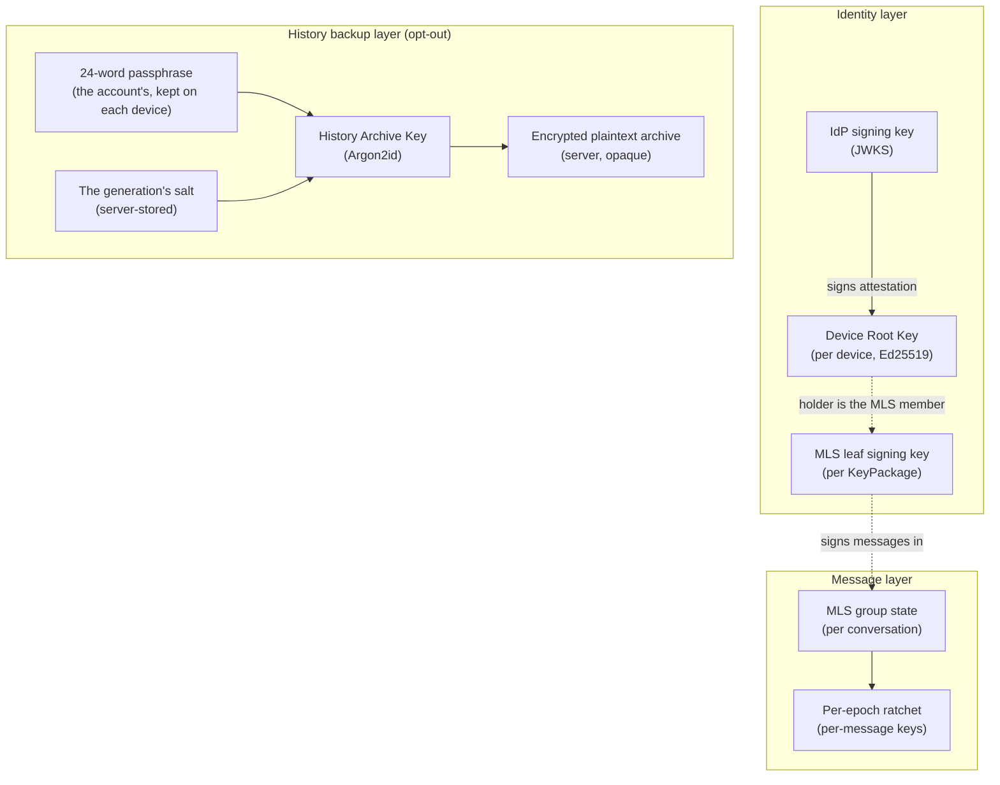

---

## 2. Threat model

### What we protect against

| Threat | Mitigation |
|---|---|
| IdP operator reads message content (legal order, insider, breach) | Server only sees MLS ciphertext; per-message keys are derived inside MLS, never transmitted |
| IdP operator silently MITMs a new conversation | Adding a peer requires consuming one of *their* KeyPackages — the server can't forge MLS leaf credentials signed by Device Root Keys it doesn't control |
| Peer IdP serves a forged KeyPackage for one of its users | Each leaf credential carries an attestation signed by the peer's IdP; verifying it pulls that IdP's JWKS. If the peer's IdP is compromised the attack succeeds — that's the explicit trust ceiling for federation |
| Compromised device | Per-device leaves: revoke the leaf via MLS Remove commits. Post-compromise security recovers within one commit cycle. The directory-level revocation flag stops the server from handing out fresh KeyPackages for the dead device |
| A member removed from a group, or gone from it, keeps reading | Every device of theirs is committed out by MLS Remove commits (§ 6.8): nothing sent from the next epoch on decrypts for them, whatever reaches them |
| Replay / reorder / forging by transport | MLS application-message authentication + epoch ordering — handled inside the protocol |
| Lost passphrase + lost all devices | Conversations are unrecoverable. Intentional and documented |

### Trust ceiling

The system trusts the user's IdP. The IdP can mint a fresh device
attestation for an attacker who controls its signing key — that attacker
can then join the user's MLS groups going forward. This is acceptable
because it's the same ceiling OIDC already imposes: a compromised IdP
can issue access tokens for the user too, so trusting the IdP for
device attestation doesn't lower the ceiling, only makes it explicit.

What this trust does **not** grant:
- Reading historical messages — MLS forward secrecy means past
  per-message keys are deleted after use (a device keeps only those of
  messages it hasn't read yet, from its last five epochs — § 6.3), and
  the IdP doesn't see the history archive's HAK
- Impersonating the user to peer IdPs in a way they can detect on
  rotation — peer IdPs cache the user's JWKS and notice key changes
- Reading the user's local cached passphrase or attestation — the
  IDB at-rest encryption key is non-extractable

### Out of scope (non-goals)

- **Metadata.** The IdP knows: who's in each conversation, when commits
  happen, message ordering, sender device per message. We don't
  implement sealed sender or anonymous credentials.
- **Traffic analysis.** No padded delivery, no cover traffic, no mixnets.
- **Endpoint compromise.** Full device compromise breaks all bets, as
  with every E2EE system.
- **Cross-IdP plaintext fallback.** Conversations with a peer who can't
  speak the federated MLS handshake gracefully fail.

---

## 3. Elements

### 3.1 Device Root Key (DRK)

An Ed25519 keypair generated once on first sign-in to a device. The
private half lives in IndexedDB, encrypted at rest under a non-
extractable AES-256-GCM device key. The public half is sent to the IdP
exactly once — the IdP signs an attestation binding it to the user.

The DRK is *long-lived* by default (1-year attestation, silent renewal
when within 30 days of expiry). It's not used to sign MLS application
messages directly; that's the per-KeyPackage leaf signing key. The DRK
binds the device's IdP-attested identity to whatever leaf signing keys
that device produces.

### 3.2 IdP attestation

A signature by the IdP's existing JWKS key (the same one that signs
OIDC tokens and HTTP Signatures) over the `IDP-ATTEST-v1` canonical
bytes of § 7.2: the account's actor URI, the device id, the DRK, the
attestation's expiry and the key's `kid`.

The signature lives inside every MLS leaf credential the device
produces. Peers verify by fetching the issuer's JWKS, looking up the
key by `kid`, and validating the signature.

### 3.3 Device HPKE key

Each device also makes an HPKE key pair (RFC 9180, DHKEM(X25519, HKDF-SHA256)) once, beside its
DRK, and keeps the private half in its sealed store. Its public half — a raw 32-byte X25519 key —
is what the account's other devices encrypt to. The DRK signs it over the `PINAI-DEVICE-HPKE-v1`
canonical bytes of § 7.2: the account's actor URI, the device id and the key.

The instance checks only the key's length. A low-order key is refused by the sender's HPKE —
X25519 then gives the all-zero shared secret (RFC 9180 § 7.1.4) —, so a sender must never skip
that check.

The device registers the key with its DRK: `POST /api/keys/devices` takes `hpke_public_key` and
`hpke_key_signature` together, and refuses the registration (`400`) unless the DRK sent in the same
request verifies the signature. Both are optional — a device registering without them is attested
all the same, and holds no HPKE key until it sends one.

**The chain a device verifies.** A device trusts another device's HPKE key only through the
attestation the instance already signs, and checks every link itself, from what `GET
/api/keys/devices` lists for that device:

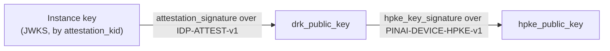

1. The device isn't revoked: `revoked_at` is null.
2. The instance's key named by `attestation_kid` verifies `attestation_signature` over the
   `IDP-ATTEST-v1` bytes rebuilt from the account's actor URI, the device id, `drk_public_key`,
   `attestation_expires_at` and `attestation_kid`; `attestation_expires_at` is still ahead.
3. `drk_public_key` verifies `hpke_key_signature` over the `PINAI-DEVICE-HPKE-v1` bytes rebuilt
   from the actor URI, the device id and `hpke_public_key`.

**The key follows the DRK that signed it.** On each registration:

| Registration | Brings a key | Brings none |
|---|---|---|
| First (no attestation yet) | stored | none held |
| Renewal (the same DRK) | replaces the one held | the one held is kept |
| Rotation (another DRK) | replaces the one held | the one held is cleared — only the old DRK signed it |

Revoking a device clears its HPKE key in the same write that sets `revoked_at`.

### 3.4 MLS leaf credential

Every MLS leaf carries a `BasicCredential` whose identity bytes are
this JSON:

```json
{
  "v": 1,
  "actor_uri": "https://idp.alice.com/users/alice_xK9mP",
  "device_id": "550e8400-e29b-41d4-a716-446655440000",
  "drk_pub": "<base64>",
  "idp_att": {
    "issuer": "https://idp.alice.com",
    "kid": "key-2026-01",
    "expires_at": "2027-05-14T12:00:00Z",
    "signature": "<base64>"
  }
}
```

Receivers verify in this order:

1. Parse JSON; reject if `v !== 1`.
2. `idp_att.issuer` origin must match the origin of `actor_uri` — an
   attacker-controlled IdP must not be able to attest someone else's
   actor.
3. `expires_at` must be in the future (5-minute clock-skew slack).
4. Look up the issuer's JWKS by `kid` (1-hour client-side cache,
   refresh-on-verify-failure for rotation safety) and verify the
   signature over the canonical bytes.

After verification, the leaf is trusted as "actor X's device Y." MLS's
own LeafNode self-signature handles per-message integrity.

### 3.5 KeyPackage

A single-use bundle the device publishes ahead of time so peers can
add it to groups without a round-trip. Each KeyPackage contains a
leaf-signing public key of the device + the device's full credential
(Section 3.4) + MLS protocol fields (HPKE init key, capabilities,
lifetime). The server stores them in an inventory keyed by
`(user_id, device_id)`; peers claim one atomically when adding the user
to a conversation.

In each group the device signs with the key its leaf there carries — the
one of the KeyPackage it joined through, or the one it founded the group
with — which peers verify its messages and commits against. Every key the
device published stays in its MLS store, and a key it binds later, after a
reload, signs only where its leaf carries that key.

A device keeps its stash topped up to the cap — 100 per device by
default — whenever the server reports it at or below the refill
threshold (20, `needs_refill = true`), or doesn't list the device at
all. It checks when it enters the app, every 6 hours while it stays
open, and whenever the IdP pushes `key_packages_low`: each live
session reads its own device's count from `GET
/api/keys/packages/status` and uploads the difference (§ 6.9).

The IdP pushes `key_packages_low` to the owner's live sessions when a
claim leaves one of their devices at the threshold, or finds no
package left; a refused claim pushes nothing. An offline device makes
up a missed push on its next start. KeyPackages live 30 days, so a
device left unopened for longer can't be added to a group until it is
opened again.

### 3.6 24-word recovery passphrase

A BIP-39 mnemonic of 24 words — 256 random bits — generated client-side by an account's first
device, on its first sign-in. Its only job is to derive the History Archive Key — losing it means
losing past messages on a fresh device, not losing your account.

It belongs to the account, not to a device, and the account has one at a time, in
**generations**: the first device makes generation 1, and a new passphrase — the next
generation — is made only when the current one is lost: no device holds it and the words are
gone. A new generation erases the archive (§ 3.8): what was saved under the lost passphrase could
no longer be opened.

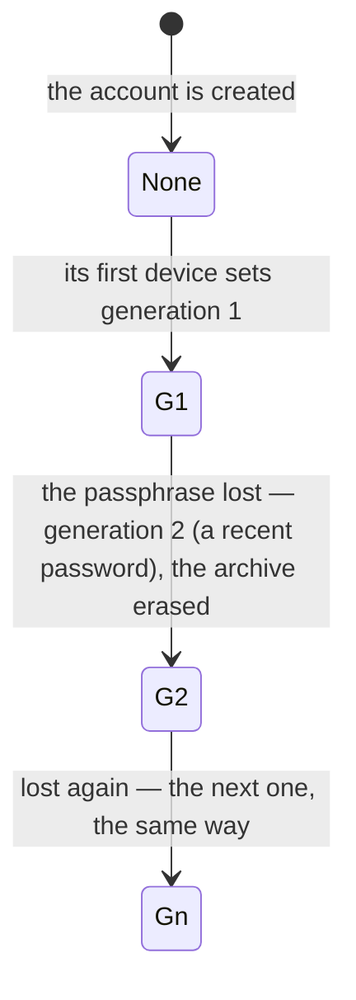

A device signing in to an account that has a history key (`GET /api/history/key`) is asked for
the words instead (`/onboarding/recovery-restore`, § 6.4): typing them restores the archive, and
the device keeps them, so it archives under the same key from then on, and approves itself
(§ 3.9). "Start fresh on this device" leaves it without a passphrase: it reads its conversations
from then on but archives nothing, until the words are entered from Settings → Devices →
"Restore history". A device's passphrase is stored locally, encrypted under its AES-GCM key, for
revealability in Settings → Devices.

A device says which generation it holds (`PUT /api/keys/devices/:device_id/history-key`), only for
the current one and from its own session, once it has named its device
(`PUT /api/sessions/current/device`, `identity-provider/specs/auth.md § 1`, "Sessions and
devices"); `GET /api/keys/devices` lists each device's `history_generation`: a device holds the
passphrase when that is the current generation.

### 3.7 History Archive Key (HAK)

Derived from the passphrase and its generation's salt via Argon2id
(`t=3, m=64 MiB, p=4, dkLen=32`). The salt is 16 random bytes, made by the device that sets the
generation and stored with it (`PUT /api/history/key`), so every device holding the passphrase
derives the same HAK. Each generation has its own salt, so its own HAK.

A generation is set from a session that has named its device, and records that device
(`set_by_device`): the account's other devices can tell which of them set it.

The device setting a generation also derives two values from its HAK, stored with it. The
server keeps them and hands them out; it never computes them.

- **The check value**: `HMAC-SHA256(key = HAK, message = "pinai/history-archive/check-v1")`, the
  message as ASCII bytes: 32 bytes. A device tells by it whether a passphrase is the current one:
  it derives the HAK from the words and the current salt, and compares. A wrong passphrase is told
  apart even when the archive is empty. The check value can't be used to brute-force the
  passphrase: the passphrase is 256 random bits, 2²⁵⁶ guesses, each an Argon2id derivation.
- **The approval public key**: the Ed25519 public key whose 32-byte seed is
  `HKDF-SHA256(ikm = HAK, info = "pinai/device-approval/v1")`, with no salt. Only the devices
  holding the passphrase have its private half; each of them checks the stored public half against
  its own derivation.

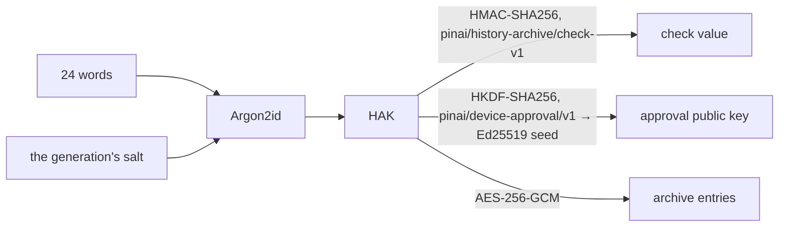

### 3.8 Encrypted plaintext archive

Every decrypted MLS application message gets re-encrypted under HAK with AES-256-GCM (fresh
12-byte nonce per entry) and batch-uploaded to the server, naming the generation it was sealed
under. The server only sees opaque ciphertext + nonces. A device with the current passphrase can
paginate the archive and decrypt every entry; a device without it sees only bytes.

**The archive only ever holds the current generation's entries:**

- An upload names its generation and is refused (`409 stale_history_key`) unless it is the
  current one — and while the account has none: a device that missed a new generation mixes no
  keys. It reads the key again (`GET /api/history/key`) and keeps its entries until it holds the
  current passphrase.
- A new generation erases the account's archive in the transaction that sets it. An upload under
  way either commits first and is erased with the rest, or is refused.
- Settings → Clear (`DELETE /api/history/messages`) erases the entries only: the key and its
  generation stay, and every device goes on saving new messages under it.

### 3.9 Approvals

The user's own devices decide which devices belong to the account. A device counts once another
device of the account approves it, or once the passphrase is typed on it. The instance stores and
lists the approvals and refuses malformed ones, but never decides whom to trust: each device checks
them itself.

**An approval** is an Ed25519 signature over the `PINAI-DEVICE-APPROVAL-v1` canonical bytes of
§ 7.2 — the account's actor URI, the approved device's id and its DRK —, made either:

- **by another device** of the account, with its DRK (`by: "device"`); or
- **by the passphrase**, with the current generation's approval key (§ 3.7), on the device the
  words are typed on (`by: "passphrase"`): the device approves itself.

It binds the approved device's DRK: a device whose DRK changes is no longer approved.

**What the instance checks** (`POST /api/keys/devices/:device_id/approvals`, § 5, "Approvals"),
before it stores the approval in `device_approvals`, one per approved device and approver:

- the calling session named its device (§ 5, "Key directory rules"), an unrevoked device of the
  account: the approver, or with the passphrase the device approved;
- a device approves another unrevoked device of the account that registered a DRK, never itself;
  the passphrase approves the session's own device, under the current generation only, which the
  request names;
- the signature verifies — Ed25519, strict, as every root-key signature here — under the
  approver's DRK or the generation's approval public key, over the bytes rebuilt from the approved
  device's DRK as held.

The write is checked again: an approval whose devices or generation changed meanwhile is decided
anew, so none outlives what it was checked on. A new approval pushes `device_approved { device_id }`
to the account's live sessions, which read the device list again.

**What drops them**, in the very write that leaves them unverifiable:

| Change | Approvals dropped |
|---|---|
| A device revoked (`POST /api/keys/devices/:device_id/revoke`) | Those it signed |
| A device's DRK rotated (`POST /api/keys/devices`, another DRK) | Its own, and those it signed |
| A new generation set (`PUT /api/history/key`) | Those by the passphrase under older generations |

**Who is approved** each device works out itself, from `GET /api/keys/devices` — each device's
`approvals`, beside its DRK — and the generation's approval public key from `GET /api/history/key`:

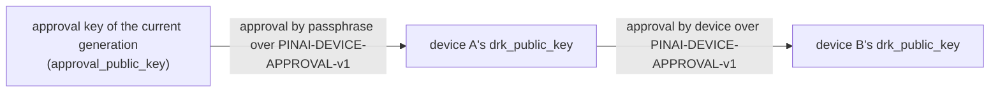

A device is approved when it carries an approval by the current approval key, or by an unrevoked
device that carries one: two links at most. A device holding the current passphrase approves
itself with the approval key, so its chain is one link from then on — and again whenever its own
DRK changes, which drops its approvals.

The stored approval public key is the instance's word until a device can check it, so two rules
keep the chain out of the instance's hands:

- **A device that doesn't hold the current passphrase** can't confirm the approval public key: until
  it holds the passphrase, it trusts only the device it approved itself in a code handshake
  (§ 3.10), whose keys it took from that device, never from the list.
- **A device that holds it** derives the approval key itself (§ 3.7) and compares. When the stored
  approval public key differs, the instance changed it: the device trusts no approval made by that
  key, trusts no device it hasn't trusted already, and warns the user.

### 3.10 The approval handshake

A new device is approved with a short code, over a request the instance relays between it and one
other device of the account. The instance carries the two devices' messages without reading them,
and never sees the code.

**What the two devices do.** The new device opens a request and shows a 6-digit code; the user
types it on a device of theirs that is approved. The two run SPAKE2 keyed by the code over the
request's messages; under its session key, each device then sends the other its device id, DRK and
HPKE key. An approval signs a device id and a DRK (§ 7.2), so each signs the other's as they came
out of the exchange, never as the device list shows them: the approved device's approval makes the
new one approved, and the new device's approval of the other is the one it trusts before it holds
the passphrase (§ 3.9). Should the instance list another key for either device, the approval
doesn't verify over it, and is refused. A wrong code fails the exchange, and the device that finds
it wrong ends the request: without the code, the instance gets one guess per request — a
one-in-a-million chance. The messages' byte format is the clients': the client step that speaks
it adds it to this section; the instance never parses it.

**The relay** (§ 5, "Approvals"):

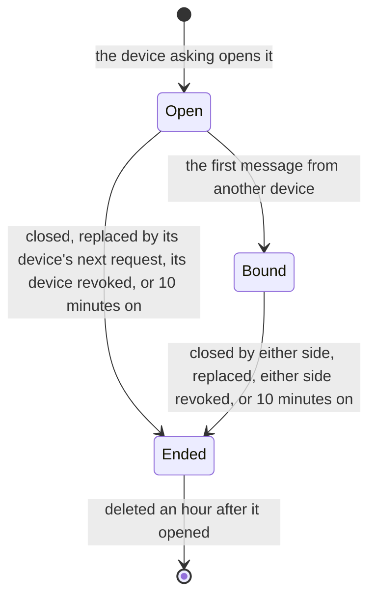

Pushes go to the sessions of devices only: a session that named none can take no part.

- **Opening.** A session that named its device, which registered a DRK, opens a request for that
  device: open 10 minutes. A device has one open request — a new one closes the one before —, and an
  account opens 10 an hour at most (`429`), counted under the account's lock. The account's other
  devices get `approval_requested { request_id, device_id, display_name }` — the name the
  `User-Agent` of its first registration, or of a KeyPackage upload after one that said nothing,
  gave the device: "Chrome on Android" —; a device coming online lists the open requests instead.
- **Binding.** Until another device posts, any device of the account may read or close the
  request. The first message from a device other than the one asking binds the request to it — a
  device with a DRK only (`409 no_root_key`), as answering ends in approving —, and the devices left
  out get `approval_closed { request_id }`: their prompt goes. From then on only the two of them
  post, read or close it, and any other device is refused (`409 approval_request_taken`), ended or
  not.
- **Messages** are opaque, 1 to 4096 bytes each, 12 a request at most
  (`409 approval_request_full`), numbered `seq` 1, 2, … in the order they arrive. A device reads
  those after a `seq` that are not its own. Each post pushes `approval_message { request_id, seq }`
  to the other side's sessions — every message the asking device posts before one answers, to
  every other device's.
- **Ending.** Either side closes the request (`DELETE`); it ends by itself 10 minutes after it
  opened, and when a device taking part in it is revoked. An ended request takes no message and no
  close (`410 approval_request_ended` rather than `404`, so a device tells a request that ended from
  one that never was), but its two sides still read it — the last message may come with the close.
  A close, a request replaced by its device's next one, or a revoke, pushes
  `approval_closed { request_id }` to both sides' sessions — every device's while nobody answers;
  an expiry pushes nothing, as each side holds `expires_at`. Requests are deleted an hour after
  they opened, when they no longer count against the limit, and are then unknown (`404`).

---

## 4. Schema

```
users                    — local accounts (actor_uri, inbox_url, display_name,
                            username + NanoID suffix, avatar_url, pronouns, bio)
remote_actors            — cache of federated users (inbox_url, avatar_url, TTL)
conversations            — kind: dm | group, name
conversation_members     — actor_uri, joined_at, left_at
direct_messages          — sender_actor_uri, mls_ciphertext, activity_uri,
                            reply_to_id, federation_status (server stores
                            ciphertext, never sees plaintext)

user_devices             — per-device row, one per (user_id, device_id):
                            display_name, kind (laptop | phone | tablet | unknown),
                            paired_at, last_seen_at, revoked_at,
                            drk_public_key BYTEA, attestation_signature BYTEA,
                            attestation_kid TEXT, attestation_issued_at,
                            attestation_expires_at (whole seconds, as signed),
                            hpke_public_key BYTEA, hpke_key_signature BYTEA
                            (both or neither, and only with a drk_public_key),
                            history_generation INTEGER NULL (the history key's
                            generation the device says it holds)
key_packages             — single-use stash (per-device, expires_at, consumed_at)
history_keys             — the account's history key, one row per account, none
                            until its first device sets one: generation INTEGER
                            (> 0), salt BYTEA (16), check_value BYTEA (32),
                            approval_public_key BYTEA (32), set_at,
                            set_by_device (the device whose session set it)
device_approvals         — one per (device_id, approver): device_id, drk_public_key
                            BYTEA (32, the root key it binds), approver_device_id
                            (another device's DRK signed) or generation (that
                            generation's approval key signed) — exactly one —,
                            signature BYTEA (64), created_at. Dropped with the
                            approver's revocation, a DRK rotation (the device's
                            and those it signed), and older generations'
                            passphrase approvals when a new one is set
approval_requests        — id, user_id, device_id (asking), approver_device_id
                            (the first other device to post, NULL until then),
                            created_at, expires_at (+ 10 min), closed_at; one not
                            closed per device; deleted an hour after created_at
approval_messages        — PRIMARY KEY (request_id, seq); device_id (the poster),
                            body BYTEA (1–4096, opaque), created_at
history_messages         — PRIMARY KEY (user_id, id);
                            conversation_id, ciphertext BYTEA, nonce BYTEA,
                            client_message_id, created_at.
                            Server-opaque; idempotent upserts via
                            ON CONFLICT DO NOTHING. Only the current
                            generation's entries.

mls_commits              — per-conversation commit log
                            UNIQUE (conversation_id, epoch)
mls_welcomes             — outbound queue for offline device adds
                            (recipient_user_id, recipient_device_id)
```

---

## 5. Endpoints

All Bearer-auth except where noted. Cross-IdP paths use HTTP Signatures — see
`specs/06-federation-authentication.md`.

### Key directory

| Endpoint | Description |
|---|---|
| `POST /api/keys/devices` | Register/renew/rotate the caller's DRK attestation: `{ device_id, drk_public_key, hpke_public_key?, hpke_key_signature? }`, keys and signature in standard base64. Idempotent on `(device_id, drk_public_key)`. The device's HPKE key comes with the DRK's signature over its canonical bytes, both or neither (§ 3.3). A session that declared its device (`PUT /api/sessions/current/device`) registers that device only. A device seen for the first time is named from the request's `User-Agent` ("Chrome on Linux"); one recorded unnamed takes the name of its first KeyPackage upload that says. First-time mint emits a `DeviceJoined` WS event to the user's other live sessions; a rotation drops, in the same write, the device's approvals and those it signed (§ 3.9). Returns the signature, kid, issued_at, expires_at, and the canonical bytes the IdP signed so the client can re-verify locally |
| `GET /api/keys/devices` | List the caller's devices with their attestation expiry (the client uses this to schedule silent renewals), and whether each is signed in: `signed_in`, `last_active_at`. With each device, what another device needs to verify its keys itself (§ 3.3): `drk_public_key`, `attestation_signature`, `attestation_kid`, `attestation_expires_at` — the text the attestation signed —, `hpke_public_key`, `hpke_key_signature`; `null` where the device has registered no DRK, or no HPKE key. And `history_generation`, the history key's generation the device says it holds (§ 3.6), `null` until it says: the client compares it with the current generation. And `approvals`, oldest first, those binding the device's `drk_public_key` (§ 3.9): `{ by: "device", device_id, signature, created_at }` — `device_id` the approver — or `{ by: "passphrase", generation, signature, created_at }`, the signature in standard base64 |
| `PUT /api/keys/devices/:device_id/history-key` | `{ generation }`: the device says it holds that generation of the account's history key (§ 3.6). Only from the device's own session: one that has named this very device (`403 device_required` when it named none, `403 device_mismatch` when another; below). The current generation only (`409 stale_history_key`, none set yet included, checked again as it is written); an unrevoked device of the caller's only (`403` revoked, `404` another account's or unknown). `204` |
| `POST /api/keys/devices/:device_id/revoke` | Signs the device out — its sessions end (`identity-provider/specs/auth.md § 1`, "Sessions and devices") — then sets the directory-level revocation flag, clears the device's HPKE key, drops the approvals it signed (§ 3.9) and closes the approval requests it asks or answers (§ 3.10, `approval_closed` to the other side) in one write; the MLS Remove commits follow. Takes a password typed in the last 10 minutes (`identity-provider/specs/auth.md § 1`, "Sensitive actions"). Idempotent; `404` for a device that is not the caller's |
| `POST /api/keys/packages` | Upload a batch of KeyPackages for one of the caller's devices — refused whole (`400`) when a package is empty or not base64, or would take the device past the cap. An `expires_at` already past or beyond the lifetime (`E2EE_KEYPACKAGE_LIFETIME_SECS`) is the device's clock being off, not a bad package: the IdP stores it as now + the lifetime, by its own clock |
| `POST /api/keys/packages/claim` | Atomically reserve one KeyPackage for `actor_uri` — of `device_id`, or of any device with some left. Bearer or HTTP-Sig (peer IdPs); for remote `actor_uri` the local IdP proxies to the target IdP via HTTP-Sig |
| `POST /api/keys/packages/claim/devices` | One KeyPackage of each of `actor_uri`'s unrevoked devices that has any, as `{ claims: [...] }` — a contact's first add brings all their devices in (§ 6.5). Asked, proxied, limited and refused as a single claim is; none at all → 409 |
| `GET /api/keys/packages/status` | Per-device available counts + `needs_refill` flag |

#### Key directory rules

- **A device id is its first account's.** Device ids are not secret — a claim returns one — so
  registering or uploading for a device id another account holds is refused with `409`, and
  leaves that device untouched.
- **A session is limited to the device it declared.** Once a session names its device
  (`identity-provider/specs/auth.md § 1`, "Sessions and devices"), registering any other device
  id from it — attested or not, new or not —, or saying another device holds the history key, is
  refused with `403 device_mismatch` "This session signed in another device", and changes
  nothing: a stolen token can't take a device over. A session that names no device yet registers
  any device of the account, but neither sets the history key nor says a device holds it, approves
  a device nor takes part in an approval request: `403 device_required` "Name this session's
  device first".
- **A device's HPKE key is its DRK's.** A registration bringing one is refused (`400`) when only
  one of `hpke_public_key` and `hpke_key_signature` is sent, or when the DRK sent with it doesn't
  verify the signature over the key's canonical bytes for this device of this account; nothing is
  stored then. What a registration does to the key held follows § 3.3.
- **A revoked device is out of the directory.** Its KeyPackages are never claimed, and it can
  neither upload more nor renew its attestation (`403`) — a renewal would hand a stolen device
  another year.
- **Claims** are limited per requester (a local user, or a peer instance by its signing key): 60
  at once, then one a second (`429`). A local user's claim for a remote account is signed as that
  user and sent to the account's instance, whose refusals come back as they are: `404` no such
  account, `403` the claimer kept out, `409` no KeyPackage left, `429` rate-limited. An instance
  that fails to answer is `502`. A peer's own claim must name an account of this instance (`400`)
  — peers never relay through another instance.
- **A claim tells the owner to refill** when it leaves one of their devices at the refill
  threshold, or finds no package left: `key_packages_low` to their live sessions (§ 3.5).
- **A claim is how someone adds a device to a group**, so it follows who may add the account
  (`identity-provider/specs/social.md § 2`): a claimer the account doesn't admit —
  a block or its contact setting — is refused with `403 Can't add this person` before a package is
  taken. One's own packages are always claimable.

| Claim answer | Meaning |
|---|---|
| `200` | `{ key_package, device_id, expires_at, remaining_count, needs_refill }` — the Welcome targets `device_id` |
| `403` | The account doesn't admit the claimer |
| `404` | No such account |
| `409` | The account has no KeyPackage left on any unrevoked device |
| `429` | Too many claims from this requester, or the account's instance is rate-limiting this one |
| `502` | The account's instance did not answer |

### Approvals

The approvals of § 3.9 and the relay of § 3.10. Every route takes a session that named its device,
an unrevoked device of the account (`403 device_required` otherwise; `403` revoked).

| Endpoint | Description |
|---|---|
| `POST /api/keys/devices/:device_id/approvals` | `{ by: "device", signature }`: the session's device approves `device_id`, another unrevoked device of the account with a DRK; the signature its DRK's. `{ by: "passphrase", generation, signature }`: the session's own device approved by the passphrase, `generation` the current one, the signature its approval key's. The signature — 64 bytes, standard base64 — is over the `PINAI-DEVICE-APPROVAL-v1` bytes of § 7.2 for `device_id`'s DRK as held. `204`, and the same approval again `204`; only a new one pushes `device_approved` to the account's sessions |
| `POST /api/keys/devices/approval-requests` | No body. The session's device, which registered a DRK, asks to be approved: `201 { id, expires_at }`, open 10 minutes; its open request closed. 10 an account an hour. Pushes `approval_requested { request_id, device_id, display_name }` to the account's other devices' sessions |
| `GET /api/keys/devices/approval-requests` | The account's open requests, oldest first: `{ requests: [{ id, device_id, display_name, approver_device_id, created_at, expires_at }] }` — `device_id` the device asking, `approver_device_id` the one answering, `null` until one posts |
| `POST /api/keys/devices/approval-requests/:id/messages` | `{ body }`: 1 to 4096 bytes, standard base64, opaque. `201 { seq }`. The first from another device than the one asking — one with a DRK — binds the request to it (§ 3.10), and pushes `approval_closed` to the devices left out; 12 a request. Pushes `approval_message { request_id, seq }` to the other side's sessions |
| `GET /api/keys/devices/approval-requests/:id/messages?after=<seq>` | The messages after `after` (0 when left out), but the caller's own, in order: `{ messages: [{ seq, device_id, body, created_at }] }`, `device_id` the poster. The two sides read it until it is deleted, ended or not; any other device while it is open and nobody answers |
| `DELETE /api/keys/devices/approval-requests/:id` | Either side ends the request — while nobody answers, any device: `204`. Pushes `approval_closed { request_id }` to both sides' sessions — every device's while nobody answers |

| Refusal | Status | `error` |
|---|---|---|
| A body not as described: `by` neither `device` nor `passphrase`, `generation` missing with `passphrase` or sent with `device`, a signature or message body malformed, `after` negative | `400` | `invalid_request` |
| A signature that doesn't verify | `400` | `invalid_request`, "signature does not verify over the device's root key" |
| A device approving itself by device | `400` | `invalid_request` |
| A session that named no device | `403` | `device_required` |
| The passphrase approving another device than the session's | `403` | `device_mismatch` |
| A revoked device, approving or approved | `403` | `access_denied` |
| Approving a device not the account's, or unknown | `404` | `not_found` |
| A request not the account's, unknown, or deleted | `404` | `not_found` |
| A device with no DRK, approving, approved, asking or answering | `409` | `no_root_key` |
| The passphrase under another generation than the current one, or none set | `409` | `stale_history_key` |
| A third device posting to, reading or closing a request another answers — before any other refusal, ended or not | `409` | `approval_request_taken` |
| A request holding its 12 messages | `409` | `approval_request_full` |
| A request closed or past its 10 minutes — posted to or closed, or read by a device that isn't one of its sides (a third device on an answered one gets the `409` above) | `410` | `approval_request_ended` |
| An 11th request within the hour | `429` | `too_many_requests` |

### MLS Delivery Service

| Endpoint | Description |
|---|---|
| `POST /api/mls/groups/:conversation_id/commits` | Append an MLS Commit at the next epoch, then push it to every member — the proposer's own sessions included — and send it to the members' instances, a group's with its roster so it lands there even ahead of the Welcome (`identity-provider/specs/groups.md § 7`). `409` on epoch race carries the winning commit |
| `GET /api/mls/groups/:conversation_id/commits?since=<epoch>` | Catch-up: the commits after `since`, in epoch order, 256 a page with `has_more` |
| `GET /api/mls/welcomes?device_id=<uuid>` | Atomically claim every pending Welcome targeted at the calling device |
| `POST /api/mls/welcomes` | Hand a Welcome bundle to the sender's IdP. The IdP routes off `recipient_actor_uri`: local → row + WS push, remote → signed AP `Create{Note}` with `mlsKind: welcome` (the answer's `id` is then nil). For a group, the Note also carries the roster so the recipient's IdP can materialise the conversation — see `identity-provider/specs/groups.md § 7` |

#### Delivery Service rules

The server cannot read an MLS message, so its rules are about who may speak for a conversation,
and they hold for what peers deliver as much as for local clients.

- **A conversation exists before its MLS group** — a DM from the friendship's acceptance, a
  group from its creation. A commit or a catch-up for an unknown conversation is `404`. A peer's
  commit for a group unknown here materialises it from the roster it carries, under the rules of
  a group message (`identity-provider/specs/groups.md § 7`); one without a roster is refused
  (`400`).
- **Only active members commit** (`403`). A commit from a peer's actor outside the conversation
  is refused too: it would take an epoch the members need, and the group could not advance.
- **A Welcome goes from an active member to an active member** (`403` either way) and never
  changes membership — joining is the group routes' business, with their admin rules. A member's
  own new device is a member already.
- **A Welcome follows who may add the recipient** (`identity-provider/specs/social.md
  § 2`): a 1:1's, or a group's to someone not yet a member, from a sender the recipient doesn't
  admit is refused with `403 Can't add this person`. One's own new device is always welcome.
- **An inbound Welcome** mirrors a group's roster first, when the sender may assert it (see
  `identity-provider/specs/groups.md § 7`). A DM's Welcome can outrun the
  friendship's `Accept`: it opens the pair's DM under its id, as a first message would — or is
  refused when the pair's DM has another id.
- **Redelivery is harmless**: a commit already at its epoch — resent, or a race another member
  won — changes nothing.
- A Welcome is handed out once; claimed ones are deleted a day later, as are KeyPackages claimed
  a day ago.

| Refusal | Status | `error_description` |
|---|---|---|
| Unknown conversation | `404` | `conversation not found` |
| The caller is not an active member | `403` | `not a member of this conversation` |
| The Welcome's recipient is not an active member | `403` | `the recipient is not a member of this conversation` |
| The recipient doesn't admit the sender | `403` | `Can't add this person` |
| Epoch taken | `409` | `epoch_conflict`, with `winning_commit` |
| The same, from a peer's inbox delivery | `400` | as above |

### History backup

| Endpoint | Description |
|---|---|
| `GET /api/history/key` | The account's history key (§ 3.6–3.7): `{ generation, salt, check_value, approval_public_key, set_by_device }`, bytes in standard base64; `set_by_device` is the device whose session set the generation (`null` only once that device's row is gone). `404` before its first device sets one |
| `PUT /api/history/key` | `{ generation, salt, check_value, approval_public_key }` — 16, 32 and 32 bytes, standard base64 (`400` otherwise). From a session that has named its device (`403 device_required` otherwise), which the key records as `set_by_device`. Set only for the generation right after the current one, 1 when there is none: a compare-and-set, so two devices setting the same generation make one, and the other is answered `409 history_key_conflict` with `current_generation` (`0` for none). The very key held already — the same generation, salt, check value and approval key — is a retry: `204`, nothing written. Generation 1 takes no recent password; any later one does, as it erases the archive (`identity-provider/specs/auth.md § 1`, "Sensitive actions"). In one transaction: the key replaced, the account's archive erased, the passphrase approvals of older generations dropped (§ 3.9). `204` |
| `POST /api/history/messages` | `{ generation, entries }`: a batch of 1 to 50 entries (`400` otherwise; a nonce is 12 bytes), sealed under `generation` — the current one only (`409 stale_history_key`, also while none is set; § 3.8). Every `conversation_id` must be one the caller is or was a member of — leaving a group keeps the history already read — or the batch is refused whole (`403`). Idempotent upsert on `(user_id, id)` — first decryptor of a message wins; subsequent uploads from the user's other devices no-op. Answers `{ inserted }`, how many were new |
| `GET /api/history/messages?after_id=&after_created_at=&limit=` | Keyset pagination over `(created_at DESC, id DESC)`, limit clamped 1..=500, default 100. `next_cursor` names the page's last entry, and is `null` only on an empty page; `after_id` and `after_created_at` (RFC 3339) go together (`400`) |
| `DELETE /api/history/messages` | Erase the user's archive. Settings → Devices → Clear. The history key and its generation stay: every device goes on saving under it. Takes a password typed in the last 10 minutes (`identity-provider/specs/auth.md § 1`, "Sensitive actions") |

| Refusal | Status | `error` |
|---|---|---|
| No history key yet (`GET /api/history/key`) | `404` | `not_found` |
| Setting the key, or saying a device holds it, from a session that named no device | `403` | `device_required` |
| Saying another device than the session's holds the key | `403` | `device_mismatch` |
| A generation that isn't the one right after the current one | `409` | `history_key_conflict`, with `current_generation` |
| A generation past the first, the password not typed in the last 10 minutes | `401` | `insufficient_user_authentication` |
| An upload, or a device's report, naming a generation that isn't the current one | `409` | `stale_history_key` |

### WebSocket events (server → client)

| Event | When |
|---|---|
| `new_dm` | A peer sent a message in a conversation the recipient is in |
| `message_edited` | Sender replaced the ciphertext for one of their existing messages |
| `mls_welcome_ready` | A Welcome bundle was just deposited for one of the recipient's devices |
| `group_created` | The recipient's IdP materialised a federated group from an inbound Note's roster snapshot |
| `device_joined` | A new device of *this user* completed first-time DRK registration. Other live sessions of the same user run the multi-device fanout |
| `key_packages_low` | A claim left one of *this user's* devices at the refill threshold, or found none left. Each live session tops its own device up (§ 3.5) |
| `device_approved` | `{ device_id }`: a device of *this user* was approved (§ 3.9). Every live session reads `GET /api/keys/devices` again |
| `approval_requested` | `{ request_id, device_id, display_name }`: another device of *this user* asks to be approved (§ 3.10). To the sessions of the account's devices but the asking one |
| `approval_message` | `{ request_id, seq }`: the other side of a request posted; the device reads `…/messages?after=`. To the other side's sessions — while nobody answers, every device's but the asking one's |
| `approval_closed` | `{ request_id }`: a request ended — closed by a side, replaced by its device's next one, or a side revoked —, to both sides' sessions (every device's while nobody answers); or another device answered it, to the devices left out. Sessions that named no device hear none of the `approval_*` pushes |
| `dm_delivery_failed`, `friend_request`, `friend_accepted`, `friend_removed`, `presence_update`, `typing`, `heartbeat_ack` | (Out of scope for this spec — see other specs) |

---

## 6. Scenarios

### 6.1 First-ever sign-in (brand-new user, brand-new device)

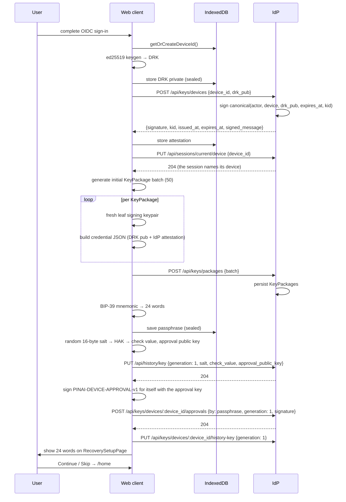

The session names its device right after registering it: setting
generation 1, approving the device with its approval key and saying the
device holds it all take a session that has named its device (§ 3.6,
§ 3.9). The first device approves itself, so it is the account's first
approved device. The user is now able to send and receive E2EE messages.
The history key's generation 1 and the locally-stored passphrase mean
every future decrypted message will be archived to `/api/history/messages`
under HAK.

### 6.2 Same user signs in on a second device

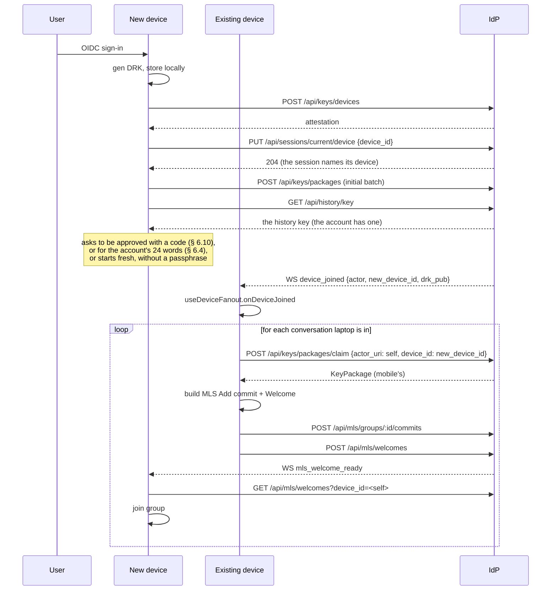

The mobile can now decrypt *future* messages in every conversation. Past
messages remain inaccessible unless the user runs the history restore
flow (Section 6.4).

**Offline case** — if every other device of the user is offline at the
moment of registration, the WS push lands nowhere. The reconcile-on-WS-
connect path inside `useDeviceFanout` handles this: every time any
device of the user comes online, it pulls `/api/keys/devices` and runs
the same fanout for any device it doesn't yet have an MLS leaf for in
every conversation.

**The fanout's rules** (`IE2eePort.addOwnDevices`, `devicesToAdd` in
`@pinai/domain/models/group`):

- A device adds its siblings only to groups it holds keys for. One that holds
  none founds nothing: a group founded there would hold only it, and its commit
  would take an epoch from the real one.
- Each device is added with a KeyPackage of its own — claimed by its device id,
  never "any device of this account" — one device a commit, the leaves looked
  at again after each.
- A commit that loses its epoch (`409`) is dropped, the group catches up on the
  DS's log, and the leaves are looked at again: another of the user's devices
  may have added this one meanwhile. At most five times; a commit lost any other
  way is dropped too, so the group can commit again on the next run.
- A device makes one change to a conversation's MLS state at a time — a commit
  of its own, a catch-up, a join from a Welcome, a group dropped — so it never
  applies a commit, its own pushed back by the DS included, over one it is still
  making. A run goes over every conversation the device
  holds keys for: it first applies the commits the DS holds past its epoch, then
  adds the siblings missing. It runs when the device list refreshes (the
  `device_joined` push only refreshes it), when the conversation list changes,
  and when the device comes to hold a group — founded on a first send or joined
  from a Welcome (`IE2eePort.onGroupHeld`).
- A device applies a group's commits as the `mls_commit` push announces them
  (`IE2eePort.catchUp`), so its next message is sent at the epoch the others
  are at: one sent from an epoch they left is read by none of them.
- A contact's first add takes a KeyPackage of each of their devices (§ 6.5), so
  all of them read the conversation from the start; only one with no KeyPackage
  left then waits for a sibling to add it.
- Each device shows what the user's other devices send: a message from the
  user's own account is this device's echo only when it holds a copy of it
  (`isHeldHere` in `@pinai/domain/models/own-messages`). Any other is decrypted
  like anyone's; one that doesn't decrypt — MLS never decrypts a device's own —
  shows nothing, never a placeholder.

Every member's Welcome carries the ratchet tree (the extension), not only the
founder's: the device adding a sibling, or an admin adding someone later, is
seldom the founder, and a joiner builds the group from the Welcome alone.

### 6.3 Receiving a message

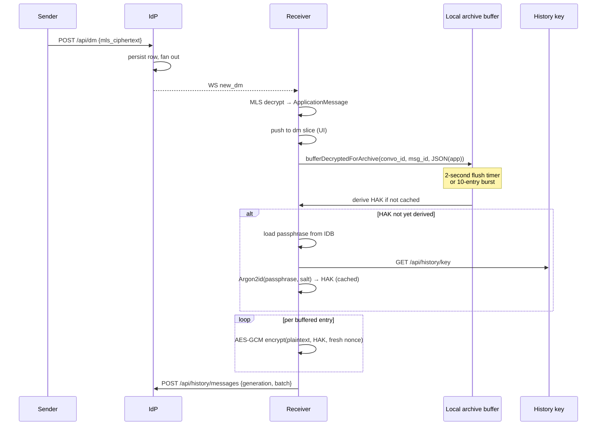

The server only sees the MLS ciphertext (per-message) and later the
HAK-encrypted plaintext copy in the archive. Neither lets it read the
message content without breaking the underlying cryptography.

**A message overtaken by a commit.** A message and a commit travel
separately, and one sent just before a commit can arrive after it —
from another instance especially, and often, since each device added to
a conversation is a commit. Each device therefore keeps, for its last
five epochs, the keys of the messages it hasn't read yet (openmls
`max_past_epochs`, set where a group is created and where one is joined):
such a message decrypts once the commit is applied. Each key is still
deleted once used, so what has been read stays out of reach.

### 6.4 Restoring history on a new device

The user reaches `/onboarding/recovery-restore` either by direct URL or
via Settings → Devices → "Restore history." Typing the 24 words is one
flow whatever brings the user there: the words checked, the device
approved by them, its generation reported, the archive restored.

```mermaid
sequenceDiagram
    participant U as User
    participant Web as New device
    participant IDB as IndexedDB
    participant IdP
    participant Store as dm slice

    U->>Web: type 24 words
    Web->>IdP: GET /api/history/key
    IdP-->>Web: {generation, salt, check_value, approval_public_key, set_by_device}
    Web->>Web: Argon2id(words, salt) → candidate HAK → its check value and approval key
    alt the check value differs
        Web->>U: "Wrong passphrase"
    else the stored approval public key differs from the one derived
        Web->>U: a warning: the key was changed; nothing new is trusted
    else both match
        Web->>IDB: save the words and their generation (sealed)
        Web->>Web: sign PINAI-DEVICE-APPROVAL-v1 for itself with the approval key
        Web->>IdP: POST /api/keys/devices/:device_id/approvals {by: passphrase, generation, signature}
        IdP-->>Web: 204, then WS device_approved to the account's sessions
        Web->>IdP: PUT /api/keys/devices/:device_id/history-key {generation}
        IdP-->>Web: 204
        loop until next_cursor is null
            Web->>IdP: GET /api/history/messages?after_id=&after_created_at=
            IdP-->>Web: {entries, next_cursor}
            loop per entry
                Web->>Web: AES-GCM decrypt(ciphertext, HAK, nonce)
                alt auth tag valid
                    Web->>Store: pushDmMessage(conversation_id, parsed Message)
                    Note over Web: restored++
                else auth tag fails
                    Note over Web: a damaged entry, skipped++
                end
            end
        end
        Web->>U: toast "Restored N messages" / "No archive"
    end
```

The words are checked before anything is read: the HAK derived from them and the generation's
salt must give the generation's check value, and the approval key derived from it the stored
approval public key (§ 3.7). A wrong check value is "Wrong passphrase", whether the archive holds
entries or not, and nothing is kept. A right check value with another approval public key means the
instance changed the key: the device trusts no approval made by it and warns (§ 3.9).

When both match, the device keeps the words with their generation and approves itself: the request
comes from the session that named it, and names the generation it derived the key under — a new
generation set meanwhile refuses it (`409 stale_history_key`), and the device reads the key again.
The other devices see it approved on `device_approved`, or on their next look at the device list.
It then says it holds the generation and pages the archive under the HAK. Every entry is the
current generation's (§ 3.8), so one failing its auth tag is damaged and skipped — never a sign of
a wrong passphrase —, and an empty archive restores nothing: "No archive". An account with no
history key (`404`) has nothing to restore. Setting a new generation drops the approvals made with
the old words, so after a start over a device approves itself again with the new ones.

### 6.5 Sending a message to a new contact

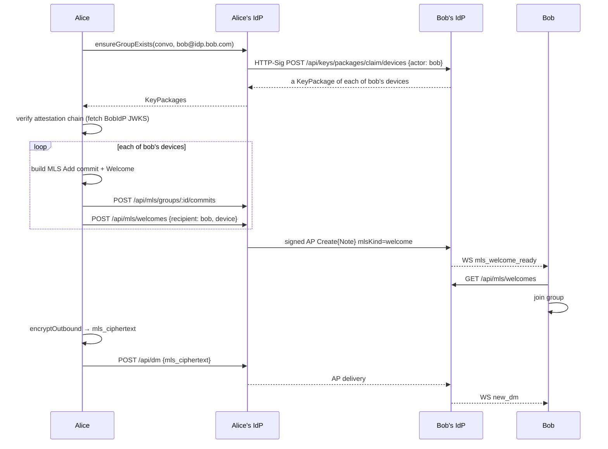

The verification step on Alice's side — "fetch BobIdP JWKS" — is the
moment Alice's client decides whether to trust this leaf as belonging
to Bob. JWKS is cached for an hour; rotation safety comes from
`invalidate(issuer)` and retry on verify-failure.

A device founds a conversation's group only when it holds none, and two
sends at once found it once. If the first add fails — most often because
another device founded the group first, and the commit at epoch 1 is taken
(`409`) — the device drops the group it founded rather than keep one that
holds only itself, where what it sends would be read by nobody. The send
fails, and the device joins the real group once one of its siblings adds
it (§ 6.2), or the other side does.

### 6.6 Revoking a compromised device

```mermaid
sequenceDiagram
    participant U as User
    participant Web as Other device
    participant IdP

    U->>Web: Settings → Devices → Revoke
    Web->>IdP: POST /api/keys/devices/:device_id/revoke
    IdP->>IdP: end the device's sessions, then mark user_devices.revoked_at = now(), drop the approvals it signed, close its approval requests
    Note over IdP: its tokens and sockets stop at once;<br/>future /api/keys/packages/claim<br/>requests for this device fail
    loop for each conversation the revoked device is in
        Web->>Web: build MLS Remove commit
        Web->>IdP: POST /api/mls/groups/:id/commits
    end
```

The flag, the HPKE key cleared, the approvals the device signed dropped and its approval requests
closed are one write: a device approved through it alone needs another approval (it normally holds
the passphrase by then and approves itself), and the other side of a request it took part in gets
`approval_closed`.

The IdP goes first. It may refuse — a password typed more than 10 minutes ago
(`identity-provider/specs/auth.md § 1`, "Sensitive actions") — and then nothing
was done: the user types it again and revokes once more. Once it answered, the
device is signed out and can read nothing new while the commits go out.

MLS Remove commits provide post-compromise security: future epochs use
a key schedule the revoked leaf was never part of. The directory-level
flag stops the server from handing out fresh KeyPackages from the dead
device, and the device is signed out: each session names the device it
signed in (`identity-provider/specs/auth.md § 1`, "Sessions and devices").

### 6.8 Someone leaves a group's MLS state with its roster

Taking someone off a group's roster (`identity-provider/specs/groups.md § 3`) takes
nothing from them cryptographically: their devices still hold the group's keys. So every device of
someone the roster no longer holds is committed out of the MLS group — one Remove commit a leaf,
each posted to the DS, after the roster change, never before (the IdP validates the change first:
an admin, never the last one):

- **A removal**: the remover's client, right after `DELETE /api/groups/:id/members/:actor_uri`
  succeeds, with the roster `GET …/members` then answers.
- **A leave**, which can't commit the leaver's own devices out, **or a removal that stopped short**:
  an admin's client, on `member_removed` and whenever it opens the group, compares the MLS group's
  leaves (by their credential, § 7.1) with the roster and commits out every device of an actor it
  doesn't hold. Nothing happens when the roster doesn't hold the admin themselves.

Commits race: two admins catching up at once both build a Remove at the same epoch. The second
gets `409`; its client drops its pending commit, catches up on the DS's log — which may already
have removed what was left — and looks again. A commit that never reaches the DS is dropped the
same way, so the device can still commit, and the next look at the group finishes the work.

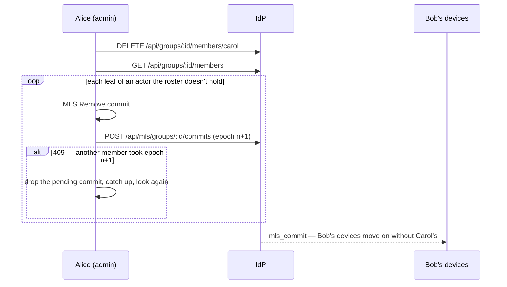

A device committed out keeps the group as it stood, so the messages up to the removal still decrypt
there. Added back, it is sent a Welcome to a group it already holds: the Welcome replaces that group
only when it brings a later epoch. A Welcome no later than the group held leaves it as it is, as when
both sides founded the group at once. A removed member who clears the group from their list
(`DELETE /api/groups/:id`) drops its MLS state from the device, with its cached history; being added
again then joins it afresh.

### 6.7 Silent attestation renewal

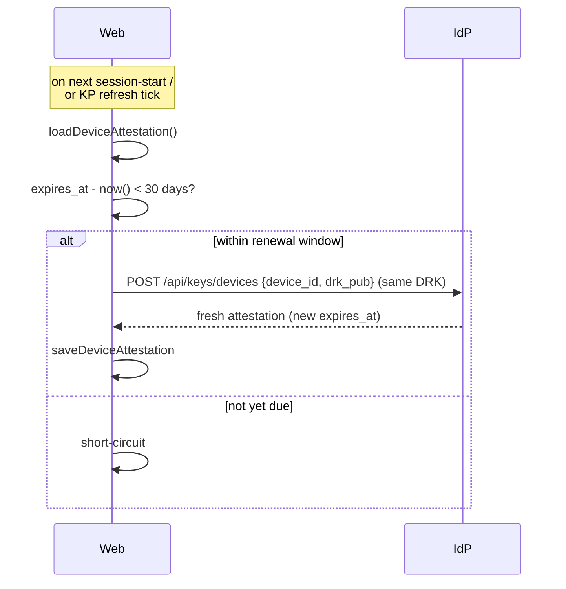

Renewal reuses the existing DRK — only the attestation's `expires_at`
moves forward, and the HPKE key registered stays (§ 3.3). KeyPackages
already in the server's stash stay valid.
New KeyPackages built after renewal carry the fresh attestation.

### 6.9 Keeping the KeyPackage stash topped up

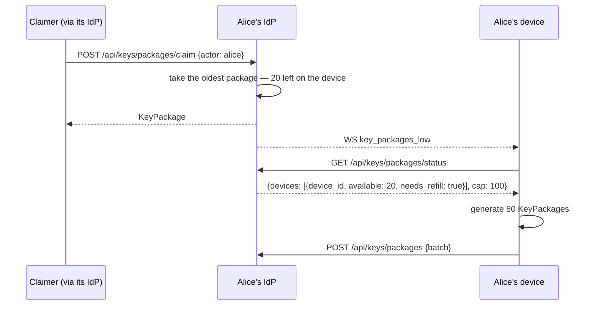

The device runs the same top-up when it enters the app and every 6
hours while it stays open, so a push it missed while offline is made
up on its next start. A claim that finds nothing answers `409` and
still pushes: once the owner's device has refilled, adding them again
succeeds. The status lists only devices with a package left, so a
device it doesn't list is refilled the same way, to the cap.

### 6.10 Approving a new device with a code

The phone has just signed in, registered its DRK and HPKE key and named its device; the laptop is
an approved device of the same account.

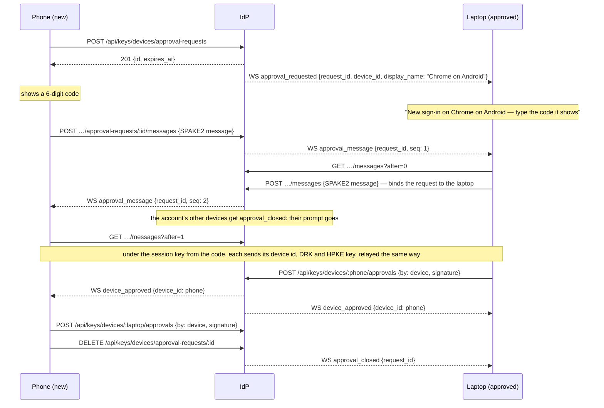

Each side signs the other's DRK as it came out of the exchange: should the instance list another
key for that device, the approval doesn't verify over it, and is refused. A wrong code fails the
exchange; the device that finds it wrong closes the request, and a new attempt is a new request,
with a new code. A device that comes online meanwhile lists the open requests
(`GET /api/keys/devices/approval-requests`); once the laptop answered, any other device of the
account is refused (`409 approval_request_taken`). The phone trusts the laptop from the exchange
alone until it holds the passphrase (§ 3.9); once it does, it approves itself with the approval
key and checks every chain from the device list.

---

## 7. Wire formats

### 7.1 MLS leaf credential

Inside every leaf's `BasicCredential` (Section 3.4 JSON).

### 7.2 Canonical signed bytes

The IdP's attestation of a DRK (§ 3.2), a DRK's signature over its
device's HPKE key (§ 3.3) and an approval of a device (§ 3.9) are all over
UTF-8 lines, each ended by `\n` (a literal newline, 0x0A) but the last.
Every field is written exactly so:

- `actor_uri`: the account's actor URI, exactly as `/userinfo` answers
  `actor_uri`;
- `device_id`: a lowercase hyphenated UUID;
- keys: standard base64, with padding;
- `expires_at`: RFC 3339 in UTC, to the second — `2027-05-14T12:00:00Z`,
  no fraction —, the text `GET /api/keys/devices` lists as
  `attestation_expires_at`;
- `kid`: as the instance's JWKS names the key.

The leading tag keeps a signature from ever verifying as another use of
the same key; a change to the fields needs a new tag.

What the IdP signs in `POST /api/keys/devices`:

```
IDP-ATTEST-v1\n
<actor_uri>\n
<device_id>\n
<base64(drk_pub)>\n
<expires_at as YYYY-MM-DDThh:mm:ssZ>\n
<kid>
```

What a device's DRK signs over its HPKE key:

```
PINAI-DEVICE-HPKE-v1\n
<actor_uri>\n
<device_id>\n
<base64(hpke_public_key)>
```

What an approval signs — by another device's DRK, or by the generation's
approval key —, `device_id` and `drk_public_key` the approved device's:

```
PINAI-DEVICE-APPROVAL-v1\n
<actor_uri>\n
<device_id>\n
<base64(drk_public_key)>
```

### 7.3 History archive entry (POST `/api/history/messages`)

```json
{
  "generation": 2,
  "entries": [
    {
      "id": "<uuid; matches direct_messages.id>",
      "conversation_id": "<uuid>",
      "ciphertext": "<base64-std>",
      "nonce": "<base64-std, 12 bytes>",
      "client_message_id": "<optional>"
    }
  ]
}
```

`generation` names the history key's generation the entries were sealed
under: an upload under any other generation is `409 stale_history_key`
(§ 3.8). `ciphertext` is the AES-256-GCM encryption of the JSON-serialised
`ApplicationMessage` under HAK with `nonce`. The JSON includes a
domain-specific replacer for `Uint8Array` fields (attachment AES keys
+ nonces) so they round-trip through serialization.

### 7.4 JWKS rotation handling

The IdP's JWKS at `/.well-known/jwks.json` publishes one or more
EdDSA keys. Each leaf credential's `idp_att.kid` names which key
signed it. When a peer fails to verify a signature:

1. The peer invalidates the cached JWKS for that issuer.
2. The peer refetches and retries the verification once.
3. Permanent failure rejects the leaf.

When the IdP rotates its signing key, the **old key remains in JWKS
for at least the longest active-attestation lifetime** (1 year by
default — same as `attestation_expires_at`). This is the same rule
the IdP follows for JWT-signing-key rotation, just with a longer
horizon. Existing attestations remain verifiable through their
natural expiry; clients renew through the normal 30-day window;
new attestations use the new key.

---

## 8. Storage architecture summary

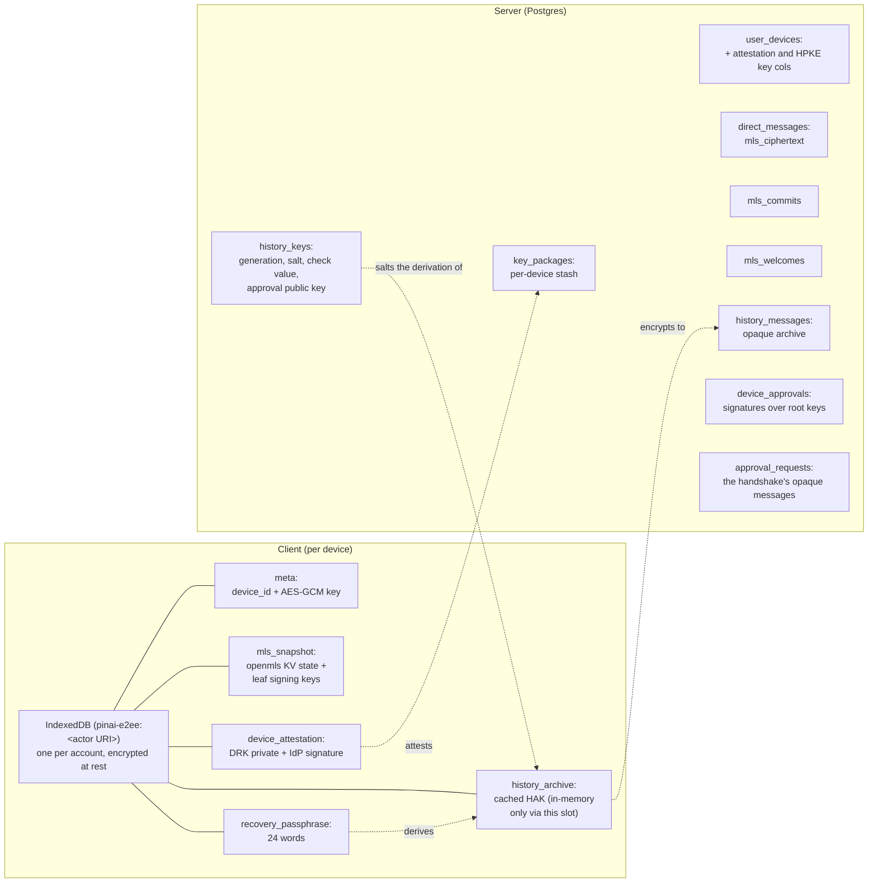

Two persistence boundaries:

- **Client IndexedDB** holds everything the device needs to decrypt
  messages and prove its identity to peers. Every blob is encrypted
  under a per-device non-extractable AES-256-GCM `CryptoKey` so that
  full IDB extraction by an attacker without script execution in the
  user's origin yields nothing useful. Each account signed in on a
  browser has its own databases and its own device key, so to the IdP
  two accounts sharing a browser are two devices, and signing in as
  one never erases the other's.
- **Server Postgres** holds opaque material only — MLS ciphertexts,
  base64'd KeyPackages, encrypted history archive entries, the history
  keys' salts, check values and approval public keys (none of them
  secret), public attestation columns, the approvals' signatures and the
  approval handshake's messages (public by design: SPAKE2 messages reveal
  nothing of the code). Read access to the database yields no plaintext
  message content.

The same per-device AES-GCM key encrypts the Zustand `persist`
middleware's message-plaintext cache — that way the cache (used for
"don't blank conversation history on page reload") shares the same
threat model as the rest of the IDB content.

---

## 9. Open questions and known limitations

- **Server-side KeyPackage signature validation.** The server doesn't
  currently re-verify that an uploaded KeyPackage's embedded leaf
  credential signature chains back to a registered DRK. Peer clients
  do this verification when a foreign leaf surfaces in their MLS
  state, so the security-critical path is covered; server-side
  validation is defense-in-depth and requires pulling `openmls` into
  the server crate.
- **Reactions and edits in restored history.** The MVP restore path
  handles `kind: "text"` application messages. Reactions (which apply
  as deltas to an existing message) and edits (which replace the
  ciphertext of an existing message) are skipped — they'd need
  ordering guarantees against the restored target message that the
  current implementation doesn't provide.
- **Background streaming of large archives.** The restore page pulls
  pages serially. For users with very large histories this is
  noticeable; a progressive streaming UI is a future enhancement.
- **A commit that never reaches an instance.** Commits are sent once, best effort, and members
  catch up only from their own instance's log. A commit lost to a network failure leaves that
  instance's members who joined before it unable to read anything sent after it, until they are
  removed and added back. Its roster only covers the commit that outruns a Welcome.
- **A message more than five commits behind.** A device that applies six
  or more commits before a message sent ahead of them can't decrypt it
  (§ 6.3); only the history archive can bring it back, from a device of
  the user's that did read it.
- **Out-of-band fingerprint verification.** No user-facing UI for
  comparing device attestations out of band. Trust on first use plus
  IdP-attestation is the baseline; an opt-in verification surface
  would be additive.
