# Pīna'i — End-to-End Encryption (MLS)

All direct messages and group conversations are end-to-end encrypted using
**MLS (RFC 9420)**. The identity-provider serves three roles: an OIDC
authentication endpoint, a key directory, and an MLS Delivery Service. It
never sees plaintext message content.

For the protocol-level explainer of MLS itself (TreeKEM, KeyPackages,
commits, epochs), see `identity-provider/specs/e2ee-protocols-overview.md`.
This document is the integration spec.

---

## 1. Principles

Three properties define the system:

1. **The user's devices decide which devices are theirs; the IdP carries
   what it can't read.** Each user picks an identity-provider
   (`alice@idp.alice.com`). That IdP signs every device's long-lived
   cryptographic identity — the attestation the rest of the network checks —
   and carries every message, archive entry and key share without being able
   to read them. Which devices the account's existing conversations and its
   passphrase reach is the user's own devices' call: a new device counts once
   one of them approves it with a short code, or once the account's 24 words
   are typed on it (§ 3.9). Contacts take the IdP's attestation instead — what
   that leaves open is in § 2. The IdP never holds a message-decryption key,
   the passphrase or the key it derives.
2. **Per-device, not per-user, identity.** Every device generates its own
   Ed25519 Device Root Key (DRK) and gets a fresh attestation from the IdP.
   New devices join existing conversations through standard MLS Add commits,
   which the user's devices make for approved devices only; no master-secret
   has to be smuggled around.
3. **History is on by default, under one passphrase per account.** The
   account's first device mints a 24-word passphrase: the account's history
   key, in generations (§ 3.6). Every device holding it re-encrypts each
   decrypted plaintext under the History Archive Key it derives, and uploads
   it to an opaque server-side archive — there is no switch to stop it; the
   device that approves a new one with the code shares the words with it,
   sealed (§ 3.11), so a device approved with the code restores past messages
   by itself. An account that lost every device and the words loses its
   archive and starts over with a new passphrase — the explicit
   security/usability trade-off this system accepts.

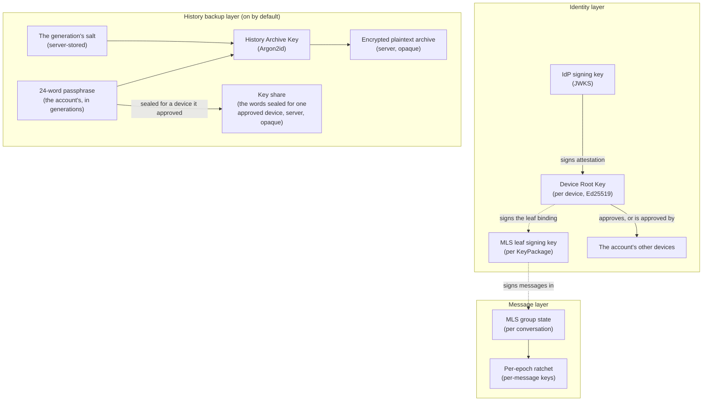

---

## 2. Threat model

Below, **the instance** is the user's identity provider acting on its own — its server, its
database, its routes and pushes, and whoever runs it through them. The code a device runs is set
apart: a web app runs what its host serves, so for a web app the user's own instance serves, the
rows below that name the instance don't hold ("What is not protected").

### What is protected

| Threat | Mitigation |
|---|---|
| The database or one of its backups leaks; an operator browses it | It holds nothing that opens a message, the archive or the passphrase: MLS ciphertexts, the archive sealed under the HAK, key shares sealed for one device's HPKE key each; the salts, check values, public keys, signatures and the handshake's messages open none of them (§ 8) |
| The network reads a conversation | Only MLS ciphertext crosses, over HTTPS; per-message keys are derived inside MLS on the devices, never transmitted |
| Another instance reads a conversation it carries | It carries MLS ciphertext only; it reads what a device it attests for one of its own users is let into ("What is not protected") |
| The instance puts a leaf key of its own under one of the user's devices' credentials, in a KeyPackage it serves, to read a conversation in that device's place | Every leaf credential carries the device's leaf binding, its DRK's signature over the leaf's signature key (§ 3.4), and every device checks it on every add and on every leaf it meets: without the DRK's private half, the instance makes none |
| A peer instance serves a forged KeyPackage for one of its users | The leaf credential carries the peer's attestation, verified against its JWKS, and the leaf binding, verified against the attested DRK (§ 3.4). A device the peer attests for itself is its users' trust ceiling, as below |
| The instance slips a device of its own into the user's existing conversations | The user's devices add only devices they approved (§ 3.9): approved with the code, or with the 24 words typed on it. An approval is a signature by an approved device's DRK, or by the passphrase's approval key — the instance holds neither |
| The instance reads the archive or the passphrase | The HAK derives from the passphrase, which never reaches the instance in the clear: a device shares it only with a device it approved with the code, sealed for that device's HPKE key and signed by its own DRK (§ 3.11) |
| The instance shows its own device just as the user signs in elsewhere, for the user to approve | Approving takes the 6-digit code the new device shows, the password of a SPAKE2 exchange: without it, the instance gets at most two guesses per code — one against each side —, a one-in-five-hundred-thousand chance, and each guess costs the user a code, asked for or typed: a device draws a new code for each exchange, runs one exchange per code, and opens the next by itself only when nobody answered within ten minutes of its own clock (§ 3.10) |
| The instance changes the approval public key, to approve a device itself | A device holding the passphrase derives the key itself, compares, trusts nothing new and warns on a mismatch (§ 3.9) |
| A device nobody approved appears on the account | No device of the user's adds it to a conversation or sends it the passphrase; each one holding the current passphrase that sees it in the device list announces it — "Not you? Sign it out." The list is the instance's: a device it leaves out is caught only if met as a leaf in a conversation one of the user's devices is in ("What is not protected", § 3.9) |
| The instance starts the history over from a device of its own | The new generation's setter isn't a device the others approved: they refuse the generation and warn — "Your history was reset from a device you haven't approved." —, and never approve that setter, which would hand it everything. The way back is a start over from one of the user's own devices (§ 6.11) |
| A device is lost or stolen | Revoke it — MLS Remove commits leave it out of every later epoch, the approvals it signed and the key shares it sent or was sent are dropped, the directory hands out no KeyPackage of it (§ 6.6) — and, if it held the 24 words, start over from one of the user's devices (§ 6.11): only a new generation cuts its words off |
| A member removed from a group, or gone from it, keeps reading | Every device of theirs is committed out by MLS Remove commits (§ 6.8): nothing sent from the next epoch on decrypts for them, whatever reaches them |
| Replay / reorder / forging by transport | MLS application-message authentication + epoch ordering — handled inside the protocol |

### What is not protected

- **A device the user's instance attests, in the conversations others add the user to.** A contact
  founding a DM with the user, or a group adding the user, adds every device the instance attests
  for the user (§ 6.5) — one of the instance's own included. It reads what is sent there until one
  of the user's devices in the conversation, holding the current passphrase, meets its leaf, finds
  its root key unlisted or unapproved and announces it (§ 3.9) — and it is committed out only if
  the instance carries the commit: the instance's Delivery Service can refuse it, drop it or never
  forward it, and can withhold the Welcomes that would bring the user's devices in.
- **Conversations the instance opens in the user's name.** With a device of its own and the
  user's account, it can found a DM's group before the user's devices do, befriend someone as the
  user, or create a group as the user: none of the user's devices is ever added there, so none
  meets its leaf. It speaks as the user in them, and it can keep them out of what the user's
  devices are shown.
- **A device a contact's instance attests for that contact.** The user's devices can't see a
  contact's approvals: they add every device the contact's instance attests to the conversations
  the user opens with them, and to a group when it gains that contact. Closing this, and the two
  points above, takes user identity keys that contacts check, beyond this system.
- **Anyone holding the 24 words and a session.** Approving a device by the passphrase, they have
  it added to every existing conversation by the user's devices, and restore the archive. A
  revoked device that held the words keeps them, as does anyone who saw them. Cutting them off is
  replacing the words (§ 6.12) from one of the user's devices holding them — or, with none left,
  starting over (§ 6.11): a new generation, the old words opening nothing; the replacement
  re-saves the history the device holds under the new words, a start over erases it.
- **Who holds the passphrase.** Each device's `history_generation` is that device's own report,
  carried by the instance: "held by N devices" is shown as the list says, among the devices found
  approved.
- **Who set a generation.** `set_by_device` is the instance's word: naming a device the user
  approved, it hides a reset from the warning on every device, and sends them to the reset page
  as after a replacement of the words. A device catches only the lie about itself — a generation
  said to be its own while it set none.
- **Someone with only the password.** Their device is announced and kept out of the existing
  conversations and the passphrase, but they can erase the archive — Settings → Devices → Clear
  history backup, or a start over —, and their device gets into the conversations contacts open
  with the user from then on (above). With a recent sign-in they can sign the other sessions out,
  revoke every device and start over: their device then becomes the account's root of trust, and
  the existing conversations are out of the user's reach.
- **The user approving a device that isn't theirs.** The code proves that the two devices speak to
  each other, not whose the new one is: the prompt names the device ("New sign-in on Chrome on
  Android"), and "Not me" signs it out.
- **The code a device runs.** Whoever hosts the web app a user opens — the user's instance,
  another, or the official one — can change its code, and that code does what the device does:
  reads the passphrase, approves a device. The desktop app runs the code it was installed with
  (`app://pinai`), never code an instance serves.
- **The instance erasing what it stores.** It controls the database: it can drop the archive, a
  key share, an approval or a message — never read or forge one it stores. It can go back on the
  account's history key, too: the user's devices refuse a generation below one they have seen
  and save nothing meanwhile (§ 3.9), a start over can't move past it — the instance takes only
  the generation after its current one, and a device never sets one it has seen —, and only the
  instance putting the key back restores saving. A dropped archive loses
  past messages on new devices; the devices that read them keep them.
- **Metadata.** The instance knows who is in each conversation, when commits happen, message
  ordering and sizes, the sender device of each message, and which devices share the passphrase
  with which. There is no sealed sender and no anonymous credential.

### Lost everything

An account that lost every device and the 24 words starts over (§ 6.11): a new device sets the next
generation — a recent password, the archive erased — and becomes the account's new root of trust,
approved by its own new words. It joins none of the account's existing conversations: only the
user's own devices add a sibling, and none is left (§ 9). Devices that still exist hold the old
passphrase: they refuse the new generation, as one set by a device they never approved, and warn,
until the user puts one back — it asks to be approved and its code is typed on the new device (the
two approve each other, the new device shares the new passphrase, and the old one adds it to its
conversations) — or types the new words on it.

### Trust ceiling

To the rest of the network, a device of the user's is one the user's instance attests (§ 3.2):
contacts trust its attestation, as they trust the instance's OIDC tokens. The instance — or
whoever holds its signing key — can therefore attest a device of its own. Such a device is kept out
of the conversations the user's devices add devices to, and of the passphrase. It is let into the
conversations contacts open with the user — until one of the user's devices, there, meets it and
commits it out, and only if the instance carries that commit —, and it can open conversations of
its own in the user's name, where none of the user's devices ever is. This is the ceiling OIDC
already imposes — a compromised IdP issues access tokens for the user too —, made explicit.

What this trust does **not** grant:
- Reading the messages of a conversation its device wasn't added to — MLS keys live on the
  devices, and forward secrecy deletes past per-message keys once used (a device keeps only those
  of messages it hasn't read yet, from its last five epochs — § 6.3)
- Reading the history archive or the passphrase — sealed under the HAK, and for approved devices'
  HPKE keys
- Joining the user's existing conversations, or receiving the passphrase — both take an approval
  the instance can't sign
- Speaking in a conversation as one of the user's devices — every leaf it holds is bound to the
  device's DRK (§ 3.4)
- Approving a device by changing the approval public key — a device holding the passphrase checks
  it
- Reading what a device keeps — its private keys and its MLS state never leave it, and the
  passphrase leaves it only sealed in a key share (§ 8)

### Out of scope (non-goals)

- **Traffic analysis.** No padded delivery, no cover traffic, no mixnets.
- **Endpoint compromise.** Full device compromise breaks all bets, as
  with every E2EE system.
- **Cross-IdP plaintext fallback.** Conversations with a peer who can't
  speak the federated MLS handshake gracefully fail.

---

## 3. Elements

### 3.1 Device Root Key (DRK)

An Ed25519 keypair generated once on first sign-in to a device. The
private half lives in IndexedDB, encrypted at rest under a non-
extractable AES-256-GCM device key. The public half is sent to the IdP
exactly once — the IdP signs an attestation binding it to the user.

The DRK is *long-lived* by default (1-year attestation, silent renewal
when within 30 days of expiry). It's not used to sign MLS application
messages directly; that's the leaf signing key (§ 3.5). The DRK
binds the device's IdP-attested identity to whatever leaf signing keys
that device produces, by signing each one: the leaf binding (§ 3.4).

### 3.2 IdP attestation

A signature by the IdP's existing JWKS key (the same one that signs
OIDC tokens and HTTP Signatures) over the `IDP-ATTEST-v1` canonical
bytes of § 7.2: the account's actor URI, the device id, the DRK, the
attestation's expiry and the key's `kid`.

The signature lives inside every MLS leaf credential the device
produces. Peers verify by fetching the issuer's JWKS, looking up the
key by `kid`, and validating the signature.

### 3.3 Device HPKE key

Each device also makes an HPKE key pair (RFC 9180, DHKEM(X25519, HKDF-SHA256)) once, beside its
DRK, and keeps the private half in its sealed store. Its public half — a raw 32-byte X25519 key —
is what the account's other devices encrypt to: the passphrase they share with it (§ 3.11). The
DRK signs it over the `PINAI-DEVICE-HPKE-v1` canonical bytes of § 7.2: the account's actor URI,
the device id and the key.

The instance checks only the key's length. A low-order key is refused by the sender's HPKE —
X25519 then gives the all-zero shared secret (RFC 9180 § 7.1.4) —, so a sender must never skip
that check.

The device registers the key with its DRK: `POST /api/keys/devices` takes `hpke_public_key` and
`hpke_key_signature` together, and refuses the registration (`400`) unless the DRK sent in the same
request verifies the signature. Both are optional — a device registering without them is attested
all the same, and holds no HPKE key until it sends one.

**The chain a device verifies.** A device trusts another device's HPKE key only through the
attestation the instance already signs, and checks every link itself, from what `GET
/api/keys/devices` lists for that device:

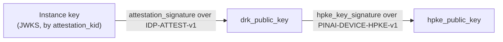

1. The device isn't revoked: `revoked_at` is null.
2. The instance's key named by `attestation_kid` verifies `attestation_signature` over the
   `IDP-ATTEST-v1` bytes rebuilt from the account's actor URI, the device id, `drk_public_key`,
   `attestation_expires_at` and `attestation_kid`; `attestation_expires_at` is still ahead, with
   the 5 minutes of clock skew § 3.4 allows.
3. `drk_public_key` verifies `hpke_key_signature` over the `PINAI-DEVICE-HPKE-v1` bytes rebuilt
   from the actor URI, the device id and `hpke_public_key`.

**The key follows the DRK that signed it.** On each registration:

| Registration | Brings a key | Brings none |
|---|---|---|
| First (no attestation yet) | stored | none held |
| Renewal (the same DRK) | replaces the one held | the one held is kept |
| Rotation (another DRK) | replaces the one held | the one held is cleared — only the old DRK signed it |

Revoking a device clears its HPKE key in the same write that sets `revoked_at`.

### 3.4 MLS leaf credential

Every MLS leaf carries a `BasicCredential` whose identity bytes are
this JSON:

```json
{
  "v": 2,
  "actor_uri": "https://idp.alice.com/users/alice_xK9mP",
  "device_id": "550e8400-e29b-41d4-a716-446655440000",
  "drk_pub": "<base64>",
  "idp_att": {
    "issuer": "https://idp.alice.com",
    "kid": "key-2026-01",
    "expires_at": "2027-05-14T12:00:00Z",
    "signature": "<base64>"
  },
  "leaf_binding": "<base64>"
}
```

`leaf_binding` is the DRK's Ed25519 signature over the
`PINAI-LEAF-BINDING-v1` canonical bytes of § 7.2: the actor URI, the
device id and the leaf's signature public key — the raw 32-byte Ed25519
`signature_key` of the LeafNode the credential sits in. The attestation
and the DRK are public, so without the binding anyone holding them — the
instance first — could pair them with a leaf key of its own in a
KeyPackage it serves; with it, only the device that holds the DRK makes a
leaf under its credential.

Receivers verify in this order:

1. Parse JSON; reject if `v !== 2`.
2. `idp_att.issuer` must be exactly the origin of `actor_uri` — scheme,
   host and port as browsers write an origin, no path —: an
   attacker-controlled IdP must not be able to attest someone else's
   actor.
3. `expires_at` must be in the future (5-minute clock-skew slack).
4. Fetch the issuer's JWKS from `<issuer>/.well-known/jwks.json`
   (10-second timeout, 1-hour client-side cache, refetched on a signature
   that fails — § 7.4), look the key up by `kid` and verify the signature
   over the `IDP-ATTEST-v1` bytes rebuilt from the credential.
5. `drk_pub` verifies `leaf_binding` — Ed25519, strict — over the
   `PINAI-LEAF-BINDING-v1` bytes rebuilt from `actor_uri`, `device_id` and
   the LeafNode's signature key.

A KeyPackage claimed for an actor's device must also name that very actor
and device; one naming another is refused as a forged one is. An issuer
that can't be reached settles nothing: a claimed KeyPackage is then not
added, and a leaf met is left as it is and checked again the next time it
is met. A verdict holds for the leaf as it stands: an Update over it, or
another leaf at its index, is checked anew.

Every device runs these checks on every leaf it adds — the KeyPackage's —
and on every leaf it meets: in a Welcome's ratchet tree, in a commit that
adds one, and a leaf replaced by an Update or by a commit's path. A leaf
failing them is never added, and one met in a group is warned of and
committed out — if the instance carries the commit — by any device of the
group, holding the passphrase or not: the checks need no approval. An
attestation that only expired is no forgery: such a leaf is warned of and
left in place — its device brings it current when it renews (Keeping
leaves current) — so a member away for a year isn't shut out of groups
nobody would add them back to; a malformed credential, an issuer that
isn't the actor's, an attestation or a binding that doesn't verify are
committed out. A contact's leaf is
trusted on its attestation and leaf binding; a leaf of the device's own
account also needs the device list to list its device with the
credential's `drk_pub`, approved over that root key (§ 3.9) — one that
doesn't is announced, and committed out under the same proviso, by a
device holding the current passphrase.

After verification, the leaf is trusted as "actor X's device Y." MLS's
own LeafNode self-signature handles per-message integrity.

**Keeping leaves current.** A leaf carries the attestation of the moment
its credential was made, and a renewal (§ 6.7) doesn't reach it: a member
joining once that attestation expired would meet an expired leaf. So
after each registration, a device commits in every group it holds an
update of its own leaf, over the same signature key, carrying the
credential of its current attestation — one commit per group and
renewal, none where its leaf already carries the credential it would
make. A refresh that fails is tried again at the next sync, and holds
back nothing else of it: the user's other devices are still added.

### 3.5 KeyPackage

A single-use bundle the device publishes ahead of time so peers can
add it to groups without a round-trip. Each KeyPackage contains the
device's leaf-signing public key — the one it bound, which every
KeyPackage it makes carries until it binds another — + the device's full credential
(§ 3.4), its leaf binding signing that very key + MLS protocol fields
(HPKE init key, capabilities, lifetime). The server stores them in an
inventory keyed by `(user_id, device_id)`; peers claim one atomically
when adding the user to a conversation.

In each group the device signs with the key its leaf there carries — the
one of the KeyPackage it joined through, or the one it founded the group
with — which peers verify its messages and commits against. Every key the
device published stays in its MLS store, and a key it binds later, after a
reload, signs only where its leaf carries that key.

A device keeps its stash topped up to the cap — 100 per device by
default — whenever the server reports it at or below the refill
threshold (20, `needs_refill = true`), or doesn't list the device at
all. It checks when it enters the app, every 6 hours while it stays
open, and whenever the IdP pushes `key_packages_low`: each live
session reads its own device's count from `GET
/api/keys/packages/status` and uploads the difference (§ 6.9).

The IdP pushes `key_packages_low` to the owner's live sessions when a
claim leaves one of their devices at the threshold, or finds no
package left; a refused claim pushes nothing. An offline device makes
up a missed push on its next start. KeyPackages live 30 days, so a
device left unopened for longer can't be added to a group until it is
opened again.

### 3.6 24-word recovery passphrase

A BIP-39 mnemonic of 24 words — 256 random bits — generated client-side by an account's first
device, on its first sign-in. Its only job is to derive the History Archive Key — losing it means
losing past messages on a fresh device, not losing your account.

It belongs to the account, not to a device, and the account has one at a time, in
**generations**: the first device makes generation 1, and a new passphrase — the next
generation — is made only when the current one is lost (no device holds it and the words are
gone) or must be replaced (a revoked device, or someone the user no longer trusts, holds it):
a start over, § 6.11. A new generation erases the archive (§ 3.8): what was saved under the old
passphrase could no longer be opened.

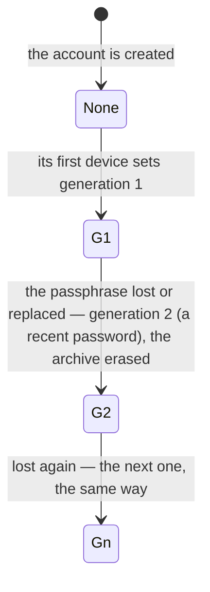

A device signing in to an account that has a history key (`GET /api/history/key`) gets the words
one of two ways (`/onboarding/recovery-restore`): approved with the code by a device of the
account (§ 3.10), it is sent them by the device that approved it (§ 3.11, § 6.10); or the
user types them (§ 6.4), which approves it (§ 3.9). Either way it checks them against the
generation, keeps them, approves itself with them, archives under the same key from then on and
restores the archive. There is no third way in: a device that is neither approved nor holds the
words stays on that page, publishes no KeyPackage — so none of the account's devices, nor any
contact's, adds it to a conversation — and archives nothing, until it is approved, the words are
typed, or it starts over: "I no longer have my devices or my words" (§ 6.11). A device that held
words of this account and finds them no longer the key in force is not pushed out: it keeps its
conversations and its own copy, saves nothing and decides nothing, under a banner that says what
happened — a generation set by a device it doesn't know, or a change none of the user's devices
made — and offers the way back: approved with a code or the new words ("It was me"), or a start
over from it once the password is changed ("It wasn't me"). Only words replaced from a device it
found approved (§ 6.12) send it to a reset page that waits the same way: then the user replaced
them, and it comes back with a code or the new words. A device's passphrase is stored locally, encrypted
under its AES-GCM key, for revealability in Settings → Devices.

A device says which generation it holds (`PUT /api/keys/devices/:device_id/history-key`), only for
the current one and from its own session, once it has named its device
(`PUT /api/sessions/current/device`, `identity-provider/specs/auth.md § 1`, "Sessions and
devices"); `GET /api/keys/devices` lists each device's `history_generation`: a device holds the
passphrase when that is the current generation.

### 3.7 History Archive Key (HAK)

Derived from the passphrase and its generation's salt via Argon2id
(`t=3, m=64 MiB, p=4, dkLen=32`). The password is the 24 words, lowercase, joined by single
spaces, as UTF-8 bytes. The salt is 16 random bytes, made by the device that sets the
generation and stored with it (`PUT /api/history/key`), so every device holding the passphrase
derives the same HAK. Each generation has its own salt, so its own HAK.

A generation is set from a session that has named its device, and records that device
(`set_by_device`): the account's other devices can tell which of them set it.

The device setting a generation also derives two values from its HAK, stored with it. The
server keeps them and hands them out; it never computes them.

- **The check value**: `HMAC-SHA256(key = HAK, message = "pinai/history-archive/check-v1")`, the
  message as ASCII bytes: 32 bytes. A device tells by it whether a passphrase is the current one:
  it derives the HAK from the words and the current salt, and compares. A wrong passphrase is told
  apart even when the archive is empty. The check value can't be used to brute-force the
  passphrase: the passphrase is 256 random bits, 2²⁵⁶ guesses, each an Argon2id derivation.
- **The approval public key**: the Ed25519 public key whose 32-byte seed is
  `HKDF-SHA256(ikm = HAK, info = "pinai/device-approval/v1")`, with no salt. Only the devices
  holding the passphrase have its private half; each of them checks the stored public half against
  its own derivation.

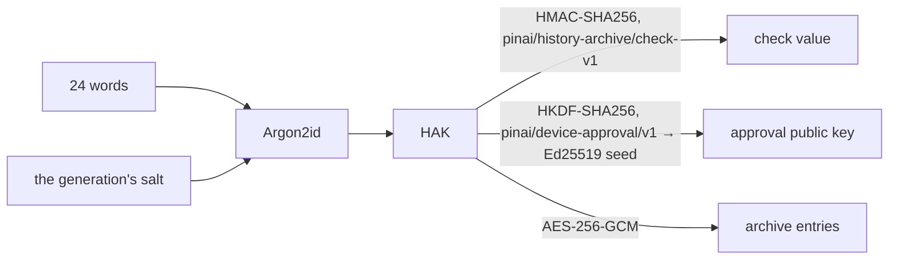

### 3.8 Encrypted plaintext archive

Every decrypted MLS application message gets re-encrypted under HAK with AES-256-GCM (fresh
12-byte nonce per entry), its conversation and message ids bound as associated data (§ 7.3), and
batch-uploaded to the server, naming the generation it was sealed under. The server only sees
opaque ciphertext + nonces. A device with the current passphrase can paginate the archive and
decrypt every entry; a device without it sees only bytes. A restore files an entry only under the
ids it was sealed with: one the instance moved to another conversation or message fails to open.

**The archive only ever holds the current generation's entries:**

- An upload names its generation and is refused (`409 stale_history_key`) unless it is the
  current one — and while the account has none: a device that missed a new generation mixes no
  keys. It reads the key again (`GET /api/history/key`): its entries wait, unsealed and in
  memory, while it may still hold the current passphrase, and are dropped once it knows it
  doesn't — nothing is ever sealed under a generation it doesn't hold, and a device that holds
  none keeps none.
- A new generation erases the account's archive in the transaction that sets it. An upload under
  way either commits first and is erased with the rest, or is refused.
- Settings → Devices → Clear history backup (`DELETE /api/history/messages`) erases the entries
  only: the key and its generation stay, and every device goes on saving new messages under it.

### 3.9 Approvals

The user's own devices decide which devices belong to the account. A device counts once another
device of the account approves it, or once the passphrase is typed on it. The instance stores and
lists the approvals and refuses malformed ones, but never decides whom to trust: each device checks
them itself. It reads their structure for one thing only, a key share, which it refuses to and from
a device that isn't approved, and from a device that didn't approve its recipient (§ 3.11) — a
backstop behind each device's check, never one in its place.

**An approval** is an Ed25519 signature over the `PINAI-DEVICE-APPROVAL-v1` canonical bytes of
§ 7.2 — the account's actor URI, the approved device's id and its DRK —, made either:

- **by another device** of the account, with its DRK (`by: "device"`); or
- **by the passphrase**, with the current generation's approval key (§ 3.7), on the device the
  words are typed on (`by: "passphrase"`): the device approves itself.

It binds the approved device's DRK: a device whose DRK changes is no longer approved.

**What the instance checks** (`POST /api/keys/devices/:device_id/approvals`, § 5, "Approvals"),
before it stores the approval in `device_approvals`, one per approved device and approver:

- the calling session named its device (§ 5, "Key directory rules"), an unrevoked device of the
  account: the approver, or with the passphrase the device approved;
- a device approves another unrevoked device of the account that registered a DRK, never itself;
  the passphrase approves the session's own device, under the current generation only, which the
  request names;
- the signature verifies — Ed25519, strict, as every root-key signature here — under the
  approver's DRK or the generation's approval public key, over the bytes rebuilt from the approved
  device's DRK as held.

The write is checked again: an approval whose devices or generation changed meanwhile is decided
anew, so none outlives what it was checked on. A new approval pushes `device_approved { device_id }`
to the account's live sessions, which read the device list again.

**What drops them**, in the very write that leaves them unverifiable:

| Change | Approvals dropped |
|---|---|
| A device revoked (`POST /api/keys/devices/:device_id/revoke`) | Those it signed |
| A device's DRK rotated (`POST /api/keys/devices`, another DRK) | Its own, and those it signed |
| A new generation set (`PUT /api/history/key`) | Those by the passphrase under older generations |

**Who is approved** each device works out itself, from `GET /api/keys/devices` — each device's
`approvals`, beside its DRK — and the generation's approval public key from `GET /api/history/key`:

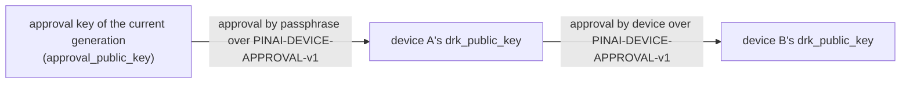

A device is approved when it carries an approval by the current approval key, or by an unrevoked
device that carries one: two links at most, each link matched by device id **and** root key. Its
chain JWKS → attestation → DRK must verify; its HPKE key matters only to sharing (§ 3.11), so a
device registered without one is announced and approved all the same. A list naming a device id
more than once is refused whole: the device decides nothing from it, and warns. A device holding the current passphrase approves
itself with the approval key, so its chain is one link from then on — and again whenever its own
DRK changes, which drops its approvals.

The stored approval public key is the instance's word until a device can check it, so two rules
keep the chain out of the instance's hands:

- **A device that doesn't hold the current passphrase** can't confirm the approval public key: until
  it holds the passphrase, it trusts only the devices it approved itself in a code handshake
  (§ 3.10), whose keys it took from the exchange, never from the list.
- **A device that holds it** derives the approval key itself (§ 3.7) and compares. When the stored
  approval public key differs, the instance changed it: the device trusts no approval made by that
  key, trusts no device it hasn't trusted already, and warns the user.

**What approval gates**, on each of the user's devices: adding a device to the conversations it
holds (§ 6.2), and the passphrase — a device shares it only with the devices it approved itself in
a code handshake, and accepts a share only from one of them (§ 3.11).

**Who acts on approval.** Only a device that holds the current passphrase, and whose own
derivation of the approval key matches the stored one, tells approved devices from others: it
alone adds a device, announces one, or commits one out on these grounds, and it reads the device
list again first — `device_approved` may arrive after a sibling's add. A device without it — a new
device before its share or its words, an old one refusing a newer generation — does none of
these. A device that acts:

- keeps every sibling it has found approved, by device id and root key (§ 8): a sibling whose root
  key changes is a new device, to approve again;
- announces, once per device, a device that appears with no approval after it began acting — the
  devices listed when it began acting (its first generation, the words typed or shared, a start
  over, a replacement) are its baseline, never announced as new —: "New device not approved:
  Chrome on Linux. Not you? Sign it out." — and keeps it waiting in Settings → Devices with "Not
  mine", which revokes it; the code field comes only while that device asks to be approved
  (§ 3.10): the code is the new device's to show, so one that asks nothing can't be approved from
  here until it is opened and asks;
- names, for each device it found approved, what approved it: a device whose approval of it is
  older than its own approval of that device — a handshake leaves one each way —, else the
  passphrase; what it counts by now, not necessarily what first brought it in.

**A reset the user didn't make.** Any device warns of a generation newer than the one it holds or
has seen, set by a device it hasn't approved or with no chain it can check — "Your history was
reset from a device you haven't approved." —, and of a stored approval public key that differs
from its own derivation, worded for an unknown change. When the user didn't start over, the
setter isn't theirs: it is never approved — approving it would hand it the account's
conversations and its new words —, and the way back is a start over from one of the user's own
devices (§ 6.11), the password changed first, or the thief starts over again. Such a reset pushes
none of the user's devices out of the app: each that held words stays, under a banner, in its
conversations, with its own copy, saving and deciding nothing until it holds the words in force. It still publishes KeyPackages,
so a conversation a contact opens from then on adds it, and the device that started over commits
it out there (§ 6.11).
After a start over, the devices listed when it was made are "from before": the new device shows
them so, with "Sign out" and the way back by a code, and names them as it shows the new words —
never as new devices. The device a "It wasn't me" refuses is never among them: it waits, named as
the one that reset the history and not the user's, with "Sign out" and no code. A device from
before that the user lost is still signed in, still holds the conversations it was in, and still
receives what is sent there, until it is signed out: the new device, in none of them, can't
commit it out, and only ending its sessions cuts it off.

**A device of the account met as a leaf.** The device list is the instance's: a device it leaves
out of it, or shows unapproved, can still be in a conversation someone else added the user to — a
DM a contact founds, a group that adds the user —, since contacts add every device the instance
attests (§ 6.5). So a device that acts checks every leaf of its own account it meets in a
conversation (§ 3.4) by its root key, not its device id alone — the instance can attest a root key
of its own under an approved device's id: a leaf whose credential's `drk_pub` the list doesn't show
for that device, or shows unapproved, is announced as above and committed out of the conversation
(an MLS Remove, § 6.8) — if the instance carries the commit. It has read what was sent there until
then.

**What a device never takes back from the list.** Each device keeps what it has seen (§ 8):

- **Generations only move forward.** A device never goes back to a generation older than the one
  it holds or has seen, whatever `GET /api/history/key` answers: it warns instead. Words give one
  generation only: the words it holds, matching a key served under another generation number,
  are refused the same way, and so is an account answering no key once one was seen.
- **A revocation is final.** A device remembers every revocation it saw; a device the list later
  shows unrevoked stays revoked for it — never added, never shared with, its approvals trusted for
  nothing.

### 3.10 The approval handshake

A new device is approved with a short code, over a request the instance relays between it and one
other device of the account. The instance carries the two devices' messages without reading them,
and never sees the code.

**What the two devices do.** The new device opens a request and shows a 6-digit code; the user
types it on a device of theirs that is approved. The two run SPAKE2 keyed by the code over the
request's messages, their device ids bound into it as its identities; once each has confirmed the
other knew the code, each sends the other its DRK and HPKE key sealed under keys of the exchange
(the bytes below). Each checks what it received against the device list — the device listed once,
unrevoked, with those very keys, its root chain verifying — and refuses the exchange otherwise. An
approval signs a device id and a DRK (§ 7.2), so each signs the other's as they came out of the
exchange, never as the device list shows them: the approved device's approval makes the new one
approved, and the new device's approval of the other is the one it trusts before it holds the
passphrase (§ 3.9). The answering device keeps the asking one as its handshake partner, then
approves it; the asking device approves the answering one only once the list shows that approval
of itself, verifying under the key the exchange gave — a refused asker approves nothing — and keeps
it as its partner (§ 8): the partners are whom a share is sent by and taken from (§ 3.11). Should
the instance list another key for either device, the approval doesn't verify over it, and is
refused. A wrong code fails the exchange, and the device that finds it wrong ends the request.

**The rules both devices keep:**

- **The code** is 6 digits drawn uniformly at random by the device asking, a new one for each
  exchange: a device never runs a second exchange on a code, never shows one again, and the
  answering device never tries a code it already failed with. Without the code, the instance gets
  at most two guesses per code — a man in the middle runs one exchange against each side —, a
  one-in-five-hundred-thousand chance.
- **A guess costs the user an action.** A device opens a request — and shows a new code — while the
  user is on its "Another device" page, or when they ask for a new code. It opens the next one by
  itself only when no device answered the last and ten minutes passed on its own clock (the relay's
  `expires_at` is the instance's word); after an answer of any kind — a wrong code, a close, a
  message refused, an error —, the next code waits for the user's "New code". Each of the
  instance's guesses is then a code the user asked for or typed.
- **The answering device holds the current passphrase**, found the stored approval key to be
  its own derivation, and has said it holds that generation (`PUT …/history-key`) — what the new
  device checks of it in the list, so that it shares the passphrase with the new device right after (§ 3.11) —
  one that doesn't would leave the new device approved through it with no share coming. A device
  that found the approval key changed answers no request. After a start over the old device is
  the one asking, and the new device, which holds the new words, answers it (§ 6.11).
- **The messages' byte format** below is the clients'; the instance never parses it.

**The exchange's bytes.** SPAKE2 as RFC 9382 defines it, suite `SPAKE2-P256-SHA256-HKDF-HMAC`: its
M and N, A the device asking (it goes first, and uses M), B the device answering (N); shares as
uncompressed SEC1 points (65 bytes, on the curve), x and y drawn uniformly in [1, p), a shared point
at the identity refused.

- **w**, the code made memory-hard as the RFC asks: `OS2IP(Argon2id(password = the 6 ASCII digits,
  salt = "PINAI-APPROVAL-CODE-v1\n" ‖ request id, t = 2, m = 19 MiB, p = 1, 40 bytes)) mod p` —
  40 bytes, so the reduction is unbiased. Light enough for a phone: a guess is only ever online.
- **The identities** `idA` / `idB`: `<actor_uri>\n<device_id>` of each side, ids lowercased; the
  asking device takes the answering one's from the relay's `device_id` on its first message — a
  false one fails the confirmation.
- **The transcript and keys** as RFC 9382 § 3.3–3.4: `TT` with 8-byte little-endian lengths;
  `Ke ‖ Ka = SHA-256(TT)`; `KcA ‖ KcB = HKDF-SHA256(salt = empty, Ka, "ConfirmationKeys" ‖ AAD, 32)`,
  `AAD = "PINAI-DEVICE-APPROVAL-HANDSHAKE-v1\n" ‖ request id`; `cA` / `cB` = HMAC-SHA256 over `TT`,
  compared in constant time, A's sent first and B's only once A's verified.
- **The sealed keys**: each direction's key `HKDF-SHA256(salt = empty, Ke,
  "PINAI-DEVICE-APPROVAL-HANDSHAKE-v1 keys A->B" | "… B->A", 32)`, AES-256-GCM with a zero nonce —
  each key seals one message —, the message's 2-byte header as associated data, the DRK (32) then
  the HPKE key (32) as plaintext.
- **The messages**, each `0x01` (the version) ‖ its type ‖ its payload, at an exact length:

  | # | Type | From | Payload | Bytes |
  |---|---|---|---|---|
  | 1 | `0x01` share | A | A's share | 67 |
  | 2 | `0x02` share | B | B's share — binds the request | 67 |
  | 3 | `0x03` confirm | A | `cA` | 34 |
  | 4 | `0x04` confirm + keys | B | `cB` ‖ B's sealed keys, once `cA` verified | 114 |
  | 5 | `0x05` keys | A | A's sealed keys, once `cB` verified and B's keys checked | 82 |

  A message out of turn or of the wrong length, a share off the curve or a seal that doesn't open
  ends the exchange as tampered with; the device finding it ends the request and sends nothing
  more.

**The relay** (§ 5, "Approvals"):

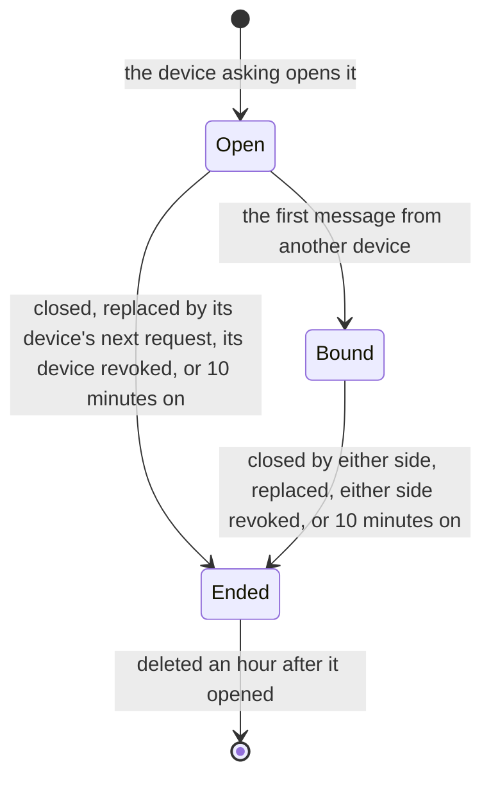

Pushes go to the sessions of devices only: a session that named none can take no part.

- **Opening.** A session that named its device, which registered a DRK, opens a request for that
  device: open 10 minutes. A device has one open request — a new one closes the one before —, and an
  account opens 10 an hour at most (`429`), counted under the account's lock. The account's other
  devices get `approval_requested { request_id, device_id, display_name }` — the name the
  `User-Agent` of its first registration, or of a KeyPackage upload after one that said nothing,
  gave the device: "Chrome on Android" —; a device coming online lists the open requests instead.
- **Binding.** Until another device posts, any device of the account may read or close the
  request. The first message from a device other than the one asking binds the request to it — a
  device with a DRK only (`409 no_root_key`), as answering ends in approving —, and the devices left
  out get `approval_closed { request_id }`: their prompt goes. From then on only the two of them
  post, read or close it, and any other device is refused (`409 approval_request_taken`), ended or
  not.
- **Messages** are opaque, 1 to 4096 bytes each, 12 a request at most
  (`409 approval_request_full`), numbered `seq` 1, 2, … in the order they arrive. A device reads
  those after a `seq` that are not its own. Each post pushes `approval_message { request_id, seq }`
  to the other side's sessions — every message the asking device posts before one answers, to
  every other device's.
- **Ending.** Either side closes the request (`DELETE`); it ends by itself 10 minutes after it
  opened, and when a device taking part in it is revoked. An ended request takes no message and no
  close (`410 approval_request_ended` rather than `404`, so a device tells a request that ended from
  one that never was), but its two sides still read it — the last message may come with the close.
  A close, a request replaced by its device's next one, or a revoke, pushes
  `approval_closed { request_id }` to both sides' sessions — every device's while nobody answers;
  an expiry pushes nothing, as each side holds `expires_at`. Requests are deleted an hour after
  they opened, when they no longer count against the limit, and are then unknown (`404`).

### 3.11 Key shares

The account's passphrase travels by itself from a device holding it to a device it approved with
the code: sealed for the recipient, signed by the sender, carried by the instance, which can't read
it. One sharing serves both directions — a new device approved with the code receives the words
from the device that approved it, and after a start over (§ 6.11) an old device receives the new
words from the new one.

**What a share is.** The sender seals the 24 words — written as a BIP-39 mnemonic is: lowercase,
separated by single spaces — with HPKE (RFC 9180) in base mode for the recipient's HPKE key
(§ 3.3), with the suite DHKEM(X25519, HKDF-SHA256), HKDF-SHA256, AES-128-GCM:

- `info` = `pinai/history-key-share/v1`, as ASCII bytes;
- `aad` = the `PINAI-HISTORY-SHARE-v1` bytes of § 7.2: the account's actor URI, the sender's device
  id, the recipient's, and the generation;
- the output: `enc`, the 32-byte encapsulated key, and `ciphertext`, 1 to 1024 bytes.

Its DRK signs the `aad` followed by `enc` and `ciphertext`, as § 7.2 writes them: the share is
bound to the account, both devices and the generation, so the instance can neither move it to
another device nor replay it under another generation.

**Who shares with whom, and when.** Only a device that approved the recipient in a code
handshake (§ 3.10): the recipient approved it in return, and its handshake partners are the only
devices it trusts before it holds the passphrase.

- **A new device approved with the code**: the approving device — holding the current generation
  (it said so, § 3.6) and approved under it — shares right after the two devices' mutual approvals
  (§ 6.10).
- **After a start over**: the old device asks to be approved, the new device answers, and the new
  device shares the new passphrase with it once the two approved each other (§ 6.11).
- **A device approved by the 24 words** typed on it holds the passphrase, and needs no share.
- **A holder that didn't approve a device** never shares with it.

**The sender's rules.** A device holding the current generation shares with every one of the
devices it approved itself in a handshake that the device list shows unrevoked, not holding that
generation, and carrying its approval back — an approval of this device by that one, verifying
under the DRK the exchange gave: a recipient that never approved it back would refuse the share,
which would then hold the place of a good one, and does so on each refresh of the list and as soon as it comes to hold a new
generation: the instance keeps the first share and answers the others `204`, so sharing again is
harmless. It seals for the HPKE key the list shows for that device, once its chain verifies
(§ 3.3) from the DRK the exchange gave it — never the list's. Should the list show another DRK
for it, no HPKE key, one that DRK didn't sign, or an attestation that doesn't verify, it shares
nothing and warns, as for a changed approval key (§ 3.9); an issuer out of reach, or an
attestation that only expired, waits for the next refresh.

**What the instance checks** (`POST /api/history/key-shares`, § 5, "History backup"), each against
the directory as it stands:

- the calling session named its device (§ 5, "Key directory rules"): the sender, an unrevoked
  device of the account;
- the generation the request names is the current one — none set refuses every share;
- the sender, which has a DRK, holds that generation (its `history_generation`); the recipient is
  another unrevoked device of the account, with a DRK and an HPKE key, that doesn't;
- the sender approved the recipient: the recipient carries an approval by the sender's DRK
  (`by: "device"`) binding the root key it holds;
- both are **approved under the current generation**, by the stored approvals' structure: a device
  carrying an approval by the passphrase under that generation, or one by an unrevoked device that
  carries such an approval — two links at most, as § 3.9 says, each binding the root key its
  device holds. Their signatures were checked when stored;
- the signature verifies — Ed25519, strict — under the sender's DRK over the bytes of § 7.2.

The instance stores one share per recipient and generation, in `history_key_shares`: of two
devices that both approved the recipient sharing at once, the first one stored stays — the
recipient trusts either —, and the other is answered `204` too, nothing written. The write is
checked again under the locks it takes — both devices', every device the approvals it relied on
name, and those approvals —, so a share is never stored over devices or approvals that changed
meanwhile. An approval it relied on dropped later — by a revoke of a device in the chain, say —
doesn't delete it: only the changes below do. A new share pushes `history_key_ready { device_id }`
to the recipient device's sessions only.

**What deletes them**, in the very write that leaves them useless:

| Change | Shares deleted |
|---|---|
| A new generation set (`PUT /api/history/key`) | All of the account's |
| The recipient says it holds the generation (`PUT /api/keys/devices/:device_id/history-key`) | The one it was sent |
| A device revoked (`POST /api/keys/devices/:device_id/revoke`) | Those it sent, and the one it was sent |
| A device's DRK rotated (`POST /api/keys/devices`, another DRK) | Those it sent — they no longer verify —, and the one it was sent |
| A device's HPKE key replaced or cleared (`POST /api/keys/devices`) | The one it was sent — sealed for a key it no longer holds |

**Accepting one.** On `history_key_ready`, or whenever it lacks the passphrase — at each start,
and, while the app hasn't let it in yet and so has no socket, again and again on its waiting
page —, the recipient reads its share (`GET /api/history/key-shares`) and keeps the words only when every check holds:

1. the sender is one of the devices it approved itself in a code handshake, by the DRK the
   exchange gave it and never the list's (§ 3.9);
2. the signature verifies under that DRK over the bytes of § 7.2, rebuilt from the account's actor
   URI, the sender's device id, its own and the generation;
3. the seal opens under its HPKE private key, with the same `info` and the `aad` rebuilt the same
   way;
4. the words give the current generation's check value and approval public key (§ 3.7), derived
   from them and the generation's salt.

It then keeps the words with their generation, approves itself with the approval key, says it
holds the generation — which deletes the share — and restores the archive (§ 6.4). A share failing
a check is left unused, and the device warns, as for a changed approval key (§ 3.9). The instance
keeps the first share of a recipient and generation, so a bad one it stores stands in the way of
a good one until a report, a revoke, a DRK or HPKE key change, or a new generation deletes it: a
lying instance can hold the passphrase back this way — the user can still type the words —, never
hand over other words.

---

## 4. Schema

```
users                    — local accounts (actor_uri, inbox_url, display_name,
                            username + NanoID suffix, avatar_url, pronouns, bio)
remote_actors            — cache of federated users (inbox_url, avatar_url, TTL)
conversations            — kind: dm | group, name
conversation_members     — actor_uri, joined_at, left_at
direct_messages          — sender_actor_uri, mls_ciphertext, activity_uri,
                            reply_to_id, federation_status (server stores
                            ciphertext, never sees plaintext)

user_devices             — per-device row, one per (user_id, device_id):
                            display_name, kind (laptop | phone | tablet | unknown),
                            paired_at, last_seen_at, revoked_at,
                            drk_public_key BYTEA, attestation_signature BYTEA,
                            attestation_kid TEXT, attestation_issued_at,
                            attestation_expires_at (whole seconds, as signed),
                            hpke_public_key BYTEA, hpke_key_signature BYTEA
                            (both or neither, and only with a drk_public_key),
                            history_generation INTEGER NULL (the history key's
                            generation the device says it holds)
key_packages             — single-use stash (per-device, expires_at, consumed_at)
history_keys             — the account's history key, one row per account, none
                            until its first device sets one: generation INTEGER
                            (> 0), salt BYTEA (16), check_value BYTEA (32),
                            approval_public_key BYTEA (32), set_at,
                            set_by_device (the device whose session set it)
device_approvals         — one per (device_id, approver): device_id, drk_public_key
                            BYTEA (32, the root key it binds), approver_device_id
                            (another device's DRK signed) or generation (that
                            generation's approval key signed) — exactly one —,
                            signature BYTEA (64), created_at. Dropped with the
                            approver's revocation, a DRK rotation (the device's
                            and those it signed), and older generations'
                            passphrase approvals when a new one is set
approval_requests        — id, user_id, device_id (asking), approver_device_id
                            (the first other device to post, NULL until then),
                            created_at, expires_at (+ 10 min), closed_at; one not
                            closed per device; deleted an hour after created_at
approval_messages        — PRIMARY KEY (request_id, seq); device_id (the poster),
                            body BYTEA (1–4096, opaque), created_at
history_messages         — PRIMARY KEY (user_id, id);
                            conversation_id, ciphertext BYTEA, nonce BYTEA,
                            client_message_id, created_at.
                            Server-opaque; idempotent upserts via
                            ON CONFLICT DO NOTHING. Only the current
                            generation's entries.
history_key_shares       — PRIMARY KEY (recipient_device_id, generation): one a
                            recipient and generation, the first stored; user_id,
                            sender_device_id, enc BYTEA (32), ciphertext BYTEA
                            (1–1024), signature BYTEA (64, the sender's DRK),
                            created_at. Server-opaque. Deleted by a new
                            generation, the recipient's report, a revoke of
                            either device, a DRK rotation of either, and a new
                            HPKE key of the recipient

mls_commits              — per-conversation commit log
                            UNIQUE (conversation_id, epoch)
mls_welcomes             — outbound queue for offline device adds
                            (recipient_user_id, recipient_device_id)
```

---

## 5. Endpoints

All Bearer-auth except where noted. Cross-IdP paths use HTTP Signatures — see
`specs/06-federation-authentication.md`.

### Key directory

| Endpoint | Description |
|---|---|
| `POST /api/keys/devices` | Register/renew/rotate the caller's DRK attestation: `{ device_id, drk_public_key, hpke_public_key?, hpke_key_signature? }`, keys and signature in standard base64. Idempotent on `(device_id, drk_public_key)`. The device's HPKE key comes with the DRK's signature over its canonical bytes, both or neither (§ 3.3). A session that declared its device (`PUT /api/sessions/current/device`) registers that device only. A device seen for the first time is named from the request's `User-Agent` ("Chrome on Linux"); one recorded unnamed takes the name of its first KeyPackage upload that says. First-time mint emits a `DeviceJoined` WS event to the user's other live sessions; a rotation drops, in the same write, the device's approvals and those it signed (§ 3.9), and the key shares it sent or was sent; a new HPKE key, or one cleared, the share it was sent (§ 3.11). Returns the signature, kid, issued_at, expires_at, and the canonical bytes the IdP signed so the client can re-verify locally |
| `GET /api/keys/devices` | List the caller's devices with their attestation expiry (the client uses this to schedule silent renewals), and whether each is signed in: `signed_in`, `last_active_at`. With each device, what another device needs to verify its keys itself (§ 3.3): `drk_public_key`, `attestation_signature`, `attestation_kid`, `attestation_expires_at` — the text the attestation signed —, `hpke_public_key`, `hpke_key_signature`; `null` where the device has registered no DRK, or no HPKE key. And `history_generation`, the history key's generation the device says it holds (§ 3.6), `null` until it says: the client compares it with the current generation. And `approvals`, oldest first, those binding the device's `drk_public_key` (§ 3.9): `{ by: "device", device_id, signature, created_at }` — `device_id` the approver — or `{ by: "passphrase", generation, signature, created_at }`, the signature in standard base64 |
| `PUT /api/keys/devices/:device_id/history-key` | `{ generation }`: the device says it holds that generation of the account's history key (§ 3.6). Only from the device's own session: one that has named this very device (`403 device_required` when it named none, `403 device_mismatch` when another; below). The current generation only (`409 stale_history_key`, none set yet included, checked again as it is written); an unrevoked device of the caller's only (`403` revoked, `404` another account's or unknown). The key share the device was sent is deleted in the same write (§ 3.11). `204` |
| `POST /api/keys/devices/:device_id/revoke` | Sets the directory-level revocation flag, clears the device's HPKE key, drops the approvals it signed (§ 3.9), deletes the key shares it sent or was sent (§ 3.11) and closes the approval requests it asks or answers (§ 3.10, `approval_closed` to the other side) in one write, then signs the device out — its sessions end, a web app's with the browser session it signed in through and that browser's other web apps (`identity-provider/specs/auth.md § 1`, "Sessions and devices"); the MLS Remove commits follow. Takes a password typed in the last 10 minutes (`identity-provider/specs/auth.md § 1`, "Sensitive actions"). Idempotent; `404` for a device that is not the caller's |
| `POST /api/keys/packages` | Upload a batch of KeyPackages for one of the caller's devices — refused whole (`400`) when a package is empty or not base64, or would take the device past the cap. An `expires_at` already past or beyond the lifetime (`E2EE_KEYPACKAGE_LIFETIME_SECS`) is the device's clock being off, not a bad package: the IdP stores it as now + the lifetime, by its own clock |
| `POST /api/keys/packages/claim` | Atomically reserve one KeyPackage for `actor_uri` — of `device_id`, or of any device with some left. Bearer or HTTP-Sig (peer IdPs); for remote `actor_uri` the local IdP proxies to the target IdP via HTTP-Sig |
| `POST /api/keys/packages/claim/devices` | One KeyPackage of each of `actor_uri`'s unrevoked devices that has any, as `{ claims: [...] }` — a contact's first add brings all their devices in (§ 6.5). Asked, proxied, limited and refused as a single claim is; none at all → 409 |
| `GET /api/keys/packages/status` | Per-device available counts + `needs_refill` flag |

#### Key directory rules

- **A device id is its first account's.** Device ids are not secret — a claim returns one — so
  registering or uploading for a device id another account holds is refused with `409`, and
  leaves that device untouched.
- **A session is limited to the device it declared.** Once a session names its device
  (`identity-provider/specs/auth.md § 1`, "Sessions and devices"), registering any other device
  id from it — attested or not, new or not —, or saying another device holds the history key, is
  refused with `403 device_mismatch` "This session signed in another device", and changes
  nothing: a stolen token can't take a device over. A session that names no device yet registers
  any device of the account, but neither sets the history key nor says a device holds it, approves
  a device, takes part in an approval request, shares the passphrase nor reads a share:
  `403 device_required` "Name this session's device first".
- **A device's HPKE key is its DRK's.** A registration bringing one is refused (`400`) when only
  one of `hpke_public_key` and `hpke_key_signature` is sent, or when the DRK sent with it doesn't
  verify the signature over the key's canonical bytes for this device of this account; nothing is
  stored then. What a registration does to the key held follows § 3.3.
- **A revoked device is out of the directory.** Its KeyPackages are never claimed, and it can
  neither upload more nor renew its attestation (`403`) — a renewal would hand a stolen device
  another year.
- **Claims** are limited per requester (a local user, or a peer instance by its signing key): 60
  at once, then one a second (`429`). A local user's claim for a remote account is signed as that
  user and sent to the account's instance, whose refusals come back as they are: `404` no such
  account, `403` the claimer kept out, `409` no KeyPackage left, `429` rate-limited. An instance
  that fails to answer is `502`. A peer's own claim must name an account of this instance (`400`)
  — peers never relay through another instance.
- **A claim tells the owner to refill** when it leaves one of their devices at the refill
  threshold, or finds no package left: `key_packages_low` to their live sessions (§ 3.5).
- **A claim is how someone adds a device to a group**, so it follows who may add the account
  (`identity-provider/specs/social.md § 2`): a claimer the account doesn't admit —
  a block or its contact setting — is refused with `403 Can't add this person` before a package is
  taken. One's own packages are always claimable.

| Claim answer | Meaning |
|---|---|
| `200` | `{ key_package, device_id, expires_at, remaining_count, needs_refill }` — the Welcome targets `device_id` |
| `403` | The account doesn't admit the claimer |
| `404` | No such account |
| `409` | The account has no KeyPackage left on any unrevoked device |
| `429` | Too many claims from this requester, or the account's instance is rate-limiting this one |
| `502` | The account's instance did not answer |

### Approvals

The approvals of § 3.9 and the relay of § 3.10. Every route takes a session that named its device,
an unrevoked device of the account (`403 device_required` otherwise; `403` revoked).

| Endpoint | Description |
|---|---|
| `POST /api/keys/devices/:device_id/approvals` | `{ by: "device", signature }`: the session's device approves `device_id`, another unrevoked device of the account with a DRK; the signature its DRK's. `{ by: "passphrase", generation, signature }`: the session's own device approved by the passphrase, `generation` the current one, the signature its approval key's. The signature — 64 bytes, standard base64 — is over the `PINAI-DEVICE-APPROVAL-v1` bytes of § 7.2 for `device_id`'s DRK as held. `204`, and the same approval again `204`; only a new one pushes `device_approved` to the account's sessions |
| `POST /api/keys/devices/approval-requests` | No body. The session's device, which registered a DRK, asks to be approved: `201 { id, expires_at }`, open 10 minutes; its open request closed. 10 an account an hour. Pushes `approval_requested { request_id, device_id, display_name }` to the account's other devices' sessions |
| `GET /api/keys/devices/approval-requests` | The account's open requests, oldest first: `{ requests: [{ id, device_id, display_name, approver_device_id, created_at, expires_at }] }` — `device_id` the device asking, `approver_device_id` the one answering, `null` until one posts |
| `POST /api/keys/devices/approval-requests/:id/messages` | `{ body }`: 1 to 4096 bytes, standard base64, opaque. `201 { seq }`. The first from another device than the one asking — one with a DRK — binds the request to it (§ 3.10), and pushes `approval_closed` to the devices left out; 12 a request. Pushes `approval_message { request_id, seq }` to the other side's sessions |
| `GET /api/keys/devices/approval-requests/:id/messages?after=<seq>` | The messages after `after` (0 when left out), but the caller's own, in order: `{ messages: [{ seq, device_id, body, created_at }] }`, `device_id` the poster. The two sides read it until it is deleted, ended or not; any other device while it is open and nobody answers |
| `DELETE /api/keys/devices/approval-requests/:id` | Either side ends the request — while nobody answers, any device: `204`. Pushes `approval_closed { request_id }` to both sides' sessions — every device's while nobody answers |

| Refusal | Status | `error` |
|---|---|---|
| A body not as described: `by` neither `device` nor `passphrase`, `generation` missing with `passphrase` or sent with `device`, a signature or message body malformed, `after` negative | `400` | `invalid_request` |
| A signature that doesn't verify | `400` | `invalid_request`, "signature does not verify over the device's root key" |
| A device approving itself by device | `400` | `invalid_request` |
| A session that named no device | `403` | `device_required` |
| The passphrase approving another device than the session's | `403` | `device_mismatch` |
| A revoked device, approving or approved | `403` | `access_denied` |
| Approving a device not the account's, or unknown | `404` | `not_found` |
| A request not the account's, unknown, or deleted | `404` | `not_found` |
| A device with no DRK, approving, approved, asking or answering | `409` | `no_root_key` |
| The passphrase under another generation than the current one, or none set | `409` | `stale_history_key` |
| A third device posting to, reading or closing a request another answers — before any other refusal, ended or not | `409` | `approval_request_taken` |
| A request holding its 12 messages | `409` | `approval_request_full` |
| A request closed or past its 10 minutes — posted to or closed, or read by a device that isn't one of its sides (a third device on an answered one gets the `409` above) | `410` | `approval_request_ended` |
| An 11th request within the hour | `429` | `too_many_requests` |

### MLS Delivery Service

| Endpoint | Description |
|---|---|
| `POST /api/mls/groups/:conversation_id/commits` | Append an MLS Commit at the next epoch, then push it to every member — the proposer's own sessions included — and send it to the members' instances, a group's with its roster so it lands there even ahead of the Welcome (`identity-provider/specs/groups.md § 7`). `409` on epoch race carries the winning commit |
| `GET /api/mls/groups/:conversation_id/commits?since=<epoch>` | Catch-up: the commits after `since`, in epoch order, 256 a page with `has_more` |
| `GET /api/mls/welcomes?device_id=<uuid>` | Atomically claim every pending Welcome targeted at the calling device |
| `POST /api/mls/welcomes` | Hand a Welcome bundle to the sender's IdP. The IdP routes off `recipient_actor_uri`: local → row + WS push, remote → signed AP `Create{Note}` with `mlsKind: welcome` (the answer's `id` is then nil). For a group, the Note also carries the roster so the recipient's IdP can materialise the conversation — see `identity-provider/specs/groups.md § 7` |

#### Delivery Service rules

The server cannot read an MLS message, so its rules are about who may speak for a conversation,
and they hold for what peers deliver as much as for local clients.

- **A conversation exists before its MLS group** — a DM from the friendship's acceptance, a
  group from its creation. A commit or a catch-up for an unknown conversation is `404`. A peer's
  commit for a group unknown here materialises it from the roster it carries, under the rules of
  a group message (`identity-provider/specs/groups.md § 7`); one without a roster is refused
  (`400`).
- **Only active members commit** (`403`). A commit from a peer's actor outside the conversation
  is refused too: it would take an epoch the members need, and the group could not advance.
- **A Welcome goes from an active member to an active member** (`403` either way) and never
  changes membership — joining is the group routes' business, with their admin rules. A member's
  own new device is a member already.
- **A Welcome follows who may add the recipient** (`identity-provider/specs/social.md
  § 2`): a 1:1's, or a group's to someone not yet a member, from a sender the recipient doesn't
  admit is refused with `403 Can't add this person`. One's own new device is always welcome.
- **An inbound Welcome** mirrors a group's roster first, when the sender may assert it (see
  `identity-provider/specs/groups.md § 7`). A DM's Welcome can outrun the
  friendship's `Accept`: it opens the pair's DM under its id, as a first message would — or is
  refused when the pair's DM has another id.
- **Redelivery is harmless**: a commit already at its epoch — resent, or a race another member
  won — changes nothing.
- A Welcome is handed out once; claimed ones are deleted a day later, as are KeyPackages claimed
  a day ago.

| Refusal | Status | `error_description` |
|---|---|---|
| Unknown conversation | `404` | `conversation not found` |
| The caller is not an active member | `403` | `not a member of this conversation` |
| The Welcome's recipient is not an active member | `403` | `the recipient is not a member of this conversation` |
| The recipient doesn't admit the sender | `403` | `Can't add this person` |
| Epoch taken | `409` | `epoch_conflict`, with `winning_commit` |
| The same, from a peer's inbox delivery | `400` | as above |

### History backup

| Endpoint | Description |
|---|---|
| `GET /api/history/key` | The account's history key (§ 3.6–3.7): `{ generation, salt, check_value, approval_public_key, set_by_device }`, bytes in standard base64; `set_by_device` is the device whose session set the generation (`null` only once that device's row is gone). `404` before its first device sets one |
| `PUT /api/history/key` | `{ generation, salt, check_value, approval_public_key }` — 16, 32 and 32 bytes, standard base64 (`400` otherwise). From a session that has named its device (`403 device_required` otherwise), which the key records as `set_by_device`. Set only for the generation right after the current one, 1 when there is none: a compare-and-set, so two devices setting the same generation make one, and the other is answered `409 history_key_conflict` with `current_generation` (`0` for none). The very key held already — the same generation, salt, check value and approval key — is a retry: `204`, nothing written. Generation 1 takes no recent password; any later one does, as it erases the archive (`identity-provider/specs/auth.md § 1`, "Sensitive actions"). In one transaction: the key replaced, the account's archive erased, the passphrase approvals of older generations dropped (§ 3.9), the account's key shares deleted (§ 3.11). `204` |
| `POST /api/history/messages` | `{ generation, entries }`: a batch of 1 to 50 entries (`400` otherwise; a nonce is 12 bytes), sealed under `generation` — the current one only (`409 stale_history_key`, also while none is set; § 3.8). Every `conversation_id` must be one the caller is or was a member of — leaving a group keeps the history already read — or the batch is refused whole (`403`). Idempotent upsert on `(user_id, id)` — first decryptor of a message wins; subsequent uploads from the user's other devices no-op. Answers `{ inserted }`, how many were new |
| `GET /api/history/messages?after_id=&after_created_at=&limit=` | Keyset pagination over `(created_at DESC, id DESC)`, limit clamped 1..=500, default 100. `next_cursor` names the page's last entry, and is `null` only on an empty page; `after_id` and `after_created_at` (RFC 3339) go together (`400`) |
| `DELETE /api/history/messages` | Erase the user's archive: Settings → Devices → Clear history backup. The history key and its generation stay: every device goes on saving under it. Takes a password typed in the last 10 minutes (`identity-provider/specs/auth.md § 1`, "Sensitive actions") |
| `POST /api/history/key-shares` | `{ recipient_device_id, generation, enc, ciphertext, signature }` — `enc` 32 bytes, `ciphertext` 1 to 1024, `signature` 64, standard base64 (`400` otherwise): the session's device shares the passphrase of `generation` with `recipient_device_id`, sealed for its HPKE key and signed by the sender's DRK over the `PINAI-HISTORY-SHARE-v1` bytes of § 7.2 (§ 3.11). From a session that named its device, the sender; under the current generation, which the sender holds and is approved under; to another unrevoked device of the account with an HPKE key, approved under it, approved by the sender itself (`by: "device"`, over the root key it holds), and not holding it. `204`; a share held already for the recipient and generation — this one or another approver's — is kept and answered `204` too. Only a new share pushes `history_key_ready { device_id }` to the recipient device's sessions |
| `GET /api/history/key-shares` | The share waiting for the session's device under the current generation: `{ sender_device_id, generation, enc, ciphertext, signature, created_at }`, bytes in standard base64. `404` when none waits — none was made, it said it holds the generation, or the account has no history key |

| Refusal | Status | `error` |
|---|---|---|
| No history key yet (`GET /api/history/key`) | `404` | `not_found` |
| Setting the key, saying a device holds it, sharing it or reading a share, from a session that named no device | `403` | `device_required` |
| Saying another device than the session's holds the key | `403` | `device_mismatch` |
| A generation that isn't the one right after the current one | `409` | `history_key_conflict`, with `current_generation` |
| A generation past the first, the password not typed in the last 10 minutes | `401` | `insufficient_user_authentication` |
| An upload, a device's report or a share naming a generation that isn't the current one, or while none is set | `409` | `stale_history_key` |
| A share malformed: `enc`, `ciphertext` or `signature` not base64 or not their size | `400` | `invalid_request` |
| A share to the sending device itself | `400` | `invalid_request`, "A device shares the history key with another device" |
| A share whose signature doesn't verify under the sender's DRK | `400` | `invalid_request`, "signature does not verify over the share" |
| Sharing from a revoked device, or to one | `403` | `access_denied` |
| A share to a device not the account's, or unknown | `404` | `not_found` |
| No share waiting for the session's device (`GET /api/history/key-shares`) | `404` | `not_found` |
| Sharing from, or to, a device with no DRK | `409` | `no_root_key` |
| A share to a device with no HPKE key | `409` | `no_hpke_key` |
| Sharing from a device that hasn't said it holds the generation | `409` | `history_key_not_held` |
| Sharing from, or to, a device not approved under the current generation | `409` | `not_approved` |
| A share to a device the sender didn't approve itself | `409` | `not_the_approver`, "Only a device that approved this one shares the history key with it" |
| A share to a device that holds the generation already | `409` | `history_key_held` |

### WebSocket events (server → client)

| Event | When |
|---|---|
| `new_dm` | A peer sent a message in a conversation the recipient is in |
| `message_edited` | Sender replaced the ciphertext for one of their existing messages |
| `mls_welcome_ready` | A Welcome bundle was just deposited for one of the recipient's devices |
| `group_created` | The recipient's IdP materialised a federated group from an inbound Note's roster snapshot |
| `device_joined` | A new device of *this user* completed first-time DRK registration. Other live sessions of the same user read the device list again: the device is announced until one of them approves it, and added to their conversations once approved (§ 3.9, § 6.2) |
| `key_packages_low` | A claim left one of *this user's* devices at the refill threshold, or found none left. Each live session tops its own device up (§ 3.5) |
| `device_approved` | `{ device_id }`: a device of *this user* was approved (§ 3.9). Every live session reads `GET /api/keys/devices` again |
| `approval_requested` | `{ request_id, device_id, display_name }`: another device of *this user* asks to be approved (§ 3.10). To the sessions of the account's devices but the asking one |
| `approval_message` | `{ request_id, seq }`: the other side of a request posted; the device reads `…/messages?after=`. To the other side's sessions — while nobody answers, every device's but the asking one's |
| `approval_closed` | `{ request_id }`: a request ended — closed by a side, replaced by its device's next one, or a side revoked —, to both sides' sessions (every device's while nobody answers); or another device answered it, to the devices left out. Sessions that named no device hear none of the `approval_*` pushes |
| `history_key_ready` | `{ device_id }`: a key share waits for the device (§ 3.11), which reads `GET /api/history/key-shares`. To that device's sessions only; a device that missed it reads its share when it next lacks the passphrase |
| `dm_delivery_failed`, `friend_request`, `friend_accepted`, `friend_removed`, `presence_update`, `typing`, `heartbeat_ack` | (Out of scope for this spec — see other specs) |

---

## 6. Scenarios

### 6.1 First-ever sign-in (brand-new user, brand-new device)

```mermaid
sequenceDiagram
    participant U as User
    participant Web as Web client
    participant IDB as IndexedDB
    participant IdP

    U->>Web: complete OIDC sign-in
    Web->>IDB: getOrCreateDeviceId()
    Web->>Web: ed25519 keygen → DRK; X25519 keygen → HPKE key, signed by the DRK
    Web->>IDB: store DRK and HPKE private halves (sealed)
    Web->>IdP: POST /api/keys/devices {device_id, drk_public_key, hpke_public_key, hpke_key_signature}
    IdP->>IdP: sign canonical(actor, device, drk_pub, expires_at, kid)
    IdP-->>Web: {signature, kid, issued_at, expires_at, signed_message}
    Web->>IDB: store attestation
    Web->>IdP: PUT /api/sessions/current/device {device_id}
    IdP-->>Web: 204 (the session names its device)
    Web->>Web: leaf signing keypair → credential JSON (DRK pub + IdP attestation + the DRK's leaf binding)
    Web->>Web: generate initial KeyPackage batch (50), each over that key and credential
    Web->>IdP: POST /api/keys/packages {batch}
    IdP->>IdP: persist KeyPackages
    Web->>Web: BIP-39 mnemonic → 24 words
    Web->>Web: random 16-byte salt → HAK → check value, approval public key
    Web->>IDB: the words and their key as pending (sealed): never shown, never used
    Web->>IdP: PUT /api/history/key {generation: 1, salt, check_value, approval_public_key}
    IdP-->>Web: 204
    Web->>IDB: the pending words kept as the device's passphrase
    Web->>Web: sign PINAI-DEVICE-APPROVAL-v1 for itself with the approval key
    Web->>IdP: POST /api/keys/devices/:device_id/approvals {by: passphrase, generation: 1, signature}
    IdP-->>Web: 204
    Web->>IdP: PUT /api/keys/devices/:device_id/history-key {generation: 1}
    Web->>U: show 24 words on RecoverySetupPage
    U->>Web: Continue / Skip → /home
```

The session names its device right after registering it: setting
generation 1, approving the device with its approval key and saying the
device holds it all take a session that has named its device (§ 3.6,
§ 3.9). The words are kept and shown only once the account's key is
theirs: should another device of the account set generation 1 first
(`409 history_key_conflict`), they are dropped unseen, and this device is a
second device on an account with a key (§ 6.2). Until then they wait as
pending, sealed on the device, so an answer lost to a reload loses no
words: the device's next start settles them — kept when the key in force
is theirs, sent again when the account has none, dropped when another is
in force. Only a first device's generation 1 is ever sent again by
itself: a later generation's pending words — a start over's — are kept
when they are in force and dropped otherwise, never sent without the
user's own "Erase and start over". The first device approves itself, so it is the account's first
approved device. The user is now able to send and receive E2EE messages.
The history key's generation 1 and the locally-stored passphrase mean
every future decrypted message will be archived to `/api/history/messages`
under HAK.

### 6.2 Same user signs in on a second device

```mermaid
sequenceDiagram
    participant U as User
    participant Mobile as New device
    participant Laptop as Existing device
    participant IdP

    U->>Mobile: OIDC sign-in
    Mobile->>Mobile: gen DRK and HPKE key, store locally (sealed)
    Mobile->>IdP: POST /api/keys/devices {device_id, drk_public_key, hpke_public_key, hpke_key_signature}
    IdP-->>Mobile: attestation
    Mobile->>IdP: PUT /api/sessions/current/device {device_id}
    IdP-->>Mobile: 204 (the session names its device)
    Mobile->>IdP: GET /api/history/key
    IdP-->>Mobile: the history key (the account has one)
    IdP-->>Laptop: WS device_joined {actor, new_device_id, drk_pub}
    Note over Laptop: the mobile is announced: not approved yet
    Note over Mobile: is approved with a code (§ 6.10),<br/>or with the account's 24 words (§ 6.4)
    Mobile->>IdP: POST /api/keys/packages (initial batch), once approved
    IdP-->>Laptop: WS device_approved {device_id: mobile}
    Laptop->>IdP: GET /api/keys/devices
    Laptop->>Laptop: the mobile's chain verifies, and it is approved (§ 3.9)
    loop for each conversation laptop is in
        Laptop->>IdP: POST /api/keys/packages/claim {actor_uri: self, device_id: new_device_id}
        IdP-->>Laptop: KeyPackage (mobile's)
        Laptop->>Laptop: attestation, leaf binding and approval check out (§ 3.4); build MLS Add commit + Welcome
        Laptop->>IdP: POST /api/mls/groups/:id/commits
        Laptop->>IdP: POST /api/mls/welcomes
        IdP-->>Mobile: WS mls_welcome_ready
        Mobile->>IdP: GET /api/mls/welcomes?device_id=<self>
        Mobile->>Mobile: join group
    end
```

The mobile can now decrypt *future* messages in every conversation; past
ones come back from the archive once it holds the passphrase (§ 6.4,
§ 6.10). Until it is approved it stays on the new-device page and
publishes no KeyPackage: nobody adds it to a conversation, and it is
announced on each of the account's devices until one approves it, the
words are typed on it, or it is signed out.

**Offline case** — if every other device of the user is offline at the
moment of registration, the WS push lands nowhere. The reconcile-on-WS-
connect path inside `useDeviceFanout` handles this: every time any
device of the user comes online, it pulls `/api/keys/devices` and runs
the same fanout for any approved device it doesn't yet have an MLS leaf
for in every conversation.

**The fanout's rules** (`IE2eePort.addOwnDevices`, `devicesToAdd` in
`@pinai/domain/models/group`):

- Only a device holding the current passphrase, its derived approval key the
  stored one, adds siblings — those it finds approved (§ 3.9) over the root
  key whose chain JWKS → attestation → DRK verifies (§ 3.3), from a
  KeyPackage whose leaf binding verifies under that DRK (§ 3.4) — and it
  reads the device list again before it adds or removes one. One nobody
  approved is announced, never added.
- Such a device that meets, in a conversation it holds, a leaf of its own
  account whose credential's root key the device list doesn't show
  approved for that device — brought in by a contact's add (§ 6.5) —
  announces it and commits it out, if the instance carries the commit
  (§ 3.9).
- A device adds its siblings only to groups it holds keys for. One that holds
  none founds nothing: a group founded there would hold only it, and its commit
  would take an epoch from the real one.
- Each device is added with a KeyPackage of its own — claimed by its device id,
  never "any device of this account" — one device a commit, the leaves looked
  at again after each.
- A commit that loses its epoch (`409`) is dropped, the group catches up on the
  DS's log, and the leaves are looked at again: another of the user's devices
  may have added this one meanwhile. At most five times; a commit lost any other
  way is dropped too, so the group can commit again on the next run.
- A device makes one change to a conversation's MLS state at a time — a commit
  of its own, a catch-up, a join from a Welcome, a group dropped — so it never
  applies a commit, its own pushed back by the DS included, over one it is still
  making. A run goes over every conversation the device
  holds keys for: it first applies the commits the DS holds past its epoch, then
  adds the siblings missing. It runs when the device list refreshes (the
  `device_joined` and `device_approved` pushes only refresh it), when the
  conversation list changes,
  and when the device comes to hold a group — founded on a first send or joined
  from a Welcome (`IE2eePort.onGroupHeld`).
- A device applies a group's commits as the `mls_commit` push announces them
  (`IE2eePort.catchUp`), so its next message is sent at the epoch the others
  are at: one sent from an epoch they left is read by none of them.
- A contact's first add takes a KeyPackage of each of their devices (§ 6.5), so
  all of them read the conversation from the start; only one with no KeyPackage
  left then waits for a sibling to add it.
- Each device shows what the user's other devices send: a message from the
  user's own account is this device's echo only when it holds a copy of it
  (`isHeldHere` in `@pinai/domain/models/own-messages`). Any other is decrypted
  like anyone's; one that doesn't decrypt — MLS never decrypts a device's own —
  shows nothing, never a placeholder.

Every member's Welcome carries the ratchet tree (the extension), not only the
founder's: the device adding a sibling, or an admin adding someone later, is
seldom the founder, and a joiner builds the group from the Welcome alone.

### 6.3 Receiving a message

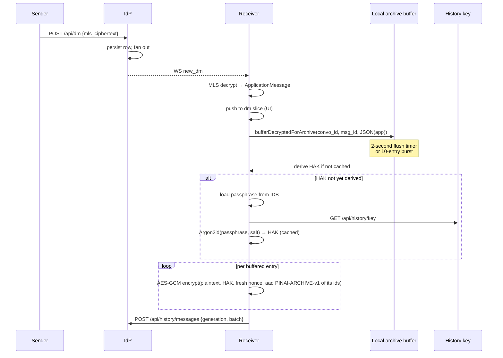

The server only sees the MLS ciphertext (per-message) and later the
HAK-encrypted plaintext copy in the archive. Neither lets it read the
message content without breaking the underlying cryptography.

**A message overtaken by a commit.** A message and a commit travel
separately, and one sent just before a commit can arrive after it —
from another instance especially, and often, since each device added to
a conversation is a commit. Each device therefore keeps, for its last
five epochs, the keys of the messages it hasn't read yet (openmls
`max_past_epochs`, set where a group is created and where one is joined):
such a message decrypts once the commit is applied. Each key is still
deleted once used, so what has been read stays out of reach.

### 6.4 Restoring history on a new device

The user reaches `/onboarding/recovery-restore` either by direct URL or
via Settings → Devices → "Restore history." Typing the 24 words is one
flow whatever brings the user there: the words checked, the device
approved by them, its generation reported, the archive restored. Words
received in a key share (§ 3.11, § 6.10) go through the same flow from the
check on.

```mermaid
sequenceDiagram
    participant U as User
    participant Web as New device
    participant IDB as IndexedDB
    participant IdP
    participant Store as dm slice

    U->>Web: type 24 words
    Web->>IdP: GET /api/history/key
    IdP-->>Web: {generation, salt, check_value, approval_public_key, set_by_device}
    Web->>Web: Argon2id(words, salt) → candidate HAK → its check value and approval key
    alt the check value differs
        Web->>U: "Wrong passphrase"
    else the stored approval public key differs from the one derived
        Web->>U: a warning: the key was changed; nothing new is trusted
    else both match
        Web->>IDB: save the words and their generation (sealed)
        Web->>Web: sign PINAI-DEVICE-APPROVAL-v1 for itself with the approval key
        Web->>IdP: POST /api/keys/devices/:device_id/approvals {by: passphrase, generation, signature}
        IdP-->>Web: 204, then WS device_approved to the account's sessions
        Web->>IdP: PUT /api/keys/devices/:device_id/history-key {generation}
        IdP-->>Web: 204
        loop until next_cursor is null
            Web->>IdP: GET /api/history/messages?after_id=&after_created_at=
            IdP-->>Web: {entries, next_cursor}
            loop per entry
                Web->>Web: AES-GCM decrypt(ciphertext, HAK, nonce, aad PINAI-ARCHIVE-v1 of its ids)
                alt auth tag valid
                    Web->>Store: pushDmMessage(conversation_id, parsed Message)
                    Note over Web: restored++
                else auth tag fails
                    Note over Web: a damaged entry, skipped++
                end
            end
        end
        Web->>U: toast "Restored N messages" / "No archive"
    end
```

The words are checked before anything is read: the HAK derived from them and the generation's
salt must give the generation's check value, and the approval key derived from it the stored
approval public key (§ 3.7). A wrong check value is "Wrong passphrase", whether the archive holds
entries or not, and nothing is kept. A right check value with another approval public key means the
instance changed the key: the device trusts no approval made by it and warns (§ 3.9).

When both match, the device keeps the words with their generation and approves itself: the request
comes from the session that named it, and names the generation it derived the key under — a new
generation set meanwhile refuses it (`409 stale_history_key`), and the device reads the key again.
The other devices see it approved on `device_approved`, or on their next look at the device list.
It then says it holds the generation and pages the archive under the HAK, each entry opened with
the ids it comes back under as associated data (§ 7.3) and filed under them only. Every entry is
the current generation's (§ 3.8), so one failing its auth tag — damaged, or moved to other ids —
is skipped, never a sign of a wrong passphrase, and an empty archive restores nothing: "No
archive". An account with no
history key (`404`) has nothing to restore. Setting a new generation drops the approvals made with
the old words, so after a start over a device approves itself again with the new ones.

### 6.5 Sending a message to a new contact

```mermaid
sequenceDiagram
    participant Alice
    participant AliceIdP as Alice's IdP
    participant BobIdP as Bob's IdP
    participant Bob

    Alice->>AliceIdP: ensureGroupExists(convo, bob@idp.bob.com)
    AliceIdP->>BobIdP: HTTP-Sig POST /api/keys/packages/claim/devices {actor: bob}
    BobIdP-->>AliceIdP: a KeyPackage of each of bob's devices
    AliceIdP-->>Alice: KeyPackages
    Alice->>Alice: verify each attestation (fetch BobIdP JWKS) and leaf binding
    loop each of bob's devices
        Alice->>Alice: build MLS Add commit + Welcome
        Alice->>AliceIdP: POST /api/mls/groups/:id/commits
        Alice->>AliceIdP: POST /api/mls/welcomes {recipient: bob, device}
    end
    AliceIdP->>BobIdP: signed AP Create{Note} mlsKind=welcome
    BobIdP-->>Bob: WS mls_welcome_ready
    Bob->>BobIdP: GET /api/mls/welcomes
    Bob->>Bob: join group; check every leaf — bob's own devices approved and listed
    Alice->>Alice: encryptOutbound → mls_ciphertext
    Alice->>AliceIdP: POST /api/dm {mls_ciphertext}
    AliceIdP-->>BobIdP: AP delivery
    BobIdP-->>Bob: WS new_dm
```

The verification step on Alice's side — "fetch BobIdP JWKS", then the leaf
binding under the attested DRK (§ 3.4) — is the moment Alice's client
decides whether to trust this leaf as belonging to Bob. JWKS is cached for
an hour; rotation safety comes from `invalidate(issuer)` and retry on
verify-failure. Alice can't see Bob's approvals: she adds every device
Bob's instance attests for him (§ 2). Bob's devices can: each one in the
conversation holding Bob's current passphrase checks the leaves of Bob's
own account by their root keys, and one whose root key Bob's device list
doesn't show approved for that device is announced on Bob's devices and
committed out — if Bob's instance carries the commit (§ 3.9). The same
holds for a group that adds Bob. A conversation Bob's instance opens in
Bob's name with a device of its own, where none of Bob's devices is ever
added, escapes this check (§ 2).

A device founds a conversation's group only when it holds none, and two
sends at once found it once. If the first add fails — most often because
another device founded the group first, and the commit at epoch 1 is taken
(`409`) — the device drops the group it founded rather than keep one that
holds only itself, where what it sends would be read by nobody. The send
fails, and the device joins the real group once one of its siblings adds
it (§ 6.2), or the other side does.

### 6.6 Revoking a compromised device

```mermaid
sequenceDiagram
    participant U as User
    participant Web as Other device
    participant IdP

    U->>Web: Settings → Devices → Revoke
    Web->>IdP: POST /api/keys/devices/:device_id/revoke
    IdP->>IdP: mark user_devices.revoked_at = now(), drop the approvals it signed and its key shares, close its approval requests, then end the device's sessions (a web app's with its browser session)
    Note over IdP: its tokens and sockets stop at once;<br/>future /api/keys/packages/claim<br/>requests for this device fail
    loop for each leaf naming the revoked device, in each conversation it is in
        Web->>Web: build MLS Remove commit
        Web->>IdP: POST /api/mls/groups/:id/commits
    end
```

The flag, the HPKE key cleared, the approvals the device signed dropped, the key shares it sent or
was sent deleted and its approval requests closed are one write: a device approved through it alone
needs another approval (it normally holds the passphrase by then and approves itself), a share it
signed is never read, and the other side of a request it took part in gets `approval_closed`.

The IdP goes first. It may refuse — a password typed more than 10 minutes ago
(`identity-provider/specs/auth.md § 1`, "Sensitive actions") — and then nothing
was done: the user types it again and revokes once more. Once it answered, the
device is signed out and can read nothing new while the commits go out.

Every leaf whose credential names the device goes, not only the first
found: a copy of its credential over another key — a forgery a member
slipped in — would otherwise stay in its place.

MLS Remove commits provide post-compromise security: future epochs use
a key schedule the revoked leaf was never part of. The directory-level
flag stops the server from handing out fresh KeyPackages from the dead
device, and the device is signed out: each session names the device it
signed in, and a web app's ends with the browser session it signed in
through, so the cookie left on that device signs nothing in again without
the password (`identity-provider/specs/auth.md § 1`, "Sessions and devices").
Every other device of the user's remembers the revocation (§ 3.9).

A revoked device that held the 24 words keeps them: with them and a session
it could still open the archive and approve a device by the passphrase.
Cutting it off takes replacing the words (§ 6.12) from one of the user's
devices that holds them: that device sets the next generation, re-saves
the history it holds under the new words, and the old words approve and
open nothing any more. With no such device left, a start over (§ 6.11)
does the same, and the archive is lost.

### 6.7 Silent attestation renewal

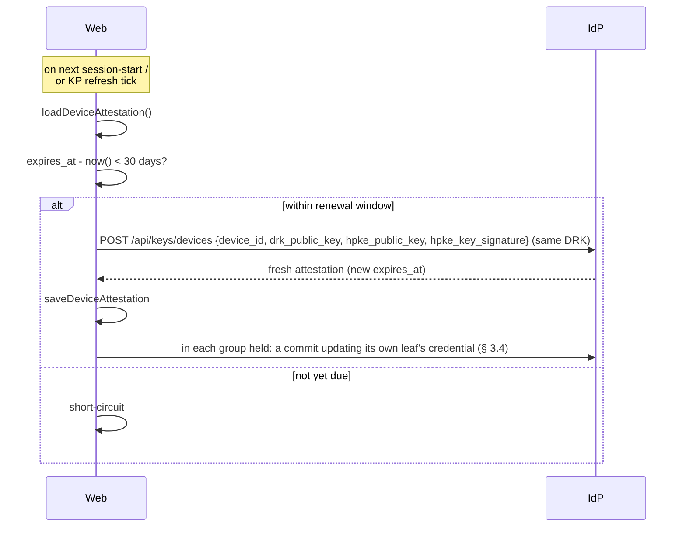

Renewal reuses the existing DRK — only the attestation's `expires_at`
moves forward, and the HPKE key registered stays (§ 3.3). KeyPackages
already in the server's stash stay valid.
New KeyPackages built after renewal carry the fresh attestation, and the
device's leaf in each group it holds is updated to it (§ 3.4, "Keeping
leaves current"). The check runs when the device enters the app and at
each 6-hour KeyPackage tick, so a device left open for weeks renews too.

### 6.8 Someone leaves a group's MLS state with its roster

Taking someone off a group's roster (`identity-provider/specs/groups.md § 3`) takes
nothing from them cryptographically: their devices still hold the group's keys. So every device of
someone the roster no longer holds is committed out of the MLS group — one Remove commit a leaf,
each posted to the DS, after the roster change, never before (the IdP validates the change first:
an admin, never the last one):

- **A removal**: the remover's client, right after `DELETE /api/groups/:id/members/:actor_uri`
  succeeds, with the roster `GET …/members` then answers.
- **A leave**, which can't commit the leaver's own devices out, **or a removal that stopped short**:
  an admin's client, on `member_removed` and whenever it opens the group, compares the MLS group's
  leaves (by their credential, § 7.1) with the roster and commits out every device of an actor it
  doesn't hold, every leaf whose credential doesn't decode — it can be no member's —, and every leaf
  whose credential fails its checks though it names a member (§ 3.4). Nothing happens when the roster doesn't hold the admin themselves.

Commits race: two admins catching up at once both build a Remove at the same epoch. The second
gets `409`; its client drops its pending commit, catches up on the DS's log — which may already
have removed what was left — and looks again. A commit that never reaches the DS is dropped the
same way, so the device can still commit, and the next look at the group finishes the work.

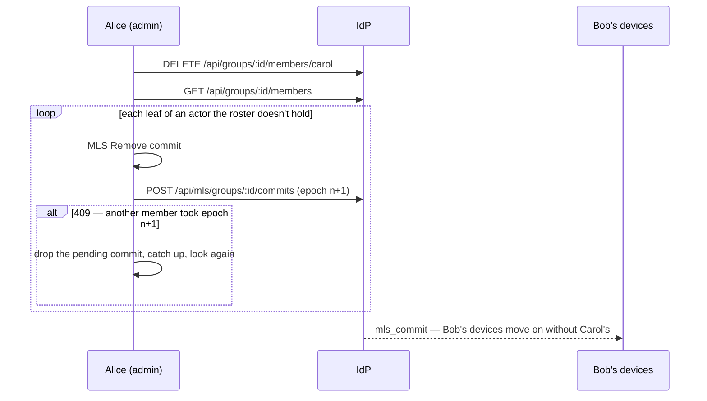

A device committed out keeps the group as it stood, so the messages up to the removal still decrypt
there. Added back, it is sent a Welcome to a group it already holds: the Welcome replaces that group
only when it brings a later epoch. A Welcome no later than the group held leaves it as it is, as when
both sides founded the group at once. A removed member who clears the group from their list
(`DELETE /api/groups/:id`) drops its MLS state from the device, with its cached history; being added
again then joins it afresh.

### 6.9 Keeping the KeyPackage stash topped up

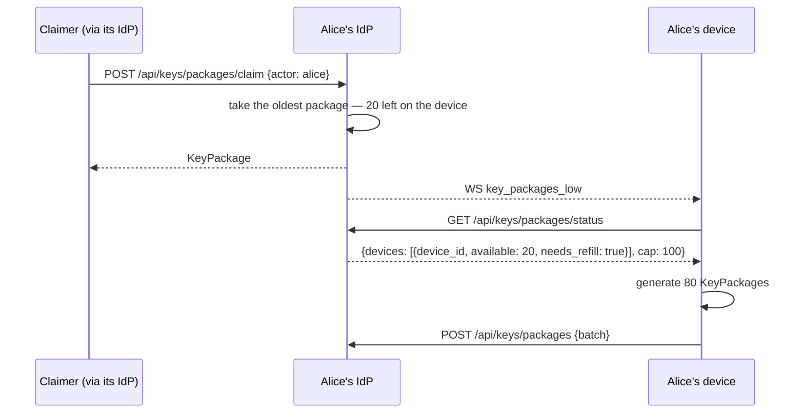

The device runs the same top-up when it enters the app and every 6
hours while it stays open, so a push it missed while offline is made
up on its next start. A claim that finds nothing answers `409` and
still pushes: once the owner's device has refilled, adding them again
succeeds. The status lists only devices with a package left, so a
device it doesn't list is refilled the same way, to the cap.

### 6.10 Approving a new device with a code

The phone has just signed in, registered its DRK and HPKE key and named its device; the laptop is
an approved device of the same account, holding the current generation's passphrase. The code
approves the phone; the laptop then shares the passphrase with it, and the phone restores the
archive by itself.

```mermaid
sequenceDiagram
    participant P as Phone (new)
    participant I as IdP
    participant L as Laptop (approved)
    P->>I: POST /api/keys/devices/approval-requests
    I-->>P: 201 {id, expires_at}
    I-->>L: WS approval_requested {request_id, device_id, display_name: "Chrome on Android"}
    Note over P: shows a 6-digit code
    Note over L: "New sign-in on Chrome on Android — type the code it shows"
    P->>I: POST …/approval-requests/:id/messages {SPAKE2 message}
    I-->>L: WS approval_message {request_id, seq: 1}
    L->>I: GET …/messages?after=0
    L->>I: POST …/messages {SPAKE2 message} — binds the request to the laptop
    I-->>P: WS approval_message {request_id, seq: 2}
    Note over I: the account's other devices get approval_closed: their prompt goes
    P->>I: GET …/messages?after=1
    Note over P,L: each confirms the other knew the code, then sends its DRK and HPKE key sealed under the exchange's keys (§ 3.10), relayed the same way
    L->>L: the phone's keys are the listed ones: kept as its handshake partner
    L->>I: POST /api/keys/devices/:phone/approvals {by: device, signature}
    I-->>P: WS device_approved {device_id: phone}
    I-->>L: WS device_approved {device_id: phone}
    P->>I: GET /api/keys/devices — the laptop's approval of it verifies under the exchanged key
    P->>I: POST /api/keys/devices/:laptop/approvals {by: device, signature}
    L->>I: DELETE /api/keys/devices/approval-requests/:id
    I-->>P: WS approval_closed {request_id}
    Note over L: the phone is approved: added to the laptop's conversations (§ 6.2), and sent the passphrase
    L->>L: HPKE-seal the 24 words for the phone's HPKE key (aad PINAI-HISTORY-SHARE-v1), sign with its DRK
    L->>I: POST /api/history/key-shares {recipient_device_id: phone, generation, enc, ciphertext, signature}
    I->>I: both approved under the generation, the phone by the laptop; the laptop holds it, the phone not; the signature verifies
    I-->>L: 204
    I-->>P: WS history_key_ready {device_id: phone}
    P->>I: GET /api/history/key-shares
    I-->>P: {sender_device_id: laptop, generation, enc, ciphertext, signature, created_at}
    P->>P: from the laptop it approved; signed by the DRK the exchange gave; opens; the words give the check value and approval public key
    P->>I: POST /api/keys/devices/:phone/approvals {by: passphrase, generation, signature}
    P->>I: PUT /api/keys/devices/:phone/history-key {generation}
    I->>I: the phone's share deleted
    P->>I: GET /api/history/messages … (the restore of § 6.4)
    Note over P: "Your history is back"
```

Each side signs the other's DRK as it came out of the exchange: should the instance list another
key for that device, the approval doesn't verify over it, and is refused. A wrong code fails the
exchange; the device that finds it wrong closes the request, and a new attempt is a new request,
with a new code. A device that comes online meanwhile lists the open requests
(`GET /api/keys/devices/approval-requests`); once the laptop answered, any other device of the
account is refused (`409 approval_request_taken`). The phone trusts the laptop from the exchange
alone until it holds the passphrase (§ 3.9); once it does, it approves itself with the approval
key and checks every chain from the device list.

The share is the phone's only way to the passphrase short of the 24 words: it accepts it from the
laptop because it approved the laptop itself, by the laptop's DRK as the exchange gave it, and keeps
the words only once they give the generation's check value and approval public key (§ 3.11). The
instance carries the share without reading it, and checks only what it can: who shares with whom,
under which generation, by which approvals, signed by whom — and a device that didn't approve the
phone is refused (`409 not_the_approver`). Once the phone says it holds the generation, the device
list shows it, and nobody shares with it again.

### 6.11 Starting over

A start over replaces the account's passphrase: when it is lost — no device holds it and the words
are gone — or must be replaced — a revoked device, or someone the user no longer trusts, holds
it. The device that starts over sets the next generation and becomes the account's new root of
trust; the user's other devices, if any, are approved again from it; the archive is erased.

Here the user lost every device and the 24 words, and signs in on a new device: "I no longer have
my devices or my words". Later they find an old tablet, which still holds generation 1.

```mermaid
sequenceDiagram
    participant N as New device
    participant I as IdP
    participant T as Old tablet (generation 1)
    Note over N: "Your saved history will be erased. A device you still have will warn you, and can come back with a code typed here"
    N->>N: the password typed again; 24 new words → a salt, HAK, check value, approval key
    N->>I: PUT /api/history/key {generation: 2, salt, check_value, approval_public_key}
    I->>I: one write: the key replaced, the archive erased, generation 1's passphrase approvals and every key share dropped
    N->>I: POST /api/keys/devices/:N/approvals {by: passphrase, generation: 2, signature}
    N->>I: PUT /api/keys/devices/:N/history-key {generation: 2}
    Note over N: shows the 24 new words
    T->>I: GET /api/history/key
    I-->>T: {generation: 2, …, set_by_device: N}
    Note over T: N is no device it approved: it refuses generation 2, saves nothing,<br/>and warns "Your history was reset from a device you haven't approved."
    Note over T: the user, who did start over, asks to be approved on the tablet: it shows a code
    T->>I: POST /api/keys/devices/approval-requests
    Note over N,T: the code typed on N, the handshake of § 6.10 the other way round: N approves T, T approves N
    N->>I: POST /api/history/key-shares {recipient_device_id: T, generation: 2, …}
    I->>I: T approved under generation 2 — by N, which its own new words approve
    I-->>T: WS history_key_ready {device_id: T}
    T->>I: GET /api/history/key-shares
    T->>T: from N, which it approved itself; the words give generation 2's check value and approval key
    T->>I: POST /api/keys/devices/:T/approvals {by: passphrase, generation: 2, signature}
    T->>I: PUT /api/keys/devices/:T/history-key {generation: 2}
    Note over T: N approved from here on: added to the tablet's conversations (§ 6.2)
```

Setting generation 2 takes a password typed in the last 10 minutes, and erases the archive
(§ 3.8): what was saved under the lost words could no longer be opened. The new device becomes the
account's new root of trust — its new words approve it — and every approval made under
generation 1's key goes with that generation, so no old device is approved any more, and none can
take a share — until a device holding generation 2 vouches for it: an approval one device gave
another by its DRK outlives the generation, so an old device whose handshake partner is approved
again is approved through it. The old tablet can't confirm generation 2's approval key, and sees a generation set
by a device it never approved: it refuses the generation and warns — staying in the app, its
conversations and its own copy kept, saving and deciding nothing, under a banner offering the
code, the new words, or a start over of its own. On the new device it is "from before", never a
new device. Putting it back follows the
usual rule (§ 3.10): the tablet, which lacks the current passphrase, asks; the new device, which
holds it, answers. The two approve each other's DRK: N's approval makes the tablet approved under
generation 2 — what the instance checks before it carries the share —, and the tablet's own
approval of N is what it accepts the share by. Typing the new words on the tablet does the same
without a share (§ 6.4).

Until then, the new device treats the tablet as any device it hasn't approved: in a conversation
both are in — one a contact started since — it commits the tablet's leaf out (§ 3.4), and adds it
back once it is approved again; the messages in between come back from the archive once the
tablet holds the new words.

A reset the user didn't make reads the same on the tablet, and is answered the other way: the
setter isn't the user's, so it is never approved — that would hand it the account's
conversations and its new words —, and the way back is a start over from one of the user's own
devices, which then becomes the root of trust in its place.

---

### 6.12 Replacing the words

A device holding the current passphrase replaces it — Settings → Devices, "Replace my words" —
when a revoked device, or someone the user no longer trusts, saw the words. It is a start over's
first half (§ 6.11) from a device the account already trusts, followed by a re-archive: the
history this device holds is saved again under the new words, so it isn't lost as a start over
loses it.

```mermaid
sequenceDiagram
    participant D as Device holding generation n
    participant I as IdP
    participant P as A handshake partner
    participant O as Another device of the account
    Note over D: "Replace my words": what changes, what can't come back; the password, typed in the last minutes
    D->>D: 24 new words → salt, HAK, check value, approval key; kept as pending, marked for a re-archive
    D->>I: PUT /api/history/key {generation: n+1, …}
    I->>I: one write: the key replaced, the archive erased, older passphrase approvals and every share dropped
    D->>D: the pending words kept, a re-archive due; the new words shown
    D->>I: POST approvals {by: passphrase, generation: n+1} · PUT …/history-key {generation: n+1}
    D->>I: POST /api/history/key-shares (to P, § 3.11)
    I-->>P: history_key_ready — P holds n+1 by itself
    loop the local copy, a conversation at a time, 50 entries a batch
        D->>D: each message as one entry (its latest text, its attachments' keys), its reactions; sealed under n+1 (§ 7.3)
        D->>I: POST /api/history/messages {generation: n+1, entries}
        D->>D: the cursor moves past what was taken
    end
    Note over O: holds n: "Your words were replaced on <D>" — a code typed on D, or the new words
```

The words, the generation and the erasing write are a start over's, under the same rules: the
password typed in the last minutes before anything is minted, the words pending until the IdP
took them, a conflict or a refusal leaving nothing behind, generations only moving forward — and
only over the generation this device holds: another device's replacement landing first is a
conflict, never a generation replaced unread. What it adds:

- **The archive is brought onto this device first.** Before anything is minted, the device
  restores the current generation's archive into its own copy — refusing while its copy isn't
  read back yet, or a restore under that generation is still due —, so what is erased is what it
  now holds: only what never reached the archive can be lost.

- **The re-archive** is due from the moment the new key is the account's — recorded with it, so
  a reload or a lost answer resumes it — and runs in the background, one tab of the device at a
  time, a conversation at a time, paced, each batch an idempotent upsert, a cursor kept after
  each one the IdP takes. Each message is one entry — its latest text, its attachments' keys, an
  `edited` mark —, and its reactions one snapshot entry (§ 7.3): the counts as this device holds
  them, its own reaction marked, no other reactor named. It stops
  for good once another generation is in force; it never uploads under one the device doesn't
  hold. It saves what this device holds: a message only another device read doesn't come back,
  nor an edit's history beyond the message's latest text.
- **The other devices**: a handshake partner of the replacing device receives the new words as
  any share (§ 3.11). Any other holds generation n, refuses n+1 and waits on its reset page,
  told the words were replaced on that device when it is one it found approved — "reset from
  another device" otherwise —, and comes back with a code typed on it, or the new words. The
  setter's name is the instance's word (§ 2): a lie gets nothing approved, as no device holding
  n+1 answers for a setter that didn't set it.
- **The old words** give no key in force: they open no entry — the archive holds only n+1's —,
  and approve nothing, as the IdP dropped the older passphrase approvals.

## 7. Wire formats

### 7.1 MLS leaf credential

Inside every leaf's `BasicCredential` (Section 3.4 JSON).

### 7.2 Canonical signed bytes

The IdP's attestation of a DRK (§ 3.2), a DRK's signatures over its
device's HPKE key (§ 3.3) and over each of its leaf keys (§ 3.4), an
approval of a device (§ 3.9), a key share (§ 3.11) and an archive
entry's associated data (§ 7.3) are all over UTF-8 lines, each ended by
`\n` (a literal newline, 0x0A) but the last. Every field is written
exactly so:

- `actor_uri`: the account's actor URI, exactly as `/userinfo` answers
  `actor_uri`;
- `device_id`: a lowercase hyphenated UUID;
- keys: standard base64, with padding;
- `expires_at`: RFC 3339 in UTC, to the second — `2027-05-14T12:00:00Z`,
  no fraction —, the text `GET /api/keys/devices` lists as
  `attestation_expires_at`;
- `kid`: as the instance's JWKS names the key;
- `generation`: the history key's generation in decimal ASCII digits, with
  no sign and no leading zero — `1`, `12`;
- a share's `enc` and `ciphertext`: standard base64, with padding.

No field holds a newline, so the lines split one way only.

The leading tag keeps a signature from ever verifying as another use of
the same key; a change to the fields needs a new tag.

What the IdP signs in `POST /api/keys/devices`:

```
IDP-ATTEST-v1\n
<actor_uri>\n
<device_id>\n
<base64(drk_pub)>\n
<expires_at as YYYY-MM-DDThh:mm:ssZ>\n
<kid>
```

What a device's DRK signs over its HPKE key:

```
PINAI-DEVICE-HPKE-v1\n
<actor_uri>\n
<device_id>\n
<base64(hpke_public_key)>
```

What a device's DRK signs over each of its MLS leaf signature keys — the
credential's `leaf_binding`, the key the LeafNode's `signature_key`:

```
PINAI-LEAF-BINDING-v1\n
<actor_uri>\n
<device_id>\n
<base64(leaf_signature_public_key)>
```

What an approval signs — by another device's DRK, or by the generation's
approval key —, `device_id` and `drk_public_key` the approved device's:

```
PINAI-DEVICE-APPROVAL-v1\n
<actor_uri>\n
<device_id>\n
<base64(drk_public_key)>
```

What a key share's HPKE seal binds as its `aad`, `device_id`s the sending
and the receiving device's:

```
PINAI-HISTORY-SHARE-v1\n
<actor_uri>\n
<sender_device_id>\n
<recipient_device_id>\n
<generation>
```

What an archive entry's AES-256-GCM seal binds as its associated data
(§ 7.3), `conversation_id` and `id` the entry's, each a lowercase
hyphenated UUID:

```
PINAI-ARCHIVE-v1\n
<conversation_id>\n
<id>
```

What the sender's DRK signs: the `aad`'s five lines, then the seal's two
halves, as they are sent in `POST /api/history/key-shares`:

```
PINAI-HISTORY-SHARE-v1\n
<actor_uri>\n
<sender_device_id>\n
<recipient_device_id>\n
<generation>\n
<base64(enc)>\n
<base64(ciphertext)>
```

### 7.3 History archive entry (POST `/api/history/messages`)

```json
{
  "generation": 2,
  "entries": [
    {
      "id": "<uuid; a message's direct_messages.id, an edit's derived from its ciphertext>",
      "conversation_id": "<uuid>",
      "ciphertext": "<base64-std>",
      "nonce": "<base64-std, 12 bytes>",
      "client_message_id": "<optional>"
    }
  ]
}
```

An edit is an entry of its own: its `id` is a UUID (version 8) made of the
SHA-256 of the edit's MLS ciphertext, the bytes every device holding it
sees, so each device archives an edit under the same id, once.

`generation` names the history key's generation the entries were sealed
under: an upload under any other generation is `409 stale_history_key`
(§ 3.8). `ciphertext` is the AES-256-GCM encryption, under HAK with `nonce`, of
the client's archive entry as JSON — a message (its text, its attachments' keys, an `edited` mark),
an edit or a reaction —, its associated data the
`PINAI-ARCHIVE-v1` bytes of § 7.2 for the entry's `conversation_id` and
`id`. A restore rebuilds them from the ids the entry comes back under and
files the entry there only: an entry the instance moved to other ids
fails its tag and is skipped as damaged (§ 6.4).

**A reaction snapshot** (a replacement's re-archive, § 6.12) is an entry of its own, one per
message with reactions: `kind: "reaction-snapshot"`, its `target_message_id`, and
`[{ emoji, count, reacted }]` — the counts the device held, `reacted` its own user's reaction,
no other reactor named. Its `id` is keyed, so the instance can't recompute it from what it sees:
a version-8 UUID made of the first 16 bytes of `HMAC-SHA256(key, "<conversation_id>\n<message_id>\nreactions")`
(ids lowercased), `key = HKDF-SHA256(ikm = HAK, info = "pinai/rearchive-entry-id/v1")`, no salt,
32 bytes — stable under one generation, another under the next. A restore takes it as the base
of that message's reactions, the latest one by the entry's own `created_at` when there are
several; named reaction entries dated after that `created_at` apply on top, those dated at or
before it are counted already — only their ids are kept, so a later decrypt adds nothing. A
message the restoring device holds decrypted keeps its own reactions. The JSON includes a
domain-specific replacer for `Uint8Array` fields (attachment AES keys
+ nonces) so they round-trip through serialization.

### 7.4 JWKS rotation handling

The IdP's JWKS at `/.well-known/jwks.json` publishes one or more
EdDSA keys. Each leaf credential's `idp_att.kid` names which key
signed it. When a peer fails to verify a signature:

1. The peer invalidates the cached JWKS for that issuer — at most once
   a minute per issuer, so forged leaves can't make it hammer an honest
   one.
2. The peer refetches and retries the verification once.
3. Permanent failure rejects the leaf.

A fetch gives up after 10 seconds, and an issuer whose fetch failed is not
asked again for a minute: its leaves are left unchecked meanwhile, and
checked when next met (§ 3.4).

When the IdP rotates its signing key, the **old key remains in JWKS
for at least the longest active-attestation lifetime** (1 year by
default — same as `attestation_expires_at`). This is the same rule
the IdP follows for JWT-signing-key rotation, just with a longer
horizon. Existing attestations remain verifiable through their
natural expiry; clients renew through the normal 30-day window;
new attestations use the new key.

---

## 8. Storage architecture summary

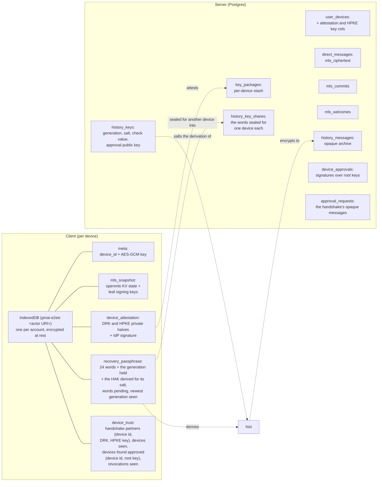

Two persistence boundaries:

- **Client IndexedDB** holds everything the device needs to decrypt
  messages and prove its identity to peers, and what it keeps of the
  account's devices so the instance can't take it back (§ 3.9): the
  devices it approved in a handshake with the keys the exchange gave, the
  devices it has seen, those it found approved with their root keys, the
  newest generation it has seen, the revocations it has seen. Every blob is encrypted
  under a per-device non-extractable AES-256-GCM `CryptoKey` so that
  full IDB extraction by an attacker without script execution in the
  user's origin yields nothing useful. Each account signed in on a
  browser has its own databases and its own device key, so to the IdP
  two accounts sharing a browser are two devices, and signing in as
  one never erases the other's. Each web app — each origin — has its
  own storage too, so two web apps in one browser are two devices, each
  named on a session of its own under the browser's
  (`identity-provider/specs/auth.md § 1`, "Sessions").
- **Server Postgres** holds opaque material only — MLS ciphertexts,
  base64'd KeyPackages, encrypted history archive entries, the history
  keys' salts, check values and approval public keys (none of them
  secret), public attestation columns, the approvals' signatures, the
  approval handshake's messages (public by design: SPAKE2 messages reveal
  nothing of the code) and the key shares (sealed for each recipient's
  HPKE key, whose private half never leaves its device). Read access to
  the database yields no plaintext message content and no passphrase.

The same per-device AES-GCM key encrypts the Zustand `persist`
middleware's message-plaintext cache — that way the cache (used for
"don't blank conversation history on page reload") shares the same
threat model as the rest of the IDB content.

---

## 9. Open questions and known limitations

- **Server-side KeyPackage signature validation.** The server doesn't
  currently re-verify that an uploaded KeyPackage's embedded leaf
  credential signature chains back to a registered DRK. Peer clients
  do this verification when a foreign leaf surfaces in their MLS
  state, so the security-critical path is covered; server-side
  validation is defense-in-depth and requires pulling `openmls` into
  the server crate.
- **Background streaming of large archives.** The restore page pulls
  pages serially. For users with very large histories this is
  noticeable; a progressive streaming UI is a future enhancement.
- **A commit that never reaches an instance.** Commits are sent once, best effort, and members
  catch up only from their own instance's log. A commit lost to a network failure leaves that
  instance's members who joined before it unable to read anything sent after it, until they are
  removed and added back. Its roster only covers the commit that outruns a Welcome.
- **A message more than five commits behind.** A device that applies six
  or more commits before a message sent ahead of them can't decrypt it
  (§ 6.3); only the history archive can bring it back, from a device of
  the user's that did read it.
- **Out-of-band fingerprint verification.** No user-facing UI for
  comparing device attestations out of band: contacts trust the user's
  instance's attestation (§ 2, "Trust ceiling"), the user's own devices
  their approvals. An opt-in verification surface would be additive.
- **A new device after losing every device.** Only the user's own devices
  add a sibling to their conversations (§ 6.2), so a device that started
  over with none left joins none of the account's existing conversations —
  only those opened from then on —, unless an old device, found again,
  approves it (§ 6.11).
