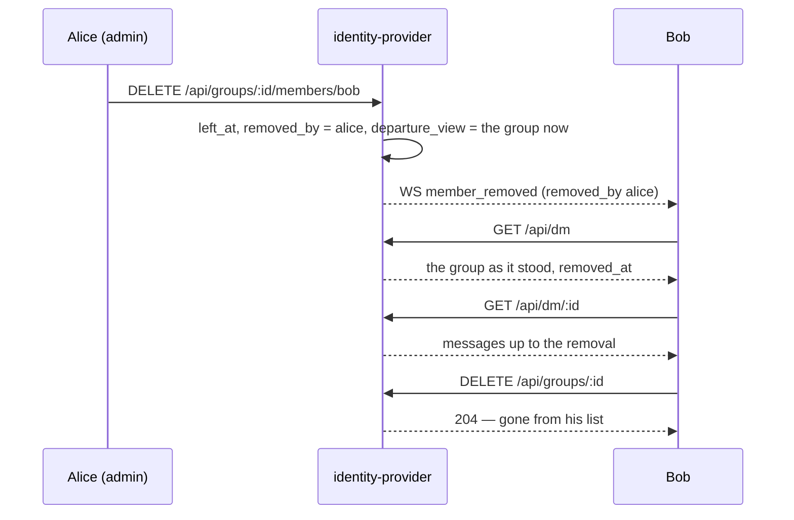
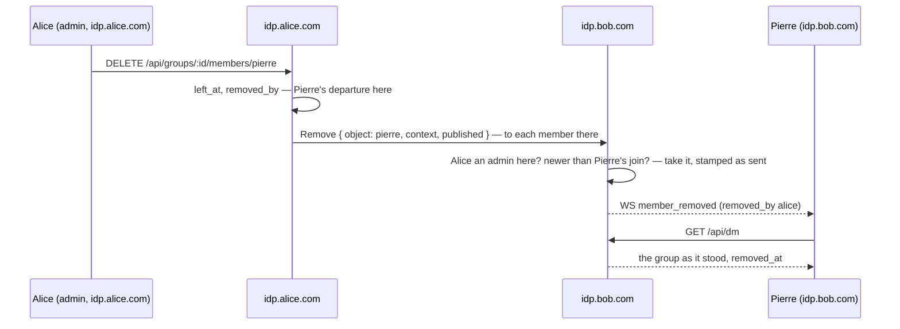
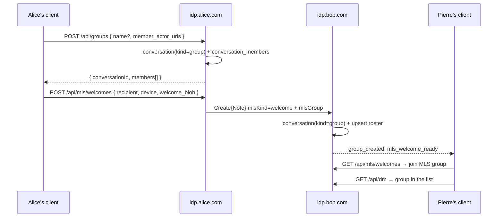
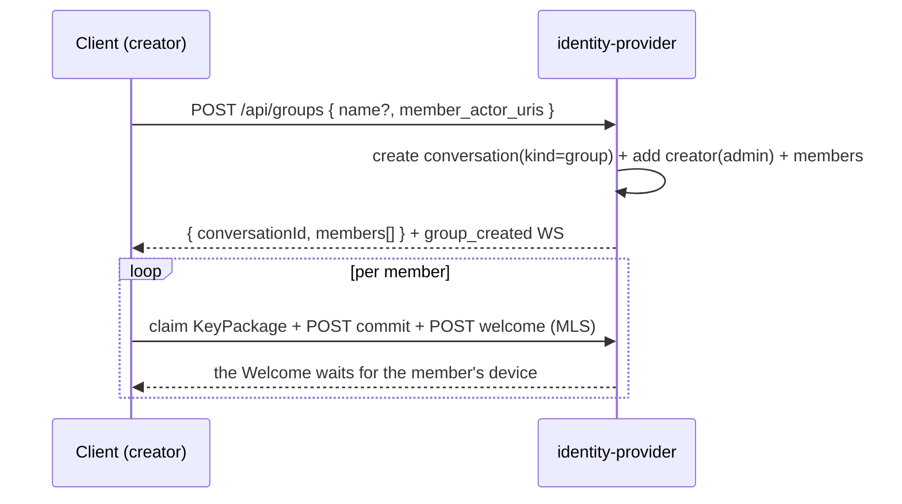

# Pina'i — Group conversations

Group conversations are `conversations` rows with `kind = 'group'`. Their
membership and roles live in `conversation_members`; the REST API below owns
**membership, roles, the authorization gates, and the membership WS events**.
MLS key material (commits/welcomes) flows separately through the Delivery
Service (`identity-provider/specs/e2ee.md`) — after creating or adding a member here, the
client bootstraps/extends the MLS group so keys reach the new members.

## 1. Roles

`conversation_members.role` is `'admin'` or `'member'` (default `'member'`;
ignored for DMs). The **creator** of a group becomes its first `admin`. Only
admins may add/remove members, rename the group, or change roles. Any member
may leave (self-removal). Removal and leaving are soft — `left_at` is set, never
a hard delete, so earlier messages stay attached to the conversation.

- **A group always keeps an admin.** Its last admin can neither leave nor be demoted while
  other members remain — `409 conflict`; they promote someone first. The last member of all
  may leave.
- **Groups only.** Every route below answers `404 Conversation not found` for a DM, exactly as
  for someone outside the group: a DM has no admin, no name and no leaving.
- **Outsiders see nothing.** A non-member is told the group does not exist (404); a member who
  is not an admin is refused management (`403 Only group admins can do this`).
- **A member removed from a group keeps it**, below; one who leaves doesn't.
- **50 members at most**, the creator included (`domain::messaging::MAX_MEMBERS`). A creation
  asking for more is `400 A group holds at most 50 members`, before any invitee is looked up; an
  add to a full group is `409 The group is full: it holds at most 50 members`. It also bounds what
  another instance's roster costs this one (§ 7).
- **Names** are trimmed and 1–100 characters (400 otherwise). A blank name at creation leaves
  the group unnamed, and clients title it by its members.
- **Actor URIs** in a request are validated (400 for one that is not an actor URI); a group is
  created with its whole roster in one step, never half.

> **Group name**: optional at creation. When the client sends a blank/absent name the server stores `NULL`, and clients derive the title from the member `display_name` values (e.g. `"Bob, Harry"`) — the list is shown from the local user's perspective, so their own name is omitted. A stored name can be changed via `PATCH /api/groups/:conversation_id` (admin only).

## 2. Endpoints (Bearer-auth)

| Endpoint | Gate | Behaviour |
|---|---|---|
| `POST /api/groups` | member | Body `{ name?, member_actor_uris[] }` — at least one URI (400 otherwise). Creates a `kind='group'` row with the caller as `admin` and each other URI once as `member`, in one transaction. Returns the group view (`conversationId`, `kind`, `name`, `members[]` with roles, `createdAt`). Emits `group_created`. |
| `GET /api/groups/:id/members` | member | Members with `role`, `displayName`, `avatarUrl`. |
| `POST /api/groups/:id/members` | **admin** | Body `{ actor_uri }`. Adds the member as `member`; a member who left rejoins. Someone already in the group: `409 Already a member`, their role untouched. Emits `member_added`. |
| `DELETE /api/groups/:id/members/:actor_uri` | **admin** or self | Sets `left_at`. `actor_uri` is percent-encoded; 404 `Member not found` when not a member. Emits `member_removed` to everyone who was a member, the removed one included (`removed_by_actor_uri` is `null` on self-leave). |
| `PATCH /api/groups/:id` | **admin** | Body `{ name }` (1–100 characters). Renames the group and returns its view. Emits `group_renamed`. |
| `DELETE /api/groups/:id` | removed member | Clears a group the caller was removed from from their list (`dismissed_at`): 204. `409 Leave the group first` for an active member, 404 for anyone else — one who left, a stranger, a DM. |
| `POST /api/groups/:id/members/:actor_uri/role` | **admin** | Body `{ role: "admin" \| "member" }`. Promote/demote — never the last admin. Emits `member_role_changed`. |
| `POST /api/groups/:id/messages` | member | Body `{ mls_ciphertext, reply_to_id?, attachment_ids? }`. Attachments follow the DM rules — as many as a DM may carry, each the sender's own upload, unlinked or linked to one of its `'failed'` messages — or the message is refused (400) and nothing is stored. See § 4. |

Both `POST /api/groups` and `POST /api/groups/:id/members` check every invitee before writing
anything. An invitee must name an account: a local one, or one its own IdP answers for over
WebFinger, under that very actor URI — asked every time, whether this IdP has the actor cached or
not, so neither the answer nor the names in the group view tell who here has met whom
(`identity-provider/specs/identity.md § 2`). Anything else is 404
`User not found` with the invitee's `actor_uri`. Then one the caller blocked, or a local one who doesn't admit the caller — a block or their
contact setting — refuses the whole request with 403 and the invitee's `actor_uri`
(`identity-provider/specs/social.md § 2`). A remote invitee is refused by its
own IdP, at the KeyPackage claim and on the Welcome.

## 3. A member removed from a group

Removing someone (`DELETE /api/groups/:id/members/:actor_uri` by an admin) records, in the same
statement as `left_at`, who removed them (`removed_by`) and the group as it stood then
(`departure_view`: its name, and its other active members with the names and avatars their list
showed). From then on, for the removed member:

| | |
|---|---|
| `GET /api/dm` | The group stays, as it stood: `removed_at`, the frozen name and members, the last message before the removal, nothing unread |
| `GET /api/dm/:id` | Its history up to the removal |
| Everything else | As for anyone outside the group: the group routes 404, sending is refused, its messages no longer reach them (§ 7) |
| `member_removed` | Pushed to them as to every member, `removed_by_actor_uri` naming the admin |

They learn nothing of the group after their removal: neither a rename, nor who joined, nor a
message. `DELETE /api/groups/:id` clears it from their list, and their history of it goes too.
Being added again brings the group back as it is now; a later removal is shown anew, whether or
not they cleared the last one. Someone who **leaves** keeps nothing: the group leaves their list
at once, and its history is 404 to them.



## 4. Message fan-out

A group message is **one** `direct_messages` row carrying a single MLS
ciphertext — MLS encrypts for the whole group, so every member decrypts the
same blob. `POST /api/groups/:id/messages` persists the row, then fans the
ciphertext out: local members receive a `new_dm` WS event (and broker publish);
remote members receive a signed AP `Create{Note}` (`mlsKind: application`) at
their inbox, exactly like a 1:1 — only enumerated over `conversation_members`
instead of a single recipient. Delivery is best-effort and self-heals via the
recipient's catch-up pull.

An instance holding several of the group's members therefore receives the same
`Create{Note}` once per member, at each one's inbox, and stores it once (by its
activity URI). Whichever delivery stores it pushes `new_dm` to every active
member there; the others are redeliveries and push nothing. The sender encrypts once with the group's existing
MLS state (no per-message bootstrap), so there is no `ensureGroupExists` step.

## 5. WS events

`group_created`, `member_added`, `member_removed`, `member_role_changed`, and
`group_renamed` are pushed to every **local** member of the conversation (same
local-fanout pattern as `mls_commit`). A remote member receives `group_created`
from their own IdP instead, the moment it materialises the group from an
inbound snapshot — see § 7. Each change's line in the conversation follows as
`group_event` (§ 6).

## 6. A group's changes in its conversation

Every change a group's copy takes is also recorded as an **event** of its conversation, a line
clients show between the messages: "Alice created the group", "Alice added Dave", "Alice removed
Bob", "Carol left", "Alice renamed the group to “Weekend trip”", "Alice made Dave an admin". The
wording is the client's, from the event's `event`, names and detail.

| `event` | Recorded when | `subject_uri` | Detail |
|---|---|---|---|
| `created` | a group is created here | — | — |
| `added` | an add is made here or taken from elsewhere; a Welcome brings someone in (by its sender) | the member | — |
| `removed` | a removal is made or taken | the member | — |
| `left` | a leave is made or taken | — (the actor left) | — |
| `renamed` | a rename is made or taken | — | `name` |
| `role_changed` | a role change is made or taken | the member | `role` |

```sql
-- A group's changes as its conversation shows them, between the messages. `created_at` is
-- the change's stamp.
CREATE TABLE conversation_events (
  id               UUID PRIMARY KEY,
  conversation_id  UUID NOT NULL REFERENCES conversations(id) ON DELETE CASCADE,
  kind             TEXT NOT NULL CHECK (kind IN
                     ('created', 'added', 'removed', 'left', 'renamed', 'role_changed')),
  actor_uri        TEXT NOT NULL,             -- who made the change
  subject_uri      TEXT,                      -- whom it is about: added, removed, role_changed
  detail           TEXT,                      -- the new name, or the new role
  created_at       TIMESTAMPTZ NOT NULL
);
```

- **Stamped as the change.** An event's `created_at` is the change's stamp, so it sits where the
  change happened among the messages. It is written right after the change: a crash between the
  two loses the line, never the change. A change taken only from a snapshot records nothing — a
  snapshot doesn't say who made it; a Welcome does: its sender added its recipient.
- **Seen from one's latest join on.** A member sees the events from their latest `joined_at` on,
  so nobody learns what happened in a group before they were in it; a removed member sees them up
  to and including their removal, until they clear the group (`domain::messaging::EventWindow`).
- **In the history.** `GET /api/dm/:id?include=events` interleaves them with the messages:

  ```json
  { "kind": "event", "id": "…", "conversation_id": "…", "event": "removed",
    "actor_uri": "https://idp.alice.com/users/alice_xK9mP", "actor_display_name": "alice",
    "subject_uri": "https://idp.bob.com/users/pierre_q4Rt", "subject_display_name": "Pierre",
    "created_at": "2026-10-01T10:00:00Z" }
  ```

  `name` and `role` appear for a rename and a role change; names are this instance's, as a
  message's sender's are.
- **Live.** Each is pushed, once recorded, to the local members who see it — those in the group
  after the change, or before a departure — as `group_event`, the same fields in the WebSocket's
  camelCase. A client adds the line to an open conversation and dedupes it against the history by
  `id`.
- **Not messages.** An event counts as no unread, plays no sound, and doesn't move the
  conversation up the list.
- **Trust.** Events are what the IdPs say, as the roster is; the MLS commits are the only
  end-to-end proof of who added or removed whom.

## 7. Federated groups

`POST /api/groups` writes `conversations` + `conversation_members` on the
creator's IdP only, and a Welcome carries nothing but key material. Since
`GET /api/dm` is driven entirely off `conversation_members`, a remote member
whose IdP holds no row would never see the group — no reload, and no number of
inbound messages, would surface it.

Every MLS Note bound for a remote member therefore carries an `mlsGroup`
snapshot of the sender's roster beside the payload:

```json
{
  "mlsKind": "welcome",
  "context": "9f1c…",
  "content": "<base64 MLS Welcome>",
  "mlsRecipientDeviceId": "3b7e…",
  "mlsGroup": {
    "name": "Weekend trip",
    "nameAt": "2026-10-01T09:30:00Z",
    "members": [
      { "actorUri": "https://idp.alice.com/users/alice_xK9mP", "role": "admin",
        "joinedAt": "2026-10-01T09:00:00Z", "roleAt": "2026-10-01T09:00:00Z" },
      { "actorUri": "https://idp.bob.com/users/pierre_q4Rt",   "role": "member",
        "joinedAt": "2026-10-01T09:20:00Z", "roleAt": "2026-10-01T09:20:00Z" }
    ]
  }
}
```

The receiving IdP creates the conversation under the advertised `context` UUID
with `kind = 'group'`, upserts every member, and pushes `group_created` to each
account of its own the snapshot brings in, once. Each member's inbox gets a
Note of its own, so the first to arrive brings in every account there it
lists, and the later ones find them in; of two arriving at the same moment,
each account is brought in, told and given its line by one only
(`Conversations::mirror_group` answers whom its write brought in). Welcomes, commits and group messages all carry the snapshot, so the
group materialises on whichever arrives first — a group whose Welcome never
landed included. 1:1 DMs never carry one: their row is minted on both IdPs at
friendship-accept.

**A commit can outrun the Welcome.** The client posts the commit that adds
someone, then their Welcome, and each travels to the other IdP as a request of
its own, in no set order. An IdP refuses a commit for a group it doesn't hold,
and members catch up only from their own IdP's log: a commit refused there
would be lost for good to every member of that IdP who joined before it, who
could then read nothing sent after it. Carrying the roster, the first of the two
to arrive materialises the group, and the commit is stored either way. Whichever
brings an account in records the line its conversation starts with, by its
sender ("Alice added Pierre"); the others find it there already.

```mermaid
sequenceDiagram
  participant A as Alice's client
  participant IA as idp.alice.com
  participant IB as idp.bob.com
  A->>IA: POST /api/mls/groups/:id/commits (epoch n adds Pierre)
  A->>IA: POST /api/mls/welcomes (Pierre's device)
  par in no set order
    IA->>IB: Create{Note} mlsKind=commit + mlsGroup
  and
    IA->>IB: Create{Note} mlsKind=welcome + mlsGroup
  end
  Note over IB: the first to arrive materialises the group;<br/>the commit is stored at epoch n either way
```

Each change to a group is sent on its own to the other IdPs holding its
members (§ 8). The snapshot heals a copy that missed one: the
next Note a member receives brings any add, rejoin, role change or rename it
lacks.

**The newer stamp wins, per field.** Every IdP holding a member keeps its own
copy of the group, any admin on any of them may change it, and nothing orders
the changes between instances. So each change is stamped once, where it is
made — a join or rejoin `joined_at`, a departure `left_at`, a role `role_at`, a
rename `name_at` — and every copy stores the stamps it receives as they are. A
copy takes a field from a snapshot only when the snapshot's stamp is newer than
its own (`domain::messaging::GroupSnapshot::changes`):

| The snapshot lists… | The copy… |
|---|---|
| a member it never held | adds them, under the snapshot's stamps |
| a member who left here, `joinedAt` later than the departure | takes them back: they rejoined since |
| a member who left here, `joinedAt` earlier or missing | leaves them out: the sender's copy predates the departure |
| an active member, a later `roleAt` | takes the role |
| an active member, a later `joinedAt` | takes the stamp, so a departure stamped before that rejoin loses to it |
| a later `nameAt` | takes the name |

An entry without stamps — from an IdP that predates them — only ever adds a
member never held, stamped on arrival; it changes no role, brings nobody back
and renames nothing, except a group new here, which takes its name.

No copy holds more than 50 members. A snapshot listing more is refused (400)
and nothing is mirrored or stored; a copy takes newcomers — added or rejoining —
only while it holds fewer than 50, in the snapshot's order. A full copy takes
nobody new until one of its members leaves.

The snapshot's absences mean nothing: it lists the sender's copy's active
members, which may be stale, and honouring an absence would let one peer undo an
add another has applied. A departure travels on its own, as a `Remove` or a
`Leave` (§ 8).

A group Note for someone who isn't an active member once its snapshot is applied
was fanned out from a copy that still lists them: it is accepted (202) and
dropped, neither stored nor announced. A Welcome for them is refused
(`RecipientNotAMember`).

A member's IdP fans a group message out to every remote member of its copy, met here or not:
each is reached at their inbox as `identity-provider/specs/identity.md § 2` describes.

Only a **member asserts a roster**. A group Note or Welcome is accepted from an actor this IdP
holds as an active member of the group, or — for a group new here — one the snapshot itself
lists; anything else is refused (400) and nothing is mirrored or stored. A snapshot is never
applied to a DM. Without this, any federated peer could add itself — or anyone — to a group
by sending a Note that lists it.

A recipient who isn't an active member yet is mirrored into a group only by someone they admit
(`identity-provider/specs/social.md § 2`): a Welcome from someone else is refused
(403), and a group message or commit is dropped (202) when its sender isn't admitted or its roster
holds someone the recipient blocked — the Note is then neither mirrored nor filed as a 1:1. A
dropped commit is no loss to the members already there: each gets its own copy at their inbox.

The other accounts of this instance a snapshot lists are held to the same rule, since a Note
through one member's inbox brings in every account here it lists: one that doesn't admit the
sender, or blocked someone the snapshot lists, is left out of this copy, and the Notes that later
reach its own inbox are dropped as above.

## 8. Group changes

Every change to a group made on an IdP — an add, a removal, a leave, a rename, a role — is sent,
signed as whoever made it, to each remote member of its copy: those in the group before a removal
or a leave, the member removed included, and those after an add, the one added included. Each
goes to the member's inbox as a group message does, and like any activity it is best-effort.

| Change | Activity | `object` |
|---|---|---|
| An admin adds someone | `Add` | the member's actor URI |
| An admin removes someone | `Remove` | the member's actor URI |
| A member leaves | `Leave`, by the member | the group's id |
| An admin renames the group | `Update` | `{ "type": "Group", "name": "…" }` |
| An admin changes a role | `Update` | `{ "type": "Membership", "member": "<actor URI>", "role": "admin" }` |

Every one carries the group's id in `context` and the change's stamp in `published` — the
`joined_at`, `left_at`, `name_at` or `role_at` it set where it was made:

```json
{
  "type": "Remove",
  "actor": "https://idp.alice.com/users/alice_xK9mP",
  "object": "https://idp.bob.com/users/pierre_q4Rt",
  "context": "9f1c…",
  "published": "2026-10-01T10:00:00Z"
}
```

The receiving IdP takes a change (`application::messaging::ReceiveGroupChange`) only when:

- the group is one it holds;
- it came through the inbox of one of the group's active members here, or of the member it adds
  — a peer acts on a group here only through its members;
- whoever made it may (`GroupChange::is_entitled`): an active admin as this copy holds them, or for
  a `Leave`, the member leaving;
- an add that brings in an account of this instance is one that account admits from whoever made
  it, as for an add made here (`identity-provider/specs/social.md § 2`) — another instance's
  account is that instance's to refuse;
- it is newer than what the copy holds (`GroupChange::effect`), as for a snapshot: a removal or a
  leave of an active member after their join, an add of someone not in it — never held, or out
  since before it — while the copy has room, a role or a name newer than the one held. An add of
  someone already in the group moves their join stamp forward and tells nobody anything.

Then it applies the change with the stamp it carries, and tells its local members as for a change
made here: `member_removed` to those in the group before (the one removed included), and for the
rest to those in it after — `group_created` to a local account the add brings in,
`member_added` to the others, `group_renamed`, `member_role_changed`. A local account removed this
way keeps the group as § 3 says. Anything else is answered 202 and
ignored, so a peer learns nothing of who is in a group here; an activity that doesn't parse — no
`context`, no `published`, a name outside 1–100 characters, a role neither `admin` nor `member` —
is 400.



An inbound group `Create{Note}` is filed under its `context` UUID directly.
Opening a DM is reserved for `kind = 'dm'`:
it matches on the two actors before the id, so routing a group through it
would file the group's ciphertext into the sender's existing 1:1 with the
recipient.



## 9. Create flow (client → server)



## 10. Forking a 1:1

A 1:1 DM is private to exactly two people and is never mutated in place.
"Adding people" to a 1:1 is a **client-side** action that opens the group
composer pre-seeded with the DM peer and calls `POST /api/groups` — a brand-new
group is created and the original two-person conversation is left untouched.
