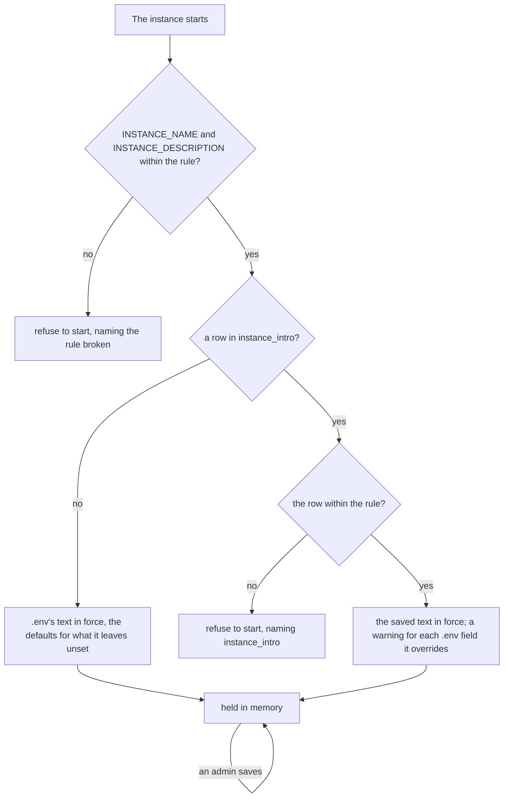

# Pina'i — Accounts and federated identity

In this architecture, users can be on **different IdPs** (e.g. Alice on `idp.alice.com`, Bob on `idp.bob.com`). Each IdP's PostgreSQL stores its own local users and a *remote actor* cache. So a friend's username can be either **local** or **remote**.

## 1. Data model

```sql
-- Local users registered on this IdP instance
CREATE TABLE users (
  id            UUID PRIMARY KEY DEFAULT gen_random_uuid(),
    username      TEXT NOT NULL UNIQUE,       -- the handle: the display name in ASCII + "_" +
                                            -- 5 of a–z0–9, e.g. "hoku_xk9mp"; used for federation:
                                            -- hoku_xk9mp@idp.alice.com (identity-provider/specs/auth.md § 2)
  display_name  TEXT NOT NULL,              -- typed at sign-up, e.g. "Hōkū"
                                            -- freeform, no uniqueness constraint, shown in UI
  avatar_url    TEXT,                       -- public RustFS URL with `?v=<unix_secs>` cache-bust
                                            -- (avatars bucket is public-read; see identity-provider/specs/profile-and-settings.md § 1)
  pronouns      TEXT,                       -- closed enum, see CHECK below
  bio           TEXT,                       -- ≤ 190 chars, freeform; enforced server-side
    email         TEXT NOT NULL UNIQUE,       -- used by OIDC; kept lowercase, and unique
                                            -- whatever its case (users_email_lower_key)
  password_hash TEXT NOT NULL,
  actor_uri     TEXT NOT NULL UNIQUE,       -- e.g. "https://idp.alice.com/users/alice"
  inbox_url     TEXT NOT NULL,              -- e.g. "https://idp.alice.com/users/alice/inbox"
  outbox_url    TEXT NOT NULL,              -- e.g. "https://idp.alice.com/users/alice/outbox"
  email_verified_at TIMESTAMPTZ,            -- NULL until the signup OTP is consumed;
                                            -- /login refuses to issue a session while NULL,
                                            -- unless the account is admitted
  admitted_at   TIMESTAMPTZ,                -- let in without confirming its address: signs in
                                            -- without a code, never swept as unconfirmed
                                            -- (identity-provider/specs/auth.md § 4)
  is_admin      BOOLEAN NOT NULL DEFAULT false, -- an admin of this instance; the first is created
                                            -- from ADMIN_EMAIL (identity-provider/specs/auth.md § 4)
  invited_by    UUID REFERENCES users(id) ON DELETE SET NULL,
                                            -- who vouched for it: the admin whose invitation let
                                            -- it in (identity-provider/specs/auth.md § 5)
  contact_policy TEXT NOT NULL DEFAULT 'friends_and_groups',
                                            -- who may message the account (identity-provider/specs/social.md § 2):
                                            -- everyone | friends_and_groups | friends
  created_at    TIMESTAMPTZ NOT NULL DEFAULT now(),
  updated_at    TIMESTAMPTZ NOT NULL DEFAULT now(),

  CONSTRAINT users_pronouns_check
    CHECK (pronouns IS NULL OR pronouns IN ('he', 'she', 'non-binary'))
);

-- Cache of remote users fetched via ActivityPub / WebFinger from other IdP instances
CREATE TABLE remote_actors (
  id            UUID PRIMARY KEY DEFAULT gen_random_uuid(),
  actor_uri     TEXT NOT NULL UNIQUE,       -- e.g. "https://idp.bob.com/users/bob"
  inbox_url     TEXT,                       -- e.g. "https://idp.bob.com/users/bob/inbox"
                                            -- cached on first WebFinger resolution to avoid repeated lookups;
                                            -- NULL for an actor first seen through an inbound Follow,
                                            -- which is then reached at "{actor_uri}/inbox"
  instance      TEXT NOT NULL,              -- e.g. "idp.bob.com"
  display_name  TEXT,
  avatar_url    TEXT,
  pronouns      TEXT CHECK (pronouns IN ('he', 'she', 'non-binary')),
  bio           TEXT,                       -- the Person's `summary`, as text
  fetched_at    TIMESTAMPTZ NOT NULL DEFAULT now(),  -- last resolved or discovered; a profile card
                                                     -- older than 24 h discovers the actor again
  updated_at    TIMESTAMPTZ NOT NULL DEFAULT now()
);

-- How the instance introduces itself, as an admin saved it (§ 6): one row, none until the first save
CREATE TABLE instance_intro (
  only_row      BOOLEAN PRIMARY KEY DEFAULT true CHECK (only_row),
  name          TEXT,                       -- NULL: the instance's domain
  description   TEXT,                       -- NULL: none
  updated_by    UUID REFERENCES users (id) ON DELETE SET NULL,
  updated_at    TIMESTAMPTZ NOT NULL        -- these two for whoever reads the database
);
```

## 2. Remote actor cache

`remote_actors` is written whenever an actor is resolved (WebFinger, on an outgoing request) or
discovered (its first inbound `Follow`, or a stale profile card —
`identity-provider/specs/profile-and-settings.md § 1`), with the inbox, name, avatar (`icon`), bio
(`summary`) and pronouns its actor document gives. A fetch that brings no inbox, name or avatar —
an unreachable peer, a document without them — keeps the cached value rather than erasing it. The
bio and pronouns are those of the document read: one without them clears them, and only an
unreachable peer keeps them. Discovery accepts only a URI of the
form `…/users/{handle}`; any other actor is refused with `400 Cannot parse remote actor URL`. A
name, avatar, bio or pronouns outside the peer profile limits
(`identity-provider/specs/profile-and-settings.md § 3`) count as none. The friendship keeps the
avatar the actor was met with, on either side of the request, so a new friend is shown with it
at once.

The cache is never what tells a user whether someone exists, or what they are called: that would
tell them who on this instance has met whom. Where a user names an arbitrary actor — a group's
invitees — the actor is resolved anew on its own instance, cached or not
(`identity-provider/specs/groups.md § 2`).

A resolution the actor's instance fails — it doesn't answer, or answers a WebFinger or actor
document no instance would send — is `502 the account's instance did not answer`: for a friend
request, a DM to an address not cached here, and a group invitee (with its `actor_uri`). An
instance that answers it knows no such account is `404`.

A group's members reach this instance in the rosters other members' instances send, so a member
may be someone nobody here has met. What goes to each remote member — a group message, an edit,
an MLS commit — is delivered at the inbox cached for them, else at the one their instance names
over WebFinger, asked in the background so that no request waits on a slow peer, and cached from
then on (`infrastructure::federation::Inboxes`). A send asks at most 10 instances; a member whose
instance didn't answer, knew no such account or named another actor gets nothing and isn't asked
for again for 10 minutes, so a dead or made-up member costs one lookup. An account of this
instance is never looked up.

## 3. What peers read of an account

`GET /.well-known/webfinger?resource=acct:{handle}@{domain}` points at the account's actor, for
an account of this instance only (`404 User not found` for any other). `GET /users/{handle}` is
its `Person` — display name (else the handle), inbox, `icon` when it has an avatar, `summary` and
`pronouns` when it has a bio and pronouns (`identity-provider/specs/profile-and-settings.md § 3`),
and the instance key as `publicKey`; `GET /actor` is the instance's `Application` actor, whose key signs
the inter-instance requests. The outbox and the `followers` / `following` collections are always
empty: nothing is published, and whom an account is friends with is not for anyone to read.

## 4. Federated address format

The canonical address format used throughout the system is `username@domain` (e.g. `alice_xk9mp@idp.alice.com`), **without** a leading `@` — `/userinfo` answers it as `address`. Clients receive actor URIs (`https://idp.alice.com/users/alice_xk9mp`) in some events and normalise them to `username@domain` via `actorUriToAddress()` before using them as conversation keys.

An actor URI is an `http(s)` URL with a host, no query and no fragment, of 2 KiB at most once
normalised (`domain::identity::ActorUri`) — whether a peer or a user hands it over, anything else is
refused.

## 5. `username` vs `display_name`

- `display_name` is the only name shown client-side. The user types it at sign-up — `Hōkū`,
  `Ana Tane` — within the rules of `identity-provider/specs/profile-and-settings.md § 1`
  (trimmed, 1–50 characters). It has no uniqueness constraint and can be changed at any time.
  It is also the only name the instance's own pages and its admins' API give an account: an
  invitation's inviter, a reset link's member, the members list
  (`identity-provider/specs/auth.md` § 4, § 5, § 7).
- `username` is the unique internal identifier used for federation and ActivityPub addressing,
  derived from the display name at account creation and never changed. It is never shown in the
  UI.

The username is the display name made a chosen name (`UsernameChoice::derived_from`), then `_` and
a 5-character suffix of `a–z0–9` (`identity-provider/specs/auth.md § 2`):
1. transliterated to ASCII (`Hōkū` → `Hoku`, `Ærø` → `AEro`, `李雷` → `Li Lei`);
2. lowercased;
3. every run of anything but `a–z0–9` made one `_`, none at either end;
4. cut at 32 characters.

A name with fewer than 2 characters left gives `user`. The suffix keeps every username unique
without asking anyone, so two people named Hōkū are `hoku_xk9mp` and `hoku_3t8qa`.

Example flow at account creation:
- User inputs: `Hōkū Tane`
- Backend sets: `username = "hoku_tane_xk9mp"`, `display_name = "Hōkū Tane"`,
  `actor_uri = "https://idp.alice.com/users/hoku_tane_xk9mp"`

## 6. The instance's description

An instance says what it is to whoever is about to sign in to it: on its sign-in pages
(`identity-provider/specs/auth.md § 1` "The sign-in pages"), and in its NodeInfo, the document
every fediverse server publishes about itself.

| What | From |
|---|---|
| Name | What an admin saved in Settings → Instance; otherwise `INSTANCE_NAME`. Trimmed, 40 characters at most; blank or unset, the instance's domain |
| Description | What an admin saved in Settings → Instance; otherwise `INSTANCE_DESCRIPTION`. Trimmed, 90 characters at most; blank or unset, none |
| People | Every local account, counted at most a minute ago (`Accounts::count`) |
| Open registration | `REGISTRATIONS`: yes for `open`, no for `invite`, the default (`identity-provider/specs/auth.md § 6`) |
| Source | `SOURCE_URL`, an `http(s)` URL; unset or blank, Pīna'i's own repository, `https://github.com/Pina-i/pinai` (`PINAI_SOURCE_URL`) |

A `SOURCE_URL` that is no `http(s)` URL with a host stops the instance at startup (`SourceUrl`).

**The name and the description** are one text, written either in `.env` by whoever sets the
instance up, or in Settings → Instance by an admin (`GET` / `PUT /api/admin/intro`,
`identity-provider/specs/auth.md § 4`). Both go through one rule, `IntroText::parse`: each field
trimmed, a blank one the default — the domain for the name, no description, which the pages read
"An identity provider." —, the name 40 characters at most and the description 90, counted in
characters (the description is set as the pages' headline). What is in force:

1. the text an admin saved, whole, once one has saved (`intro_in_force`): `.env` is no longer read
   for either field;
2. otherwise `INSTANCE_NAME` and `INSTANCE_DESCRIPTION`, as read at the start: a changed value
   takes effect at the next restart;
3. otherwise the defaults.

An admin saves the name and the description together; the text is kept in `instance_intro`'s one
row (§ 1), which doesn't exist until the first save. There is no "use `.env` again": an admin who
wants its values back types them in the form.



- **`.env` is checked whatever is in force**: a value past its limit stops the start even when a
  saved text overrides it. So does a row that breaks the rule — edited by hand —, the error naming
  the table.
- **An overridden variable is reported at each start**, field by field, while it is set and
  differs from the saved field (`overridden_settings`): `INSTANCE_NAME is not used: an admin
  changed the name in Settings → Instance. Change it there, or remove INSTANCE_NAME from .env`. A
  variable unset, or equal to what was saved, is not reported.
- **The text in force is held in memory** (`IntroInForce`): loaded at the start, replaced by each
  save once the row is written, so a refused or failed save leaves it as it was. No request from a
  visitor reads the database for it. This assumes one process per instance, as the presence board
  and the reset mail budget already do. Two admins saving at the same moment are taken one after
  the other (`EditIntro`), so the row and memory end on the same text.

A change shows:

| Where | When |
|---|---|
| Sign-in, invitation, reset and forgot pages | The next page load (they are `no-store`) |
| NodeInfo | At once; a browser or a client may keep the last answer for up to 60 s (`max-age=60`) |
| A reset link asked for by mail | The next mail: its subject and text name the instance |
| The client's landing and Settings | At their next NodeInfo read, within a minute; Settings → Instance shows the saved text at once, from the `PUT`'s answer |

The instance's `Application` actor (whose `name` is its base URL), the mail sender (`SMTP_FROM`)
and the sign-up code mail, which doesn't name the instance, don't take it.

Scenarios:

- **Setting up an instance.** The operator sets `INSTANCE_NAME` and `INSTANCE_DESCRIPTION` in
  `.env`: the instance introduces itself so from its first start, rather than by its domain.
- **An admin changes it.** They save a new name in Settings → Instance; the next sign-in page and
  NodeInfo show it. At each start after, while `.env` still sets another name, the log says
  `INSTANCE_NAME` is not used.
- **The operator edits `.env` after an admin saved.** The change has no effect, and the warning
  says where to change the name instead.
- **A name left blank in the form.** It is saved as the default: the pages show the domain, and the
  form shows the domain as its placeholder, not as a value.

**The source.** Pīna'i is under the GNU AGPL-3.0-or-later, whose § 13 has whoever runs a modified
version offer its users, over the network, the source of the version they run. The instance offers
it in two places: NodeInfo's `software.repository`, for software, and a "↳ Source" link at the foot
of its sign-in pages, for people. An instance running the code unmodified keeps the default; one
running a fork points `SOURCE_URL` at the fork, and both places follow.

**NodeInfo 2.1**, answered to any origin:
- `GET /.well-known/nodeinfo` links to the document:
  `{"links":[{"rel":"http://nodeinfo.diaspora.software/ns/schema/2.1","href":"<issuer>/nodeinfo/2.1"}]}`.
- `GET /nodeinfo/2.1` is the document, `Content-Type: application/json;
  profile="http://nodeinfo.diaspora.software/ns/schema/2.1#"`, kept a minute by caches:

```json
{
  "version": "2.1",
  "software": { "name": "pinai", "version": "0.1.0", "repository": "<SOURCE_URL>" },
  "protocols": ["activitypub"],
  "services": { "inbound": [], "outbound": [] },
  "openRegistrations": true,
  "usage": { "users": { "total": 1204 } },
  "metadata": { "nodeName": "Aotearoa", "nodeDescription": "Design and type people." }
}
```

`openRegistrations` follows `REGISTRATIONS`: `true` on an open instance, `false` on an invite-only
one. `software.repository` is `SOURCE_URL`, normalised (`https://github.com/Pina-i/pinai` by
default). `nodeDescription` is left out when there is none. The web client's landing reads it while the user
types an instance's address, to show `✓ resolved · Aotearoa · 1,204 people` before sending them
there; a client tells a Pīna'i instance by `software.name`.
