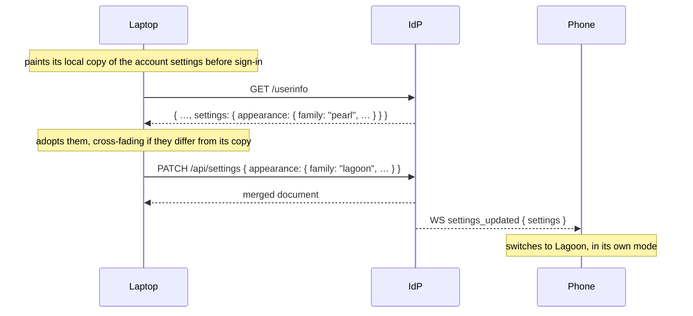
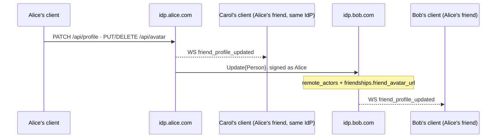

# Pina'i — Profile and settings

## 1. Profile editing API

An account edits its name, pronouns, bio and avatar through three Bearer-auth endpoints, and reads
them back on `/userinfo`; it reads another account's on `/api/profiles` (§ 1, Profile card):

| Endpoint | Body | Answer |
|---|---|---|
| `GET /userinfo` | — | The account: `sub`, `email`, `email_verified`, `totp_enabled`, `admin` (an admin of this instance, `identity-provider/specs/auth.md § 4`), `preferred_username` (the handle), `display_name`, `address` (`handle@domain`), `actor_uri`, `avatar_url`, `pronouns`, `bio`, its `settings` (§ 2), and `privacy` (`identity-provider/specs/social.md § 2`). A token whose account is gone is `401 invalid_token` (`User not found`). |
| `PATCH /api/profile` | `{ display_name, pronouns?, bio? }` | The new `/userinfo` document. |
| `PUT /api/avatar` | the raw image, typed by its `Content-Type`: `image/jpeg`, `image/png`, `image/webp` or `image/gif` | `{ avatar_url }` |
| `DELETE /api/avatar` | — | `204` |
| `GET /api/profiles?actor={actor URI}` | — | The card: `{ actor_uri, display_name, avatar_url, pronouns, bio, friends_since }`. |

### Profile rules

The form sends every field on every save:

- `display_name` — required; trimmed, 1–50 characters.
- `pronouns` — `he`, `she` or `non-binary`; `null` or empty clears. The `users` table checks the
  set too.
- `bio` — at most 190 characters; empty clears.

A value outside them is `400 invalid_request`, described by the rule it breaks (`display_name
cannot be blank`, `pronouns must be one of: he, she, non-binary`, …). An avatar is 1 byte to 2 MiB
of one of the four types, else `400` (`Content-Type must be image/jpeg, image/png, image/webp, or
image/gif`, `Body cannot be empty`).

The whole profile — name, avatar, pronouns and bio — federates to the account's friends (§ 3).

### Profile card

`GET /api/profiles?actor=` answers what the caller is shown of an account, here or elsewhere:

- `pronouns` and `bio` as the profile rules have them, `null` when none.
- `friends_since` — when the friendship was accepted on the caller's side (RFC 3339,
  `identity-provider/specs/social.md § 1`), `null` unless they are friends.

An account of this instance is shown to every account here, as its `Person` is to anyone (§ 3).
One of another instance is shown from `remote_actors`, and only to a caller who counts it among
their accepted friends or shares a conversation with it, both still members — the rule presence
follows (`identity-provider/specs/presence.md`, What a peer is told). Any other actor is `404 not_found` (`User not
found`), cached or not: the cache never tells who here has met whom
(`identity-provider/specs/identity.md § 2`). An `actor` that is no actor URI is `400`
(`` `actor` is not an actor URI ``).

A non-friend's cached profile is only as fresh as the last time anyone here resolved them, and a
friend's misses an `Update{Person}` that was lost. So a card whose `remote_actors.fetched_at` is
more than 24 h old is answered as cached, and the account is discovered again in the background
(`identity-provider/specs/identity.md § 2`) for the next read.

### Avatar storage

The avatars bucket is **public-read** (`s3:GetObject` for `Principal: *`), unlike the attachments
bucket. The IdP keeps one object per account and type, `{user_id}.{ext}`, and stores its public
URL on `users.avatar_url`, versioned by the upload time:

```
{STORAGE_PUBLIC_URL}/avatars/{user_id}.{ext}?v={unix_secs}
```

The key is stable, so without `?v` a browser keeps the old bytes after a re-upload; the version
travels verbatim through `Update{Person}` to peers' `remote_actors.avatar_url` and
`friendships.friend_avatar_url`.

The account never points at a removed image. An upload is stored, then shown on
`users.avatar_url`, and only then are the account's images of the other types removed; a delete
clears `users.avatar_url` before removing the images. A failed upload or write leaves the avatar
the account had. An image a failed removal leaves behind is shown nowhere, and the next upload
removes it.

After each change the account's friends are told of it (§ 3).

## 2. User settings

A user's settings come in two scopes, and only one of them reaches the IdP:

| Scope | Examples | Kept |
|---|---|---|
| Account | palette, motif, notification mutes | `user_settings` on the home IdP; every device follows it |
| Device | light / dark / system | the device only (the client's local storage) — never sent |

The palette is an identity choice that should look the same everywhere; light or dark depends on the
screen and the time of day. A device paints the account's palette in its own mode.

### Data model

```sql
CREATE TABLE user_settings (
  user_id    UUID PRIMARY KEY REFERENCES users(id) ON DELETE CASCADE,
  settings   JSONB NOT NULL DEFAULT '{}'::jsonb
      CHECK (jsonb_typeof(settings) = 'object')
      CHECK (octet_length(settings::text) <= 16384),
  updated_at TIMESTAMPTZ NOT NULL DEFAULT now()
);
```

The document belongs to the client. Each top-level key is a **section** — `appearance` and
`notifications` today:

```json
{
  "appearance": { "family": "lagoon", "motif": "raranga" },
  "notifications": { "muteAll": false, "mutedConversations": ["<conversation id>"] }
}
```

The IdP checks the shape (an object of objects, within 16 KiB) and never interprets a section. A client
that doesn't know a section therefore never drops it, and a client validates whatever it reads back,
falling back to its defaults for a value it doesn't recognise.

Settings are not federated and not end-to-end encrypted: they live on the user's home IdP only and say
nothing about anyone else.

### Endpoints

| Endpoint | Behaviour |
|---|---|
| `GET /userinfo` | Carries the document as `settings` (`{}` if never saved), so a client has it from its first request without a fetch of its own. `PATCH /api/profile`, which answers with the same shape, carries it too. |
| `PATCH /api/settings` | Bearer-auth. Body: an object of sections. Each section named **replaces** the stored one whole; the others are kept — a single `settings \|\| $change` upsert. Answers with the merged document, and pushes it to every session of the user as a `settings_updated` WebSocket event. 400 on a body that isn't an object of objects, or that would take the document past the cap. |

There is no `GET /api/settings`: a client reads its settings on `/userinfo`, which it fetches on every
sign-in — including the silent one each page load goes through, since access tokens live in memory only
— and follows changes from its other sessions through `settings_updated`.

### Scenarios



- **Change on one device.** The client applies and caches the change at once, then sends it. The other
  sessions switch live on `settings_updated`; the originating session receives the same document back.
- **Change while the IdP is unreachable.** The client keeps its change marked unsynced and sends it
  again on its next sign-in, where it wins over the IdP's copy instead of being overwritten by it.
- **Several devices changing concurrently.** The last `PATCH` for a section wins; sections don't
  interfere with one another, because a client sends only the sections it changed — a whole document
  would put its stale copy of the others back.
- **Before sign-in, or before `/userinfo` answers.** The client paints its local copy of the account
  settings — those of the last account signed in on it — so pages never flash the default.

## 3. Real-time profile propagation

An account's profile — display name, avatar, pronouns and bio — is shown by its friends'
clients, here and on other instances; a change reaches them at once.



### Outbound

After a change the IdP pushes `friend_profile_updated` to the live sessions of each local account
that counts the actor among its accepted friends, and posts an `Update{Person}`, signed as the
account, to the inbox of each accepted friend on another instance — one first seen through its
`Follow` is reached at `{actor_uri}/inbox`. Delivery is best-effort
(`identity-provider/specs/event-delivery.md § 2`): the change is saved whatever becomes of it.

A new friend on another instance is sent one too, once the friendship is accepted: by the
accepter's IdP after its `Accept`, and by the requester's when the `Accept` arrives. Each instance
read the other's `Person` when the request was made, and an edit while it was pending reached
nobody.

```json
{
  "@context": "https://www.w3.org/ns/activitystreams",
  "type": "Update",
  "actor": "https://idp.bob.com/users/bob_k2m9x",
  "object": {
    "type": "Person",
    "id": "https://idp.bob.com/users/bob_k2m9x",
    "preferredUsername": "bob_k2m9x",
    "name": "New Bob",
    "icon": { "type": "Image", "url": "https://s3.bob.com/avatars/<id>.webp?v=1790762965" },
    "summary": "Kia ora &lt;3<br>Wellington",
    "pronouns": "he"
  }
}
```

The `Person` carries the whole shown profile — no `name` without a display name, no `icon`
without an avatar, no `summary` or `pronouns` without them — so each `Update` replaces what the
peer knew. `summary` is the bio as HTML, as ActivityPub has it: `&`, `<`, `>`, `"` and `'`
escaped, a line break as `<br>`. `pronouns` is a Pina'i extension: `he`, `she` or `non-binary`.

### Inbound

An `Update{Person}` at `POST /users/:username/inbox`, past the three inbound checks
(`specs/06-federation-authentication.md`):

- **Only the account itself.** The `Person`'s `id` must be the activity's actor, which the
  signature binds; one naming any other account, or an account of this instance, is
  `403 access_denied` (`an actor may only update its own profile`). The signature proves who sent
  the activity, not whose profile it names.
- **Within this instance's limits.** The name is taken as a local display name is (trimmed,
  1–50 characters), the avatar only at an `http(s)` URL of at most 2048 bytes, since every
  friend's client loads it. The `summary` is reduced to text — tags dropped, `<br>` and `</p>` as
  line breaks, character references decoded — and kept within the bio rule (§ 1); pronouns other
  than the three are none. Anything else is taken as not given. The name an actor document gives
  when the actor is discovered or resolved (`identity-provider/specs/identity.md § 2`) goes through the same rule.
- The name, avatar, pronouns and bio replace those in `remote_actors` — one the `Person` lacks is
  cleared — the avatar that of every friendship naming the actor, and `friend_profile_updated`
  goes to the local accounts that count it among their accepted friends. A `Person` whose `id` is
  no actor URI is ignored.

### The event

```json
{
  "type": "friend_profile_updated",
  "data": {
    "actorUri": "https://idp.bob.com/users/bob_k2m9x",
    "displayName": "New Bob",
    "avatarUrl": "https://s3.bob.com/avatars/<id>.webp?v=1790762965"
  }
}
```

`displayName` and `avatarUrl` are `null` once cleared. The client updates the friend at once, and
reads their card again (§ 1) if it shows it.

### Summary

| Trigger | Transport | What is written |
|---|---|---|
| Local profile update | WebSocket push | `users` |
| Remote profile update | `Update{Person}` → WebSocket push | `remote_actors` + `friendships.friend_avatar_url` |
