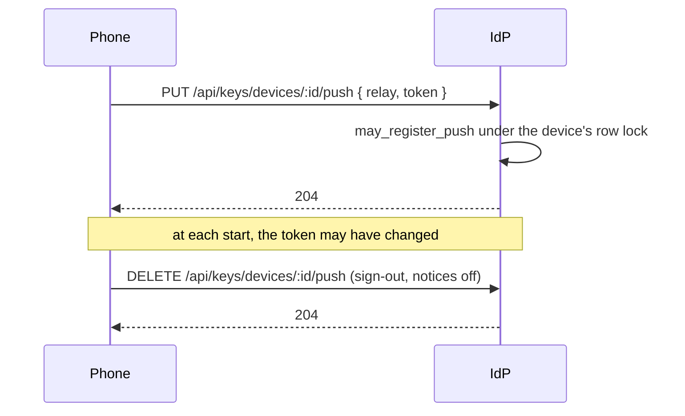

# Pīna'i — Push notices

A device's app closes its WebSocket in the background, so what the instance pushes there — another
device asking to be approved, someone asking to start the history over — reaches only the devices
open at that moment. A phone hears of them with its app closed through a push notice: the instance
hands it to a relay, which hands it to the phone's platform service (FCM, APNs), which wakes the
phone.

The instance cannot be its own relay: sending to an app through FCM or APNs takes a key of the app
publisher's, which no instance holds. So the app names the relay that holds it — the official app,
the official relay; a fork, its own — and the instance sends there. This is Matrix's pusher model.

## 1. Registrations

```
device_push_registrations — one per device (device_id, user_id, relay, token, updated_at)
```

- **`relay`**: the relay's address as the app gives it, an absolute `https` URL — `http` only on a
  loopback host, for a development instance or a test's fake relay —, with no credentials and no
  fragment, 512 bytes at most (`domain::e2ee::PushRelay`).
- **`token`**: what the relay knows the device by, 1–512 bytes of printable ASCII without spaces
  (`domain::e2ee::PushToken`) — Expo's `ExponentPushToken[…]`, FCM's and APNs' tokens. Whoever holds
  it can send the device notices, so it is never written to a log.

The device's own session sets and removes its registration (`domain::e2ee::may_register_push`):
a session that named that very device (`403 device_required` when it named none, `403
device_mismatch` when another), the caller's device (`404` otherwise), unrevoked (`403`). The write
decides under the device's row lock, which a revoke takes first: a revoke committed before it leaves
nothing written. No recent password: the app sets it again at each start, as the relay may hand it
another token, and removes it at its sign-out or once its user turned notices off.

A revoke deletes the registration in its own write (`identity-provider/specs/e2ee.md § 3.12`): a
revoked device is sent nothing. Deleting the device's row deletes it too.



## 2. Endpoints

| Endpoint | Description |
|---|---|
| `PUT /api/keys/devices/:device_id/push` | Bearer-auth. `{ relay, token }`, both required (axum's `422` without one; `400` naming the rule a value breaks): the device's registration, replacing the one held (§ 1). `204` |
| `DELETE /api/keys/devices/:device_id/push` | Bearer-auth. The device's registration removed, none held too; decided as the `PUT` is (§ 1). `204` |
