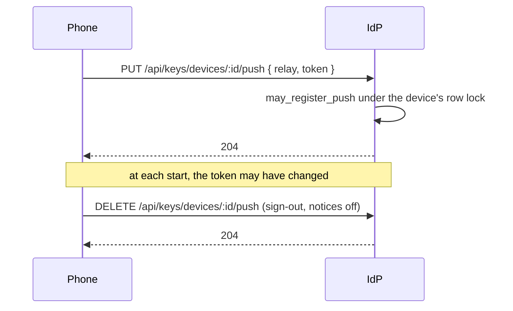
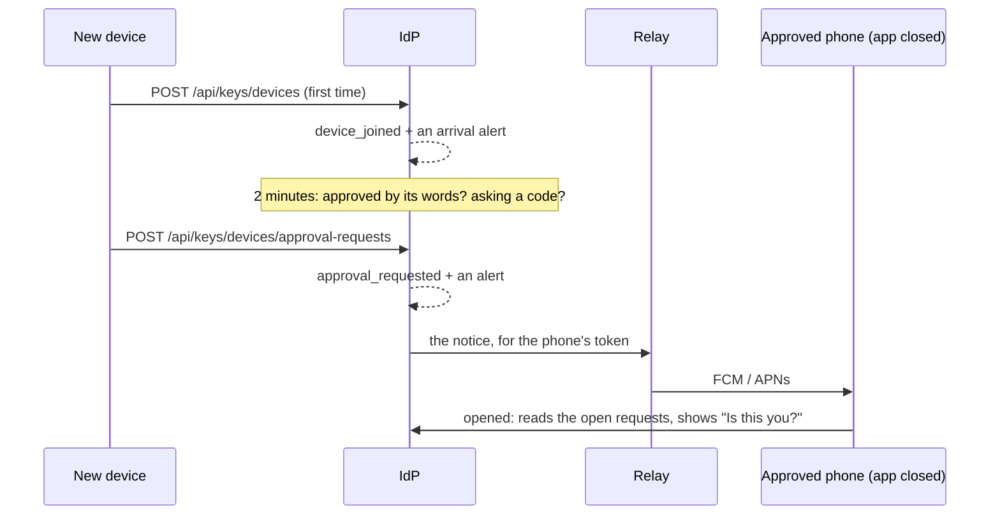

# Pīna'i — Push notices

A device's app closes its WebSocket in the background, so what the instance pushes there — another
device asking to be approved, someone asking to start the history over — reaches only the devices
open at that moment. A phone hears of them with its app closed through a push notice: the instance
hands it to a relay, which hands it to the phone's platform service (FCM, APNs), which wakes the
phone.

The instance cannot be its own relay: sending to an app through FCM or APNs takes a key of the app
publisher's, which no instance holds. So the app names the relay that holds it — the official app,
the official relay; a fork, its own — and the instance sends there. This is Matrix's pusher model.

## 1. Registrations

```
device_push_registrations — one per device (device_id, user_id, relay, token, updated_at)
```

- **`relay`**: the relay's address as the app gives it, an absolute `https` URL — `http` only on a
  loopback host, for a development instance or a test's fake relay —, with no credentials and no
  fragment, 512 bytes at most (`domain::e2ee::PushRelay`).
- **`token`**: what the relay knows the device by, 1–512 bytes of printable ASCII without spaces
  (`domain::e2ee::PushToken`) — Expo's `ExponentPushToken[…]`, FCM's and APNs' tokens. Whoever holds
  it can send the device notices, so it is never written to a log.

The device's own session sets and removes its registration (`domain::e2ee::may_register_push`):
a session that named that very device (`403 device_required` when it named none, `403
device_mismatch` when another), the caller's device (`404` otherwise), unrevoked (`403`). The write
decides under the device's row lock, which a revoke takes first: a revoke committed before it leaves
nothing written. No recent password: the app sets it again at each start, as the relay may hand it
another token, and removes it at its sign-out or once its user turned notices off.

A revoke deletes the registration in its own write (`identity-provider/specs/e2ee.md § 3.12`): a
revoked device is sent nothing. Deleting the device's row deletes it too.



## 2. When a notice is sent

Three things are told, each as its WebSocket push goes out — the device and trust notifiers queue
an alert beside it (`api::background::PushAlerts`), and nothing in the request waits for the
notice:

| What happened | Its WebSocket push | The notice |
|---|---|---|
| A device asks a code: an approval request opened (`identity-provider/specs/e2ee.md § 3.10`) | `approval_requested` | At once |
| A device registered for the first time | `device_joined` | `ARRIVAL_NOTICE_DELAY` (2 minutes) on, only if it still waits then: known, unrevoked, not approved, and asking no code — its request's notice went as it opened (`domain::e2ee::arrival_still_waits`). A device restored by its 24 words has approved itself by then |
| A device asks to start the history over (`identity-provider/specs/e2ee.md § 3.12`) | `start_over_requested` | At once |

`api::background::serve_push_alerts` takes the alerts off the queue — 256 waiting, 1024 under
way, the arrivals' delays included; past either, an alert is dropped and the drops warned about
once a minute at most — and hands each to `NotifyDevices`. It is best effort, as federation
delivery is: an alert dropped, waiting out its delay as the instance stops, or lost with a restart
costs a notice, never the event itself — the WebSocket push went, and the app reads the device
list, the open requests and the start over again when it is opened.



## 3. Who is told

The account's devices (`domain::e2ee::push_recipients`):

- approved under the current generation — they can answer a code or cancel a start over; an
  account with no history key has none;
- with a live session that named them — a device signed out would open on a sign-in;
- holding a registration;
- never the device the notice is about.

A device's WebSocket being open doesn't hold the notice back: an app in front shows what the
WebSocket brought and leaves the notice unshown.

## 4. What a notice says

Fixed words, the same for everyone: no name — the account's, a device's — and no identifier. The
relay and the platform's service learn only that this device was told something, then
(`domain::e2ee::PushNotice`).

| Notice | Title | Body | `tag` / `data.kind` |
|---|---|---|---|
| A device waits | "Is this you?" | "A device is signing in to your account. Open Pīna'i to approve it or sign it out." | `device_waiting` |
| A start over | "Start your history over?" | "Someone asked to start your history over. If it wasn't you, open Pīna'i to cancel it." | `start_over` |

A notice replaces the one of its tag the phone shows: a device's arrival then its code leave one.

## 5. The relay protocol

Expo's push API is the protocol: a relay of our own takes the same message
(`infrastructure::push::ExpoRelays`). One `POST` to the registration's `relay`, its body a JSON
array of one message:

```json
[{
  "to": "<token>",
  "title": "Is this you?",
  "body": "A device is signing in to your account. Open Pīna'i to approve it or sign it out.",
  "tag": "device_waiting",
  "priority": "high",
  "ttl": 3600,
  "channelId": "sign-ins",
  "data": { "kind": "device_waiting" }
}]
```

`priority: high` wakes a dozing phone; `ttl` (`PUSH_NOTICE_TTL`, an hour) drops a notice a phone
out of reach for longer would get late — opened, the app shows what is current anyway;
`channelId` is the notification channel the app creates (`PUSH_CHANNEL`).

The relay's address is one a device chose, so it is asked through the federation's screened client
(`specs/06-federation-authentication.md`, "Peer request policy"): private space refused on a
production instance, no redirect, its timeouts and body cap. The answer is read as Expo's tickets:
`ok` is sent; an error whose `details.error` is `DeviceNotRegistered` means the relay no longer
reaches the device — an app uninstalled, notices turned off — and the registration is forgotten,
only while it still holds that token (`PushRegistrations::forget`: a token registered since is
kept). Any other answer is warned about by its error code or HTTP status alone: the relay's words
name the token. Expo's receipts are not read.

## 6. Endpoints

| Endpoint | Description |
|---|---|
| `PUT /api/keys/devices/:device_id/push` | Bearer-auth. `{ relay, token }`, both required (axum's `422` without one; `400` naming the rule a value breaks): the device's registration, replacing the one held (§ 1). `204` |
| `DELETE /api/keys/devices/:device_id/push` | Bearer-auth. The device's registration removed, none held too; decided as the `PUT` is (§ 1). `204` |
