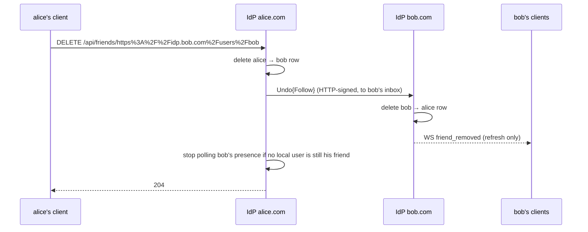
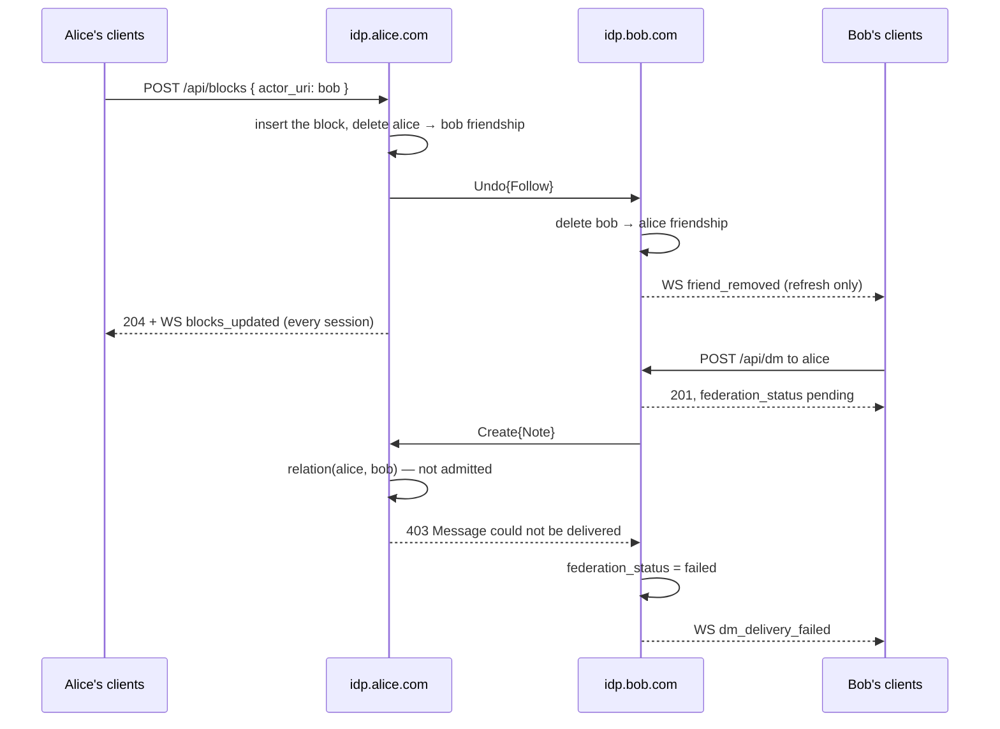

# Pina'i — Friends and who can reach a user

## 1. Friendships

### Data model

```sql
-- Friends relationships — owner is always local (FK), friend can be local or remote (actor_uri)
CREATE TABLE friendships (
  id                UUID PRIMARY KEY DEFAULT gen_random_uuid(),
  owner_user_id     UUID NOT NULL REFERENCES users(id) ON DELETE CASCADE,  -- always local
  friend_actor_uri  TEXT NOT NULL,   -- e.g. "https://idp.bob.com/users/bob" (local or remote)
  friend_avatar_url TEXT,            -- a remote friend's avatar, as its last Update{Person} said
  status            TEXT NOT NULL DEFAULT 'pending' CHECK (status IN ('pending', 'accepted')),
  direction         TEXT NOT NULL CHECK (direction IN ('outgoing', 'incoming')),  -- who sent the request
  created_at        TIMESTAMPTZ NOT NULL DEFAULT now(),
  updated_at        TIMESTAMPTZ NOT NULL DEFAULT now(),

  UNIQUE (owner_user_id, friend_actor_uri)
);
```

> **Who sent the request**
>
> Each side of a friendship has its own row — both in this database for a local pair, one on each
> IdP for a cross-IdP pair — and `direction` says which side the owner is on: `outgoing` when the
> owner sent the request, `incoming` when they received it. Only the `incoming` side may answer
> it: `GET /api/friends/incoming` lists incoming pending rows only, `POST /api/friends/:id/accept`
> and `DELETE /api/friends/:id/reject` refuse any other row, and an inbound `Accept` or `Reject`
> only applies to an `outgoing` row. Without it a pending row reads the same to both parties, and
> the requester could accept their own request. A repeated request takes over both pending rows,
> so the latest request decides who answers.
>
> A request never reopens an accepted friendship. `POST /api/friends/request` to an existing
> friend is refused (`Already friends`), and recording a request leaves an accepted row untouched
> — otherwise a peer could quietly take a friendship back to `pending`. An inbound `Follow` for an
> accepted friendship means the peer missed the `Accept`: it is answered with the `Accept` again,
> naming the pair's DM, and nothing else changes. Ending a friendship goes through unfriend only.
>
> A request to someone who blocked the requester never reaches them, and the requester can't tell:
> their own side is recorded `pending`, as for any request still unanswered (§ 2).

### Querying the friends list

Using `actor_uri` as the universal key, a JOIN across `users` and `remote_actors` gives the full friends list, whether local or federated:

```sql
SELECT
  u.username                                 AS username,      -- NULL for a remote friend
  COALESCE(u.display_name, ra.display_name)  AS display_name,
  CASE WHEN u.id IS NULL THEN f.friend_avatar_url
       ELSE u.avatar_url END                 AS avatar_url,
  f.friend_actor_uri,
  COALESCE(ra.instance, 'local')             AS instance
FROM friendships f
LEFT JOIN users u          ON f.friend_actor_uri = u.actor_uri
LEFT JOIN remote_actors ra ON f.friend_actor_uri = ra.actor_uri
WHERE f.owner_user_id = $1     -- pass the caller's local user id
  AND f.status = 'accepted';
```

A local friend is shown as its account is now — name and avatar from `users` — and a remote one
as it was met and as each `Update{Person}` since said (`identity-provider/specs/profile-and-settings.md § 3`). The friendship's `friend_avatar_url` is that copy for a
remote friend; for a local one it is never read, so a cleared avatar stays cleared.

### Friendship-accept also creates the DM conversation

When a friendship transitions to `accepted` (via `POST /api/friends/:id/accept` for both same-IdP and cross-IdP recipients, or an inbound `Accept{Follow}` when a remote peer's IdP accepts a request our user sent), the accepter's IdP flips both local rows and creates the DM conversation in one transaction: a
request accepted twice at once is accepted once, and the loser is told `Not an incoming friend
request`. Same-IdP and cross-IdP requests share one model: both rows land in `pending` at request time, and the recipient must explicitly accept — there is no auto-accept path. The new id flows out two ways:

- **Locally**: the WS `friend_accepted` payload carries it on `FriendshipPayload.conversation_id` (`Option<Uuid>`, absent on `friend_request`/`friend_removed` — the conversation outlives an unfriend). Web clients invalidate the `dm-conversations` query on this event so `localDmConvos` populates with the new row immediately.
- **Cross-IdP**: the outbound AP `Accept{Follow}` activity carries it in a non-standard `conversationId` field on the activity body (a sibling of `id`/`type`/`actor`/`object`). The requester's IdP opens its DM under that id, so both sides persist the row under the same UUID — unless the pair already shares a DM there, which is kept. An advertised id that already names a group conversation is never reused: a separate DM is opened. A peer that omits the field gets a DM under a locally minted id; the two IdPs then disagree on it, which is a safe degradation.

The migration `20260512000001_backfill_friendship_conversations.sql` retroactively creates a DM for every accepted friendship that doesn't yet have one (deduplicated by ordering the actor pair lexicographically so the two friendship rows don't each get their own conversation).

### Declining a request and ending a friendship

Both are silent for the other person: neither raises a notification. A declined request
simply stops existing, and an ended friendship drops out of the friends list. Neither
touches the DM conversation — its row, members and history stay, and re-friending the
same person reuses it. Each removes both local rows in one transaction.

| Action | Endpoint | Caller's row | Other side, same IdP | Other side, remote IdP |
|---|---|---|---|---|
| Decline | `DELETE /api/friends/:id/reject` (pending `incoming` rows only) | Deleted | Requester's pending row deleted, no event | `Reject{Follow}` to the requester's inbox |
| Unfriend | `DELETE /api/friends/:actor_uri` (percent-encoded; 404 when no row) | Deleted | Friend's row deleted; `friend_removed` WS event | `Undo{Follow}` to the friend's inbox |

`DELETE /api/friends/:actor_uri` also withdraws a pending request the caller sent, through
the same paths. Blocking someone ends the friendship through these same paths too
(§ 2).

The `friend_removed` event carries the friend's own `friendship_id` and exists so their
clients refresh the friends and DM lists; clients do not surface it as a notification.



**Inbound `Accept` and `Reject`** act on exactly one row: the one owned by the inbox the
activity was delivered to, whose friend is the activity's `actor`, and only while it is a
`pending` `outgoing` request. The embedded Follow is not trusted to name the local user, so a
peer can neither answer anyone else's request nor accept a request it sent itself.

**Delivery** of every friendship activity — `Follow`, `Accept`, `Reject`, `Undo{Follow}` — is
best-effort: the local change is committed first, the activity is sent in the background, and
the request succeeds even if the peer is unreachable (a failure is logged). A peer that missed a
`Follow` never sees the request — the requester can send it again. One that missed an `Accept`
still has its request pending and answers with nothing until it redelivers the `Follow`, which is
answered with the `Accept` again. One that missed a `Reject` or `Undo{Follow}` keeps its row
until either side touches the relationship again — its user unfriending sends an `Undo{Follow}`
back, which is a no-op here.

**Redelivery** of any friendship activity is a no-op: an `Accept`, `Reject` or `Undo{Follow}`
with no matching row answers `202` and changes nothing, and a repeated `Follow` keeps the one
pending row.

**Remote presence polling** is registered per IdP, not per user. It is only released when
no local user still has the remote actor as an accepted friend.

## 2. Who can reach a user

Two things decide who may message a user or add them to a group: their **contact setting** and
their **blocks**. Both go through one rule, and every refusal it causes is the same refusal. A refusal never tells its cause,
so the blocked person can't tell a block from a setting they may have fallen outside of — nor, on
another instance, from an instance that didn't answer.

The default setting is what makes this hold. Under it, someone who isn't a friend and shares no group
with the user can't message them. An unfriend therefore already stops the DMs, and a block, which
always ends the friendship, looks like an unfriend.

| | Effect of Alice blocking Bob |
|---|---|
| Friendship | Ended on both sides, exactly as an unfriend — or, for a request Bob sent, a decline |
| Friend requests | Bob's never reach Alice: his side stays `pending`, and she sees nothing. Alice's to Bob are refused until she unblocks him |
| DMs | Neither can send the other a new DM, or edit one in their 1:1. Bob's attempts end undelivered, as a stranger's do under the default setting |
| Their DM conversation | Kept, with its history — as after an unfriend |
| Groups they already share | Unchanged: both read and write as before. Bob's messages don't count as unread for Alice |
| New groups | Bob can't add Alice to one, nor she him. Others still can add both, if Alice admits them |
| Presence | As after an unfriend — hiding more would tell Bob he is blocked |

### The contact setting

"Who can message you or add you to a group", one value per account, `users.contact_policy`:

| Value | Who may message the account, or add it to a group |
|---|---|
| `everyone` | Anyone with its address, on any instance |
| `friends_and_groups` (default) | Its friends, and the people it shares a group with |
| `friends` | Its friends only |

It lives on `users`, not in `user_settings`: that document is the client's, and the IdP never
interprets it (`identity-provider/specs/profile-and-settings.md § 2`). The IdP enforces this one.

| Endpoint | Behaviour |
|---|---|
| `PATCH /api/privacy` | Bearer-auth. Body `{ contact_policy }`. Answers `200 { contact_policy }`; 400 `contact_policy must be everyone, friends_and_groups or friends`. |
| `GET /userinfo` | Carries it as `privacy: { contact_policy }`, as does `PATCH /api/profile`, which answers the same shape. |

### Blocks

A user can block any actor, local or remote. A block is private to the blocker: it lives on their
home IdP only, and it is never federated. ActivityPub's `Block` activity is not delivered to its
object, as the specification advises, so the blocked person's IdP never learns of it.

#### Data model

```sql
-- Actors a local user has blocked, local or remote, by actor URI.
CREATE TABLE user_blocks (
  owner_user_id      UUID NOT NULL REFERENCES users(id) ON DELETE CASCADE,
  blocked_actor_uri  TEXT NOT NULL,
  created_at         TIMESTAMPTZ NOT NULL DEFAULT now(),
  PRIMARY KEY (owner_user_id, blocked_actor_uri)
);
```

"Alice blocked Bob" below means a row with Alice as owner and Bob's actor URI. A list holds at most
1000 actors (`domain::social::MAX_BLOCKS`), each an actor URI of 2 KiB at most, since the IdP stores
what the blocker writes.

#### Endpoints

| Endpoint | Behaviour |
|---|---|
| `GET /api/blocks` | Bearer-auth. The caller's blocked actors, newest first: `[{ actor_uri, display_name, avatar_url, blocked_at }]` (`blocked_at` RFC 3339), names from `users` or `remote_actors` (`null` for an actor never resolved). |
| `POST /api/blocks` | Bearer-auth. Body `{ actor_uri }`. Blocks the actor and ends the relationship (below). Idempotent — blocking again changes nothing, even with a full list. 204; 400 `Invalid actor URI`, `You can't block yourself`, or `You can't block more than 1000 people` — nothing ended then. |
| `DELETE /api/blocks/:actor_uri` | Bearer-auth; `actor_uri` percent-encoded. Removes the block and nothing else. 204; 404 `Not blocked` when the actor isn't blocked. |

Both writes push `blocks_updated` to every session of the caller, so their other devices refetch the
list. Like `friend_removed`, it is refresh-only:

```json
{ "type": "blocks_updated", "data": {} }
```

#### Ending the relationship

`POST /api/blocks` inserts the row and deletes the friendship's rows here in one transaction, then
tells the other side what the matching friendship action would (§ 1, Declining a request and ending a
friendship) — so Bob sees an unfriend or a decline, never a block:

| Caller's friendship row | Same as | Other side, same IdP | Other side, remote IdP |
|---|---|---|---|
| `accepted`, or `pending` `outgoing` | Unfriend | Bob's row deleted; `friend_removed` | `Undo{Follow}` |
| `pending` `incoming` | Decline | Bob's row deleted, no event | `Reject{Follow}` |
| none | — | nothing | nothing |

Remote presence polling is released as on unfriend. Unblocking restores nothing: the friendship stays
ended, and either side must send a new request.

### The rule

Whether an actor may reach a local account is decided on the account's own instance, from four facts
read together in one query (`domain::social::Relation`), so that every outcome costs the same:

| Fact | Holds when |
|---|---|
| `policy` | the account's contact setting |
| `blocked` | the account blocked the actor |
| `friends` | an `accepted` friendship — a pending request is not one |
| `share_a_group` | both are active members of a conversation of kind `group` |

A block refuses, whatever else holds. Otherwise `everyone` admits, `friends_and_groups` needs
`friends` or `share_a_group`, and `friends` needs `friends`. Their 1:1 DM, which an unfriend keeps,
is no tie: it would otherwise let an ex-friend write on, and only a block would stop him.

A user who blocked someone can't write to them, ask them to be friends, nor add them to a group:
those refusals, `You blocked this user` and `Unblock this user first`, are for the blocker only.

Friend requests are open to anyone the user didn't block: the contact setting doesn't cover them. A
block keeps a request out silently, so to the requester it is just a request nobody answered.

### Where the rule is enforced

| Path | Refused when | Refusal |
|---|---|---|
| `POST /api/dm`, WS `send_dm`, `PATCH /api/dm/:id/edit` — 1:1 conversations | The sender blocked the recipient | 403 `You blocked this user` |
| Same, local recipient | The recipient doesn't admit the sender | 403 `Message could not be delivered`; nothing stored, and no DM opened — checked before the conversation is |
| Inbound `Create{Note}` without `mlsGroup`, inbound `Update{Note}` in a 1:1 | The inbox owner doesn't admit the actor | 403 `Message could not be delivered`, nothing stored. The sender's IdP marks the message `failed` and pushes `dm_delivery_failed`, as for an unreachable instance (`identity-provider/specs/direct-messages.md § 3`) |
| `GET /api/dm` unread counts | — | Messages from actors the caller blocked don't count (`identity-provider/specs/direct-messages.md § 5`) |
| `POST /api/friends/request` | The caller blocked the target | 400 `Unblock this user first` |
| Same, local target | The target blocked the caller | None visible: the caller's `outgoing` side is recorded and answered as usual; the target's `incoming` side and its `friend_request` are not |
| Inbound `Follow` | The inbox owner blocked the actor | None visible: answered 202, nothing recorded. The requester's own IdP keeps its `pending` side |
| `POST /api/groups`, `POST /api/groups/:id/members` | The caller blocked an invitee, or a local invitee doesn't admit the caller | 403 `You blocked this user` or `Can't add this person`, with the invitee's `actor_uri`; nothing written. A remote invitee is refused by its own IdP, below |
| `POST /api/keys/packages/claim`, local target | The target doesn't admit the claimer — the Bearer user, or the account a peer's request is signed as. Not checked for one's own packages | 403 `Can't add this person`, before a package is taken. Proxied for a remote target, the same 403 comes back |
| `POST /api/mls/welcomes`, local recipient, 1:1 | The recipient doesn't admit the sender — but for one's own new device | 403 `Can't add this person`, nothing written. A group's Welcome needs no check: joining went through the group routes |
| Inbound Welcome | A 1:1's, or a group's to someone not yet an active member: the recipient doesn't admit the sender, who is the one adding them | 403 `Can't add this person`, nothing mirrored or written |
| Inbound group `Create{Note}` with `mlsGroup`, recipient not yet an active member | The recipient doesn't admit the sender, or the roster holds someone they blocked | None visible: answered 202, and neither the group nor a DM is created |

WS `send_dm` has no error channel, so a refused `send_dm` is dropped; clients send through
`POST /api/dm`. Messages and edits in a group are never checked, nor are MLS commits: the group's
MLS state stays in step, so once a block is lifted new messages decrypt again without re-keying.

**Why new groups are checked twice.** Adding someone to an MLS group takes one of their
KeyPackages, so the claim is where Bob's attempt from another instance stops. A group he created
still lists Alice on his IdP, though, and every member's messages fan out to her with the roster.
Her IdP would mirror the group from the first one (`identity-provider/specs/groups.md
§ 7`), and she would see a group she can never decrypt — named as Bob likes. The roster doesn't
say who added whom, so the inbound check falls back to its sender and its members. The cost: a
group whose Welcome to Alice is lost is mirrored from its messages only when their sender may reach
her and nobody she blocked is in it; the Welcome, from whoever added her, still gets her in.

### What clients do

The IdP enforces the rule. A client keeps quiet what still reaches the user from someone they
blocked, and words every refusal so that it gives no more away than the IdP does.

- **The list.** `GET /api/blocks`, fetched again on `blocks_updated`. A person is blocked from
  their row in the friends list, the conversation list (1:1s) or a group's members. They are
  unblocked from the last two, from the 1:1 itself, from the friends list's Blocked tab, or from
  Settings → Privacy, which also holds the contact setting.
- **What still arrives.** A shared group's messages from someone blocked are shown, but play no
  sound, don't count as unread while the client is open, and their typing isn't shown — the IdP
  already leaves them out of `unread_count`. A group member the user blocked carries a badge.
- **The 1:1 with someone blocked.** Its history stays; in place of the composer, "You blocked
  *name*" and an Unblock button.
- **Sending.** Every DM goes through `POST /api/dm`, so a refusal comes back as an answer. An own
  message that ends `failed` or undelivered in a 1:1 says only that the recipient may accept
  messages from friends only, or that their server may be unreachable — the same words whichever it
  was.
- **Adding to a group.** The client keys each invitee after the group route accepts them. When a
  remote invitee's IdP refuses the KeyPackage claim (`Can't add this person`) or has none to give,
  the client removes them from the group again, so its roster stops naming someone who can never
  read it, and says they couldn't be added. Only `You blocked this user` names its cause.

### Scenarios



- **Alice blocks a friend.** The friendship ends as an unfriend would; their DM stays listed with its
  history on both sides. Bob's next message there ends undelivered, and so does every retry.
- **Carol, a stranger elsewhere, writes to Alice under the default setting.** Her message ends
  undelivered exactly as Bob's does. Once Alice chooses `everyone`, Carol's messages arrive; Bob's
  still don't.
- **Bob is on Alice's own instance.** His `POST /api/dm` is refused at once with the same 403 a
  stranger gets; no conversation is opened for either of them.
- **Alice writes to Bob after blocking him.** Refused with `You blocked this user`, until she
  unblocks him; asking him to be friends, with `Unblock this user first`.
- **Bob asks Alice to be friends.** His request is recorded on his side, `pending`, and never
  answered: Alice's IdP drops his `Follow`, or, on her own instance, records nothing for her. Once
  she unblocks him, a new request from him reaches her as any other.
- **Bob tries to add Alice to a group.** On her instance, the creation is refused outright with
  `Can't add this person`. From another instance, his claim for her KeyPackage gets that same
  answer, and his group's messages never make it appear for her.
- **Carol, Alice's friend, creates a group with Alice and Bob.** It works: others may add both.
  Bob's messages there reach Alice as before, without counting as unread.
- **Alice blocks someone whose request is pending.** The request is declined, silently, as
  `DELETE /api/friends/:id/reject` would.
- **Alice blocks someone she never met.** Only the row is written; nobody is told anything.
- **Alice unblocks Bob.** The row goes; they are strangers, and either may send a new request.
