# Pina'i — Architecture Diagram

```mermaid
flowchart TD
    subgraph ClientAlice["Alice's Clients"]
        WEB_A["🖥️ Web\nReact + Vite"]
        DESK_A["🖱️ Desktop\nElectron"]
    end

    subgraph ClientBob["Bob's Clients"]
        WEB_B["🖥️ Web\nReact + Vite"]
        DESK_B["🖱️ Desktop\nElectron"]
    end

    subgraph IdP_Alice["idp.alice.com — Identity & Messaging Backbone"]
        OIDC_A["🔐 OIDC\nAuth + JWT\nsign-in pages · NodeInfo"]
        MSG_A["💬 Msg Backbone\nFriends · DMs · ActivityPub"]
        WS_A["⚡ WebSocket Layer\nthin delivery only"]

        subgraph Broker_A["Redis (idp.alice.com)"]
            PUBSUB_A["📡 pub-sub\nPresence · typing — ephemeral"]
            STREAMS_A["🌊 Streams\nDMs — durable"]
        end

        subgraph DB_Alice["PostgreSQL (idp.alice.com)"]
            USERS_A[("users\nactor_uri · inbox_url · outbox_url")]
            REMOTE_A[("remote_actors\ncache · inbox_url · fetched_at TTL")]
            FRIENDS_A[("friendships\nowner_user_id · friend_actor_uri\nfriend_avatar_url")]
        end

        RUSTFS_A["🗄️ RustFS\nAvatars · Attachments"]
    end

    subgraph IdP_Bob["idp.bob.com — Identity & Messaging Backbone"]
        OIDC_B["🔐 OIDC\nAuth + JWT\nsign-in pages · NodeInfo"]
        MSG_B["💬 Msg Backbone\nFriends · DMs · ActivityPub"]
        WS_B["⚡ WebSocket Layer\nthin delivery only"]

        subgraph Broker_B["Redis (idp.bob.com)"]
            PUBSUB_B["📡 pub-sub\nPresence · typing — ephemeral"]
            STREAMS_B["🌊 Streams\nDMs — durable"]
        end

        subgraph DB_Bob["PostgreSQL (idp.bob.com)"]
            USERS_B[("users\nactor_uri · inbox_url · outbox_url")]
            REMOTE_B[("remote_actors\ncache · inbox_url · fetched_at TTL")]
            FRIENDS_B[("friendships\nowner_user_id · friend_actor_uri\nfriend_avatar_url")]
        end

        RUSTFS_B["🗄️ RustFS\nAvatars · Attachments"]
    end

    %% ── Client ↔ IdP connections ──────────────────────────────────────
    WEB_A  <-->|"OIDC + WebSocket"| OIDC_A
    DESK_A <-->|"OIDC + WebSocket"| OIDC_A
    WEB_A  <-->|WebSocket| WS_A
    DESK_A <-->|WebSocket| WS_A

    WEB_B  <-->|"OIDC + WebSocket"| OIDC_B
    DESK_B <-->|"OIDC + WebSocket"| OIDC_B
    WEB_B  <-->|WebSocket| WS_B
    DESK_B <-->|WebSocket| WS_B

    %% ── IdP internal wiring ───────────────────────────────────────────
    OIDC_A --> MSG_A
    MSG_A --> USERS_A
    MSG_A --> FRIENDS_A
    MSG_A --> REMOTE_A
    MSG_A --> RUSTFS_A

    MSG_A -->|"publish durable event"| STREAMS_A
    MSG_A -->|"publish presence"| PUBSUB_A
    MSG_A -->|"push to live sessions:\nprofile · friendship events"| WS_A
    STREAMS_A -->|"consume & push"| WS_A
    PUBSUB_A  -->|"consume & push"| WS_A

    OIDC_B --> MSG_B
    MSG_B --> USERS_B
    MSG_B --> FRIENDS_B
    MSG_B --> REMOTE_B
    MSG_B --> RUSTFS_B

    MSG_B -->|"publish durable event"| STREAMS_B
    MSG_B -->|"publish presence"| PUBSUB_B
    MSG_B -->|"push to live sessions:\nprofile · friendship events"| WS_B
    STREAMS_B -->|"consume & push"| WS_B
    PUBSUB_B  -->|"consume & push"| WS_B

    %% ── Federation (ActivityPub) ──────────────────────────────────────
    %% Outbound delivery is best-effort, inline tokio::spawn — no queue.
    %% Recovery for missed deliveries is per-activity (TTL re-fetch, idempotent retry,
    %% a failed DM reported to its sender). See identity-provider/specs/event-delivery.md § 2.
    MSG_B -->|"HTTP POST ActivityPub activity\nbest-effort, inline tokio::spawn"| MSG_A
    MSG_A -->|"update remote_actors cache\n+ friendships.friend_avatar_url"| REMOTE_A
    MSG_A -->|"update remote_actors cache\n+ friendships.friend_avatar_url"| FRIENDS_A

    MSG_A -->|"HTTP POST ActivityPub activity\nbest-effort, inline tokio::spawn"| MSG_B
    MSG_B -->|"update remote_actors cache\n+ friendships.friend_avatar_url"| REMOTE_B
    MSG_B -->|"update remote_actors cache\n+ friendships.friend_avatar_url"| FRIENDS_B

    %% Presence crosses instances by poll and stream, never by ActivityPub.
    %% See identity-provider/specs/presence.md § Cross-instance presence.
    MSG_A <-->|"presence: batch poll every 10 s,\nSSE stream while a conversation is open\nHTTP-signed, each instance speaks for its own accounts"| MSG_B

    %% ── Styles ────────────────────────────────────────────────────────
    classDef client   fill:#1e3a5f,stroke:#3b82f6,color:#bfdbfe
    classDef oidc     fill:#3b1f1f,stroke:#ef4444,color:#fca5a5
    classDef backbone fill:#2e1a47,stroke:#a855f7,color:#d8b4fe
    classDef ws       fill:#1a3a3a,stroke:#06b6d4,color:#67e8f9
    classDef broker   fill:#1a2a1a,stroke:#22c55e,color:#86efac
    classDef db       fill:#1a2e1a,stroke:#4ade80,color:#bbf7d0
    classDef storage  fill:#2a1f0f,stroke:#f97316,color:#fdba74

    class WEB_A,DESK_A,WEB_B,DESK_B client
    class OIDC_A,OIDC_B oidc
    class MSG_A,MSG_B backbone
    class WS_A,WS_B ws
    class PUBSUB_A,STREAMS_A,PUBSUB_B,STREAMS_B broker
    class USERS_A,REMOTE_A,FRIENDS_A,USERS_B,REMOTE_B,FRIENDS_B db
    class RUSTFS_A,RUSTFS_B storage
```

> **Note on signing in.** Any client signs its users in to any instance: a
> client is the URL of the document it publishes, and each instance serves its
> own sign-in pages, so the password is only typed on the server that checks it.
> Before sending a browser there, the web client reads the instance's NodeInfo
> to show its name. See `identity-provider/specs/auth.md § 1`.

> **Note on attachment delivery.** The browser and remote peer IdPs never
> talk to RustFS directly. `GET /api/attachments/{id}/blob` (browser, HMAC
> token) and `GET /api/attachments/{id}/content` (peer, HTTP Signature)
> stream bytes through the IdP from the private object store. Avatars too:
> `GET /avatars/{user_id}.{ext}` serves them through the IdP, never from RustFS.

---

