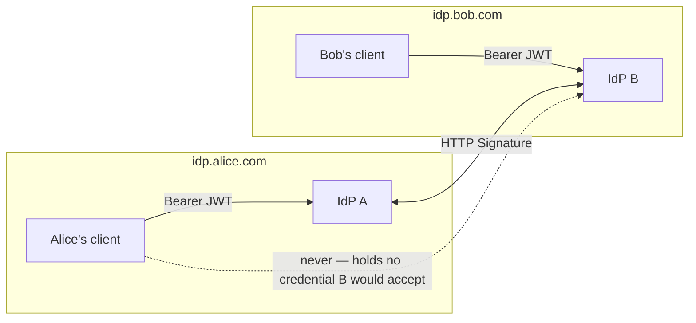
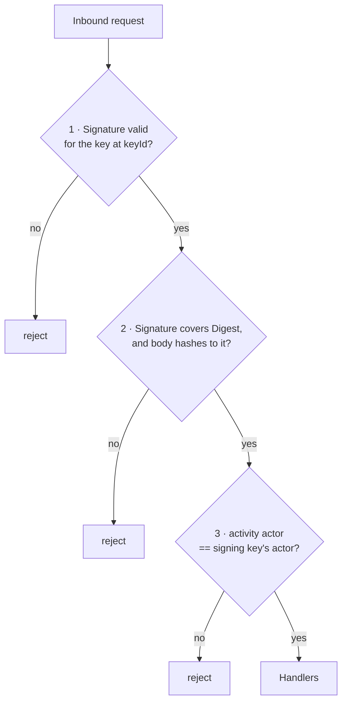
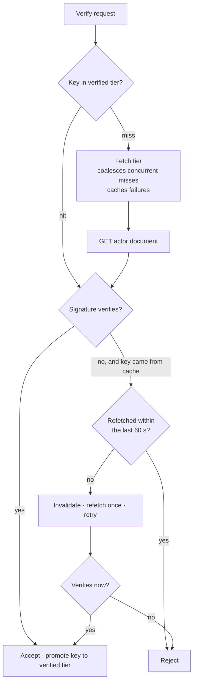

# Pina'i — Federation Authentication

Every request reaching this IdP is authenticated one of two ways, and which one depends
on **who is calling**, never on which endpoint is being called.

| Caller | Credential | Proves |
|---|---|---|
| A person's client | OIDC Bearer JWT | this user, on this IdP |
| A peer IdP | HTTP Signature over the request | this instance, or a user of it |

A remote user never presents a token here. Their client talks to their own IdP, and the two
IdPs talk to each other over signed requests. This is what makes the federation model a
home-server one rather than a multi-tenant OIDC one: opening up to another instance is a
matter of accepting *its server's* signatures, not of accepting *its users' tokens*.



---

### Where this applies

Signature authentication is shared infrastructure, not a property of the inbox. Every
server-to-server endpoint uses the same scheme and the same code path.

| Endpoint | Direction | Spec |
|---|---|---|
| `POST /users/:username/inbox` | inbound activities | this file, § Inbound |
| `GET /api/attachments/:id/content` | peer fetching attachment bytes | `identity-provider/specs/03-direct-messages.md` |
| `POST /api/presence/batch` | peer batch-polling presence | `identity-provider/specs/04-presence.md` |
| `GET /api/presence/stream` | peer SSE subscription | `identity-provider/specs/04-presence.md` |
| `POST /api/keys/packages/claim` | peer claiming a KeyPackage | `identity-provider/specs/05-e2ee.md` |

Implementation lives in `crates/federation-transport/`, shared with the chat server. Domain
handling — which activity verbs a service accepts and what they do — stays in the service.

---

### Key material

No key material is specific to federation. The Ed25519 key pair loaded from
`JWT_PRIVATE_KEY_PATH` signs both JWTs and HTTP Signatures.

A signature names its key by a `keyId` the verifier can resolve:

| keyId | Signs as | Published at |
|---|---|---|
| `<issuer>/users/<username>#main-key` | a local user | that user's actor document |
| `<issuer>/actor#main-key` | the instance itself | `GET /actor` |

The verifier fetches the document at the `keyId` minus its fragment and reads
`publicKey.publicKeyPem`. There is no key exchange and no shared secret: a peer becomes
verifiable by publishing an actor document, which it must do anyway to federate.

---

## Outbound

`signed_post` covers `(request-target)`, `host`, `date` and `digest`; GET requests, which
have no body, cover the first three.

```
(request-target): post /users/bob/inbox
host: idp.bob.com
date: Thu, 18 Sep 2026 10:00:00 +0000
digest: SHA-256=<base64 of the body>
```

That string is signed with Ed25519 and sent as:

```http
Signature: keyId="https://idp.alice.com/users/alice#main-key",
           algorithm="hs2019",headers="(request-target) host date digest",
           signature="<base64>"
```

Signing the request target is what stops a captured signature from being replayed at a
different endpoint or with a different method.

---

## Inbound

Three checks run **before any state is touched**. Each establishes something the previous
one cannot, and all three are required.



A rejection is `400` when the request is malformed — no `Signature` header, an
unparseable one, a `keyId` that does not resolve, a missing `Digest` — and `403` when a
check fails on a well-formed request: a signature that does not verify, a digest that does
not match the body, an actor that is not the signer, or a refetch refused by the rate limit.

#### 1 — Signature

Parse the `Signature` header, resolve `keyId` to its actor document, read
`publicKey.publicKeyPem`, and verify the signature over the rebuilt signing string. This
establishes that **some** real actor signed this request.

Rejected: a missing or malformed `Signature` header, a `keyId` that does not resolve, an
actor document with no `publicKeyPem`, and a signature that does not verify.

#### 2 — Digest binding

Signature verification rebuilds the signing string from header *values*. A valid signature
therefore proves the sender signed the string `digest: SHA-256=…` — never that the body
attached to the request hashes to it. Nothing in the signature alone reaches the body.

Two checks close that, and both are needed:

- **Coverage** — `digest` must appear in the signature's `headers` list. Without this an
  attacker appends their own `Digest` to a header set that never covered it.
- **Comparison** — the received bytes must hash to the `Digest` value. Without this a
  captured request is replayed with a swapped body.

The handler therefore reads the body as raw bytes. Re-serialising a parsed value would not
reproduce the bytes as received, and the digest would be computed over the wrong input.

#### 3 — Actor binding

A verified signature proves that a real actor signed the request. It does not prove that
actor is the one the activity claims to speak for. The activity's `actor` must equal the
signing `keyId` minus its fragment.

Without this, any peer holding a valid key of its own could sign an `Accept` naming someone
else as the actor — and since the handlers read `body["actor"]` directly, a friendship would
be marked accepted, and its DM conversation minted, without the named user consenting.

> This binding assumes the signing key belongs to the activity's actor, which holds for
> everything Pina'i emits. Implementations that deliver through an instance actor
> ("authorized fetch") sign with a `keyId` that differs from the activity's actor;
> federating with those requires a documented exception here, not a relaxation.

---

### Verifying-key cache

A naive verifier fetches the signer's actor document on every inbound request. The cache
that avoids this is shaped by one decision:

> **Key rotation is handled by refetching when a verification fails, not by a short TTL.**
> If expiry were the only way a rotated key were noticed, the TTL would have to be short
> enough to bound how long a peer's valid requests are rejected — which defeats the cache.



The refetch path is reachable by anyone sending a bad signature for a cached `keyId`, so it
is **rate limited per key**. Without that limit an attacker both disables the cache and
turns this IdP into an amplifier aimed at whatever host the `keyId` names.

Further rules, each closing an abuse of an attacker-chosen `keyId`:

- **Promotion requires proof.** A key enters the verified tier only after it has verified a
  real signature, never merely on a successful fetch. Every entry therefore corresponds to a
  peer that proved possession.
- **Failures are cached.** A `keyId` pointing at a dead or slow host must cost one fetch, not
  one per request.
- **Both tiers are capped.** An unbounded map keyed on attacker-controlled input is a memory
  exhaustion vector.
- **Keys are cached parsed**, so a request skips key parsing as well as the fetch.
- **The cache key is the full `keyId`**, fragment included — an actor may publish more than
  one key, and the fragment is what the signature references.

| Setting | Value | Role |
|---|---|---|
| Verified TTL | 6 h | Memory bound only; rotation is handled by refetch |
| Fetch TTL | 60 s | How long a failed fetch is remembered |
| Refetch interval | 60 s per `keyId` | Caps attacker-forced outbound requests |
| Max entries | 10 000 per tier | Bound on attacker-controlled keys |

---

### Peer request policy

Every outbound fetch above goes to an address an attacker chose, because `keyId` is supplied
by the caller. One shared client applies the same bounds to all of them.

| Bound | Value | Without it |
|---|---|---|
| Connect timeout | 3 s | A silent host holds a task indefinitely |
| Total timeout | 5 s | As above |
| Redirects | ≤ 2 | A redirect chain walks past the screened URL |
| Body cap | 256 KiB | A chunked response streams until memory runs out |

The body cap is enforced as bytes arrive rather than by trusting `Content-Length`, which a
hostile peer can omit.

Peer URLs are screened before the request is made:

- the scheme must be `https`;
- the host must not resolve into loopback, private, link-local or carrier-grade-NAT space —
  the classic target being a cloud metadata endpoint.

Both rules are derived from the local issuer: an `https` issuer is a production deployment
and gets the strict policy, while a plain-`http` issuer is local development, where the
`alice`/`bob` pair federates over `localhost`. There is no mixed-mode federation — peers are
assumed to use the same scheme as this instance, consistent with `Config::scheme()`.

> **Known gap.** The screen resolves DNS, then the HTTP client resolves again when it
> connects. A hostile resolver can answer differently for each — DNS rebinding. Closing it
> requires a connector pinned to the screened address; the current policy blocks the direct
> attempt, not the race.

---

### Summary

- Two credentials, chosen by caller, not by endpoint: JWT for people, HTTP Signature for instances.
- Federation is server-to-server. Accepting another instance's users is never a matter of accepting their tokens.
- Inbound requests pass signature, digest binding and actor binding before any state changes.
- A verified signature alone is not authorisation to speak for an actor.
- The key cache treats a verification failure, not a clock, as the signal that a key rotated.
- Every peer URL is attacker-chosen and is bounded and screened accordingly.
