# Pinai'i — Friends List & Real-Time Username Propagation

## 1. Displaying a user's friends list (usernames)

In this architecture, users can be on **different IdPs** (e.g. Alice on `idp.alice.com`, Bob on `idp.bob.com`). Each IdP's PostgreSQL stores its own local users and a *remote actor* cache. So a friend's username can be either **local** or **remote**.

---

### Data model

```sql
-- Local users registered on this IdP instance
CREATE TABLE users (
  id            UUID PRIMARY KEY DEFAULT gen_random_uuid(),
  username      TEXT NOT NULL UNIQUE,       -- user input + NanoID suffix, e.g. "alice_xK9mP"
                                            -- used for federation: @alice_xK9mP@idp.alice.com
  display_name  TEXT NOT NULL,              -- set to user input at creation, e.g. "alice"
                                            -- freeform, no uniqueness constraint, shown in UI
  avatar_url    TEXT,                       -- presigned URL pointing to RustFS/S3
  email         TEXT NOT NULL UNIQUE,       -- used by OIDC
  password_hash TEXT NOT NULL,
  actor_uri     TEXT NOT NULL UNIQUE,       -- e.g. "https://idp.alice.com/users/alice"
  inbox_url     TEXT NOT NULL,              -- e.g. "https://idp.alice.com/users/alice/inbox"
  outbox_url    TEXT NOT NULL,              -- e.g. "https://idp.alice.com/users/alice/outbox"
  created_at    TIMESTAMPTZ NOT NULL DEFAULT now(),
  updated_at    TIMESTAMPTZ NOT NULL DEFAULT now()
);

-- Cache of remote users fetched via ActivityPub / WebFinger from other IdP instances
CREATE TABLE remote_actors (
  id            UUID PRIMARY KEY DEFAULT gen_random_uuid(),
  actor_uri     TEXT NOT NULL UNIQUE,       -- e.g. "https://idp.bob.com/users/bob"
  inbox_url     TEXT,                       -- e.g. "https://idp.bob.com/users/bob/inbox"
                                            -- cached on first WebFinger resolution to avoid repeated lookups
  instance      TEXT NOT NULL,              -- e.g. "idp.bob.com"
  display_name  TEXT,
  avatar_url    TEXT,
  fetched_at    TIMESTAMPTZ NOT NULL DEFAULT now(),  -- used for cache invalidation
  updated_at    TIMESTAMPTZ NOT NULL DEFAULT now()
);

-- Friends relationships — owner is always local (FK), friend can be local or remote (actor_uri)
CREATE TABLE friendships (
  id                UUID PRIMARY KEY DEFAULT gen_random_uuid(),
  owner_user_id     UUID NOT NULL REFERENCES users(id) ON DELETE CASCADE,  -- always local
  friend_actor_uri  TEXT NOT NULL,   -- e.g. "https://idp.bob.com/users/bob" (local or remote)
  friend_avatar_url TEXT,            -- cached to avoid extra S3/RustFS lookup at render time
  status            TEXT NOT NULL DEFAULT 'pending' CHECK (status IN ('pending', 'accepted')),
  created_at        TIMESTAMPTZ NOT NULL DEFAULT now(),
  updated_at        TIMESTAMPTZ NOT NULL DEFAULT now(),

  UNIQUE (owner_user_id, friend_actor_uri)
);
```

> **Federated address format**
>
> The canonical address format used throughout the system is `username@domain` (e.g. `alice_xK9mP@idp.alice.com`), **without** a leading `@`. This is produced by `User::federated_address(&self, domain: &str)` on the server side. Clients receive actor URIs (`https://idp.alice.com/users/alice_xK9mP`) in some events and normalise them to `username@domain` via `actorUriToAddress()` before using them as conversation keys.

> **`username` vs `display_name`**
>
> - `username` is the unique internal identifier used for federation and ActivityPub addressing. It is composed of the user-chosen name + a NanoID 5-character suffix appended by the backend at account creation (e.g. `alice_xK9mP`). This guarantees uniqueness per instance with no coordination needed. It is never shown in the UI.
> - `display_name` is the only name shown client-side. It is automatically set by the backend at account creation to the user-chosen part, before the NanoID suffix (e.g. user types `alice` → `display_name = "alice"`). It is freeform, has no uniqueness constraint, and can be changed freely at any time.
>
> Example flow at account creation:
> - User inputs: `alice`
> - Backend sets: `username = "alice_xK9mP"`, `display_name = "alice"`, `actor_uri = "https://idp.alice.com/users/alice_xK9mP"`

---

### Querying the friends list

Using `actor_uri` as the universal key, a JOIN across `users` and `remote_actors` gives the full friends list, whether local or federated:

```sql
SELECT
  COALESCE(u.username,
    split_part(f.friend_actor_uri, '/', -1)) AS username,  -- derived from actor_uri for remote
  COALESCE(u.display_name, ra.display_name)  AS display_name,
  f.friend_avatar_url                        AS avatar_url,
  f.friend_actor_uri,
  COALESCE(ra.instance, 'local')             AS instance
FROM friendships f
LEFT JOIN users u          ON f.friend_actor_uri = u.actor_uri
LEFT JOIN remote_actors ra ON f.friend_actor_uri = ra.actor_uri
WHERE f.owner_user_id = $1     -- pass the caller's local user id
  AND f.status = 'accepted';
```

---

## 2. Real-time profile propagation when a friend updates their profile

Regardless of whether the friend is local or remote, the downstream propagation is always the same. The only difference is *how the update is triggered*.

1. A profile update occurs:
   - **Local friend**: the Msg Backbone updates the `users` table directly and publishes an event to the message broker.
   - **Remote friend**: Bob's IdP sends an ActivityPub `Update` activity to Alice's IdP via the federation queue (see section 3), which updates `remote_actors` and publishes an event to the broker.

```json
{
  "@context": "https://www.w3.org/ns/activitystreams",
  "type": "Update",
  "actor": "https://idp.bob.com/users/bob",
  "object": {
    "type": "Person",
    "id": "https://idp.bob.com/users/bob",
    "preferredUsername": "new_bob",
    "name": "New Bob Display Name",
    "icon": { "type": "Image", "url": "https://idp.bob.com/avatars/bob.webp" }
  }
}
```

2. The IdP updates `friend_avatar_url` on all matching `friendships` rows.
3. The broker fans out a `friend_profile_updated` event to all users who have that actor as a friend.
4. The WebSocket layer consumes the event from the broker and pushes it to all connected clients:

```json
{
  "event": "friend_profile_updated",
  "actorUri": "https://idp.bob.com/users/bob",
  "displayName": "New Bob",
  "avatarUrl": "https://idp.bob.com/avatars/bob.webp"
}
```

5. Alice's client receives it and updates its local state immediately.

```
Profile update ──▶ IdP (DB + friendships cache) ──▶ Broker ──▶ WebSocket layer ──▶ Alice's client
```

---

### Summary

| Trigger | Transport | Who updates the cache? |
|---|---|---|
| Local profile update | Broker → WebSocket | `users` table + `friendships.friend_avatar_url` |
| Remote profile update | ActivityPub `Update` → Broker → WebSocket | `remote_actors` table + `friendships.friend_avatar_url` |

---

## 3. Message broker strategy

Naively pushing events directly over WebSockets creates several problems:

- Events are lost if the client is temporarily disconnected.
- No catch-up mechanism on reconnect.
- No fan-out to multiple devices (web + desktop).
- ActivityPub delivery to unreachable remote IdPs has no retry mechanism.

The solution is a **message broker** as the backbone for all durable event delivery. Given Redis is already in the stack for presence/pub-sub, **Redis Streams** is the pragmatic choice to avoid adding a new infrastructure dependency.

### Redis transport split

| Channel | Type | Use case |
|---|---|---|
| Presence (online/offline/typing) | Redis pub-sub | Ephemeral — losing an event is acceptable |
| DMs, profile updates, friend requests, ActivityPub outbox | Redis Streams | Durable — must be delivered at least once |

Redis pub-sub remains appropriate for presence events since they are high-frequency and inherently transient. Redis Streams handles everything that must survive a disconnect or a temporarily unreachable instance.

### Federation outbox queue

Bob's IdP must never fire-and-forget ActivityPub `Update` activities over HTTP. Instead, activities are written to a persistent outbox queue before delivery is attempted:

```sql
CREATE TABLE federation_queue (
  id           UUID PRIMARY KEY DEFAULT gen_random_uuid(),
  activity     JSONB NOT NULL,
  target_inbox TEXT NOT NULL,
  attempts     INT NOT NULL DEFAULT 0,
  next_attempt TIMESTAMPTZ NOT NULL DEFAULT now(),
  delivered_at TIMESTAMPTZ,
  created_at   TIMESTAMPTZ NOT NULL DEFAULT now()
);
```

A background worker processes this queue with **exponential backoff** on failure (e.g. 30s → 5min → 30min → 6h → 24h). If Alice's IdP is unreachable, the `remote_actors` cache on her instance simply stays stale until delivery eventually succeeds — which is acceptable for profile updates. As an additional safety net, a short TTL on `remote_actors.fetched_at` triggers a WebFinger re-fetch on expiry.

### Client reconnect & catch-up

The WebSocket layer becomes a thin delivery mechanism that reads from Redis Streams rather than being the source of truth. On reconnect, the client sends its last received event ID, and the server replays any undelivered stream entries:

```
Client reconnects ──▶ sends last_event_id ──▶ server replays missed entries from Redis Stream
```

This naturally handles multi-device scenarios too: each device maintains its own consumer position in the stream.

### Scaling consideration

Redis Streams is the right starting point. If federation traffic grows significantly, **NATS JetStream** is a better long-term fit — it is designed for exactly this kind of federated, multi-instance messaging topology. Migrating later is straightforward since the broker is behind an abstraction layer in the Msg Backbone.

---

## 4. Architecture diagram

```mermaid
flowchart TD
    subgraph ClientAlice["Alice's Clients"]
        WEB_A["🖥️ Web\nReact + Vite"]
        DESK_A["🖱️ Desktop\nElectron"]
    end

    subgraph ClientBob["Bob's Clients"]
        WEB_B["🖥️ Web\nReact + Vite"]
        DESK_B["🖱️ Desktop\nElectron"]
    end

    subgraph IdP_Alice["idp.alice.com — Identity & Messaging Backbone"]
        OIDC_A["🔐 OIDC\nAuth + JWT"]
        MSG_A["💬 Msg Backbone\nFriends · DMs · ActivityPub"]
        WS_A["⚡ WebSocket Layer\nthin delivery only"]

        subgraph Broker_A["Redis (idp.alice.com)"]
            PUBSUB_A["📡 pub-sub\nPresence — ephemeral"]
            STREAMS_A["🌊 Streams\nDMs · profile updates · friend requests"]
        end

        subgraph DB_Alice["PostgreSQL (idp.alice.com)"]
            USERS_A[("users\nactor_uri · inbox_url · outbox_url")]
            REMOTE_A[("remote_actors\ncache · inbox_url · fetched_at TTL")]
            FRIENDS_A[("friendships\nowner_user_id · friend_actor_uri\nfriend_avatar_url")]
            FED_Q_A[("federation_queue\nactivity · target_inbox\nattempts · next_attempt")]
        end

        RUSTFS_A["🗄️ RustFS\nAvatars · Attachments"]
    end

    subgraph IdP_Bob["idp.bob.com — Identity & Messaging Backbone"]
        OIDC_B["🔐 OIDC\nAuth + JWT"]
        MSG_B["💬 Msg Backbone\nFriends · DMs · ActivityPub"]
        WS_B["⚡ WebSocket Layer\nthin delivery only"]

        subgraph Broker_B["Redis (idp.bob.com)"]
            PUBSUB_B["📡 pub-sub\nPresence — ephemeral"]
            STREAMS_B["🌊 Streams\nDMs · profile updates · friend requests"]
        end

        subgraph DB_Bob["PostgreSQL (idp.bob.com)"]
            USERS_B[("users\nactor_uri · inbox_url · outbox_url")]
            REMOTE_B[("remote_actors\ncache · inbox_url · fetched_at TTL")]
            FRIENDS_B[("friendships\nowner_user_id · friend_actor_uri\nfriend_avatar_url")]
            FED_Q_B[("federation_queue\nactivity · target_inbox\nattempts · next_attempt")]
        end

        RUSTFS_B["🗄️ RustFS\nAvatars · Attachments"]
    end

    %% ── Client ↔ IdP connections ──────────────────────────────────────
    WEB_A  <-->|"OIDC + WebSocket"| OIDC_A
    DESK_A <-->|"OIDC + WebSocket"| OIDC_A
    WEB_A  <-->|WebSocket| WS_A
    DESK_A <-->|WebSocket| WS_A

    WEB_B  <-->|"OIDC + WebSocket"| OIDC_B
    DESK_B <-->|"OIDC + WebSocket"| OIDC_B
    WEB_B  <-->|WebSocket| WS_B
    DESK_B <-->|WebSocket| WS_B

    %% ── IdP internal wiring ───────────────────────────────────────────
    OIDC_A --> MSG_A
    MSG_A --> USERS_A
    MSG_A --> FRIENDS_A
    MSG_A --> REMOTE_A
    MSG_A --> FED_Q_A
    MSG_A --> RUSTFS_A

    MSG_A -->|"publish durable event"| STREAMS_A
    MSG_A -->|"publish presence"| PUBSUB_A
    STREAMS_A -->|"consume & push"| WS_A
    PUBSUB_A  -->|"consume & push"| WS_A

    OIDC_B --> MSG_B
    MSG_B --> USERS_B
    MSG_B --> FRIENDS_B
    MSG_B --> REMOTE_B
    MSG_B --> FED_Q_B
    MSG_B --> RUSTFS_B

    MSG_B -->|"publish durable event"| STREAMS_B
    MSG_B -->|"publish presence"| PUBSUB_B
    STREAMS_B -->|"consume & push"| WS_B
    PUBSUB_B  -->|"consume & push"| WS_B

    %% ── Federation (ActivityPub) ──────────────────────────────────────
    FED_Q_B -->|"HTTP POST ActivityPub Update\nwith exponential backoff retry"| MSG_A
    MSG_A -->|"update remote_actors cache\n+ friendships.friend_avatar_url"| REMOTE_A
    MSG_A -->|"update remote_actors cache\n+ friendships.friend_avatar_url"| FRIENDS_A

    FED_Q_A -->|"HTTP POST ActivityPub Update\nwith exponential backoff retry"| MSG_B
    MSG_B -->|"update remote_actors cache\n+ friendships.friend_avatar_url"| REMOTE_B
    MSG_B -->|"update remote_actors cache\n+ friendships.friend_avatar_url"| FRIENDS_B

    %% ── Styles ────────────────────────────────────────────────────────
    classDef client   fill:#1e3a5f,stroke:#3b82f6,color:#bfdbfe
    classDef oidc     fill:#3b1f1f,stroke:#ef4444,color:#fca5a5
    classDef backbone fill:#2e1a47,stroke:#a855f7,color:#d8b4fe
    classDef ws       fill:#1a3a3a,stroke:#06b6d4,color:#67e8f9
    classDef broker   fill:#1a2a1a,stroke:#22c55e,color:#86efac
    classDef db       fill:#1a2e1a,stroke:#4ade80,color:#bbf7d0
    classDef storage  fill:#2a1f0f,stroke:#f97316,color:#fdba74

    class WEB_A,DESK_A,WEB_B,DESK_B client
    class OIDC_A,OIDC_B oidc
    class MSG_A,MSG_B backbone
    class WS_A,WS_B ws
    class PUBSUB_A,STREAMS_A,PUBSUB_B,STREAMS_B broker
    class USERS_A,REMOTE_A,FRIENDS_A,FED_Q_A,USERS_B,REMOTE_B,FRIENDS_B,FED_Q_B db
    class RUSTFS_A,RUSTFS_B storage
```



---

## 5. Direct messages storage & pagination

DMs live on the Msg Backbone (IdP layer). Since Alice and Bob can be on different instances, each IdP stores its own full copy of the conversation (Option 1 — mirrored). Each message is delivered via ActivityPub (`Create` activity wrapping a `Note` object) and persisted on both ends. `activity_uri` is the canonical ActivityPub object ID used to correlate federated copies across instances for edits and deletes.

### Schema

Conversations are anchored by a stable UUID that never changes regardless of participant count. This is the single key used for message storage, typing channels, unread tracking, and federation.

```sql
-- Conversation anchor — one row per conversation, DM or group
CREATE TABLE conversations (
  id           UUID PRIMARY KEY DEFAULT gen_random_uuid(),
  kind         TEXT NOT NULL DEFAULT 'dm'
                 CHECK (kind IN ('dm', 'group')),
  name         TEXT,                          -- NULL for DMs (title derived client-side from
                                              -- the other member's display_name)
                                              -- Required for groups; defaults at creation to
                                              -- the joined display_names of all initial members
                                              -- e.g. "Alice, Bob, Harry" — editable afterwards
  created_at   TIMESTAMPTZ NOT NULL DEFAULT now()
);

-- Members of a conversation — local or remote actors
-- left_at IS NULL means the member is still active
CREATE TABLE conversation_members (
  conversation_id  UUID NOT NULL REFERENCES conversations(id) ON DELETE CASCADE,
  actor_uri        TEXT NOT NULL,             -- local or remote
  joined_at        TIMESTAMPTZ NOT NULL DEFAULT now(),
  left_at          TIMESTAMPTZ,               -- NULL = still a member
  PRIMARY KEY (conversation_id, actor_uri)
);

CREATE INDEX idx_conv_members_actor
  ON conversation_members (actor_uri) WHERE left_at IS NULL;

-- Messages — keyed by conversation_id instead of sender/recipient pair
CREATE TABLE direct_messages (
  id                UUID PRIMARY KEY DEFAULT gen_random_uuid(),
  conversation_id   UUID NOT NULL REFERENCES conversations(id) ON DELETE CASCADE,
  sender_actor_uri  TEXT NOT NULL,
  content           TEXT NOT NULL,
  activity_uri      TEXT NOT NULL UNIQUE,     -- e.g. "https://idp.alice.com/activities/uuid"
                                              -- used to correlate federated copies for edits/deletes
  federation_status TEXT NOT NULL DEFAULT 'pending'
    CHECK (federation_status IN ('pending', 'delivered', 'failed')),
  reply_to_id       UUID REFERENCES direct_messages(id) ON DELETE SET NULL,
  created_at        TIMESTAMPTZ NOT NULL DEFAULT now(),
  edited_at         TIMESTAMPTZ,
  deleted_at        TIMESTAMPTZ               -- soft delete, NULL = not deleted
);

-- Keyset pagination index
CREATE INDEX idx_dm_conversation_cursor
  ON direct_messages (conversation_id, created_at DESC, id DESC);
```

> **Conversation ID ownership**: the instance that sends the first message generates the UUID and includes it in the `Create{Note}` ActivityPub activity (`context` field). The receiving instance stores it as-is. No coordination needed — one round-trip in the first message suffices to establish the shared ID on both ends.

> **Group name default**: when a group conversation is created, the server sets `name` to the comma-joined `display_name` values of all initial members excluding the creator, e.g. `"Bob, Harry"`. The creator's own name is omitted since the conversation list is always shown from the perspective of the local user. The name is stored as plain text and can be updated freely via `PATCH /api/dm/:conversation_id` (group only).

### Delivery flow

**Local DM** (sender and recipient on the same IdP):

```
Alice types → WS handler persists message
            → publishes JSON event to Redis Streams (broker) for both users
            → hub.send_to_user() pushes WsEvent::NewDm to both Alice and Bob's live connections
```

**Remote DM** (sender and recipient on different IdPs):

```
Alice types → WS handler resolves Bob's inbox_url
                ├─ cache hit:  read from remote_actors.inbox_url (no WebFinger needed)
                └─ cache miss: resolve via WebFinger → upsert into remote_actors (async)
            → persists message (federation_status = 'pending')
            → builds ActivityPub Create{Note} activity
            → delivers to Bob's inbox_url via HTTP Signatures (background task)
            → hub.send_to_user() echoes WsEvent::NewDm to Alice only (Bob is remote)

Bob's IdP ← receives HTTP POST to /users/bob/inbox
          → verifies HTTP Signature
          → persists its own copy of the message
          → hub.send_to_user() pushes WsEvent::NewDm to Bob's live connections
          → broker.publish() writes event to Redis Streams for Bob's catch-up
```

> **Note on `sender_address`**: the `DmPayload.sender_address` field sent over WebSocket contains
> the raw actor URI (e.g. `https://idp.alice.com/users/alice`). The client normalises it to
> `username@domain` format using `actorUriToAddress()` for display purposes.
> The `conversation_id` UUID is the stable key used for all conversation routing — the client
> no longer needs to derive a conversation key from actor URIs.

> **Note on `federation_queue`**: for DMs, ActivityPub delivery is done inline in a background
> `tokio::spawn` task rather than via `federation_queue`. This is sufficient for the current
> implementation. Profile updates and other non-time-critical activities still go through
> `federation_queue` with exponential backoff.

### Pagination — infinite scroll upward

Keyset pagination on `(created_at, id)` is used instead of `LIMIT/OFFSET` to avoid drift when new messages arrive during scrolling.

```sql
-- Initial load (most recent messages)
-- $1 = conversation_id UUID
SELECT * FROM direct_messages
WHERE conversation_id = $1
  AND deleted_at IS NULL
ORDER BY created_at DESC, id DESC
LIMIT 50;

-- Subsequent pages (scroll up: fetch older messages)
-- $2 = oldest created_at from previous page, $3 = oldest id from previous page
SELECT * FROM direct_messages
WHERE conversation_id = $1
  AND deleted_at IS NULL
  AND (created_at, id) < ($2, $3)
ORDER BY created_at DESC, id DESC
LIMIT 50;
```

The client keeps track of the oldest `(created_at, id)` it has received and passes it as the cursor for the next page request.

---

## 6. DM unread notification tracking

When a user is offline or viewing a different conversation, incoming DMs must not be silently lost — they need to surface as unread counts when the user returns.

### Schema

```sql
-- Tracks the last time a user opened each conversation.
-- Used to compute per-conversation unread counts on login / reconnect.
CREATE TABLE conversation_reads (
  user_id          UUID        NOT NULL REFERENCES users(id) ON DELETE CASCADE,
  conversation_id  UUID        NOT NULL REFERENCES conversations(id) ON DELETE CASCADE,
  last_read_at     TIMESTAMPTZ NOT NULL DEFAULT NOW(),
  PRIMARY KEY (user_id, conversation_id)
);
```

### Unread count query

Computed inline in the `GET /api/dm` (list conversations) response via a SQL CTE + LEFT JOIN:

```sql
-- $1 = caller actor_uri, $2 = caller user_id (local UUID)
WITH ranked_messages AS (
    SELECT
        dm.conversation_id,
        dm.sender_actor_uri,
        dm.content,
        dm.created_at,
        ROW_NUMBER() OVER (
            PARTITION BY dm.conversation_id
            ORDER BY dm.created_at DESC, dm.id DESC
        ) AS rn
    FROM direct_messages dm
    WHERE dm.deleted_at IS NULL
)
SELECT
    c.id                                        AS conversation_id,
    c.kind,
    c.name,
    cm_self.conversation_id                     AS _check,
    MAX(rm.created_at)                          AS last_message_at,
    -- last message preview (content truncated server-side to 100 chars)
    (SELECT LEFT(rm2.content, 100)
     FROM ranked_messages rm2
     WHERE rm2.conversation_id = c.id AND rm2.rn = 1)
                                                AS last_message_preview,
    (SELECT rm2.sender_actor_uri
     FROM ranked_messages rm2
     WHERE rm2.conversation_id = c.id AND rm2.rn = 1)
                                                AS last_message_sender,
    COUNT(CASE
        WHEN rm.sender_actor_uri != $1
             AND (r.last_read_at IS NULL OR rm.created_at > r.last_read_at)
        THEN 1 ELSE NULL
    END)                                        AS unread_count,
    -- all active members except the caller, as a JSON array
    COALESCE(
        JSON_AGG(
            JSON_BUILD_OBJECT(
                'actorUri',    cm_other.actor_uri,
                'displayName', COALESCE(u.display_name, ra.display_name)
            )
        ) FILTER (WHERE cm_other.actor_uri != $1),
        '[]'
    )                                           AS members
FROM conversation_members cm_self
JOIN conversations c
    ON c.id = cm_self.conversation_id
JOIN conversation_members cm_other
    ON cm_other.conversation_id = c.id
   AND cm_other.left_at IS NULL
LEFT JOIN users u
    ON u.actor_uri = cm_other.actor_uri
LEFT JOIN remote_actors ra
    ON ra.actor_uri = cm_other.actor_uri
LEFT JOIN ranked_messages rm
    ON rm.conversation_id = c.id
LEFT JOIN conversation_reads r
    ON r.user_id = $2 AND r.conversation_id = c.id
WHERE cm_self.actor_uri = $1
  AND cm_self.left_at IS NULL
GROUP BY c.id, c.kind, c.name, cm_self.conversation_id
ORDER BY last_message_at DESC NULLS LAST;
```

Only messages **not sent by the caller** count as unread — this works correctly for both DMs and group conversations. A `NULL` `last_read_at` means the user has never opened that conversation.

The `members` array contains all active participants **except the caller**. The client uses this to:
- **DM** (`kind = 'dm'`): use `members[0].displayName` as the conversation title.
- **Group** (`kind = 'group'`): use `conversations.name` as the title; display `members` list as the subtitle.

### Mark-as-read

`GET /api/dm/:conversation_id` (conversation history, initial page only — no cursor) fires a background upsert:

```sql
INSERT INTO conversation_reads (user_id, conversation_id, last_read_at)
VALUES ($user_id, $conversation_id, NOW())
ON CONFLICT (user_id, conversation_id) DO UPDATE SET last_read_at = NOW();
```

This runs in a `tokio::spawn` so it never blocks the response.

### End-to-end flow

```
Bob logs in
  → GET /api/dm returns conversations with unread_count per conversation
  → client seeds its in-memory unread store from the response
  → sidebar shows badges immediately

Alice sends a DM while Bob is connected but on a different page
  → Bob's WS receives new_dm event
  → client checks active conversation: not this one → increments unread counter + plays sound
  → badge appears on Alice's conversation in Bob's sidebar

Bob clicks Alice's conversation
  → GET /api/dm/:conversation_id called (initial page, no cursor)
  → server upserts last_read_at = NOW() in background
  → client clears the in-memory unread counter for that conversation
  → badge disappears
```

### DM API response — display names

All DM API responses include resolved display names to avoid requiring clients to do additional lookups:

| Endpoint | Fields returned | Notes |
|---|---|---|
| `GET /api/dm` | `conversation_id`, `kind`, `name`, `members[]` (actorUri + displayName, excluding caller), `last_message_preview`, `last_message_sender`, `last_message_at`, `unread_count` | Single query — see above. Client derives DM title from `members[0].displayName`; group title from `name` |
| `GET /api/dm/:conversation_id` | messages with `sender_display_name` per row | Display name resolved from `users` or `remote_actors` |
| `POST /api/dm` (response) | `conversation_id`, `kind`, `name`, `sender_display_name` | `conversation_id` created here if first message |
| WS `new_dm` event | `conversation_id`, `kind`, `sender_actor_uri`, `sender_display_name` | Client uses `conversation_id` to route to the right conversation in its local state |

---

## 7. Message reactions & replies

### Reactions

Reactions are stored in a dedicated table linked to a message by its `id`. The `UNIQUE` constraint on `(message_id, reactor_actor_uri, emoji)` enforces that a user can only react once with the same emoji on the same message.

```sql
CREATE TABLE message_reactions (
  id                UUID PRIMARY KEY DEFAULT gen_random_uuid(),
  message_id        UUID NOT NULL REFERENCES direct_messages(id) ON DELETE CASCADE,
  reactor_actor_uri TEXT NOT NULL,       -- local or remote actor
  emoji             TEXT NOT NULL,       -- e.g. "👍" or a custom emoji identifier
  created_at        TIMESTAMPTZ NOT NULL DEFAULT now(),

  UNIQUE (message_id, reactor_actor_uri, emoji)
);
```

To render the reaction bar on a message, reactions are grouped by emoji with a count and a flag indicating whether the current user has reacted:

```sql
SELECT
  emoji,
  COUNT(*)                                    AS count,
  bool_or(reactor_actor_uri = $1)             AS reacted_by_me
FROM message_reactions
WHERE message_id = $2
GROUP BY emoji
ORDER BY count DESC;
```

This produces the classic Discord-style reaction bar: `👍 3 · ❤️ 2` with the current user's reactions highlighted.

#### Federation

A reaction is federated as a `Like` activity pointing to the `activity_uri` of the target message:

```json
{
  "@context": "https://www.w3.org/ns/activitystreams",
  "type": "Like",
  "actor": "https://idp.alice.com/users/alice_xK9mP",
  "object": "https://idp.bob.com/activities/uuid",
  "content": "👍"
}
```

Removing a reaction is federated as an `Undo{Like}` activity.

---

### Replies

Replies are messages that reference another message via a `reply_to_id` self-referential foreign key on `direct_messages` (already included in the schema defined in §5):

```sql
reply_to_id UUID REFERENCES direct_messages(id) ON DELETE SET NULL
```

`ON DELETE SET NULL` is intentional — if the parent message is deleted, the reply becomes a standalone message rather than disappearing with it. This matches the expected behavior: Discord shows "Original message was deleted" in this case.

When fetching a conversation page, a single LEFT JOIN pulls the parent message preview inline — only one level deep, never recursive:

```sql
-- $1 = conversation_id, $2 = cursor created_at, $3 = cursor id
SELECT
  dm.*,
  parent.id                AS reply_to_id,
  parent.content           AS reply_to_content,
  parent.sender_actor_uri  AS reply_to_sender
FROM direct_messages dm
LEFT JOIN direct_messages parent ON dm.reply_to_id = parent.id
WHERE dm.conversation_id = $1
  AND dm.deleted_at IS NULL
  AND (dm.created_at, dm.id) < ($2, $3)
ORDER BY dm.created_at DESC, dm.id DESC
LIMIT 50;
```

The conversation remains a **flat list** with inline reply previews — no recursive thread fetching. Threads (a sub-conversation branching off a message) are a separate product decision that would require a `thread_id` column and a `threads` table, deferred until needed.

#### Federation

A reply is federated as a `Create{Note}` activity where the `Note` object includes an `inReplyTo` field pointing to the parent's `activity_uri`:

```json
{
  "@context": "https://www.w3.org/ns/activitystreams",
  "type": "Create",
  "actor": "https://idp.alice.com/users/alice_xK9mP",
  "object": {
    "type": "Note",
    "id": "https://idp.alice.com/activities/uuid",
    "inReplyTo": "https://idp.bob.com/activities/parent-uuid",
    "content": "Hey, replying to your message!"
  }
}
```

---

### Real-time delivery

Both reactions and replies are delivered via the same broker → WebSocket pipeline as DMs. The WebSocket events are:

```json
// New reaction
{
  "event": "message_reaction_added",
  "messageId": "uuid",
  "reactorActorUri": "https://idp.alice.com/users/alice_xK9mP",
  "emoji": "👍"
}

// Reaction removed
{
  "event": "message_reaction_removed",
  "messageId": "uuid",
  "reactorActorUri": "https://idp.alice.com/users/alice_xK9mP",
  "emoji": "👍"
}

// New reply (same shape as new_dm, with reply fields added)
{
  "event": "new_dm",
  "messageId": "uuid",
  "senderActorUri": "https://idp.alice.com/users/alice_xK9mP",
  "senderDisplayName": "alice",
  "content": "Hey, replying to your message!",
  "replyToId": "parent-uuid",
  "replyToContent": "Original message preview...",
  "replyToSender": "https://idp.bob.com/users/bob_aB3cD",
  "createdAt": "2026-03-20T12:00:00Z"
}
```

---

## 8. Message editing

### REST endpoint

```
PATCH /api/dm/:message_id
Authorization: Bearer <access_token>
Content-Type: application/json

{ "content": "corrected text" }
```

**Authorization**: only the original sender can edit. The `WHERE` clause enforces ownership atomically at the DB level — no separate fetch + check:

```sql
UPDATE direct_messages
SET content = $3, edited_at = now()
WHERE id         = $1
  AND sender_actor_uri = $2
  AND deleted_at IS NULL
RETURNING *;
```

Returns `404` if the message does not exist, is already deleted, or belongs to a different sender. Content must be 1–4096 characters.

### Real-time delivery

After a successful update the server pushes a `message_edited` WebSocket event to both parties:

```json
{
  "event": "message_edited",
  "messageId": "uuid",
  "newContent": "corrected text",
  "editedAt": "2026-03-20T12:05:00Z"
}
```

- **Local recipient**: pushed via `hub.send_to_user()` + published to Redis Streams for catch-up.
- **Sender (multi-device)**: echoed via `hub.send_to_user()`.
- **Remote recipient**: an `Update{Note}` ActivityPub activity is delivered to the recipient's IdP inbox in a background `tokio::spawn`. The remote IdP applies the edit via `edit_message_by_activity_uri` (matches by `activity_uri` instead of `id`) and then pushes `message_edited` to the remote recipient over their local WS.

### Federation — `Update{Note}`

```json
{
  "@context": "https://www.w3.org/ns/activitystreams",
  "type": "Update",
  "id": "https://idp.alice.com/users/alice_xK9mP/activities/uuid",
  "actor": "https://idp.alice.com/users/alice_xK9mP",
  "object": {
    "type": "Note",
    "id": "https://idp.alice.com/activities/original-uuid",
    "content": "corrected text"
  }
}
```

The `object.id` is the original `activity_uri` stored in `direct_messages.activity_uri`, which is the stable cross-instance identifier used to correlate the two mirrored copies of the message.

---

## 9. Presence system

### Overview

The presence system is split into two fully independent subsystems with separate Redis channels, separate fan-out logic, and separate SSE event types:

| Subsystem | Redis channel | Fan-out target | Replay on reconnect |
|---|---|---|---|
| **Presence** | `presence:<domain>` | All friends of the actor | Yes — last known state |
| **Typing** | `typing:<convId>` | One recipient only | Never |

Both are **ephemeral** — never persisted to PostgreSQL. Redis pub-sub is the sole transport. Losing any event is always acceptable.

---

### Part A — Presence states

#### States

| State | Meaning |
|---|---|
| `online` | User has at least one active WebSocket connection |
| `away` | User is connected but has been idle for 10 minutes |
| `offline` | User has no active WebSocket connections |

#### Redis channel

One global channel per IdP instance:

```
presence:<domain>
```

Example: `presence:idp.alice.com`

Every WebSocket worker on the instance subscribes to this channel on startup. Fan-out to individual connected clients is done in the application-level hub (`HashMap<UserId, Vec<WsSender>>`).

#### Payload envelope

```json
{
  "type": "presence",
  "event": "online" | "away" | "offline",
  "actorUri": "https://idp.alice.com/users/alice_xK9mP",
  "timestamp": "2026-03-24T12:00:00Z"
}
```

#### Publishing rules

| Trigger | Event published |
|---|---|
| WebSocket connection established | `online` |
| Last WebSocket connection closed | `offline` |
| No `heartbeat` received for 10 minutes | `away` |
| `away` user sends any message or heartbeat | `online` |

#### Heartbeat

The client sends a heartbeat every **30 seconds** over the existing WebSocket connection:

```json
{ "type": "heartbeat" }
```

The server responds immediately:

```json
{ "type": "heartbeat_ack" }
```

The server keeps a `last_heartbeat: Instant` per connection. A background task runs every 60 seconds and marks any connection whose `last_heartbeat` is older than 10 minutes as `away` by publishing an `away` event to Redis. The connection is **not closed** — the user is still connected, just idle.

#### Fan-out logic

When the WebSocket worker receives a presence event from Redis:

1. Looks up the actor's friends list from an in-memory cache (refreshed on connect, invalidated on `friend_accepted` events).
2. For each friend with an active **local** connection, calls `hub.send_to_user()`.
3. Remote friends are served via the inter-IdP SSE stream — the local worker does not handle them.

#### WebSocket event pushed to clients

```json
{
  "event": "presence_update",
  "actorUri": "https://idp.alice.com/users/alice_xK9mP",
  "state": "online" | "away" | "offline",
  "timestamp": "2026-03-24T12:00:00Z"
}
```

---

### Part B — Typing indicators

Typing is an independent subsystem. It shares no Redis channel, no payload envelope, and no fan-out path with presence states.

#### Redis channel

One channel per conversation, derived directly from the conversation UUID:

```
typing:<conversation_id>
```

Example: `typing:018e1b2c-3d4f-7a8b-9c0d-1e2f3a4b5c6d`

The `conversation_id` is the UUID assigned at conversation creation (see §5). It is stable for the lifetime of the conversation regardless of participant count — adding a member does not change it. No hashing needed since UUIDs are already compact and safe as Redis channel names.

#### Payload envelope

```json
{
  "type": "typing",
  "actorUri": "https://idp.alice.com/users/alice_xK9mP",
  "conversationId": "<conversation_id>",
  "timestamp": "2026-03-24T12:00:05Z"
}
```

`conversationId` is the raw (pre-hash) conversation ID string. Recipients use it to match the typing event to the correct conversation in their local state.

#### Client → server message

The client sends over WebSocket when the user starts typing:

```json
{ "type": "typing_start", "conversationId": "<conversation_id>" }
```

There is no `typing_stop` — the recipient clears the indicator after a **3-second timeout** with no new `typing` event for that conversation.

#### Publishing rules

| Trigger | Action |
|---|---|
| Client sends `typing_start` | Publish to `typing:<conversation_id>` |
| No further `typing_start` from client | Channel goes silent; recipients time out after 3s |

Rate-limit: the server ignores `typing_start` messages sent more than once per second per user, to avoid flooding Redis.

#### Fan-out logic

When the WebSocket worker receives a typing event from Redis:

1. Looks up the conversation's member list (from in-memory cache for active conversations).
2. For each member **except the sender** who has an active local connection, calls `hub.send_to_user()`.
3. The sender is **never** echoed the typing event back.

For DMs the member list always has exactly one entry, making this identical in cost to the previous single-recipient lookup. For future group conversations the same logic fans out to all local members without any structural change.

#### WebSocket event pushed to client

```json
{
  "event": "typing",
  "actorUri": "https://idp.alice.com/users/alice_xK9mP",
  "conversationId": "<conversation_id>",
  "timestamp": "2026-03-24T12:00:05Z"
}
```

---

### Cross-instance — inter-IdP SSE stream

Both presence states and typing indicators are propagated cross-instance via a single authenticated SSE endpoint. The two subsystems are distinguished by the SSE `event:` field.

#### Principle

Each IdP exposes an SSE endpoint that proxies its local Redis channels (both `presence:<domain>` and relevant `typing:<convId>` channels), filtered to a requested set of actors. A remote IdP connects once per domain and receives a real-time filtered stream for all actors it cares about.

```
idp.bob.com  ──SSE──▶  GET idp.alice.com/api/presence/stream
                        ?actors[]=alice_xK9mP
```

#### Endpoint

```
GET /api/presence/stream?actors[]=<username>&actors[]=...
Content-Type: text/event-stream
Authorization: (HTTP Signature — see below)
```

- Response is a persistent SSE stream.
- The remote IdP reconnects automatically on disconnect using `Last-Event-ID` + `retry:`.
- Maximum 500 actors per stream connection.

#### Authentication — HTTP Signatures

The requesting IdP signs the request using its existing ActivityPub RSA key pair, identical to the scheme used for AP activity delivery.

Required signed headers: `(request-target)`, `host`, `date`.

The receiving IdP verifies by:
1. Extracting `keyId` from the `Signature` header (e.g. `https://idp.bob.com/actor#main-key`).
2. Fetching the public key from that URI (cached — reuses existing AP actor fetch).
3. Verifying the signature. Reject `401` if invalid or `date` is older than 5 minutes (replay protection).

No new key material — fully reuses AP infrastructure.

#### SSE event format

The two subsystems use distinct SSE `event:` names so the receiving IdP can route them without inspecting the payload:

```
// Presence state event
id: <uuid>
event: presence
data: {"type":"presence","event":"online","actorUri":"https://idp.alice.com/users/alice_xK9mP","timestamp":"2026-03-24T12:00:00Z"}

// Typing event
id: <uuid>
event: typing
data: {"type":"typing","actorUri":"https://idp.alice.com/users/alice_xK9mP","conversationId":"alice_xK9mP@idp.alice.com:bob_aB3cD@idp.bob.com","timestamp":"2026-03-24T12:00:05Z"}
```

On SSE reconnect (`Last-Event-ID`), the server replays the **last known presence state** for each requested actor. Typing events are **never replayed** — a stale "is typing" indicator would be worse than no indicator.

#### Which typing channels does Alice's IdP subscribe to?

Alice's IdP subscribes to `typing:<conversation_id>` channels only for conversations where **at least one participant is local** and the other is the requesting remote instance's actor. It derives the relevant channel IDs by joining `conversation_members` against the `actors[]` query parameter.

#### Connection management on Bob's IdP

Bob's IdP maintains one outbound SSE connection per remote domain:

```
RemotePresenceRegistry:
  HashMap<domain, SSEConnection>
```

When Bob's IdP receives an SSE event:
- `event: presence` → publishes to local `presence:idp.bob.com` Redis channel → fans out to all Bob's friends who need it.
- `event: typing` → publishes to local `typing:<convId>` Redis channel → fans out to all local conversation members except the sender.

The cross-instance path is fully transparent to the WebSocket layer, which always reads from local Redis regardless of event origin.

```
Alice comes online
  → idp.alice.com: PUBLISH presence:idp.alice.com
  → SSE stream (event: presence) → idp.bob.com
  → idp.bob.com: PUBLISH presence:idp.bob.com
  → Bob's WS worker → hub.send_to_user() → Bob's clients

Alice types in DM with Bob
  → idp.alice.com: PUBLISH typing:<convId>
  → SSE stream (event: typing) → idp.bob.com
  → idp.bob.com: PUBLISH typing:<convId>
  → Bob's WS worker → looks up conversation members → hub.send_to_user() → all local members except Alice
```

---

### Initial presence state on connect

When a user opens the friends list or a DM conversation, their IdP serves current presence states immediately from the in-memory store:

```
GET /api/presence?actors[]=alice_xK9mP@idp.alice.com&actors[]=...
Authorization: Bearer <access_token>
```

Response:

```json
{
  "presence": [
    { "actorUri": "https://idp.alice.com/users/alice_xK9mP", "state": "online"  },
    { "actorUri": "https://idp.bob.com/users/carol_zZ1wX",   "state": "away"    },
    { "actorUri": "https://idp.bob.com/users/dave_mN4pQ",    "state": "offline" }
  ]
}
```

For remote actors, the state reflects the last event received via the inter-IdP SSE stream. If the SSE connection to that domain is currently down, `offline` is returned as the safe fallback.

Typing state is **not** included in this endpoint — it is too ephemeral to be meaningful as a snapshot.

---

### In-memory presence state store

Each IdP maintains one store, updated by the Redis `presence:<domain>` subscriber:

```rust
struct PresenceStore {
    states: DashMap<ActorUri, (PresenceState, Instant)>,
}
```

`Instant` records the time of the last state change. Used for `GET /api/presence` responses and for SSE reconnect replay. No persistence — on server restart all actors are `offline` until clients reconnect and heartbeat.

---

### Summary — data flow

```
── Local presence ──────────────────────────────────────────────────
Client connect / disconnect / heartbeat timeout
  → Msg Backbone updates PresenceStore
  → PUBLISH presence:<domain>
  → WS worker: hub.send_to_user() → all local friends

── Local typing ────────────────────────────────────────────────────
Client typing_start (rate-limited: 1/s)
  → PUBLISH typing:<convId>
  → WS worker: hub.send_to_user() → recipient only (never sender)
  → recipient clears indicator after 3s silence

── Cross-instance presence ─────────────────────────────────────────
PUBLISH presence:idp.alice.com
  → SSE stream (event: presence) → idp.bob.com
  → PUBLISH presence:idp.bob.com
  → WS worker → all local friends of Alice on Bob's instance

── Cross-instance typing ───────────────────────────────────────────
PUBLISH typing:<convId>
  → SSE stream (event: typing) → idp.bob.com
  → PUBLISH typing:<convId> (local)
  → WS worker → Bob's client only

── Initial state on page load ──────────────────────────────────────
Client → GET /api/presence?actors[]=...
       ← PresenceStore snapshot (typing excluded)
```
