# Pinai'i — Friends List & Real-Time Username Propagation

## 1. Displaying a user's friends list (usernames)

In this architecture, users can be on **different IdPs** (e.g. Alice on `idp.alice.com`, Bob on `idp.bob.com`). Each IdP's PostgreSQL stores its own local users and a *remote actor* cache. So a friend's username can be either **local** or **remote**.

---

### Data model

```sql
-- Local users registered on this IdP instance
CREATE TABLE users (
  id            UUID PRIMARY KEY DEFAULT gen_random_uuid(),
  username      TEXT NOT NULL UNIQUE,       -- user input + NanoID suffix, e.g. "alice_xK9mP"
                                            -- used for federation: @alice_xK9mP@idp.alice.com
  display_name  TEXT NOT NULL,              -- set to user input at creation, e.g. "alice"
                                            -- freeform, no uniqueness constraint, shown in UI
  avatar_url    TEXT,                       -- presigned URL pointing to RustFS/S3
  email         TEXT NOT NULL UNIQUE,       -- used by OIDC
  password_hash TEXT NOT NULL,
  actor_uri     TEXT NOT NULL UNIQUE,       -- e.g. "https://idp.alice.com/users/alice"
  inbox_url     TEXT NOT NULL,              -- e.g. "https://idp.alice.com/users/alice/inbox"
  outbox_url    TEXT NOT NULL,              -- e.g. "https://idp.alice.com/users/alice/outbox"
  created_at    TIMESTAMPTZ NOT NULL DEFAULT now(),
  updated_at    TIMESTAMPTZ NOT NULL DEFAULT now()
);

-- Cache of remote users fetched via ActivityPub / WebFinger from other IdP instances
CREATE TABLE remote_actors (
  id            UUID PRIMARY KEY DEFAULT gen_random_uuid(),
  actor_uri     TEXT NOT NULL UNIQUE,       -- e.g. "https://idp.bob.com/users/bob"
  inbox_url     TEXT,                       -- e.g. "https://idp.bob.com/users/bob/inbox"
                                            -- cached on first WebFinger resolution to avoid repeated lookups
  instance      TEXT NOT NULL,              -- e.g. "idp.bob.com"
  display_name  TEXT,
  avatar_url    TEXT,
  fetched_at    TIMESTAMPTZ NOT NULL DEFAULT now(),  -- used for cache invalidation
  updated_at    TIMESTAMPTZ NOT NULL DEFAULT now()
);

-- Friends relationships — owner is always local (FK), friend can be local or remote (actor_uri)
CREATE TABLE friendships (
  id                UUID PRIMARY KEY DEFAULT gen_random_uuid(),
  owner_user_id     UUID NOT NULL REFERENCES users(id) ON DELETE CASCADE,  -- always local
  friend_actor_uri  TEXT NOT NULL,   -- e.g. "https://idp.bob.com/users/bob" (local or remote)
  friend_avatar_url TEXT,            -- cached to avoid extra S3/RustFS lookup at render time
  status            TEXT NOT NULL DEFAULT 'pending' CHECK (status IN ('pending', 'accepted')),
  created_at        TIMESTAMPTZ NOT NULL DEFAULT now(),
  updated_at        TIMESTAMPTZ NOT NULL DEFAULT now(),

  UNIQUE (owner_user_id, friend_actor_uri)
);
```

> **Federated address format**
>
> The canonical address format used throughout the system is `username@domain` (e.g. `alice_xK9mP@idp.alice.com`), **without** a leading `@`. This is produced by `User::federated_address(&self, domain: &str)` on the server side. Clients receive actor URIs (`https://idp.alice.com/users/alice_xK9mP`) in some events and normalise them to `username@domain` via `actorUriToAddress()` before using them as conversation keys.

> **`username` vs `display_name`**
>
> - `username` is the unique internal identifier used for federation and ActivityPub addressing. It is composed of the user-chosen name + a NanoID 5-character suffix appended by the backend at account creation (e.g. `alice_xK9mP`). This guarantees uniqueness per instance with no coordination needed. It is never shown in the UI.
> - `display_name` is the only name shown client-side. It is automatically set by the backend at account creation to the user-chosen part, before the NanoID suffix (e.g. user types `alice` → `display_name = "alice"`). It is freeform, has no uniqueness constraint, and can be changed freely at any time.
>
> Example flow at account creation:
> - User inputs: `alice`
> - Backend sets: `username = "alice_xK9mP"`, `display_name = "alice"`, `actor_uri = "https://idp.alice.com/users/alice_xK9mP"`

---

### Querying the friends list

Using `actor_uri` as the universal key, a JOIN across `users` and `remote_actors` gives the full friends list, whether local or federated:

```sql
SELECT
  COALESCE(u.username,
    split_part(f.friend_actor_uri, '/', -1)) AS username,  -- derived from actor_uri for remote
  COALESCE(u.display_name, ra.display_name)  AS display_name,
  f.friend_avatar_url                        AS avatar_url,
  f.friend_actor_uri,
  COALESCE(ra.instance, 'local')             AS instance
FROM friendships f
LEFT JOIN users u          ON f.friend_actor_uri = u.actor_uri
LEFT JOIN remote_actors ra ON f.friend_actor_uri = ra.actor_uri
WHERE f.owner_user_id = $1     -- pass the caller's local user id
  AND f.status = 'accepted';
```

---

## 2. Real-time profile propagation when a friend updates their profile

Regardless of whether the friend is local or remote, the downstream propagation is always the same. The only difference is *how the update is triggered*.

1. A profile update occurs:
   - **Local friend**: the Msg Backbone updates the `users` table directly and publishes an event to the message broker.
   - **Remote friend**: Bob's IdP sends an ActivityPub `Update` activity to Alice's IdP via the federation queue (see section 3), which updates `remote_actors` and publishes an event to the broker.

```json
{
  "@context": "https://www.w3.org/ns/activitystreams",
  "type": "Update",
  "actor": "https://idp.bob.com/users/bob",
  "object": {
    "type": "Person",
    "id": "https://idp.bob.com/users/bob",
    "preferredUsername": "new_bob",
    "name": "New Bob Display Name",
    "icon": { "type": "Image", "url": "https://idp.bob.com/avatars/bob.webp" }
  }
}
```

2. The IdP updates `friend_avatar_url` on all matching `friendships` rows.
3. The broker fans out a `friend_profile_updated` event to all users who have that actor as a friend.
4. The WebSocket layer consumes the event from the broker and pushes it to all connected clients:

```json
{
  "event": "friend_profile_updated",
  "actorUri": "https://idp.bob.com/users/bob",
  "displayName": "New Bob",
  "avatarUrl": "https://idp.bob.com/avatars/bob.webp"
}
```

5. Alice's client receives it and updates its local state immediately.

```
Profile update ──▶ IdP (DB + friendships cache) ──▶ Broker ──▶ WebSocket layer ──▶ Alice's client
```

---

### Summary

| Trigger | Transport | Who updates the cache? |
|---|---|---|
| Local profile update | Broker → WebSocket | `users` table + `friendships.friend_avatar_url` |
| Remote profile update | ActivityPub `Update` → Broker → WebSocket | `remote_actors` table + `friendships.friend_avatar_url` |

---

## 3. Message broker strategy

Naively pushing events directly over WebSockets creates several problems:

- Events are lost if the client is temporarily disconnected.
- No catch-up mechanism on reconnect.
- No fan-out to multiple devices (web + desktop).
- ActivityPub delivery to unreachable remote IdPs has no retry mechanism.

The solution is a **message broker** as the backbone for all durable event delivery. Given Redis is already in the stack for presence/pub-sub, **Redis Streams** is the pragmatic choice to avoid adding a new infrastructure dependency.

### Redis transport split

| Channel | Type | Use case |
|---|---|---|
| Presence (online/offline/typing) | Redis pub-sub | Ephemeral — losing an event is acceptable |
| DMs, profile updates, friend requests, ActivityPub outbox | Redis Streams | Durable — must be delivered at least once |

Redis pub-sub remains appropriate for presence events since they are high-frequency and inherently transient. Redis Streams handles everything that must survive a disconnect or a temporarily unreachable instance.

### Federation outbox queue

Bob's IdP must never fire-and-forget ActivityPub `Update` activities over HTTP. Instead, activities are written to a persistent outbox queue before delivery is attempted:

```sql
CREATE TABLE federation_queue (
  id           UUID PRIMARY KEY DEFAULT gen_random_uuid(),
  activity     JSONB NOT NULL,
  target_inbox TEXT NOT NULL,
  attempts     INT NOT NULL DEFAULT 0,
  next_attempt TIMESTAMPTZ NOT NULL DEFAULT now(),
  delivered_at TIMESTAMPTZ,
  created_at   TIMESTAMPTZ NOT NULL DEFAULT now()
);
```

A background worker processes this queue with **exponential backoff** on failure (e.g. 30s → 5min → 30min → 6h → 24h). If Alice's IdP is unreachable, the `remote_actors` cache on her instance simply stays stale until delivery eventually succeeds — which is acceptable for profile updates. As an additional safety net, a short TTL on `remote_actors.fetched_at` triggers a WebFinger re-fetch on expiry.

### Client reconnect & catch-up

The WebSocket layer becomes a thin delivery mechanism that reads from Redis Streams rather than being the source of truth. On reconnect, the client sends its last received event ID, and the server replays any undelivered stream entries:

```
Client reconnects ──▶ sends last_event_id ──▶ server replays missed entries from Redis Stream
```

This naturally handles multi-device scenarios too: each device maintains its own consumer position in the stream.

### Scaling consideration

Redis Streams is the right starting point. If federation traffic grows significantly, **NATS JetStream** is a better long-term fit — it is designed for exactly this kind of federated, multi-instance messaging topology. Migrating later is straightforward since the broker is behind an abstraction layer in the Msg Backbone.

---

## 4. Architecture diagram

```mermaid
flowchart TD
    subgraph ClientAlice["Alice's Clients"]
        WEB_A["🖥️ Web\nReact + Vite"]
        DESK_A["🖱️ Desktop\nElectron"]
    end

    subgraph ClientBob["Bob's Clients"]
        WEB_B["🖥️ Web\nReact + Vite"]
        DESK_B["🖱️ Desktop\nElectron"]
    end

    subgraph IdP_Alice["idp.alice.com — Identity & Messaging Backbone"]
        OIDC_A["🔐 OIDC\nAuth + JWT"]
        MSG_A["💬 Msg Backbone\nFriends · DMs · ActivityPub"]
        WS_A["⚡ WebSocket Layer\nthin delivery only"]

        subgraph Broker_A["Redis (idp.alice.com)"]
            PUBSUB_A["📡 pub-sub\nPresence — ephemeral"]
            STREAMS_A["🌊 Streams\nDMs · profile updates · friend requests"]
        end

        subgraph DB_Alice["PostgreSQL (idp.alice.com)"]
            USERS_A[("users\nactor_uri · inbox_url · outbox_url")]
            REMOTE_A[("remote_actors\ncache · inbox_url · fetched_at TTL")]
            FRIENDS_A[("friendships\nowner_user_id · friend_actor_uri\nfriend_avatar_url")]
            FED_Q_A[("federation_queue\nactivity · target_inbox\nattempts · next_attempt")]
        end

        RUSTFS_A["🗄️ RustFS\nAvatars · Attachments"]
    end

    subgraph IdP_Bob["idp.bob.com — Identity & Messaging Backbone"]
        OIDC_B["🔐 OIDC\nAuth + JWT"]
        MSG_B["💬 Msg Backbone\nFriends · DMs · ActivityPub"]
        WS_B["⚡ WebSocket Layer\nthin delivery only"]

        subgraph Broker_B["Redis (idp.bob.com)"]
            PUBSUB_B["📡 pub-sub\nPresence — ephemeral"]
            STREAMS_B["🌊 Streams\nDMs · profile updates · friend requests"]
        end

        subgraph DB_Bob["PostgreSQL (idp.bob.com)"]
            USERS_B[("users\nactor_uri · inbox_url · outbox_url")]
            REMOTE_B[("remote_actors\ncache · inbox_url · fetched_at TTL")]
            FRIENDS_B[("friendships\nowner_user_id · friend_actor_uri\nfriend_avatar_url")]
            FED_Q_B[("federation_queue\nactivity · target_inbox\nattempts · next_attempt")]
        end

        RUSTFS_B["🗄️ RustFS\nAvatars · Attachments"]
    end

    %% ── Client ↔ IdP connections ──────────────────────────────────────
    WEB_A  <-->|"OIDC + WebSocket"| OIDC_A
    DESK_A <-->|"OIDC + WebSocket"| OIDC_A
    WEB_A  <-->|WebSocket| WS_A
    DESK_A <-->|WebSocket| WS_A

    WEB_B  <-->|"OIDC + WebSocket"| OIDC_B
    DESK_B <-->|"OIDC + WebSocket"| OIDC_B
    WEB_B  <-->|WebSocket| WS_B
    DESK_B <-->|WebSocket| WS_B

    %% ── IdP internal wiring ───────────────────────────────────────────
    OIDC_A --> MSG_A
    MSG_A --> USERS_A
    MSG_A --> FRIENDS_A
    MSG_A --> REMOTE_A
    MSG_A --> FED_Q_A
    MSG_A --> RUSTFS_A

    MSG_A -->|"publish durable event"| STREAMS_A
    MSG_A -->|"publish presence"| PUBSUB_A
    STREAMS_A -->|"consume & push"| WS_A
    PUBSUB_A  -->|"consume & push"| WS_A

    OIDC_B --> MSG_B
    MSG_B --> USERS_B
    MSG_B --> FRIENDS_B
    MSG_B --> REMOTE_B
    MSG_B --> FED_Q_B
    MSG_B --> RUSTFS_B

    MSG_B -->|"publish durable event"| STREAMS_B
    MSG_B -->|"publish presence"| PUBSUB_B
    STREAMS_B -->|"consume & push"| WS_B
    PUBSUB_B  -->|"consume & push"| WS_B

    %% ── Federation (ActivityPub) ──────────────────────────────────────
    FED_Q_B -->|"HTTP POST ActivityPub Update\nwith exponential backoff retry"| MSG_A
    MSG_A -->|"update remote_actors cache\n+ friendships.friend_avatar_url"| REMOTE_A
    MSG_A -->|"update remote_actors cache\n+ friendships.friend_avatar_url"| FRIENDS_A

    FED_Q_A -->|"HTTP POST ActivityPub Update\nwith exponential backoff retry"| MSG_B
    MSG_B -->|"update remote_actors cache\n+ friendships.friend_avatar_url"| REMOTE_B
    MSG_B -->|"update remote_actors cache\n+ friendships.friend_avatar_url"| FRIENDS_B

    %% ── Styles ────────────────────────────────────────────────────────
    classDef client   fill:#1e3a5f,stroke:#3b82f6,color:#bfdbfe
    classDef oidc     fill:#3b1f1f,stroke:#ef4444,color:#fca5a5
    classDef backbone fill:#2e1a47,stroke:#a855f7,color:#d8b4fe
    classDef ws       fill:#1a3a3a,stroke:#06b6d4,color:#67e8f9
    classDef broker   fill:#1a2a1a,stroke:#22c55e,color:#86efac
    classDef db       fill:#1a2e1a,stroke:#4ade80,color:#bbf7d0
    classDef storage  fill:#2a1f0f,stroke:#f97316,color:#fdba74

    class WEB_A,DESK_A,WEB_B,DESK_B client
    class OIDC_A,OIDC_B oidc
    class MSG_A,MSG_B backbone
    class WS_A,WS_B ws
    class PUBSUB_A,STREAMS_A,PUBSUB_B,STREAMS_B broker
    class USERS_A,REMOTE_A,FRIENDS_A,FED_Q_A,USERS_B,REMOTE_B,FRIENDS_B,FED_Q_B db
    class RUSTFS_A,RUSTFS_B storage
```



---

## 5. Direct messages storage & pagination

DMs live on the Msg Backbone (IdP layer). Since Alice and Bob can be on different instances, each IdP stores its own full copy of the conversation (Option 1 — mirrored). Each message is delivered via ActivityPub (`Create` activity wrapping a `Note` object) and persisted on both ends. `activity_uri` is the canonical ActivityPub object ID used to correlate federated copies across instances for edits and deletes.

### Schema

```sql
CREATE TABLE direct_messages (
  id                  UUID PRIMARY KEY DEFAULT gen_random_uuid(),
  sender_actor_uri    TEXT NOT NULL,
  recipient_actor_uri TEXT NOT NULL,
  content             TEXT NOT NULL,
  activity_uri        TEXT NOT NULL UNIQUE, -- e.g. "https://idp.alice.com/activities/uuid"
                                            -- used to correlate federated copies for edits/deletes
  federation_status   TEXT NOT NULL DEFAULT 'pending'
    CHECK (federation_status IN ('pending', 'delivered', 'failed')),
  created_at          TIMESTAMPTZ NOT NULL DEFAULT now(),
  edited_at           TIMESTAMPTZ,
  deleted_at          TIMESTAMPTZ           -- soft delete, NULL = not deleted
);

-- Indexes for keyset pagination in both directions
CREATE INDEX idx_dm_conversation_cursor
  ON direct_messages (sender_actor_uri, recipient_actor_uri, created_at DESC, id DESC);

CREATE INDEX idx_dm_conversation_cursor_reverse
  ON direct_messages (recipient_actor_uri, sender_actor_uri, created_at DESC, id DESC);
```

### Delivery flow

**Local DM** (sender and recipient on the same IdP):

```
Alice types → WS handler persists message
            → publishes JSON event to Redis Streams (broker) for both users
            → hub.send_to_user() pushes WsEvent::NewDm to both Alice and Bob's live connections
```

**Remote DM** (sender and recipient on different IdPs):

```
Alice types → WS handler resolves Bob's inbox_url
                ├─ cache hit:  read from remote_actors.inbox_url (no WebFinger needed)
                └─ cache miss: resolve via WebFinger → upsert into remote_actors (async)
            → persists message (federation_status = 'pending')
            → builds ActivityPub Create{Note} activity
            → delivers to Bob's inbox_url via HTTP Signatures (background task)
            → hub.send_to_user() echoes WsEvent::NewDm to Alice only (Bob is remote)

Bob's IdP ← receives HTTP POST to /users/bob/inbox
          → verifies HTTP Signature
          → persists its own copy of the message
          → hub.send_to_user() pushes WsEvent::NewDm to Bob's live connections
          → broker.publish() writes event to Redis Streams for Bob's catch-up
```

> **Note on `sender_address`**: the `DmPayload.sender_address` field sent over WebSocket contains
> the raw actor URI (e.g. `https://idp.alice.com/users/alice`). The client normalises it to
> `username@domain` format using `actorUriToAddress()` before using it as a conversation key.
> This avoids any server-side conversion and keeps the address format consistent regardless of
> whether the event originated from a local send or a federated `Create{Note}` received in the inbox.

> **Note on `federation_queue`**: for DMs, ActivityPub delivery is done inline in a background
> `tokio::spawn` task rather than via `federation_queue`. This is sufficient for the current
> implementation. Profile updates and other non-time-critical activities still go through
> `federation_queue` with exponential backoff.

### Pagination — infinite scroll upward

Keyset pagination on `(created_at, id)` is used instead of `LIMIT/OFFSET` to avoid drift when new messages arrive during scrolling.

```sql
-- Initial load (most recent messages)
SELECT * FROM direct_messages
WHERE ((sender_actor_uri = $1 AND recipient_actor_uri = $2)
   OR  (sender_actor_uri = $2 AND recipient_actor_uri = $1))
  AND deleted_at IS NULL
ORDER BY created_at DESC, id DESC
LIMIT 50;

-- Subsequent pages (scroll up: fetch older messages)
-- $3 = oldest created_at from previous page, $4 = oldest id from previous page
SELECT * FROM direct_messages
WHERE ((sender_actor_uri = $1 AND recipient_actor_uri = $2)
   OR  (sender_actor_uri = $2 AND recipient_actor_uri = $1))
  AND deleted_at IS NULL
  AND (created_at, id) < ($3, $4)
ORDER BY created_at DESC, id DESC
LIMIT 50;
```

The client keeps track of the oldest `(created_at, id)` it has received and passes it as the cursor for the next page request.

---

## 6. DM unread notification tracking

When a user is offline or viewing a different conversation, incoming DMs must not be silently lost — they need to surface as unread counts when the user returns.

### Schema

```sql
-- Tracks the last time a user opened each DM conversation.
-- Used to compute per-conversation unread counts on login / reconnect.
CREATE TABLE dm_conversation_reads (
  user_id          UUID        NOT NULL REFERENCES users(id) ON DELETE CASCADE,
  other_actor_uri  TEXT        NOT NULL,
  last_read_at     TIMESTAMPTZ NOT NULL DEFAULT NOW(),
  PRIMARY KEY (user_id, other_actor_uri)
);
```

### Unread count query

Computed inline in the `GET /api/dm` (list conversations) response via a SQL CTE + LEFT JOIN:

```sql
WITH convos AS (
    SELECT
        CASE WHEN dm.sender_actor_uri = $caller THEN dm.recipient_actor_uri
             ELSE dm.sender_actor_uri END AS other_actor_uri,
        dm.recipient_actor_uri,
        dm.created_at
    FROM direct_messages dm
    WHERE (dm.sender_actor_uri = $caller OR dm.recipient_actor_uri = $caller)
      AND dm.deleted_at IS NULL
)
SELECT
    c.other_actor_uri,
    MAX(c.created_at)                    AS last_message_at,
    COUNT(CASE
        WHEN c.recipient_actor_uri = $caller
             AND (r.last_read_at IS NULL OR c.created_at > r.last_read_at)
        THEN 1 ELSE NULL
    END)                                 AS unread_count
FROM convos c
LEFT JOIN dm_conversation_reads r
    ON r.user_id = $user_id AND r.other_actor_uri = c.other_actor_uri
GROUP BY c.other_actor_uri
ORDER BY last_message_at DESC;
```

Only messages **received** by the caller (not sent) count as unread. A `NULL` `last_read_at` means the user has never opened that conversation — all received messages are unread.

### Mark-as-read

`GET /api/dm/:address` (conversation history, initial page only — no cursor) fires a background upsert:

```sql
INSERT INTO dm_conversation_reads (user_id, other_actor_uri, last_read_at)
VALUES ($user_id, $other_actor_uri, NOW())
ON CONFLICT (user_id, other_actor_uri) DO UPDATE SET last_read_at = NOW();
```

This runs in a `tokio::spawn` so it never blocks the response.

### End-to-end flow

```
Bob logs in
  → GET /api/dm returns conversations with unread_count per conversation
  → client seeds its in-memory unread store from the response
  → sidebar shows badges immediately

Alice sends a DM while Bob is connected but on a different page
  → Bob's WS receives new_dm event
  → client checks active conversation: not this one → increments unread counter + plays sound
  → badge appears on Alice's conversation in Bob's sidebar

Bob clicks Alice's conversation
  → GET /api/dm/:address called (initial page, no cursor)
  → server upserts last_read_at = NOW() in background
  → client clears the in-memory unread counter for that conversation
  → badge disappears
```

### DM API response — display names

All DM API responses include resolved display names to avoid requiring clients to do additional lookups:

| Endpoint | Added field | Source |
|---|---|---|
| `GET /api/dm` | `other_display_name` | `users.display_name` or `remote_actors.display_name` |
| `GET /api/dm/:address` | `sender_display_name` per message | same |
| `POST /api/dm` (response) | `sender_display_name` | `users.display_name` |
| WS `new_dm` event | `sender_display_name` | `users.display_name` or `remote_actors.display_name` |

---

## 7. Message reactions & replies

### Reactions

Reactions are stored in a dedicated table linked to a message by its `id`. The `UNIQUE` constraint on `(message_id, reactor_actor_uri, emoji)` enforces that a user can only react once with the same emoji on the same message.

```sql
CREATE TABLE message_reactions (
  id                UUID PRIMARY KEY DEFAULT gen_random_uuid(),
  message_id        UUID NOT NULL REFERENCES direct_messages(id) ON DELETE CASCADE,
  reactor_actor_uri TEXT NOT NULL,       -- local or remote actor
  emoji             TEXT NOT NULL,       -- e.g. "👍" or a custom emoji identifier
  created_at        TIMESTAMPTZ NOT NULL DEFAULT now(),

  UNIQUE (message_id, reactor_actor_uri, emoji)
);
```

To render the reaction bar on a message, reactions are grouped by emoji with a count and a flag indicating whether the current user has reacted:

```sql
SELECT
  emoji,
  COUNT(*)                                    AS count,
  bool_or(reactor_actor_uri = $1)             AS reacted_by_me
FROM message_reactions
WHERE message_id = $2
GROUP BY emoji
ORDER BY count DESC;
```

This produces the classic Discord-style reaction bar: `👍 3 · ❤️ 2` with the current user's reactions highlighted.

#### Federation

A reaction is federated as a `Like` activity pointing to the `activity_uri` of the target message:

```json
{
  "@context": "https://www.w3.org/ns/activitystreams",
  "type": "Like",
  "actor": "https://idp.alice.com/users/alice_xK9mP",
  "object": "https://idp.bob.com/activities/uuid",
  "content": "👍"
}
```

Removing a reaction is federated as an `Undo{Like}` activity.

---

### Replies

Replies are messages that reference another message via a `reply_to_id` self-referential foreign key added to `direct_messages`:

```sql
ALTER TABLE direct_messages
  ADD COLUMN reply_to_id UUID REFERENCES direct_messages(id) ON DELETE SET NULL;
```

`ON DELETE SET NULL` is intentional — if the parent message is deleted, the reply becomes a standalone message rather than disappearing with it. This matches the expected behavior: Discord shows "Original message was deleted" in this case.

When fetching a conversation page, a single LEFT JOIN pulls the parent message preview inline — only one level deep, never recursive:

```sql
SELECT
  dm.*,
  parent.id                AS reply_to_id,
  parent.content           AS reply_to_content,
  parent.sender_actor_uri  AS reply_to_sender
FROM direct_messages dm
LEFT JOIN direct_messages parent ON dm.reply_to_id = parent.id
WHERE ((dm.sender_actor_uri = $1 AND dm.recipient_actor_uri = $2)
   OR  (dm.sender_actor_uri = $2 AND dm.recipient_actor_uri = $1))
  AND dm.deleted_at IS NULL
  AND (dm.created_at, dm.id) < ($3, $4)
ORDER BY dm.created_at DESC, dm.id DESC
LIMIT 50;
```

The conversation remains a **flat list** with inline reply previews — no recursive thread fetching. Threads (a sub-conversation branching off a message) are a separate product decision that would require a `thread_id` column and a `threads` table, deferred until needed.

#### Federation

A reply is federated as a `Create{Note}` activity where the `Note` object includes an `inReplyTo` field pointing to the parent's `activity_uri`:

```json
{
  "@context": "https://www.w3.org/ns/activitystreams",
  "type": "Create",
  "actor": "https://idp.alice.com/users/alice_xK9mP",
  "object": {
    "type": "Note",
    "id": "https://idp.alice.com/activities/uuid",
    "inReplyTo": "https://idp.bob.com/activities/parent-uuid",
    "content": "Hey, replying to your message!"
  }
}
```

---

### Real-time delivery

Both reactions and replies are delivered via the same broker → WebSocket pipeline as DMs. The WebSocket events are:

```json
// New reaction
{
  "event": "message_reaction_added",
  "messageId": "uuid",
  "reactorActorUri": "https://idp.alice.com/users/alice_xK9mP",
  "emoji": "👍"
}

// Reaction removed
{
  "event": "message_reaction_removed",
  "messageId": "uuid",
  "reactorActorUri": "https://idp.alice.com/users/alice_xK9mP",
  "emoji": "👍"
}

// New reply (same shape as new_dm, with reply fields added)
{
  "event": "new_dm",
  "messageId": "uuid",
  "senderActorUri": "https://idp.alice.com/users/alice_xK9mP",
  "senderDisplayName": "alice",
  "content": "Hey, replying to your message!",
  "replyToId": "parent-uuid",
  "replyToContent": "Original message preview...",
  "replyToSender": "https://idp.bob.com/users/bob_aB3cD",
  "createdAt": "2026-03-20T12:00:00Z"
}
```
